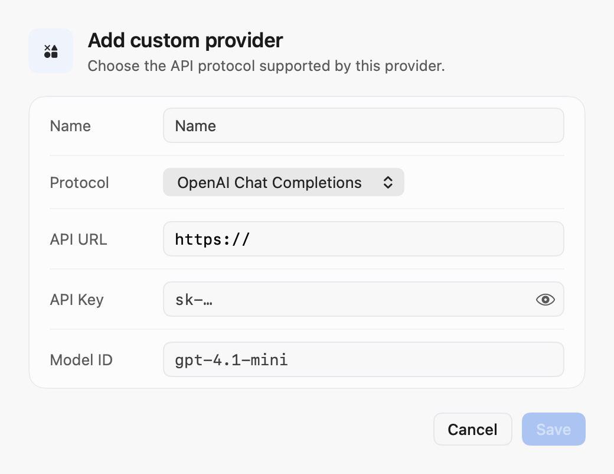

<div align="center">

# [Typeflux](https://typeflux.app) — 开源免费的 Mac AI 效率工具

把能动手干活的 AI 助手、启动器、任意应用里的语音输入、截图录屏和剪贴板历史装进一个应用，每样都只差一个快捷键。开源免费，支持本地模型。

[](https://github.com/mylxsw/typeflux/actions/workflows/test.yml)
[](https://codecov.io/gh/mylxsw/typeflux)

[English](./README.md) | 简体中文

[](https://youtu.be/ZxWWUOEgaJ4)


[查看更多截图](./docs/SCREENSHOTS.md)

</div>

## 下载

**[⬇ 下载最新版本 (.dmg)](https://github.com/mylxsw/typeflux/releases/latest)** · [版本发布记录](https://typeflux.app/zh-CN/releases)

1. 从最新 Release 下载 `Typeflux.dmg`（提供 Apple 芯片和 Intel 版本）
2. 打开 DMG，把 `Typeflux.app` 拖到 **应用程序**
3. 启动后按需授予权限（语音输入需要麦克风和辅助功能；截图需要屏幕录制）

> **macOS 13+** · 免费 · 无需注册即可开始使用

## 为什么选择 Typeflux

问 AI、找文件、口述回复、截个图、找回一小时前复制的内容——在大多数 Mac 上，这是五个不同的应用。Typeflux 把它们放到几个快捷键后面，你始终留在当前正在用的应用里。

它可以替代：语音输入法、启动器、AI 聊天应用、截图工具、录屏工具、剪贴板管理器和翻译工具。

## 四个入口

| 入口 | 默认快捷键 | 作用 |
|------|-----------|------|
| **启动器** | `⌘ Space` | 找应用、找文件、运行命令、即时计算，或直接问 AI |
| **AI 助手** | `⌘ Space` 输入后按 `⌘ ↩` | 把问题或任务交给它；可以联网搜索、读写文件、操作应用 |
| **语音输入** | 按住 `Fn` | 说话，松开后文字出现在任意应用的光标处 |
| **操作圆环** | 按住 `⌃ ⌥ Space` | 在鼠标旁展开圆形菜单，朝想用的操作划一下再松开 |

所有快捷键都可以在 **设置 → 快捷键** 中修改。其他默认快捷键：截图 `⌥⌘A`，剪贴板与历史面板 `⌥⌘O`。

## 功能

本地文件（包括技能和对话工作区）保存在 `~/.typeflux/` 下。目录结构和升级行为见
[本地数据目录](docs/DATA_DIRECTORY.md)。

### AI 助手（Agent）
不光能聊，还能动手帮你做：

- **对话**：长对话、历史记录、附件、截图、Mermaid 图和图表
- **联网搜索**并注明来源；侧边栏**内置浏览器**可以打开网站、读取页面、填写表单
- **文件与命令**：在你授权的文件夹里读写文件，在 Mac 上运行终端命令和脚本
- **操作应用**：看屏幕、点击、输入，替你完成操作
- **代码**：运行代码、修改项目、预览运行结果
- **生成图片**：通过你配置的图片生成服务
- **记忆与笔记**：记住你的偏好，把回答存进笔记本
- **技能（Skills）**（支持从 GitHub 安装）和 **MCP**，连接外部工具与数据
- **权限模式**：*每步都问*（每次工具调用都要批准）、*标准*（读取自动进行，改动前先问）、*全自动*

### 启动器
所有事情都从一个输入框开始：

- 按文件名搜索（支持拼音和路径匹配），在本机搜索 PDF、Markdown、文本里的内容（Apple 芯片）
- 打开、切换、退出应用；直接跳到已打开的浏览器标签页和书签（Safari、Chrome、Arc、Edge、Dia）
- 创建和检索系统备忘录、提醒事项：`note` / `remind` 创建，`notes` / `reminders` 搜索；回车预览，Esc 返回，⌘O 打开原应用，Tab 切换提醒事项范围。
- 在悬浮终端里运行命令，或交给「终端」/ iTerm
- 边输入边出结果：计算、进制转换、翻译、日期
- 系统控制与信息：睡眠、深色模式、蓝牙、实时系统监控、本机配置
- 关键词即可打开的内置工具：多引擎对比翻译、单词本、带节假日和农历的日历、世界时钟、笔记本、表情搜索
- 任何输入按 `⌘ ↩` 即可发起 AI 对话

窗口样式可选：类 Spotlight 的完整启动器、简约搜索栏、在启动器内直接显示的快速回答，以及可查看历史对话、浏览网页、预览文件的工作区。

### 语音输入
按住快捷键自然说话，松开后文字就输入到任意应用的光标处。

- **说着改**：选中文字，说「精简一点」或「翻译成英文」，直接替换原文
- **人格（Persona）**：按场景设置措辞和处理方式（工作邮件、闲聊、代码注释），可分别绑定快捷键
- **流式预览**：说话时实时看到部分识别结果
- **历史与重试**：回看记录、回放音频、换设置重新识别、导出 Markdown
- **胶囊样式**：底部胶囊、光球、顶角卡片或 MacBook 刘海岛

### 截图录屏
- 框选、窗口、全屏和**长截图**（自动滚动拼接）
- 录屏支持系统声音、麦克风和摄像头画中画，可暂停和裁剪，导出 MP4 或 **GIF**
- 箭头、形状、步骤编号、马赛克标注；自动识别并遮盖手机号；美化背景
- 贴到屏幕、截图取字（OCR）、截图翻译、截图问 AI

### 剪贴板
- 文字、链接、代码、图片等复制历史，支持全文搜索和按应用筛选
- 保留时长从 1 天到永久可选，重要内容可以固定
- 常用片段单独保存；`⌘1–9` 快速粘贴

### 操作圆环
按住圆环快捷键，在鼠标旁展开圆形菜单。朝某项操作划一下，松开即执行；移回圆心再松开则取消。最多 8 项，默认是语音输入、对话、翻译选中文字、截图、截图取字和剪贴板历史。

### 自定义
- **工作流**：把自己的脚本挂到启动器关键词上，支持 Python、Node、TypeScript、Shell、AppleScript 或任意程序；输出可使用 Alfred Script Filter 的 JSON 格式
- **让 AI 帮你写**：描述你想要的小工具，AI 负责编写、测试并保存
- **工作流库**：时间戳转换、JSON 格式化、生成二维码等现成工具
- **自定义 AI 指令**：把提示词变成关键词（例如 `rw` 润色、`sum` 总结）
- **关键词快捷键**：给任意关键词绑定全局快捷键

### 模型：本地或云端，由你选择

**语音识别**

| 提供方 | 类型 | 适用场景 |
|--------|------|----------|
| 本地模型 | 本地 | 隐私、离线使用（默认） |
| Typeflux Cloud | 云端流式 | 零配置，支持 60 多种语言 |
| 免费模型 | 云端 | 无需 API Key，使用开源端点 |
| Soniox | 云端流式 | 多语言实时识别 |
| 阿里云 ASR | 云端流式 | 低延迟，中文 |
| 豆包实时语音识别 | 云端流式 | 中文优化 |
| Google Speech-to-Text | 云端 | 多语言、企业级 |
| OpenAI（Whisper API） | 云端 | 高准确率 |
| 多模态大模型 | 云端 | 支持音频输入的大模型 |
| Groq | 云端 | 推理快、成本低 |

选择 **本地模型** 时，Typeflux 会下载模型并完全在你的 Mac 上运行：

| 模型 | 大小 | 参数量 | 适用场景 |
|------|------|--------|----------|
| SenseVoice | 约 350 MB | 234M | 快速多语言，普通话/粤语/英语/日语/韩语表现好 |
| FunASR（Paraformer） | 约 180 MB | 220M | 快速、准确，偏重中文的离线识别 |
| WhisperKit Medium | 约 1.5 GB | 769M | 英语和多语言听写均衡 |
| WhisperKit Large | 约 3 GB | 1.55B | 离线转写准确率最高 |
| Qwen3-ASR | 约 1.3 GB | 0.6B | 上下文理解强，适合长语音 |

**语言模型**：使用 Typeflux Cloud，或接入自己的服务：OpenAI 兼容的 Chat Completions、Anthropic Messages、OpenAI Responses，以及 Ollama。

在 **设置 → 模型 → 添加端点** 中选择 **Chat Completions**、**Anthropic Messages** 或 **Responses**，再填写端点、API Key 和模型 ID。协议会随提供方保存，并用于模型发现、连接测试、改写和对话（包括流式回复和工具调用）。已有的自定义提供方在你修改协议前保持 Chat Completions。

端点可以填写 `https://api.example.com/v1` 这样的基础地址，也可以填写完整推理地址。Typeflux 在选择 `/models`、`/messages`、`/responses` 或 `/chat/completions` 时会保留网关路径前缀。模型发现依赖网关提供兼容的 `/models` 接口；否则请手动添加模型 ID。



### 隐私
- 本地语音模型可离线运行，你的声音不必离开这台 Mac
- 私密对话的记录只保存在本机（使用远程模型时，对话内容仍会发送给所选服务商）
- 默认情况下，修改文件、执行命令前都会先问你，范围限定在你授权的文件夹
- 全部代码以 AGPL-3.0 开源

### iPhone 版（即将上线）
iOS 对话客户端位于 `Apps/iOS`：在 iPhone 上继续对话、使用语音输入，使用 Typeflux Cloud 或你自己的模型。详见 [iOS 对话客户端](./docs/IOS_CHAT.md)。

## 系统要求

- macOS 13 或更高版本（Apple 芯片或 Intel）
- 语音输入和文本插入需要麦克风与辅助功能权限
- 截图、录屏和操作应用需要屏幕录制权限

使用云端提供方时：需要 API Key 和端点 URL，或 Typeflux Cloud 账号。

使用本地推理时：模型文件会在首次使用时自动下载。

## 从源码构建

```bash
git clone https://github.com/mylxsw/typeflux
cd typeflux

# 一次性设置：创建本地代码签名身份，让 macOS
# 权限（麦克风、辅助功能）在多次重建后保持稳定。
scripts/setup_dev_cert.sh

make run          # 构建并以 .app bundle 形式启动
make dev          # 启动并附带终端日志
make dev-macbook  # 使用 MacBook 的 API：mac-pro.local:8080
make dev-macmini  # 使用 Mac mini 的 API：mac-mini.local:8080
make dev-macbook PLATFORM=ios # 选择 iOS 真机或模拟器，连接 MacBook API
make dev-macmini PLATFORM=ios # 选择 iOS 真机或模拟器，连接 Mac mini API
make full-dev     # 使用内置 SenseVoice 资源启动开发应用
make full-release # 在本地构建完整的已公证生产安装包
make release-continue # 继续中断的本地发布流程
swift test        # 运行测试
```

两个 Mac 局域网命令会使用指定的单个 API 地址，覆盖终端中已有的
`TYPEFLUX_API_URLS`。realtime 地址由选中的 API 下发：在 MacBook 的 API
环境中设置 `REALTIME_ASR_SERVER_ORIGINS=http://mac-pro.local:8081`，Mac mini
设置 `REALTIME_ASR_SERVER_ORIGINS=http://mac-mini.local:8081`，然后重启对应的 API
服务。客户端需要能够解析这两个主机名并访问 8080、8081 端口；给其他设备使用时，
不要下发 `127.0.0.1`。
不指定平台时仍启动 macOS 应用。`PLATFORM=ios` 会列出已配对的 iPhone/iPad 和
可用模拟器，输入编号后构建、安装并启动；也可以用 `DEVICE=<UDID>` 直接指定。
模拟器不需要开发者团队；真机会自动读取 Xcode 工程的团队或本机 Apple 开发证书，
证书对应多个团队时列出供选择。也可以用 `TYPEFLUX_IOS_TEAM` 指定团队。
局域网 HTTP 仅用于 iOS Debug 构建。详见 [iOS 快速入门](docs/IOS_QUICKSTART.zh-CN.md)。

> ⚠️ 如果跳过 `setup_dev_cert.sh`，`make run` 仍然可用，但 macOS 会在每次构建后重新请求权限（ad-hoc 签名）。

完整开发指南请参阅 [CLAUDE.md](./CLAUDE.md)。

### 运行 iOS 对话应用

安装完整的 Xcode 26+ 和 iOS Simulator runtime 后，在仓库根目录执行：

```sh
make ios-doctor   # 检查 Xcode 和模拟器环境
make ios-run      # 一键构建、安装并启动模拟器应用
make ios-preview  # 无需账号的离线界面预览
```

连接并配对 iPhone、完成开发签名配置后，一键部署到真机：

```sh
TYPEFLUX_IOS_DEVICE='<device-UDID>' TYPEFLUX_IOS_TEAM='<TEAMID>' make ios-deploy
```

iOS 应用最低支持 iOS 17。首次环境准备、签名、API 环境切换、Release 归档和故障排查见 [iOS 运行、安装与部署指南](./docs/IOS_QUICKSTART.zh-CN.md)。这些命令安装客户端，不部署后端或自动发布到 App Store。

## 文档

- [iOS 运行、安装与部署](./docs/IOS_QUICKSTART.zh-CN.md)
- [iOS 对话架构与开发说明](./docs/IOS_CHAT.md)
- [使用指南](./docs/USAGE.md)
- [Make 命令](./docs/MAKE_COMMANDS.md)
- [发布指南](./docs/RELEASE.md)
- [版本发布记录](https://typeflux.app/zh-CN/releases)

## 社区

加入社区，分享反馈、提问，并关注开发动态：

- [加入 Discord](https://discord.com/invite/Vr5389YrN)
- [X](https://x.com/mylxsw)
- 微信群：

  

## 贡献

Typeflux 是一个完全开源的项目。我们相信优秀工具应该属于每一个人。

欢迎贡献——AI 助手工具、启动器插件与工作流、语音识别提供方、截图录屏工具、文本插入的边界情况、多语言翻译，都是很好的切入点。

1. 阅读 [CLAUDE.md](./CLAUDE.md) 中的模块布局
2. 使用 `make dev` 在本地运行应用
3. 为任何逻辑变更添加或更新测试
4. 提交 PR，并说明对用户可见的影响

## 许可证

AGPL-3.0。详见 [LICENSE](./LICENSE)。
