# Ask conversations

Double-tapping the Ask shortcut opens a bottom-centered, borderless composer. It does
not start recording or open the conversation workspace. Return submits;
Shift-Return inserts a newline; Return during IME composition does not submit.
Escape and clicking another application dismiss the composer while preserving
the draft. Existing dictation writes into its native NSTextView.

After input and model validation succeeds, submitting opens the workspace with
history on the left, messages and tool results on the right, and a follow-up
composer. The menu also opens history.
Validation failures preserve the submitting draft without creating a conversation.
Signed out, an available own model replaces the Cloud default; otherwise the composer
offers sign-in and Settings → Models. Model configuration failures offer settings
rather than retrying a run.
The first question defaults to attaching a screenshot only when screen recording
access is already granted (a read-only preflight check). Without access, opening
the launcher or a new chat neither captures the screen nor requests permission.
The composer offers “Attach screenshot”; enabling it, using `/screenshot`, or
choosing a screen suggestion requests access explicitly. Denial keeps the draft
and offers System Settings. Follow-ups default to
text only. Attachments can be previewed, removed, or recaptured before sending.
Context is captured before the launcher takes focus. Removing a draft attachment
does not remove context already sent in previous messages.

Production views rendered with synthetic test data:

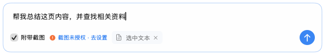
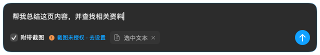
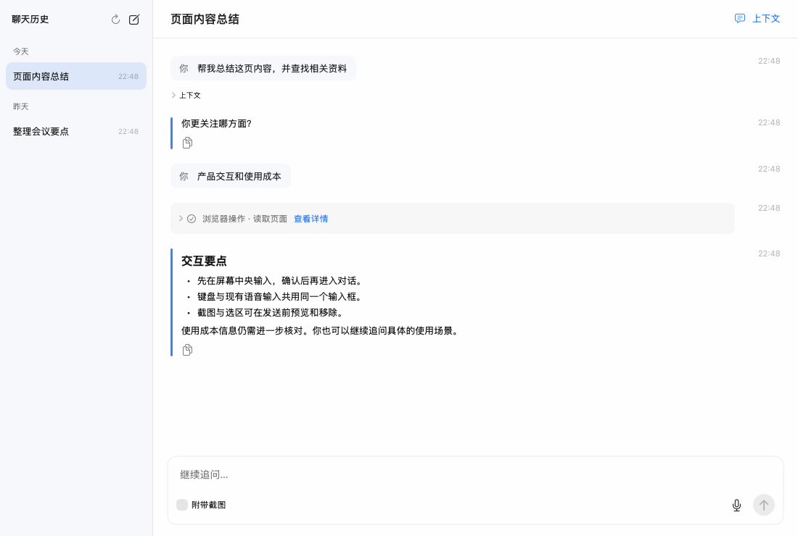
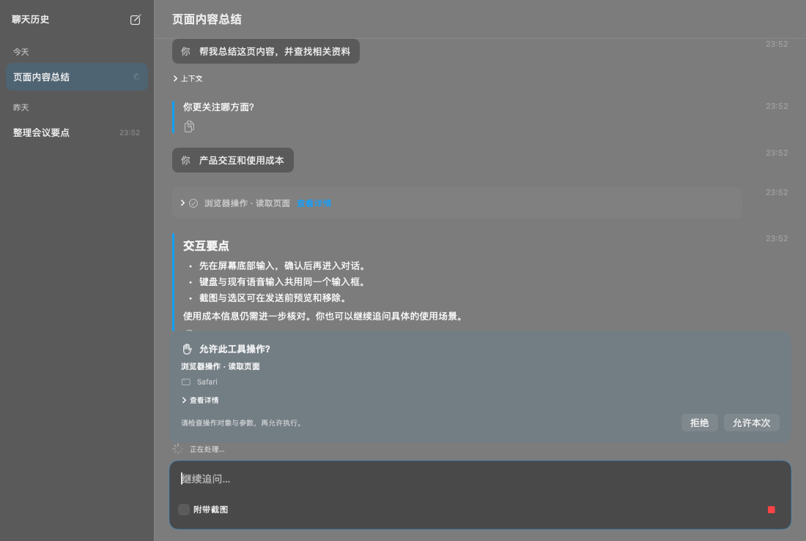
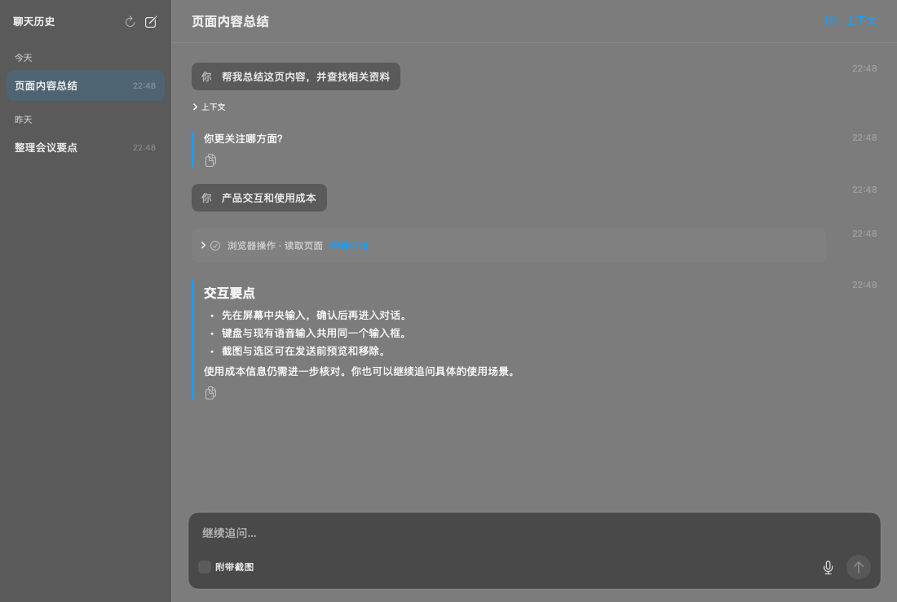
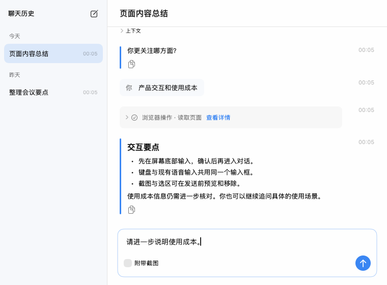


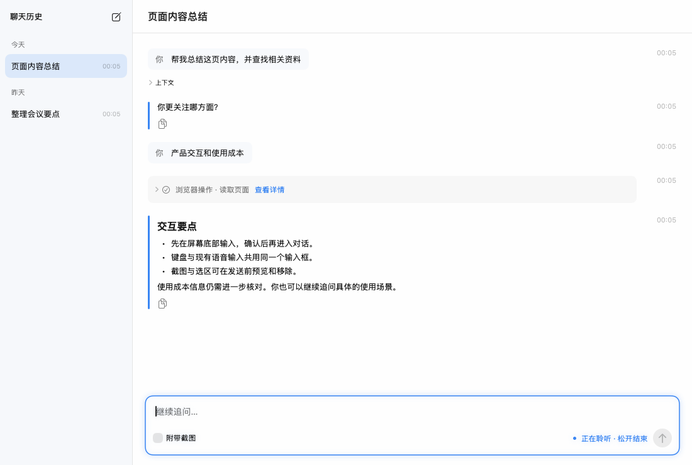
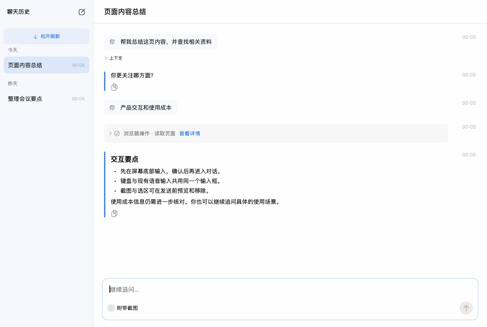

## Approved continuous-conversation layout

The launcher window is 640 pt wide and starts at 110 pt high, including a 6 pt
transparent gutter for the soft glow. Its visible bottom edge shares the recording
capsule's 58 pt inset above the target screen's usable bottom edge (16 pt window
inset + 42 pt capsule padding). Its native editor grows to 148 pt (226 pt panel)
upward before scrolling, retaining its size when reopened and keeping its bottom
edge fixed.
It has no title bar or close button. Screenshot permission and retry actions live
beside the attachment controls, not in a separate oversized notice. The workspace
uses the existing StudioTheme palette and a 210 pt history sidebar, compact 38 pt
rows, regular body text, continuous left-aligned messages and collapsed tool details.
Both appearances and the 760 x 560 minimum window are covered by render tests.

Conversation selection has its own identity and loading/error states. Cached
content remains visible during refresh; an uncached target cannot accidentally
send as a new conversation. Late responses update their own cache without changing
the user's selection or drafts. Streaming updates replace a row in place instead
of moving it to the top. Pagination merges by conversation ID, never by title.
Reading anchors and drafts are retained separately for each conversation.

The released client generated uppercase UUID strings, while PostgreSQL returned
lowercase IDs in history summaries and retained uppercase IDs in JSON snapshots.
The revised wire models canonicalize conversation UUIDs to lowercase. Old SQLite
snapshots and drafts remain readable under either spelling; higher revisions win,
and deleting a conversation removes both local spellings and its tool journal.
No server migration or deletion of existing cloud history is required.

## Hold-to-talk and edge refresh (approved design 2)

A primary-button hold of 350 ms in either editor starts recording. Application-local
mouse events arm a main-run-loop timer before gesture arbitration. Movement beyond
6 pt before the threshold switches to character selection; a short click positions
the caret. Double-clicks, modified clicks and IME composition use native editing.
Only the text editor is a hold target, not the screenshot, preview or send controls.
Release stops and transcribes through the application's existing AudioRecorder and
configured STTRouter. Transcription replaces the captured selection/insertion range
without submitting. Fn uses the same card feedback, including its short-tap lock
behavior; it does not show a second recording capsule while a composer owns focus.

The entire floating card or workspace input card has a static blue outline and
soft halo while recording, with a textual listening status. Idle and ordinary
keyboard focus use the neutral border; focus alone never adds a blue outline. Transcription dims the
outline and disables sending. Escape, loss of focus, screen locking or sleep cancels
capture/delivery and preserves the draft. A late transcript cannot reach another
conversation, changed draft, or another application. A cancelled startup retains
recorder ownership until the driver's completion has been stopped and cleaned up.
Errors appear inline. No microphone buttons or additional waveform effects remain.

The sidebar title has only the new-conversation action; the workspace header has
no context button. Message context and attachment previews still work. Pull down
beyond the history's top edge by 48 pt, then release to refresh. Trackpad momentum
and normal scrolling do not refresh. Wheel input without gesture phases settles
for 200 ms before release. Pointer dragging is also supported. The edge shows a
transient instruction/progress strip; failures retain the list and show a five-second
retry hint. Requests coalesce, and selection, drafts and transcript anchors remain
intact. An accessibility refresh action provides an alternative to the gesture.

## Components

- `AskConversationWindowController` owns the launcher, workspace, and stop-control
  panel. `AppCoordinator` connects the existing hotkey and dictation workflows.
- `AskVoiceInput` owns the editor, selection and asynchronous cancellation boundary.
  `WorkflowComposerRecording` shares the application's recorder/STT services, and
  the legacy workflow forwards composer-focused hotkeys at a main-queue boundary.
- `AskHistoryPullRefresh` observes the existing native scroll view without replacing
  its content or scroll state; `AskHistoryPullGesture` owns the threshold/release rule.
- `AskConversationModel` manages account state, history, drafts, cancellation,
  approval, and recovery. `AskAPIClient` uses the existing authenticated cloud
  transport; active conversations refresh once per second for streamed text.
- `AskConversationCache` stores account-scoped snapshots, drafts and a tool
  execution journal in SQLite under `~/.typeflux/data`. Deleting a
  conversation removes its local draft and tool journal after cloud deletion.
- `AskContextCapture` uses accessibility and ScreenCaptureKit. Missing screen
  permission leaves the question usable without an attachment. Screenshots are
  JPEG, capped at 1600 pixels on the long edge and 2 MB. On macOS 14+, Typeflux
  windows are excluded from capture. macOS 13 uses the legacy on-screen capture.
- `AskLocalTools` exposes computer, Safari/Chrome browser, and configured MCP
  tools. Every invocation requires explicit approval. Computer/browser actions
  are bound to the application from which the question was opened. After an app
  restart that target is unavailable: start a new question from the target app.
  The browser tool is only offered when that application is Safari or Chrome.
  MCP tools are named `mcp_<tool>`; when two servers expose the same tool name,
  both are kept as `mcp_<server>_<tool>`. An MCP result flagged `isError` is sent
  as a failed tool result, and its first image is attached as a JPEG observation.
- Approvals are tiered. Screenshots and browser reads are read-only; other
  computer/browser actions are writes. MCP tools follow their annotations
  (`readOnlyHint`, `destructiveHint: false`); an unannotated MCP tool counts as
  destructive, per the MCP specification. "Allow in this conversation" lets later
  calls of the same tool at the same or lower risk run without asking until the app
  quits or the account changes. Destructive calls always ask and only allow once.
- The server's `web_search` and `web_fetch` tools run without desktop approval and
  appear in the transcript with their query or host. Each message sends the
  device time zone and locale for the server's date and environment context.

## Recovery and execution

Stable message IDs make retries after a lost response idempotent. Unconfirmed
messages can be resumed after restart. Tool results are journaled before posting;
an interrupted execution with an unknown outcome is reported instead of replayed.
Approval rechecks the server run before any effect. A run waiting for tool
approval expires after 24 hours instead of five minutes; stop or resume it from
the workspace. Only one conversation can
control the desktop at a time. Cancellation blocks late answers and later local
actions; it cannot reverse actions already performed.

### Credit pauses

When the account's monthly and add-on credits are both used up, Typeflux Cloud
pauses the run (`status: "paused_credits"`) before the next model call instead of
failing it. The client treats this as a known checkpoint, not an unknown outcome:
pending tool calls are not executed, and the transcript shows a "Credits used up"
card with the monthly and add-on balances side by side. "Buy add-on credits"
opens the web billing page on its credits tab (`?tab=credits`, page token in the
fragment); "Upgrade plan" opens the plans tab. The balance is fetched again when
the card appears, whenever Typeflux becomes active, and when the billing page
returns through `typeflux://billing/return`. Once credits are available the card
turns into "Credits added · Continue", which calls
`POST /api/v1/ask/conversations/:id/runs/:run_id/resume` and drives the run from
its checkpoint. A 402 `CREDITS_EXHAUSTED` keeps the pause and shows the details
the server returned; the code is localized and never displayed as server text.
Stop in the composer ends a paused run. Without billing, the card only explains
when the period resets. Requires typeflux-api with migration 00044.

Closing an active workspace offers hide-and-continue or stop. Work continues
while the application is alive. Terminating the application does not create a
background agent: interrupted requests fail or expire and require deliberate
resume. Local history survives logout but is partitioned by account.

## Deployment and acceptance

Deploy the companion typeflux-api Ask routes and migration 00035 before shipping
this client. The default cloud model must support vision and tool calling.
Normal cloud credits, entitlements, and rate limits apply.

Focused tests use stubbed cloud/tool services and temporary SQLite files. Run:

```sh
swift test --filter 'Ask|WorkflowControllerProcessingTests.testAskShortcut'
TYPEFLUX_ASK_SNAPSHOTS="$PWD/ask-snapshots" swift test --filter AskConversationVisualTests
```

The opt-in visual suite renders production SwiftUI views and native windows with
synthetic content. It never records audio, captures the desktop, or operates a
real browser. Before release, verify on a signed app with a staging backend:

1. Double Fn shows only the bottom composer, with focus; Fn dictation inserts into
   it. Hold in each editor, release outside its bounds, cancel during startup and
   transcription, and verify the original selection/draft. Check sleep and denied
   microphone permission in a signed app. Verify 58 pt alignment on multiple screens.
2. Pull history from the top with a trackpad and mouse, including a failed network
   request; regular scrolling and momentum must not refresh.
3. Enter sends once, IME confirmation does not send, Shift-Enter adds a newline,
   Escape preserves the draft, and normal voice shortcuts retain their behavior.
4. Screenshot/selection preview and removal work on multiple monitors and with
   permissions denied; follow-ups do not attach a screenshot by default.
5. Conversation history, streaming, cancellation, retry and restart recovery work
   with the deployed model; switching accounts never displays the other history.
6. Approve a harmless browser read and screen capture; deny an action; stop during
   control. Safari/Chrome require Automation permission and their JavaScript from
   Apple Events setting; computer input requires Accessibility permission.
7. Verify configured MCP servers, including a disconnected or failing server.

English and Simplified Chinese strings are provided. The new Ask strings in
Japanese, Korean, and Traditional Chinese currently use English fallbacks except
for selected error messages; existing translated application strings are intact.

## Hold-to-talk validation (2026-09-28)

- Final focused instrumented run: 47 Swift Testing tests and 69 matching XCTest
  tests passed. This includes native window alignment/growth, IME editing,
  transcription ownership and cancellation, startup/release races, Fn routing,
  drag/trackpad/wheel refresh rules, history identity/navigation, and native renders.
- LLVM line coverage: voice transaction 95.45%, recorder adapter 91.86%, model
  93.03%, pull refresh 87.76%, composer 81.18%, views 88.24%, window controller
  81.01%. Ask plus the new recorder adapter totals 85.43%, below the repository's
  90% target. Untested paths include hardware/OS gesture delivery and desktop tools.
- Full `make coverage` run: 2672 XCTest tests, with 8 assertion failures in the
  same four pre-existing workflow tests below; all 130 Swift Testing tests passed.
  Final focused checks additionally cover subsequent gesture/focus refinements.
  The coverage script exits at the known failures, so line coverage was extracted
  directly with llvm-profdata/llvm-cov from the final focused native-render run.
- Existing failures are in `WorkflowControllerProcessingTests`:
  `testAudioPrefixSurvivesDelayedRealtimeSetupInOrder`,
  `testBeginRecordingStartsAudioBeforeRealtimeSessionSetupCompletes`,
  `testConnectivityFailureKeepsRecordingRetryableAndShowsPassiveNotice`, and
  `testLocalTranscriptIsAppliedWhenCloudASRIsCancelledAndRewriteFails`.
- Images show the production SwiftUI components with synthetic fixtures, not
  generated design mockups. Light/dark, permission notices, long text, tool
  approval and minimum-size windows were rendered and inspected.
- Signed-app/staging acceptance remains manual: these tests do not access a
  production account, live microphone, screen recording or real desktop tools.

## Opaque backplates (2026-09-29)

The launcher, workspace, sidebar and follow-up composer now use opaque Ask-specific
surfaces in both appearances. The titled workspace also has an explicit opaque
native window background. The floating panel remains transparent only outside the
rounded card so its corners and recording glow can composite correctly.

`AskSurfaceOpacityTests` renders the production views over red and blue backgrounds
in a clear native window. Interior samples must match across backgrounds, the card
body must have alpha 1, and the outer corner must remain transparent. This test
failed on the previous implementation (20 assertions) and passes with the fix.
The existing window/visual suite also passes; screenshots above were regenerated.
Full regression: all 133 Swift Testing tests passed; 2673 XCTest cases retain the
same four previously documented workflow failures (8 assertions), with no new
failing cases. The targeted opacity/native-render run passed all four tests.

## Composer focus and mouse delivery (2026-09-29)

A hidden launcher still retains its native first responder. Previously, both
editors reconciled that responder into the shared `focusedContext` during every
SwiftUI update, even when their window was inactive. This produced a feedback
loop and a flashing focus outline. Only the key window now publishes focus;
window activation/deactivation transfers or clears it, and queued publications
recheck ownership before changing observable state. Decorative outlines and
placeholder text explicitly pass mouse hits through to the native editor.

`AskComposerInteractionTests` hosts the production launcher and workspace and
sends mouse-down/up through `NSWindow.sendEvent`. It covers a hidden launcher's
retained first responder, switching back to that launcher, stable idle layout,
recording across SwiftUI updates, release-to-transcribe and draft insertion with
no automatic submission. The regression failed against the previous source:
254 focus publications in 300 ms and stale focus when returning to the launcher.
The fixed version produces no idle publications and passes both editor flows.

These event tests use a controlled key-window state and a fake recorder/STT
service. They validate native gesture delivery and UI integration, not physical
microphone capture, TCC permissions or a live transcription provider. Holding
for 350 ms starts recording; release starts transcription and only fills the
original draft. Actual signed-app microphone acceptance remains manual.

Validation: all 136 Swift Testing tests passed, including native visual snapshots
and the three new interaction regressions. The 2673 XCTest cases retain the same
four previously documented workflow failures (8 assertions); no new cases failed.

## Direct mouse hold handling (2026-09-29)

The focus fix did not resolve the reported failure to start recording in the
running app. The composer now owns mouse-down, drag and release directly instead
of relying on `NSPressGestureRecognizer`. A scoped application event monitor only
intercepts eligible presses inside the editor's visible bounds. It focuses the
window and starts a 350 ms timer without entering native selection tracking, so
recording can start while the button is still held. A short click places the caret;
movement before the threshold selects text and cancels the timer. Once recording
starts, pointer movement does not cancel it. Local/global release monitors stop
recording even if release is outside the input; focus loss and Escape cancel it.

Interaction tests now send events through `NSApplication.sendEvent`, exercising
the local monitors, small pointer movements, short clicks, drag selection, release
in another window, cancellation and both production composers. A separate workflow
integration test connects those events to the production `WorkflowComposerRecording`
adapter and verifies audio starts before release, stops once, transcribes and fills
the original editor without external text injection. Audio hardware and STT are
still substituted; this does not claim a physical-mouse/live-microphone reproduction
or prove which recognizer suppressed the original user's press.

Validation: all 139 Swift Testing tests passed, including native renders and mouse
interaction tests. The new production-adapter mouse integration test also passed.
Full XCTest: 2674 cases, with the same four pre-existing workflow failures
(8 assertions) documented above and no newly failing cases.

## Harness reliability fixes (2026-10-01)

- Stdio MCP: the client previously ran a blocking read on its actor, so `connect()`
  never returned. A standalone build of the old client against a minimal
  server timed out; the new client reads via `readabilityHandler`, discards stderr
  (a full stderr pipe blocked chatty servers), bounds every request (120 s),
  forwards cancellation as `notifications/cancelled`, fails pending requests
  when the server exits, and never raises SIGPIPE. Bare commands such as `npx`
  resolve through PATH plus common Homebrew/user directories.
- MCP `tools/list` follows `nextCursor` (stdio and HTTP). JSON-RPC errors report
  the server's message.
- A custom-model answer that stops at its output limit is reported to the server
  as `finish_reason: "length"` (OpenAI `length`, Anthropic `max_tokens`, Gemini
  `MAX_TOKENS`), which keeps the visible text as an interrupted reply.

Tests: `StdioMCPClientTests` run a shell MCP server through real pipes;
`AskMCPToolsTests` cover naming, registry ownership and result mapping.

## Agent tools (GUL-151 P2/P3)

The server runs model steps in the background (`ASK_ASYNC`), so a send returns
with the run `running` and the desktop follows progress as before. Device tools:

| Tool | What it does | Approval |
| --- | --- | --- |
| `files` | `list`, `read` (numbered lines, paging), `search`, `write`, `edit` (one unique snippet) inside folders authorized in Settings → Agent → File Access. Paths resolve through symlinks first; new files are checked through their nearest existing folder. Text only, 1 MB writes. | reads: read tier; writes: write tier |
| `run_code` | Python, JavaScript (Node) or zsh under `sandbox-exec`: no network, no reads from the home folder, writes only in a per-conversation workspace under `~/.typeflux/cache/AskSandbox-v2` (pruned after seven days). 30 s default, 120 s max; output capped; the first new PNG/JPEG is attached. Interpreters under the home folder (pyenv, nvm) stay readable. Toggle in Settings. | write tier |
| `skill` | Loads a built-in skill (`notebook`, `email-reply`, `meeting-notes`, `translate-polish`, `data-analysis`) or a user skill from `~/.typeflux/data/Skills/<name>/SKILL.md` (optional `name`/`description` front matter; a user skill replaces a built-in one). Only names and descriptions are in the tool definition. | none (app-provided instructions) |
| `notebook` | The user's Markdown notebook (`notes.sqlite`): `search` (any of the keywords, tags too), `read` (one `heading`, paged by `offset`), `list`, `create`, `append` (optionally under a heading), `update` (`find` must occur once), `tag`, `delete` (to Recently Deleted). Offered with the built-in `notebook` skill while the notes window's Agent switch and the skill are on; notes with a hidden tag (default `私密`, `private`) do not exist for it. Text changes save the previous title and body atomically; undo preserves current metadata. Deleted notes are restored from Recently Deleted. | reads: read; changes: write; every call requires consent, including automatic modes |
| `memory` | `list`, `remember`, `forget` explicit notes per account. Notes join the global memory of new conversations after the soul summary, within the 1,000-character budget, and can be removed in Settings. | list: read; changes: write |
| `computer` | Adds `inspect` (accessibility tree of the target window with click coordinates), `double_click`, `right_click`, `drag`, `hotkey` (e.g. `cmd+shift+t`), more keys and `wait`. | read: screenshot/inspect/wait |
| `browser` | Adds `snapshot` (numbered interactive elements; `click`/`fill` accept `ref`), `back` and `scroll`. Works with a running Safari/Chrome when the question did not start in a browser. | read: read/snapshot |

The server's `update_plan` list appears as a plan card above the composer;
`research`, `web_search` and `web_fetch` run on the server without approval.

MCP: clients request protocol `2025-06-18` and use the server's answer; stdio
servers can announce `notifications/tools/list_changed`, which refreshes the
registry. Remote servers that answer 401 use OAuth 2.1 (protected-resource and
authorization-server discovery, dynamic client registration, PKCE S256 with a
127.0.0.1 redirect, refresh). Only Test Connection in Settings opens the browser
to sign in; Ask reuses or refreshes the token stored in the keychain and asks the
user to sign in from Settings otherwise. The voice agent registers MCP tools with
the same collision rule as Ask (`<server>_<tool>` when names clash).

## Conversation storage: Typeflux Cloud or this Mac (GUL-193)

Each conversation is kept in one place, chosen before its first message and fixed
afterwards, so none is ever half uploaded. Signed out, every conversation stays on
this Mac; signing in is optional. The design board is
`docs/design/ask-conversation-privacy.html`.

- Where a conversation is kept is separate from which model answers: a Cloud
  conversation can use Cloud models or the user's own, a private one only the
  user's own models (API models still call their provider). "Where the agent loop
  runs" is an implementation detail and is not shown.
- The session closure returns the account (`AskRoutedAPI.session(token:owner:)`).
  `AskConversationModel` routes every call per conversation through `AskRoute`:
  `owner` is the cache partition (`local` for private conversations), `token` picks
  the backend (`AskRoutedAPI` sends an empty token to `AskLocalEngine`), and
  `account` is the session the work started in, so a sign-out or account switch
  drops late results for both kinds. Switching the default never resets the model.
- `localConversationIds` records which conversations are private. Signed in,
  `refreshHistory` reads the Cloud page and every local page and merges them:
  existing rows never move, new private rows are inserted by date, and a local
  list that fails to load keeps its rows. Drafts of a private conversation are
  saved in the `local` partition.
- A new draft carries `AskDraft.storesLocally` (nil follows Settings → Agent →
  "Keep new conversations", stored under the old `ask.localMode` key so users who
  had local mode on keep starting private conversations). The launcher always
  starts a new conversation and can choose too.
- UI: the composer shows only an icon (`AskStorageButton`: a cloud, or a sage
  lock); hovering names it and a click opens `AskLocalModeCard`, which offers the
  choice for a conversation that has not started, explains why a started one is
  fixed, and offers the other kind of new conversation. Signed in, a private
  conversation shows a "Only on this Mac" header chip instead of credits, a lock
  in the sidebar. The storage filter offers All / Cloud / This Mac in every account state. The composer edge and send button
  stay neutral (Sky/Sage/Sand tints since `aca44a96`). A new conversation follows the default and its storage is
  switched with the composer icon; ⇧⌘N and the palette
  start a private conversation; `/local` toggles the new draft's storage.
  The new-conversation page and the transcript look the same in both kinds.
- `AskLocalEngine` mirrors the server's state machine: every model step is queued
  as a device inference (`waiting_inference`) that the existing custom-model path
  runs with the user's own model; device tools keep the same approval flow; history
  is stored as JSON under `~/.typeflux/data/AskLocal/`.
  It ports the system/memory/environment prompt, references, screen observations,
  summaries after 28 messages, truncation detection, the Agent step setting
  (explicit continuous mode on fresh installs; existing saved limits remain bounded), cancel,
  retry, regenerate, expiry of interrupted runs and memory purge.
- Engine-side tools: `update_plan` and `web_search` when the user configures
  Tavily, Brave or Cloudflare in Agent → Web Search. Local `web_fetch`
  remains disabled; see `LOCAL_WEB_FETCH_BOUNDARY.md`.
- Cloudflare local search requires an Account ID and Cloudflare API Token with
  Workers AI Read and AI Gateway Read permissions. Gateway ID defaults to
  `default`; the search engine defaults to Ceramic.ai, with Exa and Linkup also
  available. An optional BYOK alias selects a provider key stored on that gateway.
  A missing explicit alias fails; without an alias Cloudflare uses the provider's
  `default` key, or AI Gateway credits if no default key exists. Test connection
  sends one billable search. See [setup](https://developers.cloudflare.com/web-search/how-to-use/).
- Cloudflare tokens occupy a separate, device-only Keychain item. Existing
  Tavily/Brave tokens keep their legacy item; changing or disabling the selected
  provider retains credentials. Clear the token field to delete that provider's
  token. Account/gateway/engine/alias settings use UserDefaults.
- Local Cloudflare search calls the fixed API endpoint directly, rejects redirects,
  caps responses at 4 MiB and returned text at 16,000 characters, and exposes
  `web_search` only with valid configuration. User tokens are never sent to Typeflux
  Cloud. Cloud conversations use the server's search configuration; the choice
  follows conversation execution location, not the selected model provider.
  iOS uses server-side search and does not expose local search configuration.
- Signed out, a Cloud model reference falls back to the first available configured
  model; with none configured the send is refused with guidance to add one in
  Settings → Models. Signed in, private conversations may use Cloud models (see
  "Where each conversation runs" below).
- Not available in private conversations: the `research` sub-agent,
  server-side background runs (a local run pauses while the app is closed and
  resumes from the workspace), run traces, Cloud usage metering and sync.

## Chat and Work (GUL-460)

Every conversation is a **chat** or **work**, chosen before its first message and
fixed afterwards. This is independent of where it is kept (Cloud, this Mac or
temporary) and of which model answers.

- A chat only talks. It is never offered a tool that reads or changes this Mac:
  of the device tools only `skill`, `memory` and `generate_image` (and the workflow
  editor's own tools) remain; files, commands, code, projects, artifacts, computer
  and browser control, the notebook, the embedded browser and MCP tools are work
  only. Engine and Cloud tools (`web_search`, `web_fetch`, `update_plan`, …) are
  unaffected. A device tool call in a chat is refused before approval or dispatch
  (`ask.kind.chatToolRefused`), even in YOLO mode.
- Work keeps today's behaviour: device tools, folder access and the permission
  mode. The permission menu only appears for work.
- The kind travels as `kind` on the opening `AskSendRequest`, is stored on the
  conversation (`AskLocalEngine`, typeflux-api `Conversation.Kind`) and is listed
  on summaries. Unknown values read as chat. Conversations from before kinds
  existed infer it for display and for the tools later sends offer: one whose
  transcript called a device tool outside chat's set is work, any other is chat.
  Only a stored kind refuses a pending call; an older conversation that is mid-run
  dispatches as before, under approval, because synced snapshots drop the run's
  tool list.
- UI: the new-conversation page shows a "Chat | Work" switch centred at the top
  (`AskConversationKindSwitch`); the launcher has a small one at the start of its
  bottom bar. A new conversation starts as the kind last sent
  (`ask.lastConversationKind`, chat at first). Work shows "What should this Mac
  work on?" on the empty page. The sidebar filters All / Chat / Work with tabs beside the storage dropdown.
- Adding a folder to a chat that has not started switches it to work; a started
  chat refuses the folder and keeps the other items. Switching a draft back to
  chat removes its folders.

### Where each conversation runs (phase 2)

- A chat that opens on a Typeflux Cloud model runs in Typeflux Cloud (the server
  engine), never on this Mac, so iOS and the web can continue it. `AskDeviceAPI`
  sends it to the server on its opening message and keeps every later call there;
  it is never adopted by this Mac. Work, and chats on the user's own models, run on
  this Mac and synchronize their history. Server conversations from before kinds
  keep their existing adoption on the next message.
- Synchronized snapshots carry this Mac's computer name (`device_name`). A
  conversation another device runs reads with `hostDeviceId`/`hostDeviceName`: its
  sidebar row shows a computer glyph and the composer is replaced by a read-only
  notice with "Start a chat from it".
- Signed in, a conversation kept on this Mac may answer with Cloud models. Their
  inference goes to the stateless `/ask/device/completions` endpoint with the
  session token, so no history reaches the server; the storage card says so. Signed
  out, Cloud references still fall back to the first local model.
- A settled conversation kept on this Mac can be uploaded (storage card → "Upload
  to Cloud", confirmed first). `AskRoutedAPI.upload` hands it to the account's
  device engine (`importConversation`), which synchronizes it, and only then removes
  the private copy. It is one-way.
- Offline (`NWPathMonitor`), a composer on a Cloud model shows a notice: a new
  conversation can switch to the first local model (it then runs on this Mac and
  synchronizes later); a started Cloud conversation can continue in a new one on a
  local model, carrying its transcript. Messages are never queued for later.
- "Continue as Work" in a chat's header, `/work` in a started chat, and the
  read-only notice start a new conversation that carries the source transcript as a
  reference (`AskReference(conversation:)`, newest turns within 16 KB). `/chat` and
  `/work` switch a new draft. A new task shows its folders beside the permission
  menu (`AskWorkFolderButton`) and the placeholder "Describe the task".

Production views rendered with synthetic data (`AskConversationKindVisualTests`, set
`TYPEFLUX_KIND_SNAPSHOTS` to a directory):

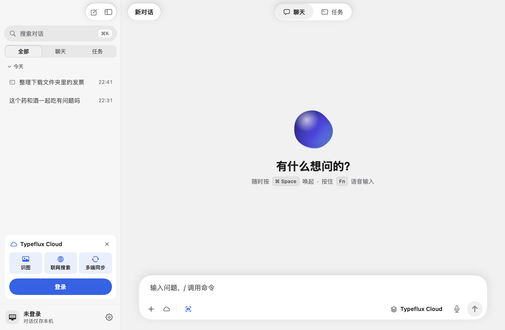
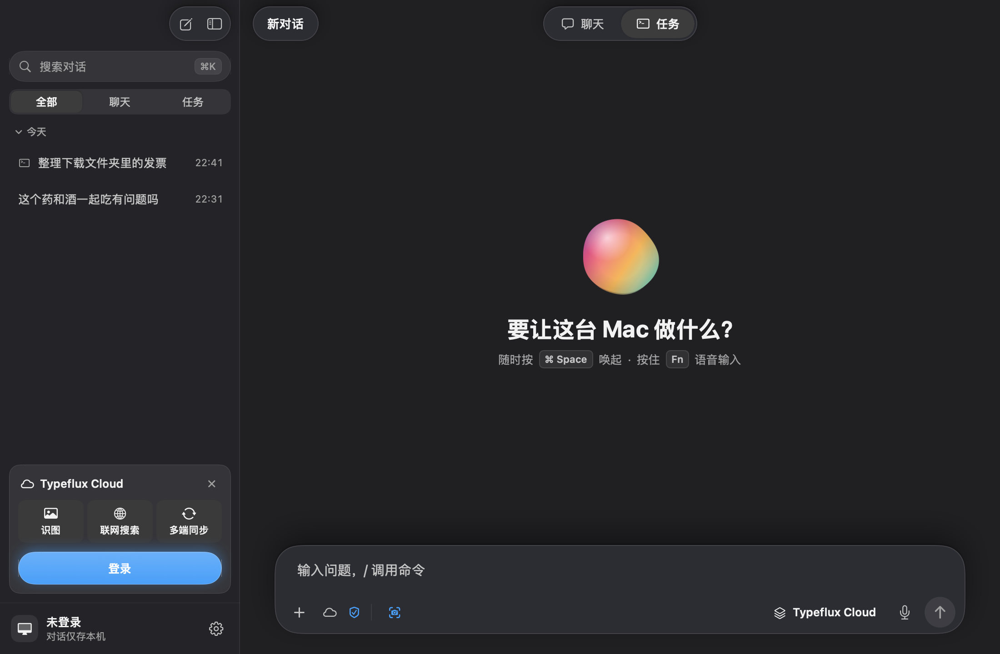
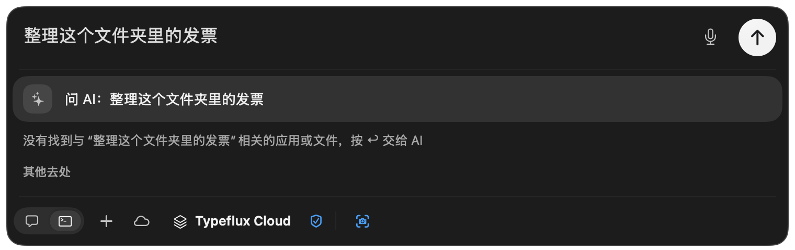

## Temporary conversations (GUL-370)

A temporary conversation is the third place a conversation can be kept, beside
Typeflux Cloud and this Mac. It is never listed in history (sidebar, ⌘K, iOS or
the web), never reads or writes memory, is never named, and ends when the user
leaves it, quits, signs out or switches accounts. The design board is
`docs/design/ask-temporary-chat.html`; the plan is `docs/design/ask-temporary-chat.md`.

- Starting one: the title bar's compose button opens a menu of the three kinds
  (⌘N follows the default, ⇧⌘N private, ⌥⌘N temporary); the storage card behind the
  composer's storage icon offers "Temporary · not saved" for a conversation that has
  not started, signed in or out; `/temp` toggles it; ⌥⌘N toggles the launcher's
  question. The launcher's choice applies to that question only.
- Where it runs is fixed by its first model: a Cloud model runs it in Typeflux Cloud
  (the first send carries `temporary: true`, the server keeps it out of the list and
  expires it after at most 24 hours); the user's own models run it in `AskLocalEngine`,
  which keeps it in memory and never writes `AskLocal/*.json`. `AskTemporaryConversation`
  records the one temporary conversation and its route
  (`AskRoute.temporary(cloud:)`, owner `AskRoutedAPI.temporaryOwner`).
- `AskTemporaryCache` sends that owner's snapshots, drafts and tool journal to an
  in-memory SQLite database, so nothing reaches `ask_conversations.sqlite`. Launcher
  input history is not recorded, no memory is sent, the `memory` tool is not offered,
  and automatic titles are off (the title policy is disabled on the wire too).
- Leaving it (new conversation, another conversation, a launcher question) asks
  first when it has messages: End, Keep, or Cancel, with "Don't ask again", which maps
  to Settings → Agent → "Confirm before leaving a temporary chat". Ending it cancels
  its run and deletes it on the server or in the engine, and from the in-memory cache.
- Keep (from the dialog, the header chip or the storage card) calls `POST
  …/:id/keep` or `AskLocalEngine.keep`, copies the snapshot to the account or `local`
  partition and lists it as a Cloud or private conversation. A keep in flight is
  never deleted by the next temporary conversation.
- UI: sand with dashed edges (`AskTheme.temporaryTint`, `temporaryDash`): the
  composer's edge, the hourglass storage icon, the header chip
  (replacing credits), a pinned "Temporary chat · In progress" row above history,
  and a line on the new-conversation page. The launcher's home hides "Continue
  conversation" while its question is temporary.
- Requires typeflux-api with migration 00071. An older server ignores the flag and
  lists the conversation like any other.

Production views rendered with synthetic data (`AskTemporaryVisualTests`, set
`TYPEFLUX_TEMPORARY_SNAPSHOTS` to a directory):

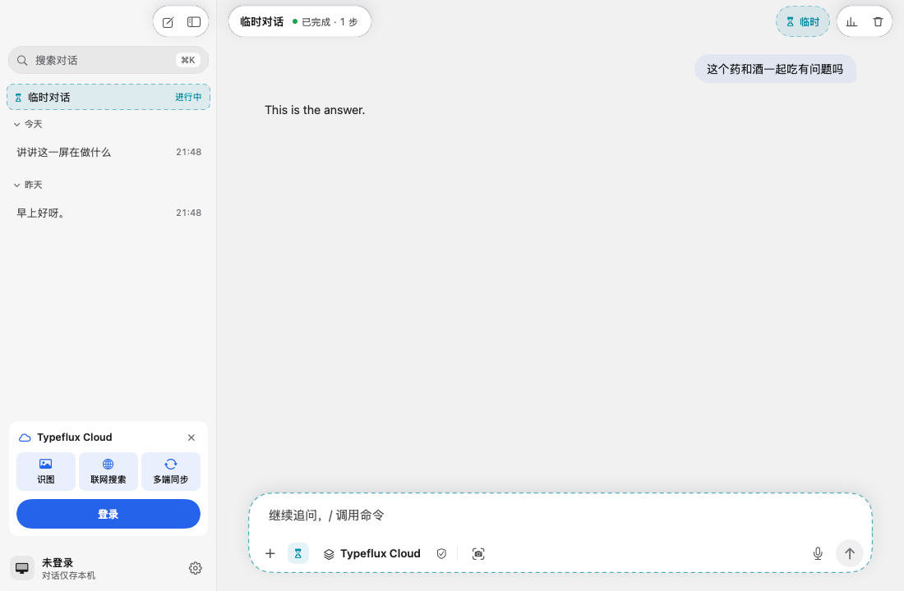
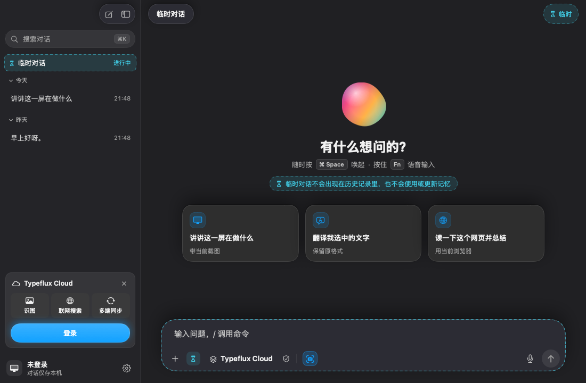
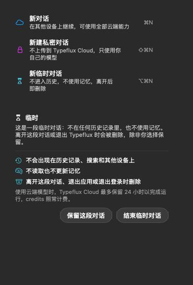
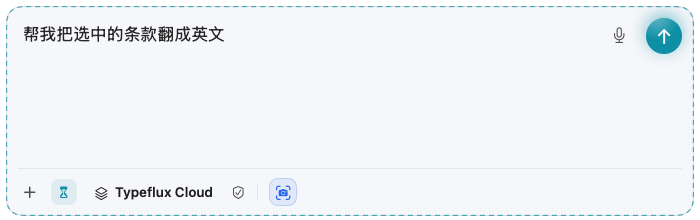

## Composer content and skills (GUL-464)

The workspace composer keeps three kinds of things apart (design board attached to
GUL-464):

- **Content** the user hands over (attached images and files, the screenshot) is a
  row of large previews above the editor (`AskContentTile`, 112 pt; `AskAttachmentTile`
  decodes an attachment and opens it in a popover). Images and the screenshot show the
  picture; a document shows its first words on a page with a type badge, its name and
  pages or size. A failed screenshot is a warning tile with its retry action. Source
  metadata keeps its small chip above the row. Sent messages keep the previews at
  156 pt; folders stay chips that reveal the folder.
- **Skills and MCP servers** are instructions, so they are tokens at the start of the
  message (`AskChosenToolTokens`) instead of chips beside the files; Backspace in an
  empty editor removes the last one. The "+" menu lists installed skills on their own
  page ("Choose skills ›"), up to `maximumChosenSkills`; with none chosen the agent still
  uses skills on its own.
- The launcher and a compact workspace (`AskComposerLayout.usesContentTiles`) keep the
  single row of chips.

### New conversation page (GUL-464)

What a conversation fixes before its first message lives on the new page and goes
away with the first message; what can change mid-conversation stays in the composer.

- Title bar: the compose button starts a conversation (⌘N); ⇧⌘N and ⌥⌘N still start
  a private or temporary one. The new page shows no title capsule, the Chat | Work
  switch in the middle and an hourglass (`ask.workspace.temporaryToggle`) on the right
  that turns the next conversation temporary. A started conversation keeps its title,
  the temporary or "This Mac" chip and its actions.
- `AskNewConversationBar` hangs under the composer: a task's folders
  (`AskWorkFolderButton`, the same `AskWorkFolderList` as the task's environment menu),
  memory when there is any, and where it is kept (`AskStorageBarControl`: Cloud or this
  Mac signed in, "This Mac" with sign-in signed out, "Not saved" while temporary).
  The workspace "+" menu therefore offers neither storage nor memory on the new page;
  the launcher, which has no bar, keeps both. The composer's task control shows only
  the permission until a started task adds folders.
- The headline and composer are grouped a little above the middle
  (`AskWorkspaceLayout.newPagePlacement`): the bottom-anchored composer is lifted under
  the measured headline and drops back to the bottom with the first message. Short
  windows, notices on the new page and another device's conversation keep it at the
  bottom.

### Sidebar filters

The sidebar keeps All / Chat / Work tabs and an All / Cloud / This Mac dropdown
below search, in both the inline sidebar and its narrow-window drawer. The two
filters combine before grouping conversations by period; task rows keep their
terminal glyph. Both controls stay visible when signed out or when history is
empty. The storage icon is neutral for All and accented only for an active filter.
Temporary conversations stay in their dedicated rows outside saved-history filters.

## Liquid Glass workspace refresh (GUL-159, 2026-10-02)

The workspace follows the interactive design board in
`docs/design/ask-workspace-liquid-glass.html` (open it in a browser; the dock at
the bottom switches scenes, appearance and glass style).

- Header: the title capsule carries the run state as a dot (green done, pulsing
  accent while running, amber waiting for approval, red failed/cancelled) next to
  the step summary. The actions capsule is always fully opaque and holds the
  credits spent (opens usage), usage, new chat and delete.
- Sidebar: the selected conversation is an accent-tinted pill with a hairline;
  a working conversation shows a breathing accent dot. Rows show the time for
  today and yesterday and the date for older conversations. Rows press with a
  short spring. ⌃⌘S toggles the sidebar.
- ⌘K palette: hangs from the top of the window over a dimmed transcript. Actions
  (new chat, attach screenshot, toggle sidebar, usage) and conversations are
  listed together; ↑/↓ move an accent highlight, Return runs it, hover follows
  the pointer and Esc or a click outside closes it. Typing highlights the first
  matching conversation. Arrow keys are taken by a window-local key monitor
  because `onKeyPress` needs macOS 14.
- Composer: what rides with the next message is spelled out above the editor as
  labelled capsules (screenshot thumbnail, selection, memory), each removable;
  the footer's round toggles still switch them. While a run works and nothing
  is typed, the send button becomes Stop (⌘.); typing turns it back into Send,
  which queues the follow-up. The separate Stop pill above the composer is gone.
- Transcript: user bubbles are accent-tinted; reasoning is a "✦ thought for N s ›"
  capsule; per-answer actions are icon-only with the answer's credits as a
  caption; tool blocks are 18 pt cards with filled status discs and a rotating
  chevron. Tool cards scroll with the transcript, so they use the glass card's
  shape on an opaque surface rather than live glass. (Since GUL-205 only a step
  waiting for approval keeps the card; see "Quiet tool activity".)
- Empty state: a slowly turning glass orb (still with Reduce Motion) above the
  title, shortcut hint and three accent suggestion cards.

Accent still means "recording" on the composer outline, so keyboard focus keeps
the neutral border; the board's focus glow is intentionally not adopted.
The ⌥Space launcher's suggestion list was added in the fidelity pass below.

Pure logic lives in `AskPaletteState`, `AskRunTone`, `AskSendControl`,
`AskPresentation.historyTimeLabel` and `AskAttachmentStrip` and is covered by
`AskLiquidGlassRedesignTests`; `renderSearchPalette` captures the palette.
Snapshots: `docs/images/ask-liquid-glass-*.png` (captured with the opaque
fallback material, since system glass cannot be cached offscreen).

### Fidelity pass (GUL-159, round 2)

Every surface was compared against the design board rendered at the same
1180 × 760 window size, using real on-screen captures with system Liquid Glass
(`AskLivePreviewHarness`, opt-in with `TYPEFLUX_ASK_LIVE_PREVIEW=<seconds>`;
scenes `chat`, `chat-top`, `empty`, `palette`, `approval`, `model-menu`,
`reason-menu`, `launcher`; `TYPEFLUX_ASK_LIVE_APPEARANCE=light`). Side-by-side
sheets: `docs/images/ask-liquid-glass-compare-*.png`.

- Window: frosted glass over the desktop (`AskWindowBackdrop`: behind-window
  blur under the app's own tint at 78% dark / 72% light); the board's colourful
  backdrop is the desktop wallpaper, not the window. In-window glass uses the
  board's graphite/white tint at 45% frost; menus 60%.
- Sidebar 264pt with a 34pt rounded search field and ⌘K key cap, 38pt rows, and
  a footer with a separator, initials avatar, name and plan badge.
- Header capsules 38pt; credits as a semibold number plus "credits".
- Reading column 720pt; composer 760pt, 28pt corners, 34pt controls, 36pt send,
  a focus hint row underneath; lit toggles get an accent ring and glow.
- Prose 14.5pt, board heading sizes, hanging-indent lists, rounded inline-code
  chips (`AskRoundedBackgroundLayoutManager`), rounded code blocks
  (`AskCodeBlock`) and tables drawn by their cells as one rounded hairline frame
  with header tint and row rules (`AskTableCellBlock`).
- User attachments as chips above the bubble; reasoning shown above its tool
  card; tool steps on a timeline with tool tags and a 参数/结果 switch.
- The approval sits inside the tool card holding its step; "Allow for this
  conversation" is the primary button unless the step is destructive.
- Model menu: text capability badges, a credit-multiplier column, "My models"
  group, "Manage models…" row; rows highlight with the accent like system menus.
- The ⌥Space launcher shows its home while empty (↑/↓, Return, ⌘1…⌘9); since GUL-240 it is built
  from the captured context, see `docs/design/ask-launcher-home.md`.

### Shadows and motion (GUL-159, round 3)

`AskMotionEffects.swift` holds the board's depth and motion, all Reduce Motion /
Reduce Transparency aware:

- Elevation (`AskElevation`): control, panel and popover levels, each a soft
  ambient shadow plus a 1pt contact shadow (dark 38% · 34pt blur · 12pt drop for
  panels; light uses a fainter navy tint). `AskOuterShadow` draws it outside the
  shape only, so glass never darkens and labels never get shadows.
- Glass edges: a gradient rim light (`AskRimLight`) on the sidebar, header
  capsules, composer, cards and palette. (A pointer-following highlight was
  tried and removed in review.)
- Menus, hover cards and the ⌘K palette pop in from their anchor (scale 0.9,
  4pt blur, spring 0.32s); new messages and tool cards rise 10pt into place
  (only items under 3 s old, so loading a conversation never animates).
- The sidebar's selection pill slides between rows (matched geometry); toggles
  light up on a spring; suggestion cards lift 3pt and press to 0.97; the send
  button springs when it becomes available; "正在思考" shimmers.
- Menus close instantly, like system menus.

### Launcher placement (GUL-159)

The ⌥Space launcher opens centred on the screen like Spotlight
(`AskLauncherPlacement`): the empty launcher, with a typical home under it, is centred,
and it grows downward from a fixed top edge while typing, staying 12pt inside
the usable screen. It no longer sits on the recording capsule's bottom inset.

### Launcher light palette and footer states (GUL-252)

In light mode the launcher read as an opaque white sheet with muddy grey
tiles, and three blue footer icons of which only one meant "on":

- Floating glass is frosted at 70% (was 88%) with a cool off-white
  `launcherSurface`, plus a black 8% hairline (`floatingGlassEdge`) so the card
  still parts from a white window. Reduce Transparency keeps the opaque fill;
  the clipboard panel shares the floating glass. Dark mode keeps 78%.
- Inside the launcher, light-mode washes are translucent (`launcher*` tokens):
  black 7% rules, accent 13% selection with an accent 18% edge, white tiles
  behind neutral row icons, a faint well behind ⌘ badges, and tertiary grey for
  times and the key hint. Dark mode resolves to the shared tokens it had.
- Footer controls fall into three kinds. Switches (screenshot, memory) show
  "on" with an accent well (`switchOnFill`/`switchOnEdge`) and the filled
  symbol when there is one (`brain.fill`), in both appearances. Menus
  (permission, model, storage, attach) never use the accent: the permission
  menu sets its own tint, because a borderless menu drew its label in the
  launcher's accent and looked like an on switch. Only states that need
  attention are coloured: YOLO red, kept on this Mac sage, a failed
  screenshot amber.

### Model chooser in conversations with images (GUL-159)

A conversation that already holds a screenshot can only continue on a model
that reads images. The chooser used to drop every other model from the list,
so custom models (which rarely declare vision support) seemed to vanish. They
are now listed dimmed and unselectable, with the reason as their caption
(`AskModelChoices.imageReason`).

### Instant launcher (GUL-159)

⌥Space used to await the whole context capture (draft cache, accessibility
selection, ScreenCaptureKit screenshot and JPEG encoding, memory) before the
panel was even created, a few hundred milliseconds on every press. Now:

- `showLauncher()` positions and shows the panel synchronously, then runs
  `prepareLauncher()` in the background. The panel never activates the app, so
  the source app stays frontmost for the selection read and the screenshot,
  which already excludes Typeflux's own windows. Chips show the capturing state.
- The panel is built once at launch (`prewarmLauncher()`), not on first use.
- The screenshot runs concurrently with the selection read.
- A cached draft never overwrites text typed into the just-opened panel, and
  text typed early still receives this launch's context.
- Pressing the hotkey again while context is still arriving refocuses the
  editor; toggling closes it and cancels the capture as before.

### Quiet tool activity (GUL-205)

The 46pt tool card weighed as much as the user's bubble, so a run's tool steps
now read as a process trace above the answer, in the reasoning line's style:

- No card: one 26pt line (12.5pt, tertiary grey) with the first step's glyph and
  a chevron; it takes a capsule hover wash like the reasoning line. One step is
  named by its tool ("Memory · List"); several by their kinds plus a quieter
  "· 3 steps". "Other" never shows: such tools are named instead.
- Success is silent. Failures add a red dot and "1 failed" only.
- While working the line stays folded and names the step under way with a
  spinner, shimmer and "· Step 2"; it unfolds only on click.
- Unfolded, steps sit under a 2pt left rule like expanded reasoning: a bare
  glyph, the step name and detail, and a status only when it is not done. The
  tool tag moved to the row's tooltip; 参数/结果 stays inside each step.
- Waiting for approval is the one state that keeps the card, orange outline and
  embedded approval, because it needs the user.

Line text is built by `AskActivity.title`, `stepNote`, `failures` and `symbol`,
covered by `AskHarnessUITests`. `renderToolActivityStates` (opt-in with
`TYPEFLUX_ASK_SNAPSHOTS`) captures every state:
`docs/images/ask-tool-activity-{dark,light}.png`.

## Interface style: Liquid Glass or Classic (GUL-309)

Settings › General › **Interface style** (界面风格; formerly "capsule style") picks
the visual language of every Typeflux surface outside the settings window: the
recording capsule, the launcher, the conversation window, the clipboard panel
and their menus and hover cards. It is stored under the existing
`ui.overlayStyle` key (`liquidGlass` / `classic`), so earlier choices carry over,
and `InterfaceStyleObserver` applies a change to open windows at once.

Classic is the flat design macOS used before Liquid Glass. The layout is the glass
design's; only the material changes (`AskClassicStyle.swift`):

- Every surface is opaque: `AskGlassMaterial.resolve(…, style: .classic)` is
  always `.opaque`, the window canvas is `AskClassic.canvas` with no desktop blur,
  and there is no rim light, frost or press/lift spring.
- The sidebar, usage and workflow panels are solid, full-height columns divided
  by a hairline (`askSidePanel`). As drawers over the conversation they keep a
  shadow.
- The title row is an opaque bar ruled off from the transcript; title and
  actions stand on it without glass pills, with square hover washes.
- Cards, the composer, menus and the ⌘K palette are solid with a hairline
  border and tighter corners (`AskStyleMetrics.classic`: composer 12, cards 10,
  menus 10, palette 12, history rows 32pt tall with 6pt corners and a grey
  selection). Only floating surfaces (menus, palette, drawers) cast shadows.

`AskClassicStyleVisualTests` renders both styles in both appearances (opt-in with
`TYPEFLUX_CLASSIC_SCREENSHOTS=<dir>`); `InterfaceStyleTests` covers the mapping,
the observer and the settings copy.

### Flush glass sidebar (GUL-397)

Liquid Glass no longer floats the sidebar as a card inset 8pt from the window.
Like the classic style, every edge column (the conversation sidebar and drawer,
the usage panel, Notes, WordBook, the usage guide and Settings) is a full-height
column flush with the window edge, with the traffic lights in its top strip and a
hairline on its inner side (`AskSidePanelChrome`). Its surface is
`AskEdgeColumnBackdrop`: a behind-window `.sidebar` blur under a lighter tint
than the canvas (40% dark / 8% light against 68% / 22%), so the column reads as
clearer glass beside the reading area. Reduce Transparency, Increase Contrast or
a pinned `.opaque` material turn it into a solid step off the canvas. New chat
and the sidebar toggle share one glass pill aligned with the capsule search
field, and the open conversation is a neutral pill with its title in the accent
(the private tint for one kept on this Mac). The Notes and WordBook shelves and
the Settings navigation mark their selection the same way
(`AskSidebarSelection`), and while any of these windows has its sidebar
collapsed, the toggle sits in the same glass pill (`askCollapsedSidebarTools`):
right-aligned atop the Notes and WordBook list column (with "new note" in
Notes), as in the conversation sidebar, and beside the traffic lights in
Settings.

## Model and reasoning-effort chip (GUL-193)

The composer shows one chip, "model · level" (only the model for Auto); the
design board is `docs/design/ask-reasoning-effort.html`.

- `AskReasoningEffort` has Auto (sends nothing) and five levels: `low`, `medium`,
  `high`, `xhigh`, `max` (轻度 / 中等 / 高 / 超高 / 极致). A Cloud model offers
  the levels its catalog entry lists in `reasoning_efforts` (the operator picks them
  in the dashboard); a reasoning model without the field offers low / medium /
  high, and so do the user's own models unless marked as not reasoning.
- The choice is global. Switching to a model with fewer levels moves it to the
  closest level (the lighter one on a tie) and says so once; requests always send
  the nearest offered level, and the server applies the same rule on retry.
- The chip's card (`AskModelEffortCard`) has the level, "model ›" (opens the model
  list page), ↺ back to Auto, and `AskEffortSlider`: one stop per offered level, a
  liquid fill drawn with `TimelineView` + `Canvas` (`AskLiquidFill`) that reaches
  the end of the track at the top level and turns violet at `max`. Reduced motion
  keeps the particles still. `/think` lists Auto plus the model's levels.

### Automatic context recovery

Ask checks estimated input occupancy before each model request. At 80% it
compresses the older request projection toward 60%, preserving original stored
messages and the newest complete tool round. The device uses the registered
model capacity for cloud custom-model bridges as well as private conversations;
planning metadata never reaches the provider. Historical extracts explicitly
mark incomplete evidence and omitted images. This local fallback does not depend
on another model and adds no summary charge. Existing model-generated summaries
remain supported, but a failed, empty or truncated summary automatically falls
back to projection compaction.

Explicit context admission failures trigger up to two smaller requests for Chat
Completions, Responses, Anthropic and Gemini, including streaming admission.
Cancellation and errors after partial output are not replayed. Compaction never
re-executes a completed tool or changes an approval. Quota, network and output
limit errors keep their separate recovery semantics. An individual current
request or required schema exceeding the model window is irreducible without
changing the task and still fails safely; compaction is not unlimited memory.

### Long conversations and execution policy

Historical message count does not limit follow-up submissions. The engine retains raw
messages and tool receipts while semantic compaction bounds the model-facing history.
Large individual inputs, storage capacity, provider quotas, tool timeouts, and explicitly
enabled resource budgets remain independently enforced.

`execution_mode` is `continuous` or `bounded`. Omission preserves the legacy bounded
behavior; `max_steps` retains its existing numeric bounds. Continuous requests must omit
`max_steps` and cannot be recovery checks. The mode is pinned in the run, persisted, and
inherited by retries unless an explicit numeric override selects bounded execution.
Regeneration may explicitly select a new policy. The UI's mode setting affects new runs;
continuing a stopped run preserves its original policy and any existing budget ledger.
Recovery checks and the workflow editor retain bounded execution.

Fresh preferences default to continuous mode. An existing `ask.agentMaxSteps` preference
is conservatively treated as a user-selected bound until the user changes execution mode.
No live conversation, pending submission, file, or execution receipt is rewritten during
this migration. Deploy the API supporting `execution_mode` before the new client: older
servers do not understand continuous mode and retain their legacy ceiling.


### Device-owned task progress and closing

The device-owned engine persists a task outcome separately from the transport run status.
`update_plan` accepts optional `outcome` (`completed`, `needs_input`, `blocked`) and `reason`.
A completed outcome requires every item to be completed. Missing input and blockers require
a concrete reason. This data is not a permission grant. The server preserves these fields in
device history replicas; its legacy server-owned execution policy is unchanged.

An answer leaving an unfinished plan without an outcome receives one closing review, within
the existing step/budget/cancellation limits. The model must request concrete operations for
normal host approval, reconcile verified plan progress, or record the real blocker. If it
still leaves the plan unsettled, the run ends with a blocked outcome, not fabricated success.

After 16 tool results without a successful plan update, an unfinished planned task enters a
plan checkpoint: only `update_plan` is offered. Other proposed operations are not dispatched.
An invalid plan gets one correction opportunity, persisted by receipt ID across summaries
and restarts. A second invalid plan or an answer bypassing the checkpoint stops honestly.
Updating the plan restores the regular toolset without bypassing permission checks. This is
not a total execution limit. Steering delivered during a checkpoint is processed before the
old checkpoint proposal, without dispatching that stale proposal.

Repeated identical successful read arguments and text results receive a warning on the third
occurrence; two further repetitions stop the run. The bounded comparison window covers files
read/list/search, web fetch/search and history reads. Images, oversized outputs, failed results,
unknown tools, writes and opaque shell commands are barriers; the host does not guess their
side effects. Different shell inspections are addressed by the plan checkpoint, not shell parsing.
Raw receipts and files remain intact, and a new user message starts a fresh progress window.
An inactive plan uses a paused marker; a structured blocker or question remains visible.

An explicit denied result suppresses the automatic closing review. A refused plan checkpoint
stops without another attempt. Ordinary tool permission decisions remain client-owned.

### Long conversation rendering

Keep scrolling independent of transcript length. `AskConversationModel.transcriptRevision`
advances when the selected snapshot or file changes change. Stream deltas reuse that
prepared history and update only the trailing message/activity and its outcome references.
Out-of-order receipts or file changes fall back to full preparation. The view's
`AskActivityOutputCache` uses that revision to bypass filtering and deep comparisons during
unrelated view updates. Callers of its revision API must advance the revision for every input
change; the non-revision API remains available for callers without an authoritative revision.

Recovery presentation and the presence of conversation images are cached at the model boundary
and invalidated by their source data. A transcript row must never rebuild recovery presentation
by scanning the execution journal. The phase and latest-row IDs are resolved once per view pass.
Historical message and activity bodies opt into equality only with a stable model action identity;
approval views always update, and hover/expansion state and environment changes remain local.

The transcript reports one content size, not every row's position in the scrolling viewport.
Scrolling alone therefore does not generate geometry dictionaries or request another scroll.
Bottom adjustments caused by stream, layout and composer changes coalesce per main-loop turn,
and queued adjustments are cancelled when the conversation changes or disappears. User scrolling
and text selection still take precedence over automatic following.

`AskTranscriptPerformanceTests` exercises cache invalidation, large journals, scheduled scroll
cancellation and the actual conversation hosting view with thousands of tool receipts. The
window stress records layout/draw p50, p95 and maximum durations; these are main-thread work
measurements, not a claim of measured display FPS. Use application profiling alongside them.

Reference: [Apple's SwiftUI performance guidance](https://developer.apple.com/documentation/Xcode/understanding-and-improving-swiftui-performance).

Stream progress has a dedicated observable channel (`AskTranscriptStreamUpdates`). The
conversation content observes it directly, while the composer and sidebar keep observing
ordinary model state. Inline launcher answers retain their broader notification, and background
activity subscribers merge both channels so tool-step indicators cannot miss stream changes.

Performance regression scenarios (2026-10-26, local Apple Silicon):

- The original slow-chat main-thread sample repeatedly entered `runPhase` → recovery
  presentation from historical row construction. The host process itself was mostly idle.
- The optimized native hosting-view stress, 180 bidirectional scroll/layout samples with
  text streaming and 10,500 raw messages, measured p50 18.97 ms, p95 25.72 ms, max 39.69 ms.
- A read-only replay of the reported conversation (869 messages), with tool arguments
  streaming, measured p50 1.85 ms, p95 3.04 ms, max 16.48 ms in the optimized build.
- Debug/coverage timing is intentionally separate: the 10,500-message case measured
  p95 42.98 ms. The test's 50 ms guard accommodates instrumentation; it is not a 60 FPS gate.

Run the focused `AskTranscriptPerformanceTests` suite through the normal test runner.
`TYPEFLUX_SCROLL_STRESS_TURNS=250` selects the larger synthetic scenario;
`TYPEFLUX_SCROLL_STRESS_TOOLS=1` streams partial tool arguments, and
`TYPEFLUX_SCROLL_STRESS_IDLE=1` isolates scrolling without generation.
`TYPEFLUX_SCROLL_STRESS_RECORD` optionally points to a local read-only `AskLocalRecord`
fixture. Only messages are replayed into an isolated model; its original task is never run.
Never commit a private conversation fixture. Tests also verify that reading older messages
is not interrupted by stream updates and that returning to the end resumes following.

The 10,500-message idle-scroll variant measured p95 21.18 ms (max 62.81 ms).
These large-fixture results eliminate sustained severe stalls in the measured scenario but
are not a guarantee of a 16.7 ms frame budget. The old application's chat IPC channel returned `unavailable` on normal shutdown and the
host correctly refused to quit without a save acknowledgment. After explicit user approval,
local chat files, workspace files and consistent SQLite snapshots were backed up and verified;
the old process tree was stopped and the optimized dev app installed and launched successfully.
The installed executable's Mach-O UUID matches the build. Direct installed-window scrolling
remains unverified: the UI automation connection repeatedly timed out at the app/menu-bar
entry point. Host sampling showed the main thread waiting normally for events. Do not treat
the native test-window results as measured display FPS or a completed installed-window check.


### Snapshot facts versus stream deltas

An additional long-history investigation found status predicates still traversed messages
on stream-driven view updates: image recovery checked every message for an image, and the
waiting indicator searched for the active assistant's persisted text during tool streaming.
Image recovery now uses the existing `hasConversationImages` fact. The waiting indicator
lazily reads a cached Boolean for the current assistant's saved text. Both facts are
invalidated whenever the selected snapshot changes, including a new assistant ID; live
text still takes precedence immediately. No time-based expiration or message truncation
is involved. The intended cost is a history scan per relevant snapshot, not per stream delta.

The stress fixture now distinguishes fixed 48-point scrolling
(`TYPEFLUX_SCROLL_STRESS_CONTINUOUS=1`) from the original whole-history jump pattern.
It also verifies production historical-message anchors at the beginning and middle of a
synthetic conversation after scrolling. A simple isolated list experiment reduced row
construction by removing redundant row IDs, but the complete chat benchmark did not improve;
that production change was discarded.

Controlled comparison with 10,500 raw messages, 180 samples and text streaming, using the
same Debug + coverage configuration:

| Scroll pattern | Before p95 | After p95 |
| --- | ---: | ---: |
| Fixed 48-point increments | 20.48 ms | 14.71 ms |
| Whole-history jumps | 41.27 ms | 35.11 ms |

The tool-argument streaming variant measured 14.48 ms p95 for fixed increments.
These measure synchronous layout/draw work, not actual display FPS. One profiler-attached
run was excluded from timing comparisons because attaching the profiler paused the process.
The 35 focused regressions covered image recovery, waiting feedback, snapshot invalidation,
historical anchors and bottom-follow behavior. Retained coverage profiles cover 13/18 changed
executable lines (72.22%); the broader regression run also passed, but its profile was replaced
by SwiftPM's subsequent stress run and is not included in that percentage.


The optimized build measured 9.32 ms p95 (5.90 ms median, 40.78 ms maximum) for the
10,500-message fixed-increment text-streaming scenario. The real 869-message tool-streaming
replay measured 3.26 ms p95 versus the earlier 3.04 ms: no material improvement was established
for that already-fast case. The benefit is concentrated in longer histories. The tested
optimized executable was packaged with the existing development packaging/signing steps,
reusing the built product; normal shutdown succeeded and the new app launched. Installed
and tested product UUIDs matched. Direct UI automation still timed out, so installed-window
scrolling remains unverified.
