# 随便问 · 内嵌浏览器：调研与设计（GUL-417）

可交互原型：[`ask-embedded-browser.html`](./ask-embedded-browser.html)（单文件，浏览器直接打开）。截图在 [`ask-embedded-browser/`](./ask-embedded-browser/)。

## 结论

- **形态**：在随便问窗口的右侧面板里加入一个「浏览器」，与对话并排，可拖动调宽；窗口太窄时以抽屉形式覆盖在对话上。这和 ChatGPT / Codex 客户端的做法一致：浏览器是聊天窗口里的一个面板，不是另一个 App。
- **引擎**：用系统 **WKWebView**，配一个独立的、持久化的「Typeflux 浏览器」数据存储（macOS 14+ `WKWebsiteDataStore(forIdentifier:)`）。用户在里面登录的账号会一直保留，只存在本机。不建议现在嵌入 Chromium：OpenAI 为 Atlas 专门造了 OWL 架构，这个投入对我们不划算。
- **AI 怎么操作**：沿用现有 `browser` 工具的契约（`observation_id`、`read`/`snapshot`/`click`/`fill`/`scroll`/`back`/`open`、操作回执），新增一个执行器 `AskEmbeddedBrowserExecutor`。观察脚本跑在隔离的 `WKContentWorld` 里，比现在通过 AppleScript 往用户浏览器注入 JS 更难被页面篡改；点击和键盘用合成的原生事件（`isTrusted` 为 true）。新增 `screenshot`、`tabs`、`key`、`handoff` 四个动作。
- **人始终在回路里**：AI 操作时页面四周有发光边框、显示「Typeflux」光标，底部浮条提供「暂停 / 接管 / 停止」，点击页面也等于接管。遇到登录、验证码、支付这类步骤，AI 把控制权交给用户，这段时间它不读取页面。会改动数据的操作按站点权限决定是否需要确认。
- **信息管理**：「站点与登录」面板集中列出用户登录过的站点，每个站点单独设置 AI 权限（禁止 / 每次询问 / 仅读取 / 可操作），可以一键退出并清除数据。AI 整理出的结果写进现有的笔记 / 记忆。
- 现有的 AppleScript 通道（控制用户自己的 Safari / Chrome）**保留**为「改用我的浏览器」。用户必须用自己的真实浏览器配置时（如 Google 账号、Passkey），走这条路。

## 实现状态（GUL-417 第一版）

已实现，代码在 `Sources/Typeflux/Ask/Browser/`：

- **面板**：`AskBrowserPanel`，包括标签栏、地址栏（输入网址或搜索词）、前进 / 后退 / 刷新、新建（无痕）标签页、在默认浏览器打开、复制链接、清除站点数据。面板可拖动调宽（宽度会记住），窗口窄时变成抽屉，顶栏地球按钮或 ⌘⇧B 切换。AI 使用浏览器时面板自动打开。
- **持久化配置**：`AskBrowserWorkspace`。macOS 14+ 使用 `WKWebsiteDataStore(forIdentifier:)` 独立配置，macOS 13 退回默认存储；最多 8 个标签页；弹窗作为新标签页打开（保留 `window.opener`）；普通 `file:` / `javascript:` 及顶层 `data:` 导航被拒绝；不支持下载，会给出提示。`web_browser.open_file` 可以在审批后预览单个本地 HTML 文件，读取权限只限该文件，不包含同目录资源。
- **工具**：新增 `web_browser`（`AskEmbeddedBrowserTool`），与现有、控制用户 Safari / Chrome 的 `browser` 工具并存。动作有 `tabs` / `new_tab` / `select_tab` / `close_tab` / `open` / `back` / `scroll` / `read` / `snapshot` / `screenshot` / `click` / `fill` / `wait` / `handoff`。
  - 观察和操作脚本复用 `AskBrowserExecutor` 的 JS，跑在隔离的 `WKContentWorld("typeflux.agent")` 中，页面脚本读不到观察状态。
  - `click` / `fill` 只接受最新快照里的 ref，`observation_id` 用过一次即作废；页面导航后旧观察失效。
  - 拒绝向密码框 `fill`；AI 只能关闭自己打开的标签页；无痕标签页对 AI 不可用。
- **站点权限**：`AskBrowserSitePolicy`，取值为禁止 / 每次询问 / 仅读取 / 可操作，默认每次询问。权限映射到现有审批风险等级（见 `AskBrowserRisk`）。点击支付、发送、删除这类控件时风险为 destructive，即使站点设为「可操作」也会询问。
- **人在回路**：AI 操作时页面加蓝色边框，底部浮条提供暂停 / 接管 / 停止。暂停只作用于发起操作的那个对话。`handoff` 会显示横幅并阻塞，直到用户点「完成，继续」或「跳过」，取消回答也会结束等待。回答结束时活动和暂停状态自动清除。
- **站点与登录**：`AskBrowserSitesView`，列出有数据或设过权限的站点，可逐个设置权限、退出并清除数据，或退出全部站点。

与上文方案的差异和待办：

- 点击和输入目前由隔离 world 里的 JS 派发（`isTrusted=false`），尚未改为合成原生 `NSEvent`。少数只认可信事件的站点可能不响应，这是下一步。
- 尚未实现：`key` 动作、输入框里 @ 引用网页、下载、定时任务。
- 回答结束后，标签页仍留在面板里供用户继续使用。

## 参考：ChatGPT / Codex 怎么做

Issue 附带的截图是 Codex 桌面客户端：左侧是对话，右侧是一个**带标签页的工作区面板**。浏览器只是其中一种标签页，和 Files、Terminal、Side chat、New page 并列，顶部是常规的地址栏和前进 / 后退 / 刷新。

| 产品 | 实现方式（公开资料） | 对我们的启发 |
|---|---|---|
| ChatGPT Atlas | OWL 架构：Chromium 在独立的隐藏进程里运行（OWL host），原生 Swift/SwiftUI 应用作为 client，两者通过 Mojo IPC 通信。macOS 输入事件由 Swift 客户端自己转换成 Blink 的输入模型。目标是启动快、能开上百个标签页，Chromium 卡死也不会拖垮 UI。[1] | 「原生 UI + 浏览器引擎」可以做得很顺滑，但自研 Chromium 宿主成本非常高。**输入事件由宿主合成**这一点值得借鉴。 |
| Codex 内嵌浏览器 | 停靠在右侧的面板，用户能看着 AI 操作。分预览、批注、浏览器操作三种模式（⌘⇧B）。文档写明内嵌浏览器不支持登录流程，也不能用用户平时的 Chrome 配置，需要登录态的任务走 Chrome 扩展。2026-06 起 AI 可以通过 CDP 读取 DOM、网络请求和控制台。[2][3] | 面板形态、快捷键、AI 和用户共用同一个可见标签页。**我们的差异点是支持登录**（持久化配置 + 站点权限），这正是本 issue 要的「用户登录自己的账号」。 |

共同模式：①浏览器与对话同窗口并排；②AI 通过 DOM / 无障碍快照加截图来「看」，通过输入事件来「做」；③AI 的每一步都可见，用户可以随时暂停或接管；④敏感步骤交给用户完成。

## Typeflux 现状（与本功能相关）

- `Ask/AskBrowserExecutor.swift` + `AskBrowserScripts.swift`：现有 `browser` 工具通过 `osascript` 在用户**最前面的 Safari / Chrome 标签页**里执行 JS。好的部分有：`AskObservationStore` 的「先观察后操作」、一次性的 `observation_id`、页面变化后作废、操作回执诚实标注 `effect_verified`。限制有：要求用户的浏览器正在运行，标签页在最前面；需要 Automation 授权，还要在浏览器里打开「允许 Apple 事件中的 JavaScript」；AI 的操作不在对话窗口里，用户看不到；JS 和页面共享同一个 world（代码注释也写明「not hostile-page attestation」）。
- `AskLocalTools.definitions` 只在检测到 Safari / Chrome 时才暴露 `browser` 工具；`builtinRisk` 把 `read`/`snapshot` 归为 `.read`，其余归为 `.write`。
- `AskWorkspaceLayout` / `AskConversationViews.rightPanel`：右侧面板这个位置已经存在（用量面板、工作流编辑面板），宽度不够时自动变成抽屉。浏览器可以作为第三种右侧面板接进来。
- `Ask/Artifacts/AskPreviewHost.swift`：现有的 WKWebView 用来预览产物，配置是非持久化、无网络、无消息处理器的沙箱。**不能复用**，浏览器需要单独建一个宿主。

## 方案比较

| 方案 | 体验 | 登录 / Cookie | 成本与风险 | 结论 |
|---|---|---|---|---|
| **A. WKWebView 内嵌（推荐）** | 原生、与 SwiftUI 布局一体、AI 操作可视化 | 独立的持久化配置，登录长期保留 | 不需要额外的二进制；一个标签页约占一个 WebContent 进程。部分站点（Google 登录）可能拦截嵌入式浏览器，需要验证 | ✅ 主方案 |
| B. 嵌入 Chromium（CEF / 类 OWL） | 与 Chrome 一致，可走 CDP | 同 A | 包体积多出约 200MB 以上；要自己做输入、IME、无障碍、更新与安全补丁；Swift 集成复杂 | ❌ 投入远超收益 |
| C. 控制用户自己的 Chrome（CDP / 扩展） | 用户的真实配置、扩展、Passkey 都可用 | 用户自己的 | 不在我们窗口里；要分发扩展；需要远程调试端口，或用户安装扩展 | 后续可选 |
| D. 现有 AppleScript 通道 | 已经可用 | 用户自己的 | 授权门槛高；只能操作最前面的标签页；JS 不隔离 | ✅ 保留为后备 |

## 架构

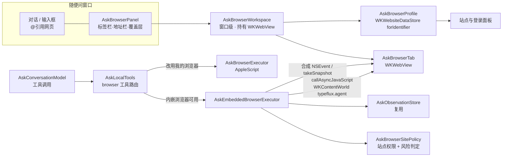

### 组件

- **`AskBrowserWorkspace`**（`@MainActor ObservableObject`，每个窗口一个）：持有标签页数组、当前选中的标签、面板宽度（持久化）。WKWebView 的生命周期挂在这里，不挂在 SwiftUI 视图上，所以切换对话、收起面板都不会重新加载页面。标签页数量上限默认 8，超出后提示用户关闭。
- **`AskBrowserTab`**：用 KVO 观察 `url`/`title`/`estimatedProgress`/`canGoBack`/`hasOnlySecureContent`。`owner` 取值为 `.user` 或 `.agent(conversationId)`：AI 只能操作自己打开的标签，或用户明确交给它的标签。无痕标签使用 `.nonPersistent()`，AI 默认关闭。
- **`AskBrowserProfile`**：macOS 14+ 用 `WKWebsiteDataStore(forIdentifier: <固定 UUID>)`，与应用里的其他 WebView 隔离；macOS 13 退回 `.default()`（目前只有 `MarkdownWebView` 使用默认存储，它不依赖 Cookie）。「站点与登录」的列表来自 `fetchDataRecords(ofTypes:)` 加 `httpCookieStore.allCookies()`；退出某个站点就是对该站点的记录调用 `removeData(ofTypes:for:)`。
- **`AskBrowserSitePolicy`**（存在 `SettingsStore`）：`host → off | ask | read | act`，默认 `ask`；新登录的站点也是 `ask`。
- **`AskEmbeddedBrowserExecutor`**：
  - **观察**：`callAsyncJavaScript(_:arguments:in:in:)` 在 `WKContentWorld.world(name: "typeflux.agent")` 里执行。可以复用 `observationBody`，参数通过 `arguments` 以类型化方式传入，不再拼接字符串。页面脚本访问不到 `__typefluxObservation` 这个闭包。注意隔离 world 仍然共享 DOM，DOM 变化检测（MutationObserver、rect 比对）照旧保留。
  - **截图**：`takeSnapshot(with:)` 生成图片，交给支持视觉的模型（复用 `AskImageCapability` 的判断）。
  - **点击 / 键盘**：按观察时元素的 rect 换算成 WKWebView 坐标，合成 `NSEvent` 的 mouseDown/mouseUp/keyDown 后直接投递给 webView（不经过全局 CGEvent，不需要辅助功能权限），这样页面收到的事件 `isTrusted` 为 true，React / 富文本编辑器都能正常响应。合成失败时退回 JS 的 `click()`，并在回执中注明。`fill` 沿用原生 value setter 再派发 input/change 事件的做法。
  - **导航**：`load(URLRequest)` 之后等待 `WKNavigationDelegate.didFinish` 或超时。目标版本 = `tabId + 导航序号 + URL`，取代 AppleScript 的 stamp，继续用 `AskObservationStore` 校验是否过期。
  - **新增动作**：`screenshot`；`tabs`（list/open/select/close，只限 AI 拥有的标签）；`key`（回车、Tab、方向键等）；`handoff(reason: login|captcha|2fa|payment|other, message)`：暂停 AI，把控制权交给用户。
- **路由**：`AskLocalTools.definitions` 在内嵌浏览器开启时总是暴露 `browser`（不再依赖 Safari 或 Chrome 正在运行）；用户在输入框里选了「改用我的 Safari / Chrome」时走原来的 AppleScript 执行器。工具 schema 保持一致，模型侧的提示词基本不用改。
- **UI**：`AskBrowserPanel`（标签栏、地址栏、`NSViewRepresentable` 托管 workspace 里的 WKWebView、覆盖层：发光边框 / AI 光标 / 控制浮条 / 横幅）、`AskBrowserSitesSheet`、对话中的「使用浏览器 · N 步」活动分组。确认卡片复用 `AskApprovalCard`。`AskWorkspaceLayout` 的右侧面板改成 `enum AskRightPanel { usage, workflow, browser }`，浏览器默认宽 600，可拖动范围为 380 到「窗口宽度 − 侧栏 − 420」。

### 关键流程

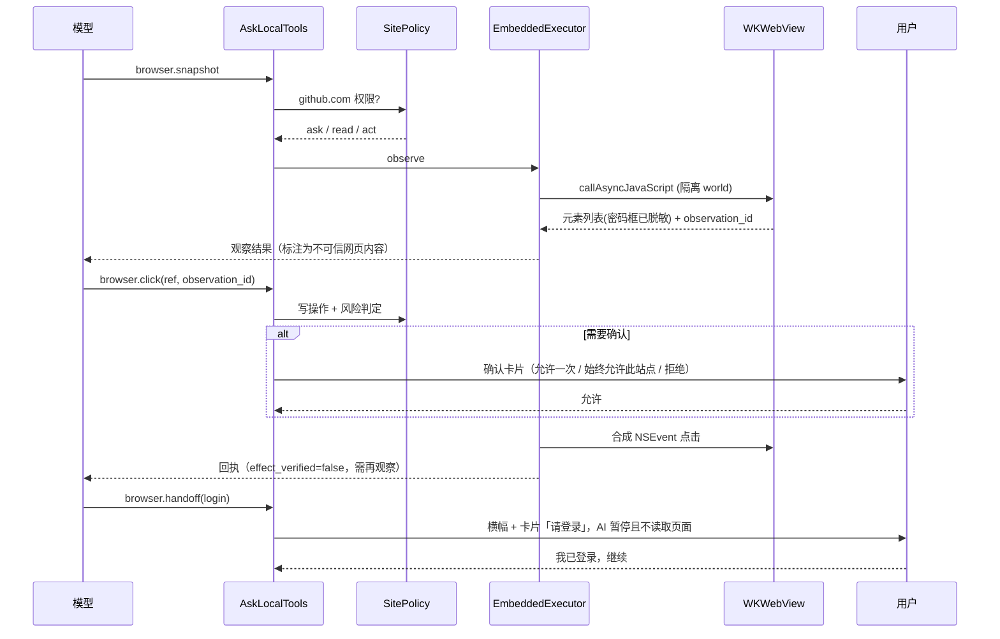

- **暂停 / 接管 / 停止**：每个工具调用开始前检查暂停状态。用户点击页面、点「接管」或按 Esc，AI 立即暂停，同时作废当前的 `observation_id`（用户可能改动了页面），恢复后必须重新观察。「停止」会取消当前这一轮回答，标签页留给用户。
- **登录交接**：AI 主动调用 `handoff`，或观察结果里出现可见的 `input[type=password]` 时，系统自动交接。交接期间不执行任何观察和截图。

## 安全与隐私

- **网页内容不可信（提示注入）**：观察结果包上「untrusted web content」标记，系统提示词要求不执行网页里的指令；站点权限是硬限制，不受模型输出影响。
- **写操作分级**：站点权限为 `ask` 时每次写操作都要确认；为 `act` 时普通点击不再询问，但**高风险操作永远需要确认**：提交含密码或支付字段的表单、按钮文案命中「支付 / 购买 / 发送 / 删除 / 转账 / Pay / Buy / Send / Delete」、上传文件、下载、离开当前站点打开新域名。
- **凭据**：观察结果里 `type=password`、`autocomplete=cc-*` / `one-time-code` 的字段值一律置空；`fill` 拒绝向这些字段写入；交接期间不截图。账号密码只由用户在页面里输入。
- **云端对话**：网页内容会作为工具结果发给 Typeflux Cloud 的模型。第一次使用时明确告知用户，站点权限面板里也写清楚。私密对话（本机模式）只发给用户自己配置的模型。
- **隔离**：独立数据存储；页面 world 不注册任何 `WKScriptMessageHandler`；普通 `file://` 导航禁止，`open_file` 审批后只允许进入选定的 HTML 文件；`window.open` / OAuth 弹窗在 `WKUIDelegate.createWebViewWith` 里作为新标签打开（必须使用传入的 configuration，保住 `window.opener`）；`mailto:` 等外部协议先询问用户；下载需要确认，并且只保存到「下载」目录。
- **日志**：URL 只记录 host，不记录 query 和 fragment（里面可能有 token）。

## 已知限制与对策（需在 P0 做技术验证）

| 问题 | 影响 | 对策 |
|---|---|---|
| Google 等站点可能拦截嵌入式浏览器登录（「此浏览器或应用可能不安全」） | 无法在内嵌浏览器里登录 Google | 用 `applicationNameForUserAgent` 补上 Safari 的 UA 片段后实测；仍被拦截时提示「改用我的 Safari / Chrome」 |
| Passkey / 系统密码自动填充在第三方 WKWebView 里可能需要 `com.apple.developer.web-browser` 授权 | 无法用 Passkey 登录、无法自动填充钥匙串 | 先支持「密码 + 2FA」；Passkey 站点交给用户自己的浏览器 |
| 无扩展；部分站点有反自动化 / 验证码 | 个别站点无法自动化 | 验证码一律 `handoff` 给用户 |
| 每个标签页一个 WebContent 进程 | 内存 | 标签上限 8；后台标签空闲 10 分钟后释放（保留 URL，回到前台时重新加载） |
| macOS 13 没有 `forIdentifier` API | 无法与应用默认存储隔离 | 退回 `.default()`；或把内嵌浏览器限定在 macOS 14+（待决） |

## 分期

1. **P0 面板与手动浏览**：右侧浏览器面板、标签页、持久化配置、站点与登录面板、输入框里 @ 引用当前网页（用户主动把页面文本作为上下文）。同时完成上表的技术验证。
2. **P1 AI 只读**：内嵌执行器的 `snapshot`/`read`/`screenshot`/`open`/`tabs`，对话中的活动分组，AI 光标与发光边框，暂停 / 停止。
3. **P2 AI 操作**：`click`/`fill`/`scroll`/`key`（合成事件）、站点权限与高风险确认、`handoff` 登录交接、接管。
4. **P3**：定时整理（结合工作流）、下载 / 上传、iOS（同样是 WKWebView，执行器可以共用）、可选的 Chrome CDP 通道。

## 测试策略

- **单元**：命令校验、站点权限与风险判定、`AskWorkspaceLayout` 的三栏宽度计算、工具路由（内嵌 vs AppleScript）。
- **WebKit 集成**（主线程，带 `.exclusiveUIState`）：用 `loadHTMLString` 加载本地页面，验证：观察在隔离 world 中执行，页面脚本读不到状态；DOM 变化后 `needs-observation`；密码框被脱敏、`fill` 被拒绝；合成点击的 `isTrusted`；`handoff` 期间观察被拒绝。
- **视觉**：参照 `AskChatRedesignVisualTests`，给面板的空态、AI 操作、交接、窄窗口四种状态做渲染测试。

## 原型说明

打开 `ask-embedded-browser.html`，顶部按钮可以切换场景：

1. **手动浏览**：标签页、地址栏（输入 `github.com` 回车后可以在页面里登录）、`…` 菜单（在 Safari 中打开 / 无痕标签 / 清除站点数据）、拖动分隔条、⌘⇧B 收起或展开面板。
2. **AI 操作演示**：「整理 GitHub 未读通知并存到笔记」的完整流程：打开页面 → 登录交接 → 读取 → 点击筛选 → 截图核对 → 写操作确认（允许一次 / 始终允许此站点 / 拒绝）→ 保存到笔记。过程中可以随时暂停、接管（或直接点击页面）、停止。
3. **站点与登录**：每个站点的 AI 权限分段控件、退出并清除数据。
4. **窄窗口**：侧栏让位，浏览器以抽屉形式覆盖在对话上。

右上角可以切换浅色 / 深色。

| 状态 | 深色 | 浅色 |
|---|---|---|
| 新标签页 | 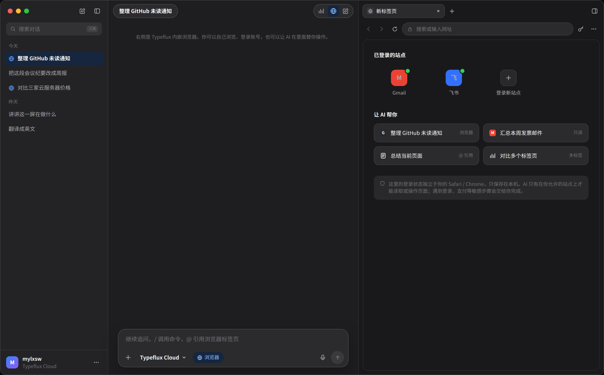 | 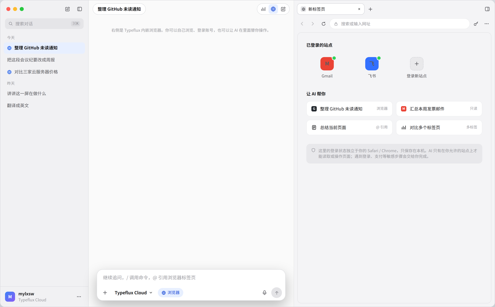 |
| 登录交接 | 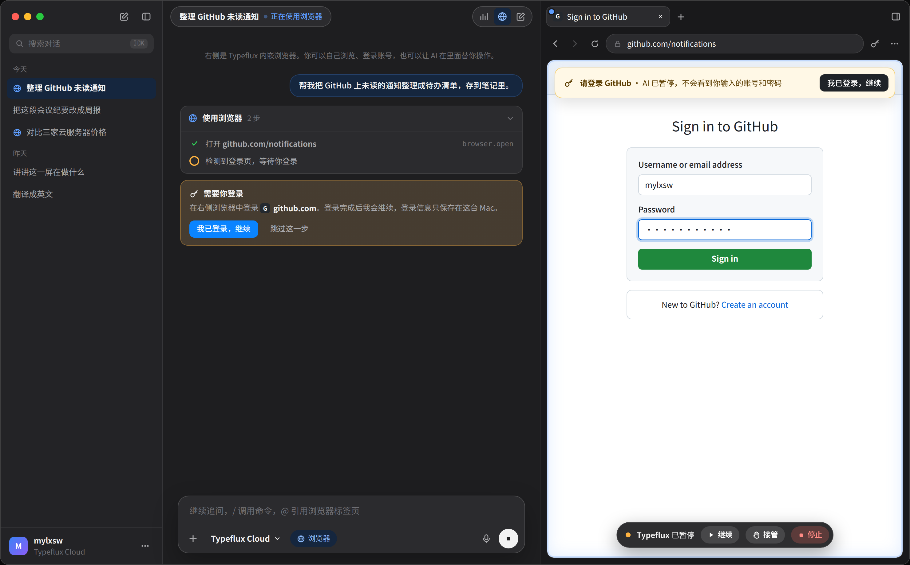 | 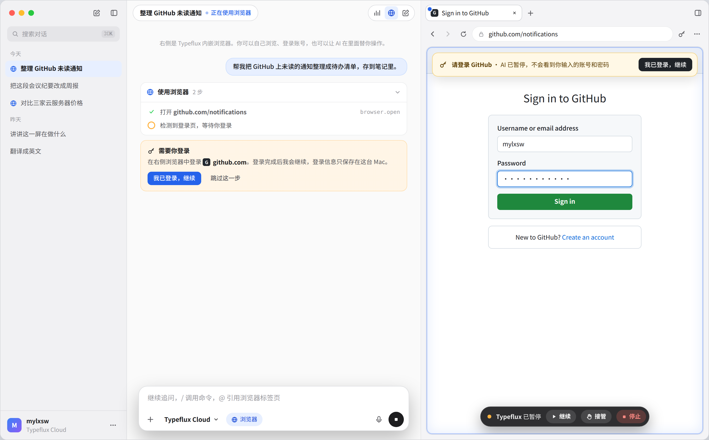 |
| AI 操作中 | 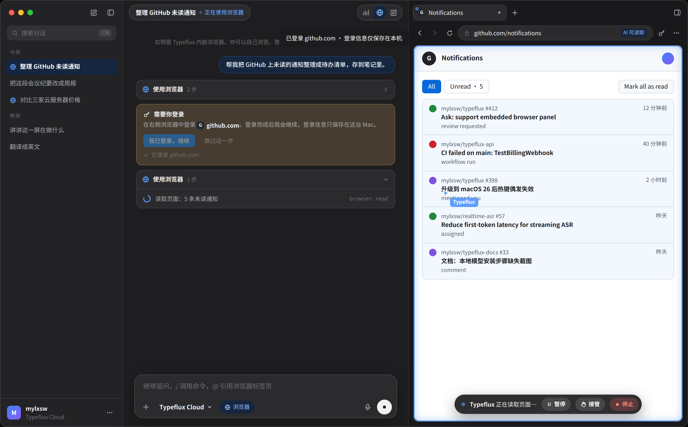 | 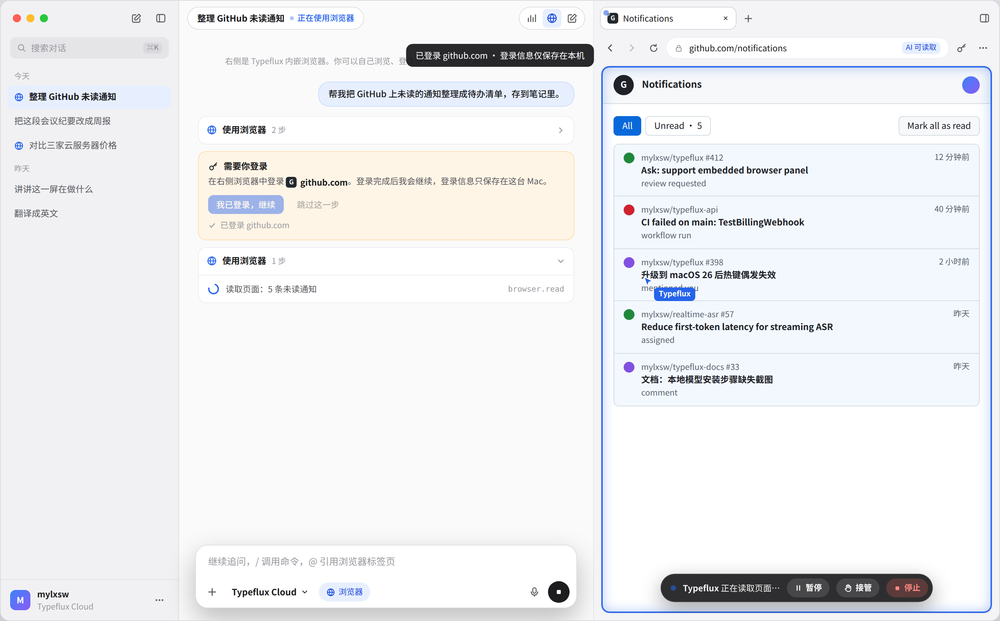 |
| 写操作确认 | 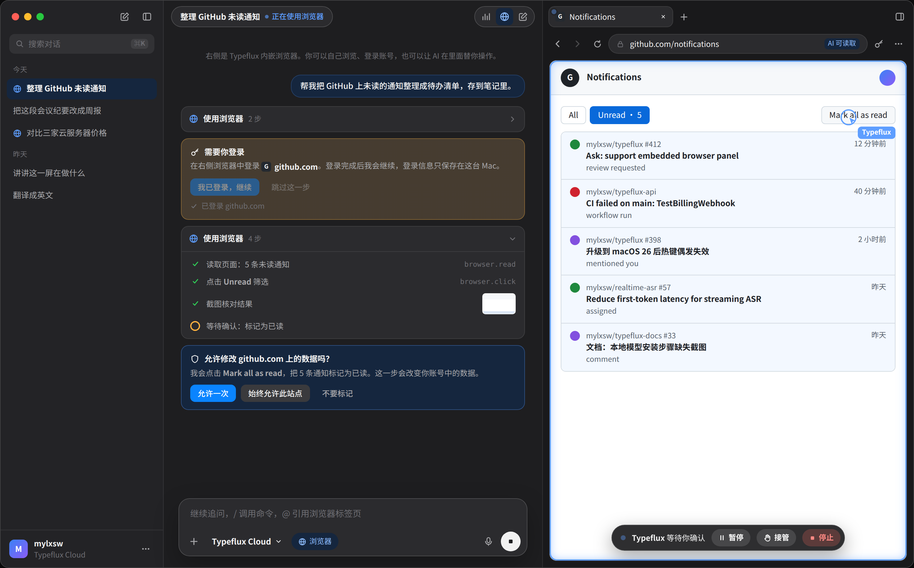 | 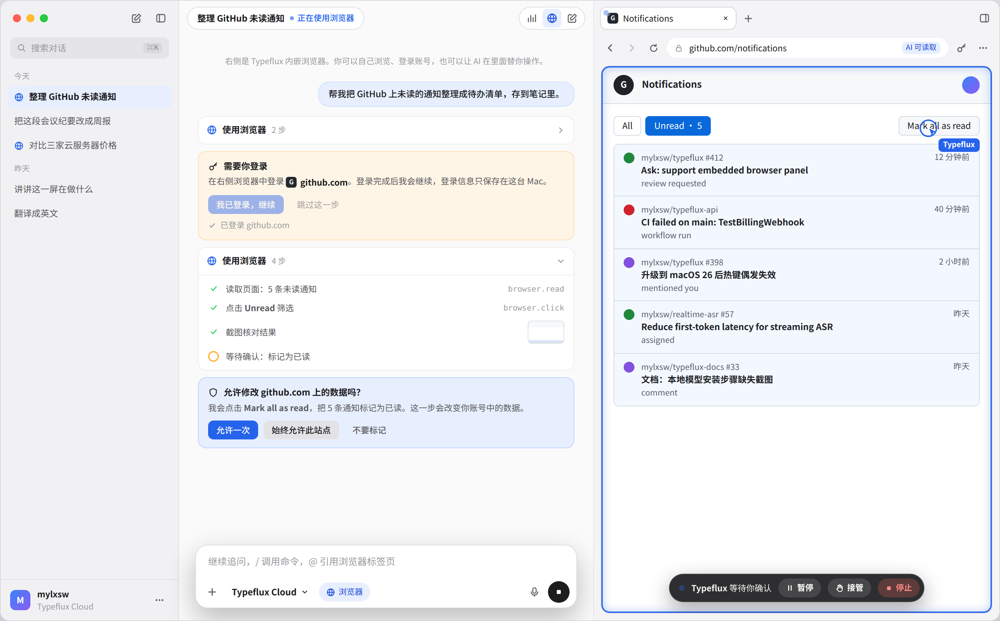 |
| 完成并存入笔记 | 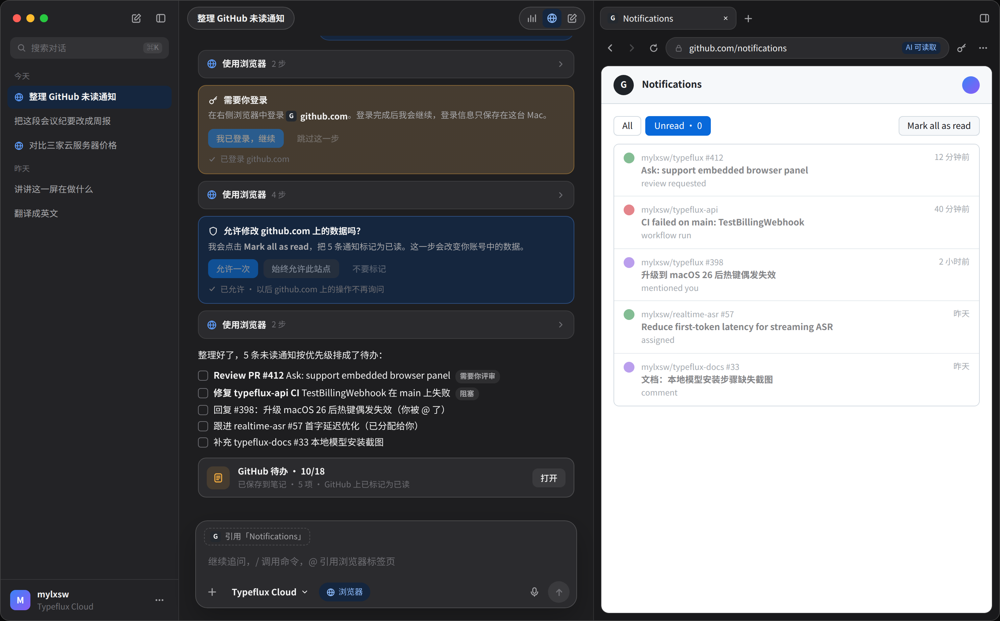 | 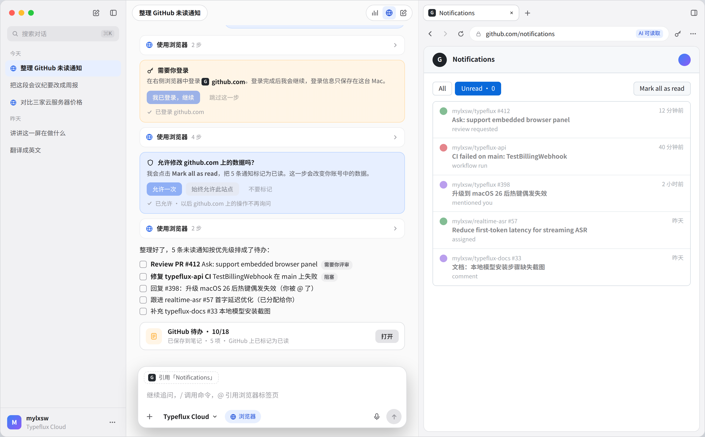 |
| 站点与登录 | 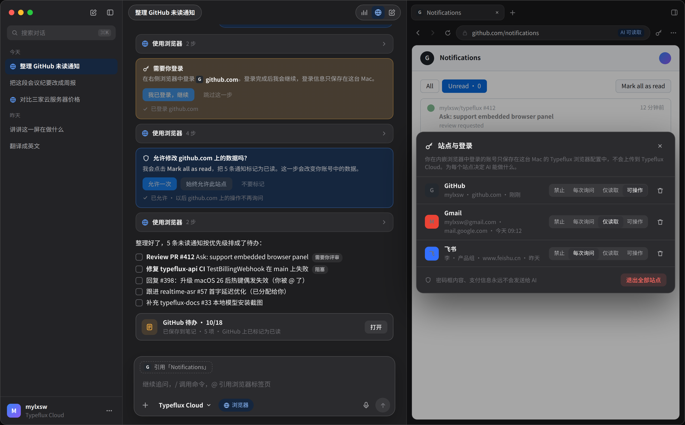 | 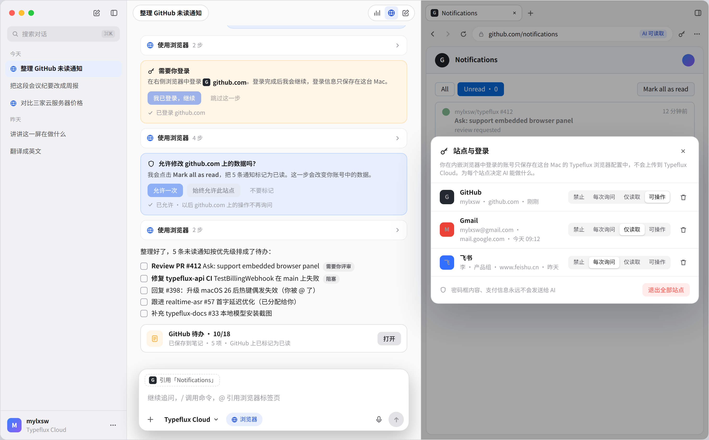 |
| 窄窗口 | 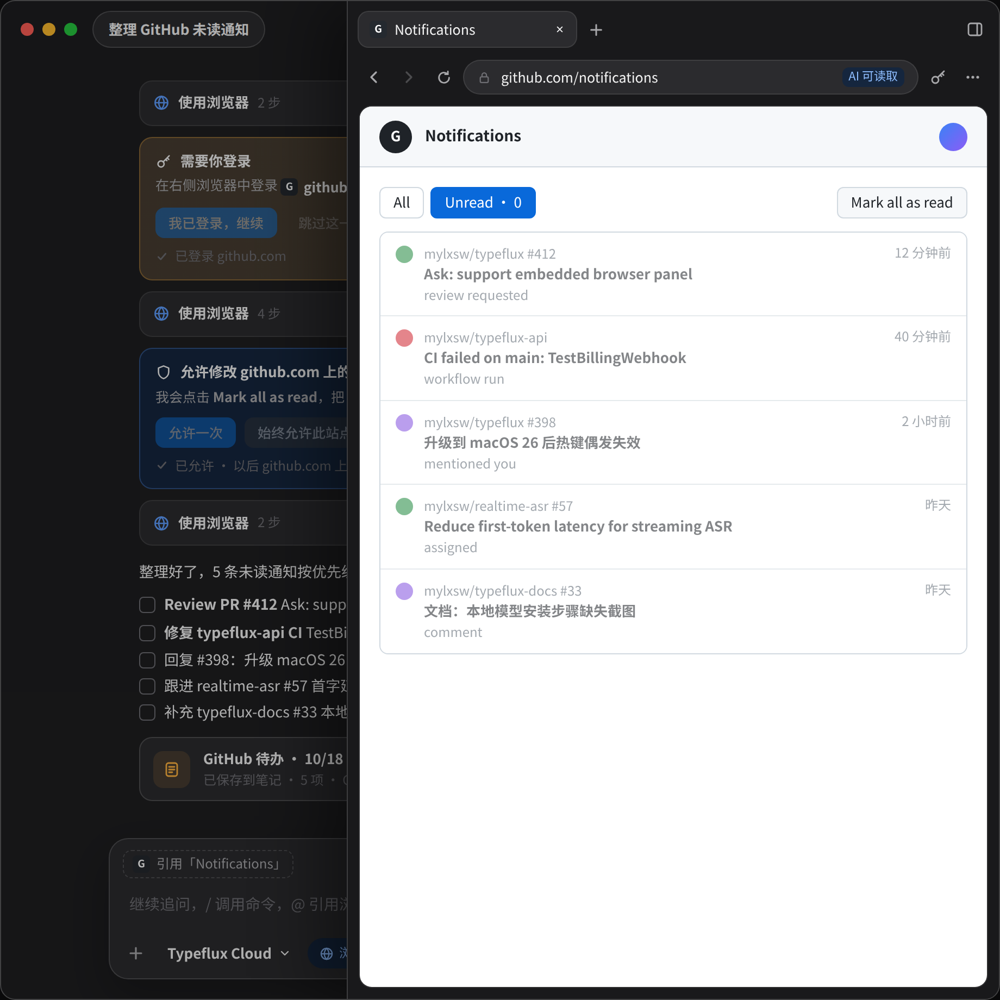 | 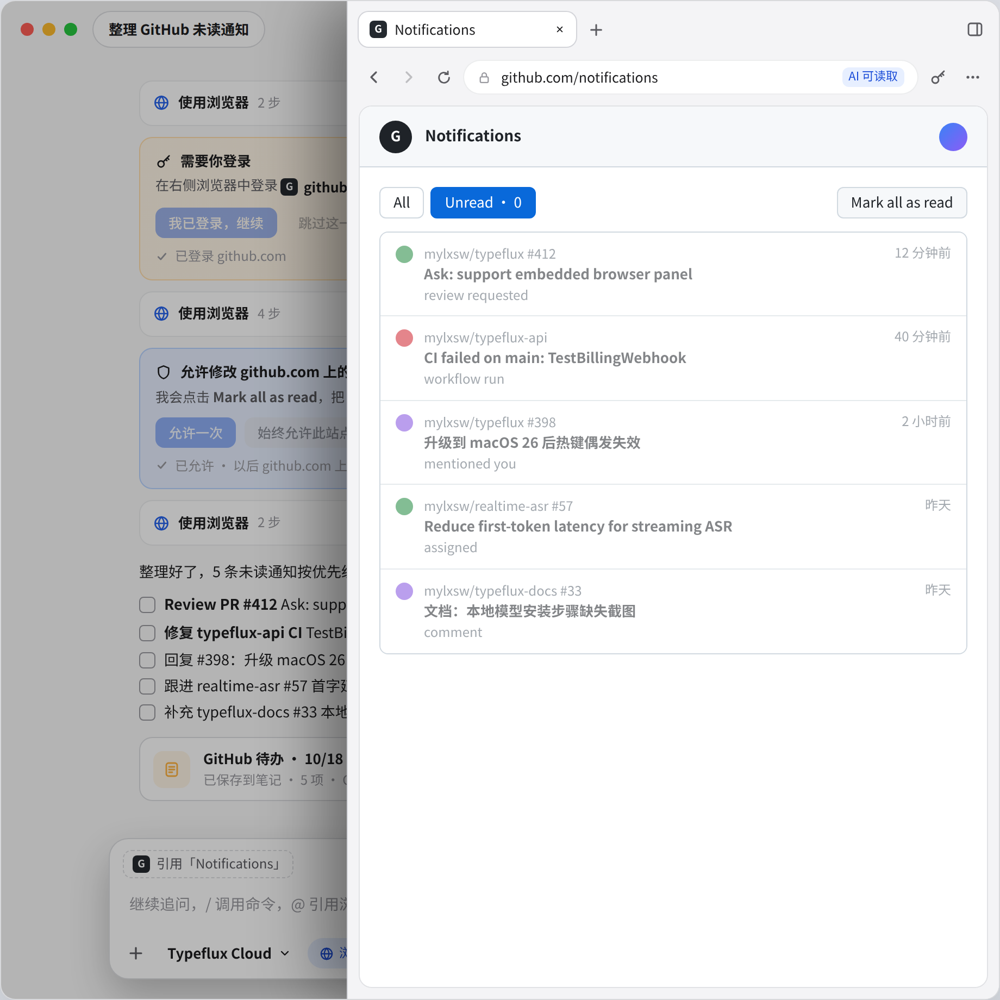 |
| 用户接管 | 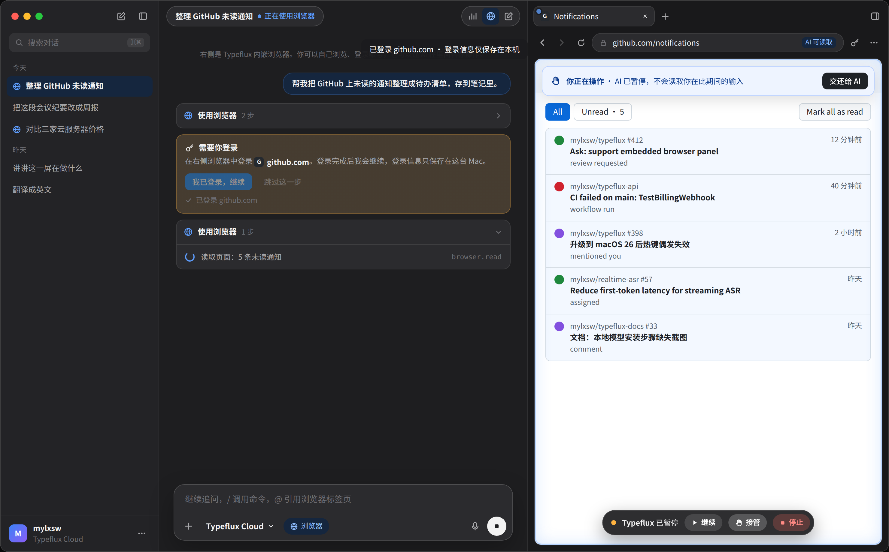 | |

## 待决问题

1. 浏览器面板按**窗口**共享（推荐，登录态和标签页跨对话复用，AI 标签绑定到对话），还是按对话隔离？
2. 新站点的默认 AI 权限用「每次询问」是否合适？
3. 是否支持 macOS 13（退回默认数据存储），还是把内嵌浏览器限定为 macOS 14+？
4. 云端对话里，网页内容发送给云端模型的告知方式：首次弹窗，还是在站点权限里说明？

## 参考

1. OpenAI, *Building ChatGPT Atlas*（OWL 架构）: https://openai.com/index/building-chatgpt-atlas
2. *Codex Gets a Native Browser*（2026-04）: https://pasqualepillitteri.it/en/news/1568/codex-native-browser-openai-april-2026
3. *Codex Now Drives the Browser with the Chrome DevTools Protocol*: https://pasqualepillitteri.it/en/news/5088/codex-browser-chrome-devtools-protocol
4. WebKit, *Building Profiles with new WebKit API*（`WKWebsiteDataStore(forIdentifier:)`，macOS 14）: https://webkit.org/blog/14423/building-profiles-with-new-webkit-api/
