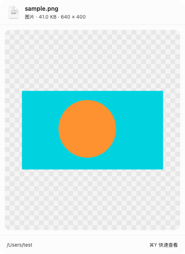
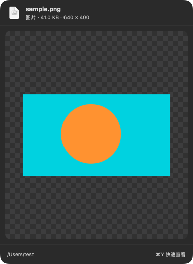
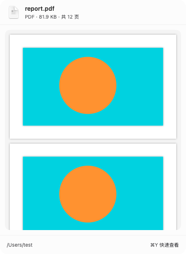
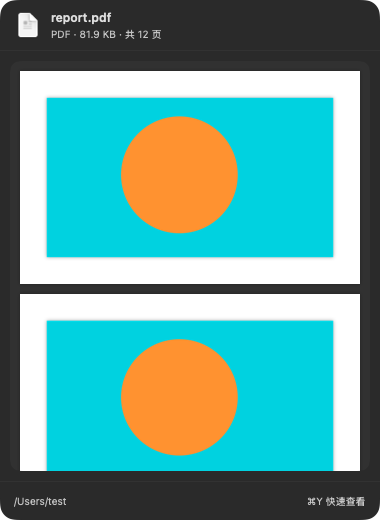
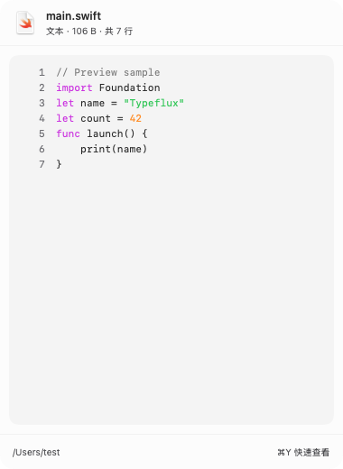
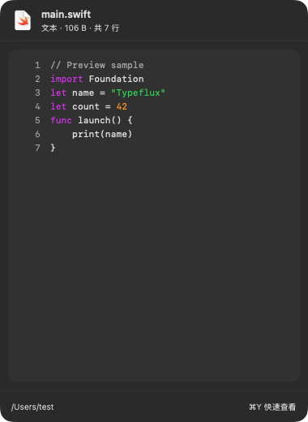
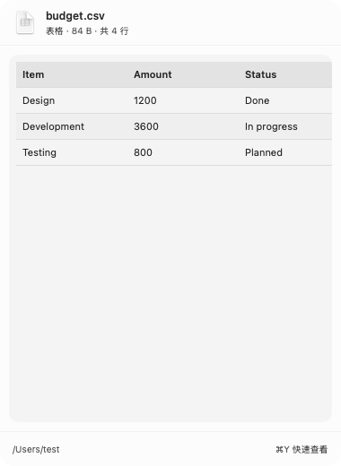
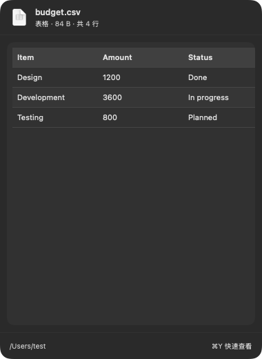

# Implemented preview window

These images are native `NSPanel` / SwiftUI captures using deterministic test content, rendered by `AskFilePreviewVisualTests` in the classic interface style. They are not browser mockups. The PDF fixture contains three visible page images with a synthetic total page count.

| Type | Light | Dark |
| --- | --- | --- |
| Image |  |  |
| PDF |  |  |
| Code |  |  |
| Table |  |  |

Recreate the captures and the optional local PNG latency measurement on macOS:

```sh
TYPEFLUX_PREVIEW_SNAPSHOTS=/tmp/typeflux-preview-snapshots \
TYPEFLUX_PREVIEW_BENCHMARK=1 \
swift test --enable-code-coverage --filter AskFilePreview
```

The latency measurement uses 20 distinct local PNG paths and includes the 120ms highlight debounce; it does not represent every format or a cold OS disk cache. Integration tests separately exercise real launcher selection, panel reuse, placement, dismissal, and the disabled setting.

Implementation decisions where the specification leaves room:

- ImageIO decodes common images directly at the requested pixel size; other image formats and Office documents use Quick Look thumbnails. PDFKit supplies the first three PDF pages. All decoding runs off the main actor or through asynchronous system APIs.
- Audio previews sample only the first 30 seconds into 80 amplitude buckets. Media never autoplays.
- Tables show at most 30 rows and 30 columns. Files that cannot be safely read, including symlink paths and File Provider placeholders, do not display a preview.
- The explicit secret-file exclusion for `*.key` takes precedence over Keynote preview support.
- Localization covers all five languages present in this repository: English, Simplified Chinese, Traditional Chinese, Japanese, and Korean. There is no sixth language enum or resource directory to extend.
