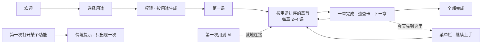

# 分功能 Onboarding 设计方案（v3）

> 状态：待评审（GUL-339 第三轮）。这一阶段只出设计，不改代码。
>
> **可交互设计稿**：`docs/design/feature-onboarding.html`，用浏览器打开，从「欢迎」一路点到「全部完成」。原型里用这些按键代替系统快捷键：
>
> | 原型 | 代替 |
> |---|---|
> | 按住空格 | fn |
> | L | 启动器 |
> | V | 剪贴板 |
> | S | 截图 |
> | 按住 R 或按住鼠标 | 圆环 |
>
> 键帽也可以直接按住或点击。顶栏可以切换深色 / 浅色、查看「全部画面」或「从头开始」。截图在 `docs/design/feature-onboarding/`。
>
> 取代 v2（同一文件的上一版）和第一轮的 `onboarding-redesign.md`。

## 0. 这一版改了什么

v2 结构是对的（首次设置 → 分功能上手 → 情境提示），但做得不够好。v3 按下面五个问题重做：

| v2 的问题 | v3 的做法 |
|---|---|
| 课程画面都是静态的：讲按键的功能却不能按，只能点「下一步」 | **每一课都能真正操作**，见下面「v3 的课程」表 |
| 练习区大面积留白，只放一句提示或一组大键帽 | 每一课都是一个具体场景：写邮件、改 Slack 消息、写周报、截一张图表、读一段英文、整理下载文件夹 |
| 太像上课：首次设置 5 屏 + 20 课 + 一个总览页，第一次「哇」来得太晚 | 首次设置只有 **3 屏**（欢迎、选用途、权限），之后直接进入第一课；课程压缩到 **15 课**；去掉了总览页 |
| 欢迎页是五个灰色方块，没有第一印象 | 左边一句话「说、找、划、问。都在一个按键之外」，右边轮播真实画面；点左边的动词可以直接看对应能力 |
| AI 在首次设置里就要求连接 | **用到时再连接**：第一次改写、第一次提问时就地弹出连接卡片，连好以后继续，不离开当前这一步 |

v3 的课程：

| 课程 | 可以做什么 |
|---|---|
| 按住说话 | 按住按键，录音胶囊里的字逐字出现；松开后整理好的文字写进邮件 |
| 启动器 | 真的能打字：算式实时出结果，应用按输入过滤，`fy` 加空格变成关键词标签 |
| 截图 | 拖鼠标框选区域，在框里拖动画箭头 |
| 圆环 | 按住后按指针方向选中某一格，松开执行 |
| Agent | 回答逐字出现，工具调用要你确认 |

## 0.1 文案密度（GUL-339 评审）

- **标题**一句话，按键直接放进标题，不超过 14 个字。
- **说明**只写一行，不超过 20 个字，不换行。能用图示、键帽、示例说明的，就不写成句子。
- **卡片**：标题加一行短描述（6–10 个字）。细节放在选中后出现的图示里，不写成段落。
- **不要**在界面上写原型操作说明（比如“原型里按 L”）。这类说明统一放在设计稿的工具栏里。
- 实现时同样遵守这些规则。新增文案在本地化之前先过一遍字数。

## 1. 结构

| 层 | 内容 | 时长 |
|---|---|---|
| 首次设置 | 欢迎 → 选择用途 → 权限 | 约 1 分钟 |
| 上手 | 5 章 15 课，按用户选的用途排序；没选的放在「更多功能」 | 每章 1–2 分钟 |
| 情境提示 | 第一次打开启动器、圆环、录屏、对话窗口时出现一次 | — |
| 回到上手 | 菜单栏「继续上手」、使用指南、老用户的新功能介绍 | — |

## 2. 首次设置

| 画面 | 要点 |
|---|---|
| 欢迎 `01`–`02` | 标题「说、找、划、问。都在一个按键之外」。左边四个动词各配一个按键；右边轮播对应能力的真实画面（每 3.2 秒切换一次，带进度条），点动词可以直接看。界面语言放在左下角。 |
| 选择用途 `03` | 6 张卡片，每张有小插图；第 6 张是「都想试试」。右边的计划实时更新：要学几个功能、约几分钟、现在需要哪些权限、哪些权限用到时再问。默认选中语音输入、启动器、Agent 对话。 |
| 权限 `04`–`05` | 只列出所选功能现在就需要的权限，每项写明用在哪里。麦克风会弹出系统对话框；辅助功能会打开系统设置，并在旁边指出要打开哪个开关，打开后自动回来。屏幕录制、摄像头和 AI 都列在「用到时再问」。 |

权限与用途的对应关系：

| 权限 | 现在就要，当用户选了 | 否则在什么时候问 |
|---|---|---|
| 麦克风 | 语音输入、Agent 对话（语音提问） | 第一次按住 fn |
| 辅助功能 | 语音输入、启动器、圆环 | 第一次写回或读选中文字 |
| 屏幕录制 | — | 第一次截图、录屏，或第一次带着屏幕提问 |
| 摄像头 | — | 录屏打开摄像头小窗时 |
| AI 连接 | — | 第一次改写或提问 |

## 3. 上手：5 章 15 课

**窗口**：普通应用窗口（与使用指南、笔记本同类），1200 × 732。

- **左栏**：总进度环和每一章，当前章展开显示每一课。
- **右边**：标题行（按键直接写在标题里）+ 练习区 + 底部状态行。
- 每一章有自己的环境色，只用在练习区的背景光里。界面本身保持中性灰，强调色只用在选中项和主按钮上。

**一课的规则**：

- 动作在真实的功能里完成，系统检测到做对了，状态行变成 ✓，主按钮变成「下一步」。
- 没做之前可以「跳过」，或点「我已经会了」（记为已学会）。
- 每章结束显示速查卡（按键 + 用途），推荐下一章，也可以「今天先到这里」。

| 章 | 课 | 练习区的场景 | 完成条件 | 截图 |
|---|---|---|---|---|
| **语音输入** | 按住说话 | 新邮件。按住后胶囊里的字逐字出现，松开后整理好的文字写进去，下面标出删掉了哪些口头禅。按得太短会提示再试一次 | 写入了文字 | `06`–`07` |
| | 说一句话改写 | Slack 里一段已经选中的话。按住说「改得正式一点」；第一次用 AI 时就地弹出连接卡片（Cloud / 自己的 Key / 本机模型），连好后继续改写，原文划掉、新文字高亮 | 选中文字被替换 | `08`–`09` |
| | 人设与词汇 | 左边点人设，下方实时显示同一句话写出来的样子；右边往词汇表加 PGVector，识别效果马上变对 | 换了人设，或加了词 | `10` |
| **启动器 · 剪贴板 · 截图** | 打开启动器 | 真的能输入：算式实时出结果，应用和文件按输入过滤，↑↓ ↩。检测到 ⌘Space 被聚焦搜索占用时，底部提示「改用 ⌥Space」，改了以后后面所有按键都会跟着变 | 用启动器执行了一项 | `11`–`12` |
| | 关键词 | 8 张关键词卡片，点一下就打开启动器并填好示例；输入 `fy` 加空格变成标签，在空输入框里按退格退出 | 运行了一个关键词 | `13` |
| | 剪贴板 | 周报写到一半。底部卡片架打开后，打字就是搜索，← → 选择，↩ 粘贴回原来的位置 | 粘贴了一条 | `14` |
| | 截图 | 一张 Numbers 图表。拖出选区（实时显示尺寸），在框里拖动就是画箭头，↩ 复制，缩略图飞到右下角，3 秒后消失 | 复制了截图 | `15` |
| **翻译 · 录屏 · 工作流** | 翻译 | 一段英文。双击任意单词，面板出现在单词旁边（单词卡 + 多个服务）；在下方录制划词翻译快捷键，实时检查冲突 | 看过翻译，并设好了没有冲突的快捷键 | `16` |
| | 录屏与 GIF | 完整流程：选格式 → 3 秒倒计时 → 录制（显示计时和 30 秒上限）→ 预览 → 拖动黄色边框裁剪 → 导出 → 保存 | 导出了 GIF | `17`–`18` |
| | 工作流 | 从示例库添加 `fx`，点「在启动器里试试」，启动器带着 `fx` 标签打开，输入金额就出汇率 | 工作流运行成功 | `19` |
| **圆环** | 按住 · 划向 · 松开 | 在指针处展开。离中心超过 20pt 时指向的那一格高亮，松开执行；移回中心松开就是取消；轻按会让圆环保持打开，可以点选或按数字 | 用手势执行了一项 | `20` |
| | 放上常用的 | 左边点添加，点圆环上的一项移除，实时重新排布，最多 8 个 | 圆环有变化 | `21` |
| **Agent 对话** | 带着上下文提问 | 上下文标签（当前屏幕、选中 3 行）可以分别关掉；先显示「读取屏幕」这一步，再逐字出现回答 | 收到回答 | `22` |
| | 让它动手 | 同一个任务（整理下载文件夹）在三种模式下的区别：严格每一步都问；标准只在改动前问；YOLO 全部自动执行，事后可以撤销。可以允许、拒绝，也可以切换模式重来 | 任务完成 | `23`–`24` |
| | 对话存在哪里 | 三张短卡片：云端同步（默认，多设备接着聊）、仅存本机（只在这台 Mac）、临时对话（用完不留）。选中哪张，下方就用三个图示讲清它的特点。按用途对比，不按安全程度对比（见下文「存储位置的文案原则」） | 选了一种 | `25` |

**存储位置的文案原则**（GUL-339 评审）：

- 不用「敏感内容」「私密」「不经过 Typeflux 服务器」这类说法。它们暗示云端不安全，会让用户对默认选项产生不信任。
- 云端同步是默认推荐，先讲它能做到什么：保存在你的账号里，多设备接着聊，可以用云端模型也可以用自己的模型。
- 仅存本机和临时对话写成给特定场景的选项（离线或想自己管理数据；一次性的问题），而不是写成「更安全」的选项。
- 不画数据被拦截（✕）的流向图，改用中性的图示。
- 不写没有核实过的安全承诺，比如「端到端加密」「不会用于训练」。如果要在这里加上 Cloud 的安全说明，需要先拿到服务端已经落实的事实，并经过确认。
- 建议同步修改现有界面文案：`ask.storage.newLocal`「新建私密对话」改为「新建本机对话」，与「仅存本机」保持一致。

结束画面：一章完成 `26`；全部完成 `27`（六个按键就是全部，默认打开「登录 Mac 时自动打开」）。

## 4. 情境提示与回到上手

| 画面 | 规则 |
|---|---|
| 菜单栏 `28` | 没学完时，菜单顶部显示进度和下一步，第一项是「打开上手中心」。首次设置后 7 天内，图标上有一个小圆点。 |
| 第一次打开启动器 `29` | 结果下方出现一行提示：怎么用关键词、怎么查看全部。关掉，或用过一次关键词以后，就不再出现。 |
| 老用户 `30` | 已经完成旧版引导的用户不走首次设置。更新后只显示一次新功能介绍，点「去试试」直接进入启动器那一章。 |

圆环、截图、录屏、对话窗口第一次打开时的提示，规则同 v2 第 6 节。截图的提示已经画在 `15` 里。

## 5. 实现要点

- **进度**：新增 `OnboardingProgress`（UserDefaults），保存所选用途和每一课的状态（未开始 / 已学会 / 跳过）。`isOnboardingCompleted` 只表示「看过首次设置」。
- **课程目录**：用静态的 `OnboardingCatalog` 定义章节、课程、完成信号和所需权限。单元测试校验：每一课都有完成信号；每个用途需要的权限都在第 2 节的表里。
- **完成信号**：复用现有入口，只在上手窗口打开期间监听。

  | 课程 | 信号来源 |
  |---|---|
  | 按住说话、改写 | 练习文本框的变化，以及 `HistoryStore` 新增的 `editSelection` 记录 |
  | 启动器、关键词 | `AskConversationModel` 的事件 |
  | 剪贴板 | `ClipboardPanelModel` 的粘贴动作 |
  | 截图、录屏、翻译 | 各自 coordinator 的完成回调 |
  | 工作流 | `AskWorkflowPlugin` 的运行结果 |
  | 圆环 | `RingActionExecutor` |
  | Agent 对话 | Ask 的会话事件 |

- **按键跟随设置**：标题、速查卡、菜单里的按键都从 `HotkeyTarget` 读取。改用 ⌥Space、改用右 ⌘ 或录了翻译快捷键以后，所有画面都会跟着变（原型里已经演示）。
- **AI 就地连接**：连接卡片复用现有的登录、API Key、Ollama 流程。连接成功后回到原来的动作继续，不丢失状态。
- **首次设置**：`OnboardingViewModel.Step` 改为 `welcome / goals / permissions`。原来的语言、语音模型、大模型三步删除；模型配置的界面挪到连接卡片的「自己的 API Key」里。
- **埋点**：`onboarding_goal_selected`、`lesson_started` / `lesson_completed` / `lesson_skipped` / `lesson_known`、`ai_connect_inline`，以及 `jit_tip_shown` / `jit_tip_dismissed`。
- **无障碍**：每一课都有键盘操作路径；VoiceOver 读出标题、状态和按键名称；打开「减少动态效果」时关掉轮播、波形、撒花和轨迹动画。
- **分步交付**：

  | 阶段 | 内容 |
  |---|---|
  | P1 | 首次设置、进度存储、菜单栏入口 |
  | P2 | 上手窗口，以及语音输入、启动器两章 |
  | P3 | 翻译 · 录屏 · 工作流、圆环、Agent 对话三章，以及 AI 就地连接 |
  | P4 | 情境提示、使用指南入口、老用户的新功能介绍 |

## 6. 需要确认

1. **默认选中的用途**：现在是语音输入、启动器、Agent 对话。要不要也默认选上圆环？
2. **启动器快捷键**：⌘Space 和聚焦搜索冲突。建议新用户直接默认 ⌥Space，第 1 课就不需要处理冲突。
3. **翻译快捷键**：目前没有默认值，课程里让用户自己录一个。另一种做法是在不冲突时默认设为 ⌃⌥T。

## 7. 验证

- 用 Playwright 驱动原型跑完整流程：首次设置 → 5 章 15 课 → 全部完成。每一课都通过真实的按键、鼠标拖动或点击完成，页面没有 JS 报错。
- 这次跑测试发现并修复了两个问题：
  - 截图缩略图挡住了「下一步」按钮。现在缩略图不拦截点击，3 秒后自动消失。
  - 「当前项」和光标用了同一个 class 名，导致左栏错位。
- 逐张检查了深色主题下的全部画面，并抽查了浅色主题。

## 8. 画面清单

| 文件 | 画面 |
|---|---|
| `01`–`05` | 欢迎（语音、圆环两帧）、选择用途、权限（麦克风对话框 / 系统设置引导） |
| `06`–`10` | 语音输入：录音中、写入完成、AI 就地连接、改写完成、人设与词汇 |
| `11`–`15` | 启动器：冲突提示、计算、关键词、剪贴板、截图标注 |
| `16`–`19` | 翻译（快捷键冲突）、录屏中、录屏预览裁剪、工作流 |
| `20`–`21` | 圆环：划向、自定义 |
| `22`–`25` | Agent：逐字回答、严格模式确认、YOLO、对话存在哪里 |
| `26`–`30` | 一章完成、全部完成、菜单栏、第一次打开启动器、老用户 |
| `light-*` | 浅色主题示例 |
