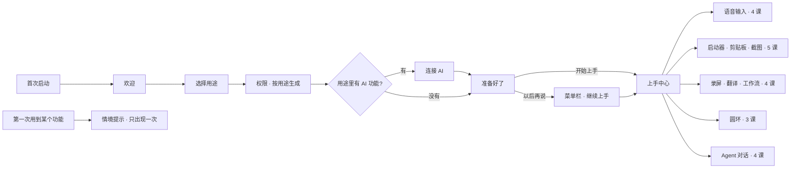

# 分功能 Onboarding 设计方案

> 状态：待评审（GUL-339 第二轮）。这一阶段只出设计，不改代码。可交互设计稿：`docs/design/feature-onboarding.html`（浏览器打开，按钮可以点；顶栏切换深色 / 浅色、「全部画面」；←/→ 切换画面；URL 用 `#<画面>&theme=dark|light&bare=1` 只显示画面）。截图在 `docs/design/feature-onboarding/`。
>
> 取代第一轮方案 `onboarding-redesign.md`。第一轮把五个功能压进一次三步的引导，用户在评审中要求每个主要功能都有专门的上手流程。

## 0. 一页结论

1. **拆成三层**：首次设置要短；功能要学透；提示在第一次用到时才出现。
   - **首次设置（约 1 分钟）**：欢迎 → 选择用途 → 权限 → 连接 AI → 准备好了。只做「能用起来」必需的事。
   - **上手中心**：一个独立的应用窗口，五个功能各有一组课程，共 20 课，每课 15–50 秒，都在真实的功能里完成。
   - **情境提示**：第一次打开启动器、圆环、录屏、对话窗口时，出现一次性的小提示。上手中心没学到的，在这里补上。
2. **按用户的用途排序，而不是按功能列表**：首次设置问「你想先用 Typeflux 做什么」。这个选择决定三件事：要申请哪些权限、要不要连接 AI、上手中心的顺序。没选的功能不会被隐藏，放在「更多功能」里。
3. **每一课都是「做一次」，不是「读一遍」**：练习区是真实的文本框，真实的启动器、剪贴板、截图工具、圆环、对话窗口会出现在桌面上。Typeflux 检测到用户做对了，就自动打勾。
4. **权限在用到时再要**：首次设置只申请所选功能现在就需要的权限（通常是麦克风 + 辅助功能）。屏幕录制、摄像头等在第一次截图、录屏时才请求，并说明原因。
5. **随时可以离开，随时可以回来**：菜单栏顶部显示「继续上手 9 / 20」；使用指南的「开始」页有「继续上手」卡片；老用户更新后看到一次新功能介绍。
6. **视觉跟随应用现有的 token**：中性灰，强调色只用在选中项和主按钮上，橙色只用来标出问题；不用渐变，图标也不加彩色底（和 `help-overlay.md` 第 2 版的评审结论一致）。支持深色 / 浅色、Liquid Glass / 经典。

## 1. 现状与问题

现有引导（`OnboardingViewModel.Step`）是 6 步：语言 → 账号 → 语音模型 → 大模型 → 权限 → 快捷键，都是为语音输入法设计的。Typeflux 现在有五组功能：

| 功能 | 入口 | 现在的引导 |
|---|---|---|
| 语音输入（听写、说一句话改写选中文字、人设、词汇表） | 按住 `fn`；人设 `⌥⌘P` | 只有快捷键表里的一行 |
| 启动器 · 剪贴板 · 截图（50 多个关键词、文件搜索、选中文字处理） | `⌘Space`、`⌥⌘O`、`⌥⌘A` | 快捷键表里各一行 |
| 录屏 · 翻译 · 工作流 | `lp` / `gif`、`fy`、翻译快捷键（默认不设置）、示例库 | 没有 |
| 圆环 | `⌃⌥Space`（首次运行时没被占用才自动设置） | 没有 |
| Agent 对话（上下文、工具权限模式、私密 / 临时对话、技能、MCP、笔记本、记忆） | 启动器 `⌘↩`、对话窗口 | 没有 |

问题：

- **功能多了，但引导没变**：80% 的功能用户在引导里看不到。
- **前面都在配置**：6 步里 3 步是语言、语音模型、大模型，而语音识别已经内置了本机模型。
- **权限一次全要**：不管用户用不用截图、录屏，都在第一次启动时一起要。
- **学了就忘**：快捷键表看过就关了；`help` 指南（GUL-390）能查，但用户不知道该先学什么。

## 2. 设计原则

1. **先能用，再学会**：首次设置只做必需的事，1 分钟内结束。学习放到上手中心，用户自己决定什么时候学。
2. **从用户想做的事出发**：先问用途，再按用途排顺序。
3. **动手做一次**：每课一个动作，在真实功能里完成，系统检测结果，不用点「我看完了」。
4. **一次只教一件事**：每课只讲一个按键或一个概念，15–50 秒学完。
5. **在需要的时刻出现**：权限和提示都等到第一次用到时；只出现一次，可以关掉。
6. **不打扰**：所有课程都能跳过，或点「我已经会了」；关掉窗口不会丢进度，也不会弹窗催。

## 3. 整体结构



## 4. 首次设置（画面 1）

| 画面 | 内容 | 说明 |
|---|---|---|
| 欢迎 `01-welcome` | 应用图标、一句话「你在 Mac 上的输入、查找和 AI 助手，都在一个按键之外」；五个功能各一张卡片，配上入口按键 | 界面语言默认跟随系统，左下角可以切换（不再单独占一步） |
| 选择用途 `02-goals` | 五张可多选的卡片，写明功能、一句话价值、课数和时长；另有「我都想看看」 | 默认选中语音输入、启动器、Agent 对话（覆盖面最广的三个）。底部实时显示「已选 3 项 · 需要 3 项权限」 |
| 权限 `03`–`05` | 分成「现在需要」和「用到时再问」两组，每项标出用在哪些功能上 | 规则见 §4.1。辅助功能打开系统设置后，旁边会出现提示卡，指出要打开哪个开关；授权后自动回到 Typeflux |
| 连接 AI `06-ai` | Typeflux Cloud（推荐）/ 自己的 API Key / 本机模型；下面列出所选功能里会用到 AI 的部分 | 所选用途都不需要 AI 时（例如只选了语音输入），这一页自动跳过。语音识别内置本机模型，不需要连接 |
| 准备好了 `07-ready` | 按用途排好的上手计划；「开始上手：语音输入」/「以后再说」 | 首次设置到此结束 |

### 4.1 权限和用途的对应关系

| 权限 | 现在就要，当用户选了 | 否则在什么时候请求 |
|---|---|---|
| 麦克风 | 语音输入、Agent 对话（语音提问） | 第一次按住 `fn` |
| 辅助功能 | 语音输入、启动器（读选中文字、写回）、圆环（代按快捷键） | 第一次需要写回或读选中文字时 |
| 屏幕录制 | 不在首次设置里要 | 第一次截图、录屏、截图识字或翻译，或对话中带上屏幕时 |
| 摄像头 | 不在首次设置里要 | 录屏时打开了摄像头小窗 |
| 自动化（Agent 设备工具） | 不在首次设置里要 | Agent 第一次调用相关工具时，沿用现有的确认流程 |

麦克风和辅助功能都没给时，主按钮不可用，旁边有「稍后授权」；跳过后菜单栏和上手中心会提醒补上。

## 5. 上手中心（画面 2–7）

**窗口**：和使用指南、笔记本同一类的普通应用窗口（1040 × 680，最小 900 × 600）。左边是侧栏，右边是内容。有红绿灯按钮，会记住位置和大小，`⌘W` 关闭。

**侧栏**：

- 总进度「已学会 9 / 20」。
- 「你选的」功能在前，其余放在「更多功能」。每个功能一行，右边是进度环。
- 底部是「使用指南」和「关闭，稍后在菜单栏继续」。

**功能总览**（`08-voice`）：一张示意图、一句话价值和课程列表（编号、标题、一句说明、时长）。主按钮是「开始第一课」或「继续」。

**一课的结构**（所有课程统一）：

```
┌ 面包屑：语音输入 › 第 1 课 · 按住说话             ▬ ▬ ▬ ▬ ┐
│ 标题：按住 [fn] 说一句话，说完松开                          │
│ 说明：一句话讲清会发生什么                                  │
│ ┌ 练习区：真实的文本框 / 示意 ──────────────────────────┐ │
│ │ 真实的功能（启动器、剪贴板、截图…）出现在桌面上         │ │
│ └─────────────────────────────────────────────┘ │
│ ● 状态：等你按住 fn → ✓ 写进去了      [我已经会了] [跳过 / 下一课] │
└──────────────────────────────────────────────────┘
```

- **完成条件由系统检测**，检测到后状态变成 ✓，主按钮变成「下一课」。每课的检测信号见 §5.6。
- 「我已经会了」和「跳过」都会进入下一课。前者记为已学会，后者记为跳过（进度环不计）。
- 学完一个功能后显示速查卡，并引导到下一个功能（`15-voice-done`）。

### 5.1 语音输入（4 课）

| # | 课 | 用户做什么 | 完成条件 | 画面 |
|---|---|---|---|---|
| 1 | 按住说话 | 在练习文本框里按住 `fn` 说一句话 | 文本框收到写入的文字 | `09`–`11`：等待 / 录音中（真实的录音胶囊）/ 写入成功并对比原话，说明口头禅已经去掉 |
| 2 | 说一句话改写选中文字 | 选中一段文字，按住 `fn` 说「改得正式一点」 | 选中的文字被替换 | `12`–`13`：有选中文字时，说的话会被当成指令（`recordingIntent = .askSelection`），并提示可以 ⌘Z 撤销 |
| 3 | 换一种语气：人设 | `⌥⌘P` 打开人设切换器，选一个；或选中文字后按 `⌥⌘P` | 切换了人设，或把人设用在了选中文字上 | — |
| 4 | 教它认识你的词 | 把两个词加进词汇表 | 词汇表有新词 | `14`：对比加词前后的识别结果 |

`fn` 被「表情与符号」占用、或者外接键盘没有 `fn` 时，第 1 课先处理这两个问题（打开键盘设置；或改用右 ⌘、右 ⌥，沿用 `ExternalKeyboardShortcutReplacement`）。

### 5.2 启动器 · 剪贴板 · 截图（5 课）

| # | 课 | 用户做什么 | 完成条件 | 画面 |
|---|---|---|---|---|
| 1 | 打开启动器 | `⌘Space`，输入 `128*3` | 启动器打开并出现结果 | `17`：真实的启动器出现在屏幕中间 |
| 2 | 关键词 | 输入 `fy hello world` | 进入了任意一个关键词 | `18`：9 个最常用的关键词，点卡片会打开启动器并填好示例；完整列表交给 `help` |
| 3 | 处理选中的文字 | 选中文字后打开启动器，选「翻译 / 改写 / 解释」 | 对选中文字运行了一次 | — |
| 4 | 剪贴板与历史 | `⌥⌘O`，选一张卡片按 ↩ | 粘贴了一条记录 | `19`：按用户当前的面板样式打开（这里是底部卡片架） |
| 5 | 截图 | `⌥⌘A` 框选，画个箭头，↩ 复制 | 复制或保存了一张截图 | `20`：截图工具栏上的引导卡片；屏幕录制权限在这一课才请求 |

`⌘Space` 默认属于聚焦搜索。第 1 课检测到冲突（读 `com.apple.symbolichotkeys` 的 64 号）时，推荐改用 `⌥Space`，也可以去系统设置关掉聚焦搜索的快捷键。

### 5.3 录屏 · 翻译 · 工作流（4 课）

| # | 课 | 用户做什么 | 完成条件 | 画面 |
|---|---|---|---|---|
| 1 | 翻译 | 选中一个单词，按划词翻译快捷键 | 翻译面板打开并出了结果 | `21`：三个翻译快捷键默认都不设置，课里让用户录一个（演示值 `⌃⌥T`），复用 `HotkeyConflictChecker` 检查冲突 |
| 2 | 截图翻译 | 框选一段外文 | 截图翻译出了结果 | — |
| 3 | 录屏与 GIF | 启动器输入 `gif`，框一块区域录几秒，停止 | 打开了录屏预览 | `22`：录制控制条和提示，说明 GIF 最长 30 秒，更长的要用 `lp` 录 MP4 |
| 4 | 工作流 | 从示例库添加 `fx`，在启动器里运行 `fx 100 usd` | 工作流运行成功 | `23`：只用随应用发布、已经信任的示例，不涉及导入第三方代码 |

### 5.4 圆环（3 课）

| # | 课 | 用户做什么 | 完成条件 | 画面 |
|---|---|---|---|---|
| 1 | 按住 · 划向 · 松开 | 按住 `⌃⌥Space`，划向「翻译」，松开 | 通过手势执行了一项 | `24`：圆环在指针处打开，键帽显示按住状态，指针轨迹指向要执行的那一项 |
| 2 | 轻按：保持打开 | 轻按快捷键，点一项或按数字 | 通过点击或数字执行了一项 | — |
| 3 | 放上你常用的 | 添加一个应用或网址 | 圆环配置有变化 | `25`：左边是可以添加的类型，右边实时预览；最多 8 个 |

没有圆环快捷键时（首次运行时 `⌃⌥Space` 被占用），第 1 课先让用户录一个。

### 5.5 Agent 对话（4 课）

| # | 课 | 用户做什么 | 完成条件 | 画面 |
|---|---|---|---|---|
| 1 | 带着上下文提问 | 在一个表格窗口前打开启动器，⌘↩ 提问 | 收到第一个回答 | `26`：对话窗口里有上下文标签（当前屏幕、选中 3 行）和工具调用记录 |
| 2 | 让它动手：工具与权限 | 让它整理文件，经历一次「允许 / 这次对话都允许 / 拒绝」 | 处理了一次工具确认，或改过权限模式 | `27`：讲清严格 / 标准 / YOLO 三种模式；默认是标准 |
| 3 | 私密与临时对话 | 新建一个私密对话 | 创建了私密或临时对话 | `28`：讲清数据存在哪、经不经过服务器 |
| 4 | 扩展能力 | 看一眼技能、MCP、笔记本、记忆 | 打开这一课即可 | `29`：只介绍，不要求现在配置 |

全部学完显示最常用的 6 个按键（`30-all-done`），菜单栏里的「继续上手」随之消失。

### 5.6 完成检测

上手中心只在打开期间、并且有课程在进行时才监听。每个信号复用已有的入口，不新增权限：

| 信号 | 来源 |
|---|---|
| 写入练习文本框 / 改写了选中文字 | 练习文本框自己的变化，加上 `HistoryStore` 里新增的 `editSelection` 记录 |
| 切换人设 | 人设切换的通知 |
| 词汇表新增 | `VocabularyStore` |
| 启动器打开 / 出了结果 / 进入关键词 | `AskConversationModel` 发出的事件 |
| 剪贴板粘贴 | `ClipboardPanelModel` 的粘贴动作 |
| 截图复制或保存、录屏预览、翻译出结果 | 各自 coordinator 的完成回调 |
| 工作流运行成功 | `AskWorkflowPlugin` 的运行结果 |
| 圆环执行（手势 / 点击） | `RingActionExecutor` |
| 收到回答 / 处理了工具确认 / 新建私密对话 | Ask 会话事件 |

## 6. 情境提示（画面 8）

用户没走上手中心也能学会。规则：

- 每个提示**只出现一次**，可以点 × 关掉；如果用户已经学过对应的课，或者已经用对了一次，就不再出现。
- 提示放在功能**自己的界面里**，不额外弹窗。

| 时机 | 提示 | 画面 |
|---|---|---|
| 第一次打开启动器 | 结果下方一行：先输入 `fy`、`g` 这样的关键词再加空格；不知道有哪些，就输入 `help` | `31-jit-launcher` |
| 第一次打开圆环 | 指针旁的提示卡：按住时划向一项，松开就执行；轻按会让圆环保持打开 | `32-jit-ring` |
| 第一次录屏 | 先说明为什么需要「屏幕录制」权限，麦克风和摄像头只在打开时才要 | `33-jit-record` |
| 第一次打开对话窗口 | 空白页展示四类能做的事，并标出当前的工具权限 | `34-jit-chat` |
| 第一次截图 | 工具栏上的提示卡（见 `20`） | — |

## 7. 回到上手（画面 9）

| 入口 | 规则 | 画面 |
|---|---|---|
| 菜单栏 | 没学完时，菜单顶部显示进度和下一课，第一项是「上手中心…」。首次设置后 7 天内图标上有一个小圆点，之后只保留菜单项 | `35-menubar` |
| 使用指南 · 开始页 | 顶部加「继续上手」卡片，列出还差什么；功能卡片可以直接进入对应的课 | `36-help` |
| 老用户 | 已经完成旧版引导的用户不走首次设置。更新后只显示一次「Typeflux 现在不只是语音输入」，列出新增的四个功能，引导到上手中心 | `37-upgrade` |
| 全部学完 | 菜单栏的「继续上手」消失；上手中心仍然可以从使用指南进入，方便复习 | — |

## 8. 数据与实现要点

- **进度**：新增 `OnboardingProgress`（`UserDefaults`），记录每课的状态：`notStarted / done / skipped`，以及用户选的用途。旧的 `isOnboardingCompleted` 只表示「看过首次设置」。
- **课程目录**：`OnboardingCatalog` 静态定义功能、课程、完成信号和需要的权限，并编写单元测试：每一课都有完成信号；每个功能需要的权限都在 §4.1 的表里。
- **按键都读用户的设置**：标题和速查卡里的按键（`fn`、`⌘Space`、`⌃⌥Space`、翻译快捷键）都从 `HotkeyTarget` 读取，用户改过就显示改过的。
- **首次设置**：`OnboardingViewModel.Step` 改为 `welcome / goals / permissions / ai / ready`；`visibleSteps` 按用途过滤（不需要 AI 就跳过 `ai`）。原来的语言步骤、语音模型步骤删除，模型配置的 UI 复用到 AI 页的「自己的 API Key」里。
- **埋点**：`onboarding_goal_selected`、`lesson_started / lesson_completed / lesson_skipped`（带功能和课程 id）、`jit_tip_shown / jit_tip_dismissed`，用来看哪些课被跳过最多。
- **无障碍**：所有课都有键盘路径；VoiceOver 读出标题、状态和按键名称；开启「减少动态效果」时不播放波形和轨迹动画。
- **分步交付**：
  - **P1** 首次设置 + 进度存储 + 菜单栏入口。
  - **P2** 上手中心框架 + 语音输入、启动器两个功能的课程。
  - **P3** 录屏 · 翻译 · 工作流、圆环、Agent 对话的课程。
  - **P4** 情境提示 + 使用指南的入口 + 老用户的新功能介绍。

## 9. 需要确认

1. **默认选中的用途**：设计稿默认选中语音输入、启动器和 Agent 对话。如果想把圆环也作为卖点推给新用户，可以加上。
2. **启动器的默认快捷键**：`⌘Space` 和聚焦搜索冲突。建议新用户直接默认 `⌥Space`，这样启动器第 1 课就不需要处理冲突。
3. **翻译快捷键**：目前默认不设置。设计稿在课程里让用户自己录一个；也可以改成在没有冲突时给一个默认值。

## 10. 画面清单

| 文件 | 画面 |
|---|---|
| `01`–`07` | 首次设置：欢迎、选择用途、权限（初始 / 系统设置引导 / 已就绪）、连接 AI、准备好了 |
| `08` | 上手中心 · 功能总览 |
| `09`–`15` | 语音输入：按住说话（等待 / 录音中 / 完成）、说一句话改写（进行中 / 完成）、词汇表、学完一个功能 |
| `16`–`20` | 启动器 · 剪贴板 · 截图：总览、打开启动器、关键词、剪贴板、截图 |
| `21`–`23` | 录屏 · 翻译 · 工作流：翻译、录屏与 GIF、工作流 |
| `24`–`25` | 圆环：按住划向松开、自定义 |
| `26`–`30` | Agent 对话：带上下文提问、工具权限、私密与临时、扩展能力、全部完成 |
| `31`–`34` | 情境提示：启动器、圆环、录屏、对话窗口 |
| `35`–`37` | 回到上手：菜单栏、使用指南、老用户 |
| `light-*` | 浅色主题示例 |
