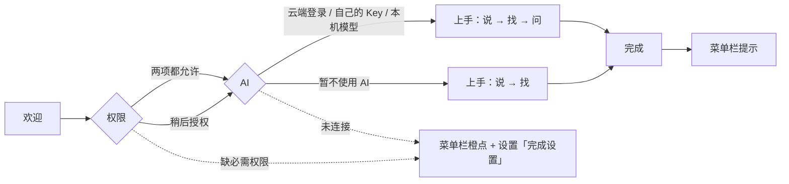

# Onboarding 重构 设计方案

> 状态：待确认（GUL-339）。可交互设计稿：`docs/design/onboarding-redesign.html`（浏览器打开，按钮可点；顶栏切换浅色/深色、「全部画面」；←/→ 切换画面）。截图在 `docs/design/onboarding-redesign/`。

## 0. 一页结论

1. **从「配置一个语音输入法」改成「学会三个按键」**。Typeflux 现在有三个能力：语音输入（说）、启动器（找）、AI 对话（问）。引导的目标是：用户关窗时已经亲手用过这三样，并记住 `fn`、`⌘Space`、`⌘↩`。
2. **6 步缩成 3 步**，前面一个欢迎页，后面一个完成页：

   ```
   欢迎 ─▶ ① 权限 ─▶ ② AI ─▶ ③ 上手（说 / 找 / 问） ─▶ 完成 ─▶ 菜单栏提示
   ```

   | 现在 | 改版 |
   |---|---|
   | 语言（单独一步） | 默认跟随系统，欢迎页右上角可以改 |
   | 账号 | 并入「AI」，作为推荐选项 |
   | 语音模型（11 个引擎） | **去掉**。内置 SenseVoice 本机模型，离线可用，只显示一行「语音识别已就绪」；要换就去设置 |
   | 大模型 | 并入「AI」：云端 / 自己的 Key / 本机模型 三选一 |
   | 权限 | 保留，只要两项必需权限，每项写清用途 |
   | 快捷键（一张表） | 改成「上手」：每个按键在页面里亲手试一次 |

3. **每一步都可以先跳过，不会卡住**。跳过权限或 AI 时，会先说清楚哪些功能能用、哪些不能用。之后由菜单栏橙点和设置里的「完成设置」卡片提醒补上。
4. **问题当场解决**：fn 被「表情与符号」占用、外接键盘没有 fn、`⌘Space` 和聚焦搜索冲突、辅助功能列表里找不到 Typeflux——只在检测到时出现，并给一键处理。

## 1. 现状问题

| # | 问题 | 原因 |
|---|---|---|
| P1 | 引导只讲语音输入 | 欢迎文案、步骤、快捷键表都按「输入法」写的；启动器和 AI 对话只在快捷键表里各占一行 |
| P2 | 前几步都在配置，迟迟用不上 | 6 步中有 3 步是语言、语音模型、大模型；新用户要先懂「STT / LLM / Base URL」才能往下走 |
| P3 | 语音引擎选择是多余的 | 发布版已经内置 SenseVoice（`LocalSTTModel.defaultModel`），不用选也能用；免费账号也不能用云端识别（`canUseCloudASR`） |
| P4 | 没有「试一试」 | 快捷键只是一张表，用户关掉窗口后不知道从哪开始 |
| P5 | 常见卡点只在快捷键页处理 | fn 冲突提示在最后一步才出现；`⌘Space` 默认和聚焦搜索冲突，现在完全没提示 |
| P6 | 跳过后无处找回 | 关窗即 `isOnboardingCompleted = true`，缺的权限和配置没有后续提醒 |

## 2. 设计原则

- **先让用户用上，再谈配置**：零配置就能用的部分（本机语音识别、启动器搜索）不放进引导；需要做选择的只剩「AI 用哪种方式」。
- **一页只做一件事**：每页一个标题、一个主按钮。
- **边做边学**：每个按键都在页面里实际按一次，结果写在页面里。
- **说清代价，不强迫**：可以跳过，但跳过前告诉用户会少什么。
- **问题出现才提示**：冲突和异常只在检测到时出现，不预先写一堆说明。

## 3. 流程



- 步骤条只显示 `权限 · AI · 上手`，欢迎和完成不算步骤。
- **已经满足的步骤自动跳过**：重装或换机时，权限都已允许就不显示权限页；已登录且模型可用就不显示 AI 页。上手页始终显示，可以一键跳过。
- 关闭窗口 = 稍后继续：保存当前进度，下次从菜单栏「继续设置」或设置卡片回到原来那一步。

## 4. 页面

### 4.0 欢迎（`01-welcome.png`）

- Logo + 「欢迎使用 Typeflux」+ 一句话「说、找、问 —— 在任何应用里，一个按键就够。」
- 三张卡片，各配一张小图和对应按键：语音输入 `fn` / 启动器 `⌘ Space` / AI 对话 `⌘ ↩`。
- 右上角语言菜单，默认跟随系统语言；切换后立即生效。
- 底部写「大约 2 分钟，3 步完成」，主按钮「开始设置」。

### 4.1 权限（`02`–`05`）

| 权限 | 必需 | 用途 | 影响 |
|---|---|---|---|
| 麦克风 | 是 | 听见你说的话 | 语音输入、语音提问 |
| 辅助功能 | 是 | 把文字写进当前应用，读取选中文字 | 语音输入、启动器、AI 对话 |
| 屏幕录制 | 否 | 让 AI 看懂当前屏幕，截图识字 | AI 对话、截图 |

- 语音识别权限只在用户选了 Apple Speech 时才需要，引导里不出现。
- **辅助功能引导**（`03-perm-ax.png`）：点「打开系统设置」后，直接跳到「隐私与安全性 → 辅助功能」。系统设置旁边浮出一张提示卡：「打开 Typeflux 右侧的开关」，列表里没有 Typeflux 时提示把 `Typeflux.app` 拖进去。Typeflux 每秒检查一次授权状态，打开后这一行自动变成「已允许」。
- 屏幕录制默认是「需要时再说」，第一次截图或带屏幕提问时再申请（这部分逻辑已有）。
- 底部写「还差 N 项必需权限」。必需权限没给全时，主按钮不可用，旁边有「稍后授权」。点「稍后授权」会弹出说明（`05-perm-skip.png`）：缺权限时语音输入和写回应用不能用，启动器搜索和打字提问可以用。
- 底部一行隐私说明：语音默认在本机识别、录音不上传；截图只在提问时随问题发送。

### 4.2 AI（`06`–`10`）

三张卡片三选一，选中后下方展开对应的配置：

| 方式 | 配置 | 完成条件 |
|---|---|---|
| **Typeflux Cloud**（默认，推荐） | Google / Apple / 邮箱登录，在浏览器里完成后自动回来 | 已登录。显示账号、套餐和本月剩余额度，并说明语音识别仍走本机、不消耗额度 |
| 自己的 API Key | 服务商芯片（OpenAI、Anthropic、Gemini、DeepSeek、OpenRouter、通义千问、更多…）+ API Key + 模型 + 测试连接；「获取 API Key」「自定义 Base URL」放在链接里 | 测试连接成功，或填全必填项 |
| 本机模型 | 自动检测 Ollama 和已安装的模型；没检测到时给「下载 Ollama」和「重新检测」 | 选中一个模型 |

- 卡片下面固定一行：**语音识别已就绪**（内置 SenseVoice，离线可用）。想换云端或其他引擎，去 设置 → 模型。
- 「暂不使用 AI」（`10-ai-skip.png`）：说明语音输入、启动器搜索/计算/剪贴板照常可用，AI 对话和 AI 润色不可用。确认后，上手页的「问」变成提示，完成页对应的卡片变灰。
- 付费会员登录后，语音识别自动切到云端（沿用 `useCloudAccountModels` 现有逻辑），页面上显示「云端识别已启用」。

### 4.3 上手（`11`–`21`）

左边是三项任务和完成状态，右边是练习区。每完成一项自动切到下一项。

**说 · 语音输入**

- 练习区放一个真实的文本框（样式像备忘录），进入这一页时焦点就在里面。
- 给两句示例：「明天下午三点和设计团队开会」「嗯…帮我记一下，周五前交周报」。第二句带口头禅，用来展示自动去掉口头禅的效果。
- 按住 fn：大键帽变成按下状态，底部出现和平时一样的录音浮条（实时字幕 + 计时）。
- 松开后：新写入的文字高亮，右上角显示「写进去了，用时 0.6 秒」，下面一行说明“嗯”已自动去掉。
- 检测到 fn 被系统占用（`GlobeKeyPreferenceReading.isReadyForHotkey == false`）时，显示警告和「打开键盘设置」，改好后自动更新。外接键盘可以一键改用右侧 ⌘ 或右侧 ⌥（沿用 `ExternalKeyboardShortcutReplacement`）。

**找 · 启动器**

- 提示按 `⌘ Space`，给 4 个示例：`128*3`、`日历`、`fy 你好`、`昨天复制的链接`。
- 真实的启动器在屏幕中间弹出，引导窗口留在后面。有结果出来就算完成（`16-try-launch-open.png`）。
- **快捷键冲突**（`17`）：`⌘Space` 默认是聚焦搜索的快捷键。检测到系统的聚焦搜索快捷键还开着（读 `com.apple.symbolichotkeys` 第 64 项）时，推荐「改用 ⌥ Space」，也可以去系统设置关掉聚焦搜索的快捷键。选完后，任务描述和完成页的按键同步更新。

**问 · AI 对话**

- 提示在启动器里输入问题，按 `⌘ ↩` 交给 AI，也可以点 🎙 用语音问。说明选中的文字和当前屏幕会自动带上，点一下就能去掉。
- 示例：「帮我写一封请假邮件，明天下午」「把选中的文字翻译成英文」「这一屏讲了什么」。
- 启动器底栏的 `⌘↩ 问 AI` 高亮（`19`）；按下后打开对话窗口并流式回答，这一项完成（`20`）。
- 没连接 AI 时（`21`）：这一项变成提示，可以「连接 AI」（回到 AI 页）或「先跳过」，不计入完成数。

底部写「已完成 N / 3」，随时可以「跳过练习」。

### 4.4 完成（`22-done.png`）

- 三张按键速查卡：`fn` 按住说话 / `⌘ Space` 打开启动器 / `⌘ ↩` 问 AI。按键和用户实际设置一致（例如改成了右 ⌘ 或 ⌥Space）。
- 三个次要功能：剪贴板与历史 `⌥⌘O`、截图 `⌥⌘A`、切换人设 `⌥⌘P`。
- 「登录 Mac 时自动打开 Typeflux」默认打开（`LaunchAtLoginManager`）。
- 主按钮「开始使用」。

### 4.5 引导之后（`23`、`24`）

- **菜单栏提示**：引导窗口关闭后，菜单栏图标下方弹出一次「Typeflux 在这里」，复述两个最常用的按键。
- **找回跳过的步骤**：缺必需权限或 AI 未连接时，菜单栏图标带橙点；菜单第一项是「继续设置」。设置侧栏底部显示「完成设置」卡片，写清还差什么、缺了会影响什么，点击回到对应的那一步。全部完成后卡片和橙点消失。

## 5. 文案（zh-Hans，其他语言同步翻译）

| 位置 | 文案 |
|---|---|
| 欢迎标题 / 副标题 | 欢迎使用 Typeflux / 说、找、问 —— 在任何应用里，一个按键就够。 |
| 权限标题 / 副标题 | 允许 Typeflux 听见你、帮你输入 / 需要两项系统权限。Typeflux 只在你按下快捷键时录音。 |
| AI 标题 / 副标题 | 选择 AI 的工作方式 / AI 用于对话、启动器提问和润色语音文字。随时可以在设置里更换。 |
| 上手标题 / 副标题 | 三个按键，上手 Typeflux / 跟着各试一次就记住了。 |
| 完成标题 / 副标题 | 一切就绪 / 记住这三个按键就够了。Typeflux 会一直在菜单栏里待命。 |

完整文案以设计稿为准。新增 key 统一用 `onboarding.v2.*` 前缀，旧 key 在实现 PR 中清理。

## 6. 实现要点

- **步骤模型**：`OnboardingViewModel.Step` 改为 `welcome / permissions / ai / practice / done`，`visibleSteps` 按「是否已满足」过滤。埋点 `analyticsName` 用新名字，并为上手页的三项分别上报 `practice_voice / practice_launcher / practice_ai`（完成 / 跳过）。
- **AI 页**：复用现有 `LLMRemoteProvider`、连接测试和登录流程；语音引擎配置 UI 从引导里删掉（设置页保留）。默认 `sttProvider = .localModel`、`localSTTModel = .senseVoiceSmall`，不变。
- **上手页**：
  - 练习文本框是 Typeflux 自己的窗口，`AXTextInjector` 照常写入，正好验证辅助功能权限是否生效。
  - 打开启动器和问 AI 的完成事件，从 `AskConversationModel` 发通知给 `OnboardingViewModel`，只在引导期间监听。
  - 聚焦搜索冲突检测写成纯函数（输入 symbolichotkeys 字典，输出是否冲突），方便测试。
- **跳过后找回**：新增 `OnboardingProgress`（UserDefaults），记录每步状态；菜单栏橙点和设置卡片都读它。`isOnboardingCompleted` 的含义改为「看过引导」，不再代表「配置完整」。
- **老用户**：已完成旧版引导的用户不再弹出完整引导。版本更新后只显示一次「新功能」卡片（启动器 + AI 对话 + 试一试），可以直接进入上手页。
- **窗口**：880×640（原来 980×780），内容不滚动；支持浅色 / 深色，开启「减少动态效果」时不播放切页动画。

## 7. 边界与异常

| 情况 | 处理 |
|---|---|
| 用户在系统弹窗里拒绝了麦克风 | 这一行变成「去系统设置开启」，之后无法再弹系统弹窗 |
| 辅助功能已打开但不生效（签名变化） | 检测到「已授权但写入失败」时提示先移除再重新添加 Typeflux |
| 浏览器登录中途关掉 | 回来时 AI 页恢复成未登录，按钮可以重试；超时 2 分钟后提示「没有收到登录结果」 |
| 测试连接失败 | 显示服务商返回的错误；可以不测试直接继续，到上手页的「问」时再暴露问题 |
| 没有网络 | 云端登录不可用，提示改用本机模型或稍后再连接；语音输入和启动器不受影响 |
| 没有麦克风设备 | 「说」显示「没有找到麦克风」，可以跳过 |
| 练习中按 esc 取消录音 | 显示「已取消，再试一次」，不算完成 |
| 引导窗口在后台时按下 fn | 照常写入当前前台应用，同样算「说」完成 |

## 8. 画面清单

| 文件 | 画面 |
|---|---|
| `01-welcome` | 欢迎 |
| `02-perm` · `03-perm-ax` · `04-perm-done` · `05-perm-skip` | 权限：初始 / 辅助功能引导 / 已完成 / 稍后授权 |
| `06-ai` · `07-ai-cloud-ok` · `08-ai-key` · `09-ai-local` · `10-ai-skip` | AI：云端未登录 / 已登录 / 自己的 Key / 本机模型 / 暂不使用 |
| `11`–`14` | 上手 · 说：待试 / 录音中 / 完成 / fn 被占用 |
| `15`–`17` | 上手 · 找：待试 / 启动器已打开 / 与聚焦搜索冲突 |
| `18`–`21` | 上手 · 问：待试 / 启动器中 / 对话窗口 / 未连接 AI |
| `22-done` | 完成 |
| `23-menubar` · `24-resume` | 菜单栏提示 / 设置中的完成卡片 |
| `dark-*` | 深色主题示例 |
