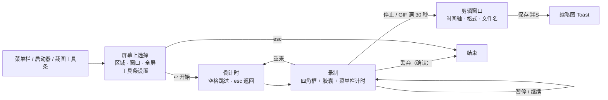

# 录屏改版：从「先填表」到「在屏幕上直接录」（GUL-366）

> 状态：设计稿，待确认。可交互设计稿：`docs/design/screen-recording-redesign.html`（`?s=<id>` 打开某一屏，`?solo=<id>` 只显示一屏，`?light=1` 浅色，`?glass=1` Liquid Glass）。截图在 `docs/design/screen-recording-redesign/`（另有 `light-editor` `light-glass-region` `glass-recording` 三张主题样例）。
>
> 这一阶段只出设计，不改代码。功能范围不变（区域 / 屏幕 / 窗口，MP4 / GIF，系统声音、麦克风、摄像头画中画，暂停，剪辑，恢复），改的是交互模型和视觉。

## 0. 一页结论

现在的问题不在功能，而在**交互模型**：录屏被做成了三个系统表单窗口（准备 540×740、录制中 460×280、预览 680×660）。用户要先读完一张表，再去屏幕上操作；录制中有一块大窗口挡在桌面上；剪辑只能靠两根滑块和秒数输入框。截图是「在屏幕上直接操作」的浮层，录屏却是另一套设计语言。

| | 现在 | 改版 |
|---|---|---|
| 开始 | 弹出表单；区域还要再点「框选区域…」；屏幕叫 “Display” | 直接进入屏幕上的选择，和截图一样框选；窗口悬停高亮、点一下选中；全屏点哪块屏录哪块 |
| 设置 | 四张卡片，长说明常驻 | 一条和截图工具栏同款的工具条；次要项收进「选项」弹层；底部一行摘要写明最终输出 |
| 摄像头 | 下拉选「右下」+ 滑块 22% + 示意图 | 选区里出现实时画面，拖到哪个角就是哪个角，拖角改大小 |
| 录制中 | 大窗口 + 三行重复状态 + 含义不明的 “⋯” | 录制范围四角红框（不压暗）+ 一枚胶囊（计时、电平、暂停、重来、丢弃、停止）+ 菜单栏计时 |
| 剪辑 | 两根滑块 + 两个秒数框，黑边预览 | 缩略图时间轴 + 两端把手 + 声音波形，`I` / `O` 设起止，`空格` 播放 |
| 保存 | 「保存位置 saved」 | 文件名可改，显示尺寸 / 帧率 / 预计大小；保存后右下角缩略图 Toast，可直接拖进其他应用 |

**建议分 4 个 PR**，每个都能单独验收：R1 屏幕上的选择 + 工具条 → R2 倒计时、录制胶囊、菜单栏 → R3 剪辑窗口 → R4 Toast 与恢复。

## 1. 设计原则

1. **在哪录，就在哪设置**。选区、窗口、屏幕都在屏幕上直接点选，不在表单里描述。
2. **默认就能录**。打开即是上次的设置，`↩` 直接开始；所有开关都是一键切换，不需要先读说明。
3. **说结果，不说规则**。用一行摘要（`1120 × 680 · MP4 · 30 FPS · 系统声音 + 麦克风 · 倒计时 3 秒`）代替长段说明；限制在用户碰到时才出现（例如 GIF 下声音按钮变灰，悬停说明）。
4. **录制时不打扰**。不压暗、不弹窗，只保留四角框和一枚胶囊；两者都不会被录进去。
5. **和截图是一套东西**。工具条、弹层、提示、Toast 直接用截图浮层的组件和 token，跟随 Classic / Liquid Glass 与明暗。

## 2. 流程

入口不变：菜单栏「录屏」、启动器 `lp` / `录屏` / `gif`（`gif` 直接以 GIF 格式打开）、截图工具条的「录屏」（直接沿用截图里框好的区域）。

## 3. 各屏说明

### 3.1 选择（截图 `region` `window` `display`）

- 进入后全屏覆盖一层和截图相同的选择浮层，默认上次的来源。
- **区域**：拖动框选；选区可移动，8 个把手改大小；左上角显示点数尺寸。最小 40 × 40 pt，小于时「开始录制」置灰。
- **窗口**：悬停的窗口高亮（蓝色描边 + 浅蓝蒙版），中央显示窗口标题、应用名和像素尺寸；点一下选中。录的是独立窗口，被遮挡、移动时仍能录到（沿用现在的 ScreenCaptureKit 窗口采集）。
- **全屏**：整块屏幕高亮。多显示器时每块屏幕各自显示名称和尺寸，点哪块录哪块，取代 “Display” 下拉框。
- 键盘：`↩` 开始、`esc` 取消、`⇥` 在区域 / 窗口 / 全屏之间切换。

### 3.2 工具条（截图 `region` `options` `gif` `perm`）

固定在当前屏幕底部中间（和系统 ⇧⌘5 一样，可拖走），开始后立即隐藏。从左到右：

| 组 | 内容 | 说明 |
|---|---|---|
| 来源 | 区域 · 窗口 · 全屏 | 分段按钮，带图标和文字 |
| 格式 | MP4 · GIF | 切到 GIF：声音按钮变灰，悬停提示「GIF 不含声音」；摘要变成「GIF · 10 FPS · 无声 · 最长 30 秒」 |
| 声音 | 系统声音、麦克风 | 图标开关。悬停说明范围（「不含 Typeflux 自己的声音；录窗口时为该应用全部声音」）。麦克风开启时显示 4 格实时电平，让用户确认「有声音进来」 |
| 摄像头 | 画中画开关 | 打开后选区内出现实时画面（见 3.3） |
| 选项 | 弹层 | 画质（MP4：720p / 1080p / 1440p / 4K；GIF：小 / 标准）、帧率（24 / 30 / 60，GIF 固定 10）、倒计时（关 / 3 / 5 / 10 秒）、鼠标指针、保存位置。弹层底部写明实际输出尺寸，并说明「只缩小不放大」 |
| 动作 | ✕ 取消、● 开始录制 | 开始按钮是工具条上唯一的红色元素 |

工具条下方一行摘要 + 快捷键提示，所见即所得地说明会得到什么文件。

**权限前置**：麦克风 / 摄像头未授权时，对应按钮右上角显示黄点；点开说明去哪里开，授权后回到这里自动生效，也可以「这次不录麦克风」。不再等用户点「开始」后才弹错误。屏幕录制权限缺失时沿用现有的 `ScreenshotPermissionGuideController`。

### 3.3 摄像头（截图 `camera`）

- 打开开关时请求摄像头权限并显示**实时画面**（现在是「只预览布局，开始时才请求权限」——用户刚打开摄像头，此时请求最自然，也能先看到自己的画面）。
- 拖动画面，松手吸附到最近的角（仍映射到 `cameraCorner` 四个值）；拖右下角改大小，范围 12%–40%（映射到 `cameraFraction`）。

### 3.4 倒计时（截图 `countdown`）

选区中央一个 132 pt 的圆形数字和进度环。`空格` 立即开始，`esc` 回到选择（设置保留）。倒计时为「关」时跳过。

### 3.5 录制中（截图 `recording` `paused` `giflimit` `discard`）

- **录制框**：四角红色角标 + 细边框，不压暗，用户可以照常操作下面的应用。窗口模式框跟随窗口。
- **胶囊**：放在录制范围下方；放不下时放上方，再不行放到范围内侧底部。胶囊和录制框都设为不被采集（沿用现有的排除窗口 ID 机制）。
  - `● 00:08` 计时、麦克风电平、暂停 / 继续、重来、丢弃、停止。
  - 暂停：红点变黄、计时闪烁、边框变虚线，并显示「已暂停」。
  - GIF：计时后显示「/ 00:30」，底部细进度条；最后 5 秒变黄并提示「还剩 N 秒自动停止」。
  - 丢弃、重来：轻量确认弹层，默认按钮是「继续录制 / 取消」。
- **菜单栏**：红色 `■ 00:08`，点击即停止；暂停时变黄。
- 胶囊可拖动；位置只在这次录制内保留。

### 3.6 剪辑窗口（截图 `editor` `gifeditor` `export`）

一个 920 × 632 的窗口完成预览、剪辑和保存：

- **标题栏**：文件名（默认「录屏 日期 时间」，点击直接改名）、扩展名、MP4 / GIF 切换。
- **播放器**：按比例显示，不留大面积黑边；中央播放按钮。下方显示当前时间 / 总时长、来源和声音摘要。
- **时间轴**：
  - 10 张缩略图组成的胶片条 + 声音波形（GIF 显示「GIF 不含声音」，无声 MP4 显示「这段录制没有声音」）。
  - 两端蓝色把手拖动剪掉头尾，最短 0.5 秒；选区外压暗。
  - 播放头可点击、拖动；播放只在选区内进行。
  - 快捷键：`空格` 播放 / 暂停，`I` / `O` 把当前位置设为起点 / 终点，`⌘S` 保存。
  - 下方一行写明「保留 00:01.8 – 00:15.2 · 共 13.4 秒」和「恢复完整」。
- **GIF 超过 30 秒**：保存按钮置灰，同时给出两个可直接点的解决办法：「保留开头 30 秒」「改存 MP4」。
- **底部**：左侧「丢弃」（确认）；中间写明「MP4 · 1120 × 680 · 30 FPS · 约 3.3 MB」；右侧保存位置（点击更改）、复制（把文件放进剪贴板，可直接粘贴到聊天 / 邮件）、另存为…、**保存 ⌘S**。
- **保存中**：保存按钮原位变成进度条，可取消；时间轴锁定。

### 3.7 Toast 与恢复（截图 `saved` `recover`）

- 保存后剪辑窗口关闭，右下角弹出和截图同款的 Toast：缩略图（可直接拖进其他应用）、文件名、位置和大小，以及「在 Finder 中显示 / 复制 / 打开」。
- 上次未保存的录制（正常退出时保留的源文件），下次启动用同一个 Toast 提示：「打开剪辑 / 丢弃 / 稍后」，取代现在窗口里的「恢复录制」。

## 4. 实现影响（确认设计后）

数据模型基本不变：`ScreenRecordingOptions` 的字段都还在，只是从表单改为工具条和直接操作来编辑。采集、写入、导出、恢复的管线（`ScreenRecordingCapture` / `Writer` / `Exporter` / `Files`）不动。

| 部分 | 改动 |
|---|---|
| 选择浮层 | 复用 `ScreenshotOverlayController` 的选区交互；新增窗口悬停命中（`SCShareableContent` 窗口列表 + 屏幕坐标）与多显示器高亮。取代 `ScreenRecordingSetupView` |
| 工具条 | 新 `ScreenRecordingToolbar`（SwiftUI），复用 `ScreenshotEditorToolbar` 的 `glass`、分段按钮、图标按钮和弹层样式；摘要行由 `ScreenRecordingOptions` + 目标尺寸计算（可单测） |
| 摄像头预览 | 开关时请求权限，`AVCaptureVideoPreviewLayer` 显示在选区内；拖动吸附角、拖角改大小映射到现有字段 |
| 录制胶囊 | 非激活 `NSPanel`，加入现有采集排除列表；位置计算（下方 → 上方 → 内侧）为纯函数，可单测。取代 460 × 280 的控制窗口 |
| 菜单栏 | 现有录制状态项改为红色计时样式，暂停变黄 |
| 剪辑窗口 | `AVPlayerView`（无控件）+ 自绘时间轴；缩略图用 `AVAssetImageGenerator`，波形用 `AVAssetReader` 读音轨降采样；文件名、复制文件（`NSPasteboard` 写文件 URL）、预计大小为新增。取代 `ScreenRecordingPreviewView` |
| Toast | 扩展 `ScreenshotToastController`，增加缩略图、拖出文件和三个动作；恢复提示复用同一组件 |
| 文案 | 新增约 40 条，五种语言；删除不再使用的长说明 |

### 分 PR

1. **R1 选择 + 工具条**：区域 / 窗口 / 全屏的屏幕上选择、工具条、选项弹层、权限前置、摘要行。
2. **R2 录制中**：倒计时、录制框、胶囊、暂停 / 重来 / 丢弃、GIF 计时、菜单栏计时、摄像头实时画面。
3. **R3 剪辑窗口**：时间轴（缩略图、波形、把手、播放头、快捷键）、文件名、GIF 超长处理、保存进度。
4. **R4 Toast 与恢复**。

每个 PR 带单测（摘要计算、胶囊位置、时间轴时间 ↔ 坐标换算、修剪约束、GIF 30 秒校验、窗口命中）和 Classic / Liquid Glass × 明暗的原生窗口截图，新增代码覆盖率目标 90%。

## 5. 待确认

1. 工具条固定在**屏幕底部中间**（像系统 ⇧⌘5），而不是像截图那样贴在选区下方——录屏的选区常常很大或是全屏，贴边会遮住内容或来回跳。是否接受？
2. 摄像头改为**打开开关时**就请求权限并显示实时画面。
3. 「复制」放进剪辑窗口和 Toast（把文件放进剪贴板）。
4. 不在这次范围内：鼠标点击高亮、按键显示、麦克风设备选择（目前跟随系统默认输入）、圆形摄像头。需要的话可以排在 R4 之后。
