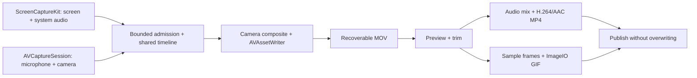

# Screen recording and GIF export

GUL-366 adds macOS screen recording to the existing screenshot feature. The approved scope includes system audio, microphone, pause/resume, independent window capture, camera picture-in-picture, preview, trimming, MP4 and GIF.

## User flow

Open **Screen recording** from the menu bar, use `lp` / `录屏` or `gif` in the launcher, or choose **Screen recording** in the screenshot toolbar's More menu after framing an unannotated region. Choose a display, an independent window, or a custom region. Configure the format, cursor, audio, camera position/size and countdown, then start.

The controls and an additional recording menu-bar item show elapsed time and offer stop. Pause excludes elapsed time from all media tracks. Stop opens a preview with start/end fields in seconds. Export uses the screenshot save directory; **Save to…** chooses another directory. Export errors leave the source available for another attempt. Discarding a recording requires confirmation. A normal app quit finishes active recording and leaves its source available in **Recover recording** on the next launch.

Setup separates Region / Screen / Window from file/sound and camera settings. Quality, frame rate, cursor and countdown live under More options. The footer keeps the primary action visible while settings scroll on small screens. Source names use display names and dimensions; region mode requires an explicit selection and never falls back to a whole display. Camera position is illustrated without opening the camera before Start.

The recording window shares the screenshot/launcher palette and the app's existing button and glass components. It follows Classic / Liquid Glass, light/dark appearance, reduced transparency and increased contrast. Preview shows the selected duration and save directory, keeps trim endpoints ordered, and disables invalid exports and edits during export. Permission actions open the relevant screen, microphone or camera settings. Recovered files are named by date rather than internal identifiers. See the UI review and native window screenshots in `docs/validation/gul-366/ui-review.md`.

MP4 records H.264, with optional system audio and microphone mixed into one AAC track on export. System audio for a window includes audio from the whole owning app. Typeflux's own playback is excluded. GIF is silent, 10 FPS, longest edge up to 960 pixels and at most 30 seconds; a GIF recording automatically stops at that duration, excluding pauses. A longer MP4 recording can also export a GIF after selecting a segment of at most 30 seconds. Video resolution is capped at 3840 pixels on its longest edge; the default is 1920 pixels and 30 FPS. Resolution never increases the native source size.

Screenshot annotations do not apply to a live recording. The toolbar offers recording only before annotating the region. Window capture follows the actual window; region capture stays fixed on its display. Only one capture/export session is active at a time.

## Implementation

- `ScreenRecordingCoordinator`: main-actor state machine, device permission checks, countdown, cancellation, preview and export. Region selection reuses the existing screenshot overlay. The coordinator's native services and presenter callbacks are injectable for tests.
- `ScreenRecordingCapture`: ScreenCaptureKit for displays, regions and independent windows; AVCaptureSession for camera and microphone on macOS 13+. Device work and callbacks run off the main thread. Capture callbacks are converted to host-clock timestamps. Screen controls use a stable excluded window identifier.
- `ScreenRecordingWriter`: serial AVAssetWriter, H.264 video plus separate AAC source tracks in a recoverable MOV intermediate. Bounded callback admission prevents unbounded retained frame queues. A shared timeline removes pauses; late paused samples are discarded. The last video frame is extended to the stop time. Camera callbacks generate composites even when the screen is static.
- `ScreenRecordingExporter`: AVMutableComposition / AVAudioMix and AVAssetExportSession produce a portable MP4 with one mixed audio track. Sequential AVAssetImageGenerator reads feed an ImageIO GIF destination with frame delays and infinite looping. Cancellation removes incomplete exports while retaining the source.
- `ScreenRecordingFiles`: session directories under Application Support, recoverable sources, and publishing via a staging file in the destination directory. Existing files are never overwritten.
- `ScreenRecordingView` and window controller: native SwiftUI setup, compact controls, preview and save result, plus an excluded region border and menu-bar stop control.

Screen recording permissions follow the existing provider. Camera permission is requested only when camera capture is enabled; microphone permission is requested only for MP4 with microphone enabled. App bundle usage descriptions and all signing entitlement variants include camera access. Screen recording settings persist in the existing UserDefaults store. No server changes, uploads, or third-party encoder binaries are introduced.

## Validation and limits

Tests use synthetic video and two audio frequencies to exercise the real AVFoundation and ImageIO paths without asking for access to a user's screen or devices. They check decodable output, audio track mixing, dimensions, duration, static tails, pause removal, camera updates on a static screen, trim behavior, GIF looping/delays, cancellation, recovery and collision-safe saves. Mocked coordinator tests exercise permissions, startup failure, interlocks, selection, late callbacks, partial recording and export failure. Native views are rendered in tests. Validation results and images are in `docs/validation/gul-366/`.

Hardware capture still requires manual validation with screen/camera/microphone permission on the supported OS versions. Camera/microphone use the system default devices. Window resize, minimize, display removal, device disconnect, HDR sources and long-duration memory/CPU should be included in that pass. macOS 14+ uses the explicit ScreenCaptureKit aspect-ratio setting; macOS 13 uses its compatible scaling configuration. Video files are SDR. Crashes before the MOV container is finalized are not guaranteed recoverable. ImageIO may retain internal GIF state even though application-side frame reads are sequential; the GIF duration/size cap bounds the work but is not a measured memory guarantee.

## References

- [CleanShot X features](https://cleanshot.com/features): capture scope, format and recording control interaction; no claim about its private internals.
- [ShareX recording implementation](https://github.com/ShareX/ShareX/blob/master/ShareX.ScreenCaptureLib/ScreenRecording/ScreenRecorder.cs): separate recording/export stages, disk intermediates and GIF conversion.
- [Apple: Meet ScreenCaptureKit](https://developer.apple.com/videos/play/wwdc2022/10156/): native filtered screen/audio samples.
- [Apple: Take ScreenCaptureKit to the next level](https://developer.apple.com/videos/play/wwdc2022/10155/): capture performance and audio filtering.
- [Apple: ImageIO destinations](https://developer.apple.com/library/archive/documentation/GraphicsImaging/Conceptual/ImageIOGuide/ikpg_dest/ikpg_dest.html): image destinations, properties and finalization.
