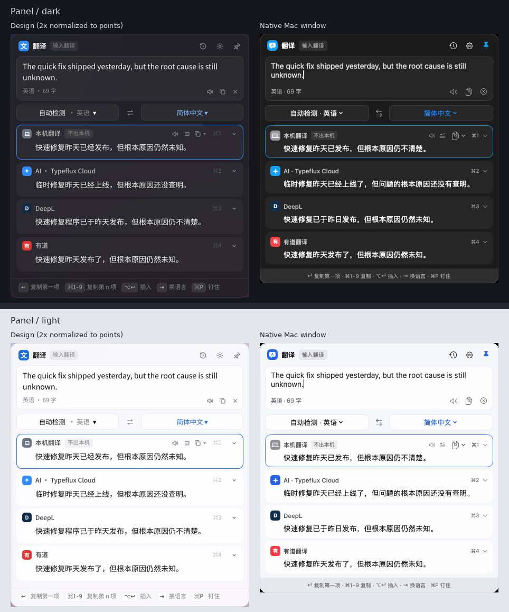
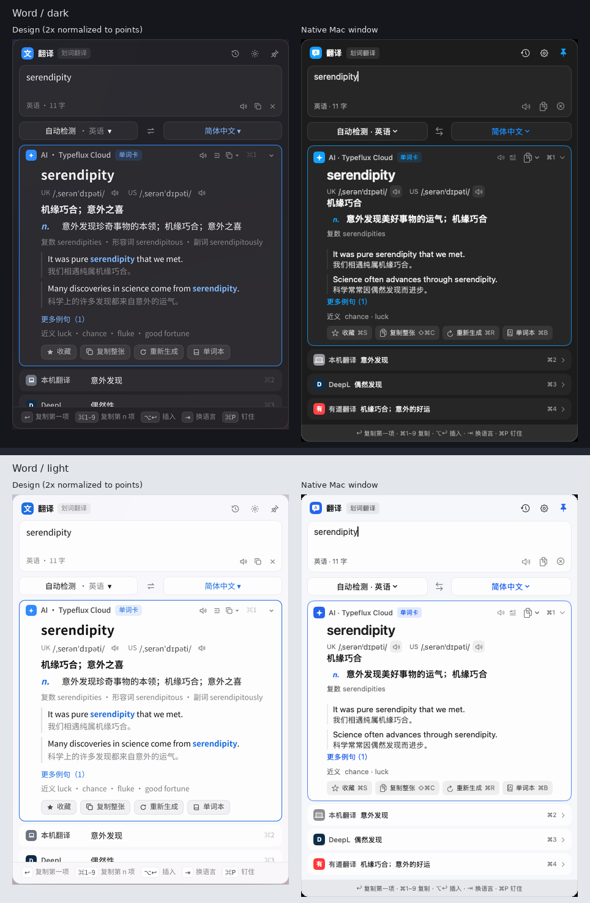
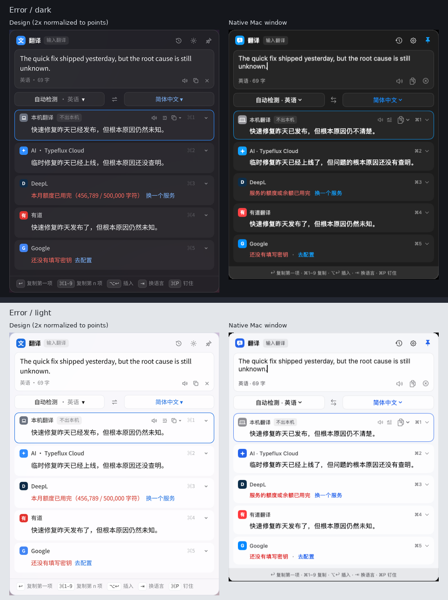
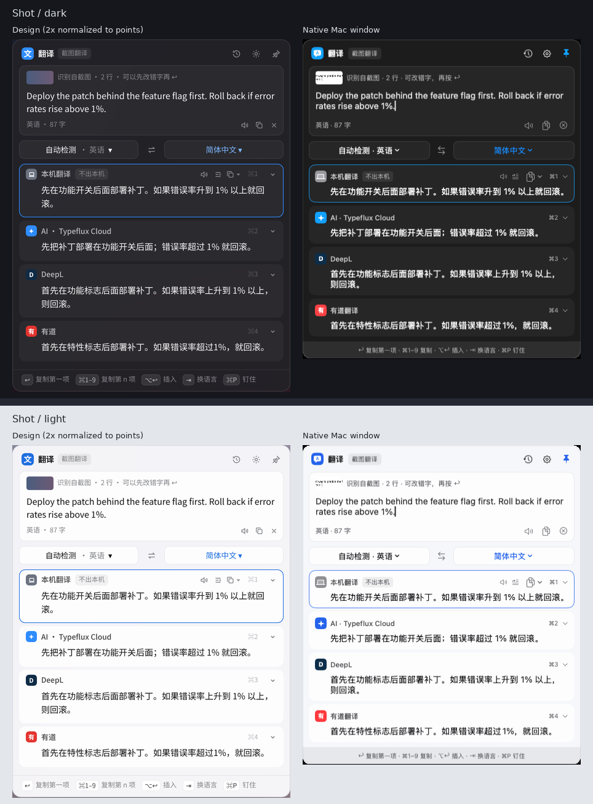
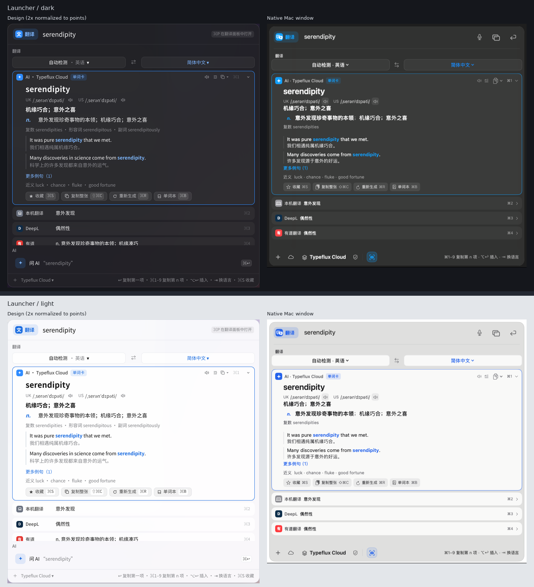
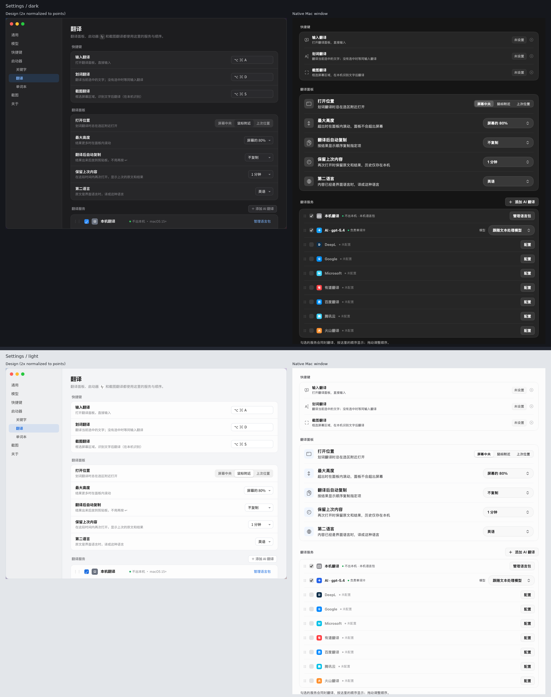

# 翻译与单词释义重构：多服务翻译面板（GUL-369）

> 状态：已实现（GUL-369，P1–P3）。配套可交互设计稿：`docs/design/translation-panel.html`（`?s=panel|word|error|shot|launcher|settings` 打开某一屏，`?light=1` 浅色，`?solo=1` 只显示画面）。截图在 `docs/design/translation-panel/`。
>
> 设计稿中的译文、密钥状态和额度都是模拟数据。为了演示对照效果，设计稿默认勾选了 DeepL 和有道，两个快捷键也填了演示值；正式默认值见 §4 和 §10。

## 0. 一页结论

| | 方案 |
|---|---|
| 形态 | 新增可钉住的**翻译面板**（独立浮窗）。启动器 `fy` 继续保留，两者共用同一套结果列表 |
| 结果 | 勾选的服务**同时翻译**，按用户设定的顺序排成一列；每一项都能单独收起、朗读、复制、插入，失败也只影响自己那一项 |
| 入口 | 三个全局快捷键：**输入翻译**、**划词翻译**、**截图翻译**；外加启动器 `fy`（⌘P 移到面板） |
| 单词释义 | 单词和短语由**排在最前的 AI 服务**写单词卡，单词卡**置顶**；其它服务收成一行简短译文，方便对照。单词本里已有的词直接显示，不再请求 AI |
| 设置 | 「设置 → 启动器 → 翻译」改为：快捷键、面板行为（位置 / 最大高度 / 自动复制 / 保留上次内容 / 第二语言）、服务列表（勾选、拖动排序、AI 可添加多个并各选模型） |
| 隐私 | 不变：本机翻译和单词本不出本机；AI 与第三方服务只在**明确操作**（↩、翻译快捷键、截图翻译）后发送 |

## 1. 重构前的现状与差距

重构前的翻译是启动器的关键字插件（`AskTranslatePlugin`，`fy` / `tr` / `翻译`，`dict` 打开单词本），GUL-255 加了翻译模型和 7 家服务商。

| 能力 | 现在 | 竞品（参考图） | 本方案 |
|---|---|---|---|
| 结果来源 | **一次只用一个引擎**：单词本 → 本机 → 首选引擎；⌘R 换 AI，⌘D 对照原文 | 多个服务同时翻译，并列显示 | 多服务并行，顺序可调 |
| 窗口 | 启动器，失去焦点就关闭 | 独立面板，可钉住、可拖动 | 独立面板 + 启动器，⌘P 互转 |
| 划词翻译 | 需要把 `fy` 绑到关键字快捷键上（「设置 → 快捷键」里的关键字快捷键） | 专用快捷键 | 专用快捷键，面板在选区旁打开 |
| 截图翻译 | 截图工具栏的「翻译」后续操作，结果进启动器 | 专用快捷键 | 专用快捷键，结果进面板；截图工具栏的「翻译」也改进面板 |
| 失败处理 | 服务商失败 → 整体改用 AI（`fallsBackToAI`） | 单项失败 | 单项显示原因和下一步，其它照常 |
| 单词释义 | AI 单词卡（音标、释义、词形、例句、近义词）+ 单词本，质量已优于竞品 | AI Dictionary 一项 + 其它服务译文 | 保留我们的单词卡，加上多服务对照 |
| 自动复制 / 保留状态 / 输入历史 | 无 / 无 / 启动器输入历史 | 有 | 有 |

结论：**单词卡、服务商接入、隐私规则都已具备，缺的是「多服务对照」和「随时可用、可钉住的翻译窗口」**。重构以复用为主，不重写引擎。

## 2. 需求理解

1. 翻译是高频的阅读辅助：读英文文档、写外文消息、看截图里的文字。用户需要**随手调出、对照几家结果、挑一个用**，有时还要**钉在旁边边看边写**。
2. 单个服务不可靠：机翻生硬、AI 偶尔过度意译、服务商会额度用完。并列对照比「失败了换一个」更省事。
3. 查单词要的是**释义**而不是一句译文：音标、词性、例句，最好能顺手收进单词本。
4. 已按确认方案完成三个阶段；设计稿保留用于交互与视觉对照。

## 3. 交互

### 3.1 翻译面板（截图 `panel`）

自上而下：

1. **标题栏**：「翻译」+ 来源标签（输入翻译 / 划词翻译 / 截图翻译 / 来自启动器）；右侧 历史、设置、钉住。拖动标题栏移动面板。
2. **原文框**：可编辑。↩ 翻译，⇧↩ 换行，↑ ↓ 翻历史（光标在开头 / 结尾时）。底部显示检测到的语言和字数，以及朗读原文、复制原文、清空（⌘⌫）。
3. **语言栏**：`自动检测 · 英语 ▾`  ⇄  `简体中文 ▾`。默认跟随现有规则（原文是界面语言时译成第二语言，否则译成界面语言）；手动选过的目标语言在本次面板会话内保持。⇥ 在常用目标语言之间轮换，⇄（⌘⇧S）交换并把第一条译文放回原文框。
4. **结果列表**：每个勾选的服务一项，标题行是 图标、名称（AI 写成「AI · 模型名」）、标签（「不出本机」「单词卡」）、⌘n 序号、收起按钮；悬停或选中时显示 朗读、插入、复制 ▾（复制译文 / 复制原文 + 译文 / 复制整张单词卡 / 插入到原应用）。
   - 本机和服务商的结果整段出现，AI 流式输出。
   - 收起后标题行显示一行预览；收起状态按服务记住。
   - 超过最大高度时列表在面板内滚动，面板不会超出屏幕。
5. **底部提示**：↩ 复制第一项 · ⌘1–9 复制第 n 项 · ⌥↩ 插入 · ⇥ 换语言 · ⌘P 钉住。

默认宽度与启动器一致（700pt），可拖动边缘调整，最小 520 × 300pt；记住宽度和视口高度上限。短内容自动收拢，长内容在用户大小与「最大高度」共同限定的范围内滚动。外观实时跟随全局 Liquid Glass / Classic、玻璃强度和深浅色设置；玻璃材质、16pt 圆角、边框、原生窗口阴影、17pt 输入字体与启动器共用组件，Classic 卡片为不透明表面，提高对比度或减少透明度时使用既有回退规则。

**钉住**：未钉住时，失去焦点或按 esc 关闭（与启动器一致）；钉住后切到别的应用也保持显示，再按一次快捷键把焦点拉回面板。

### 3.2 划词翻译与单词释义（截图 `word`、`light-word`）

- 统一的「翻译」快捷键：读取选中的文字（复用启动器的取选区逻辑），按「打开位置」设置打开面板并**立即翻译**（快捷键本身就是明确操作）。没有选中文字时等同于输入翻译。
- 原文是单词或短语时（沿用 `AskWordCard.isLookup`）：
  - **排在最前的 AI 服务**写单词卡，单词卡**置顶**，序号是 ⌘1。卡片内容沿用现有 `AskWordCard`：标题词、UK / US 音标（各自可朗读）、简明译文、按词性的释义、词形、2 条例句（「更多例句」展开第 3 条）、近义词。
  - 卡片底部：收藏（⌘S）、复制整张（⇧⌘C）、重新生成（⌘R）、单词本（⌘B）。
  - 其它服务收成**一行**：图标 + 名称 + 简短译文，用来对照。
  - 单词本里已有这张卡时直接显示（标「单词本」），不请求 AI；⌘R 才重新生成。
- ⌥↩ 在划词场景下**替换选中的文字**，与现在的写回规则一致。

### 3.3 服务失败（截图 `error`）

失败只影响那一项，说明原因并给出下一步：

| 原因 | 显示 | 操作 |
|---|---|---|
| 未配置密钥 | 还没有填写密钥 | 去配置（打开密钥表单） |
| 密钥错误 | 密钥无效 | 去配置 |
| 额度用完 | 本月额度已用完 | 换一个服务（本次会话跳过它） |
| 网络 / 超时 | 网络连接超时 | 重试（只重试这一项） |
| 本机语言包未下载 | 下载本机翻译语言包（英语 → 简体中文） | 下载（系统 Translation 授权下载，完成后仅重试本机；系统不可用时打开语言与地区设置） |
| 不支持的语言 | 不支持日语 → 韩语 | 无 |

多服务并列后，「服务商失败时改用 AI」不再需要，从设置里移除（见 §6）。

### 3.4 截图翻译（截图 `shot`）

快捷键 → 框选区域（复用截图模块的选区）→ 用 Vision 在本机识别文字 → 打开面板，原文框上方注明「识别自截图 · n 行」并显示缩略图。识别结果可以先改错字再按 ↩ 重新翻译。截图工具栏里现有的「翻译」后续操作（`ScreenshotFollowUp.translate`）也改为打开面板。

### 3.5 启动器 `fy`（截图 `launcher`）

- `fy 文本` 显示同一套结果列表（服务和顺序相同），语言栏在列表上方。
- ⌘P 把原文和结果移到翻译面板，并自动钉住。原来的 ⌘D「对照原文」保留。
- 现有规则不变：打字过程中只用本机和单词本做实时预览，AI 和服务商等 ↩ 后才发送；`fy` 单独输入时仍列出最近查过的单词；`dict` 仍打开单词本。
- 关键字的 `engine=deepl` 之类选项仍然有效：这时只用指定的那一个服务（方便做「只用 DeepL」的关键字）。

### 3.6 设置（截图 `settings`、`settings-services`）

「设置 → 启动器 → 翻译」：

- **快捷键**：翻译、截图翻译，默认都不设置（避免与用户已有的快捷键冲突），在这里或「设置 → 快捷键」录制，冲突检查走 `HotkeyConflictChecker`。
- **翻译面板**：打开位置（屏幕中央 / 鼠标附近 / 上次位置；所有入口统一遵循，屏幕由选区或鼠标确定，钉住后保持原位）、最大高度（屏幕的 60% / 80% / 整个屏幕）、翻译后自动复制（不复制 / 原文 / 第一 / 第二 / 第三项服务）、保留上次内容（不保留 / 10 秒 / 1 分钟 / 5 分钟 / 一直）、第二语言。
- **翻译服务**：一个列表，勾选 = 参与翻译，拖动 ⋮⋮ 排序（同时决定 ⌘n 序号和自动复制的「第 n 项」）。
  - 本机翻译：显示「不出本机 · 已安装语言包」，「管理语言包」跳到系统设置。
  - AI 翻译：可以「＋ 添加 AI 翻译」多条，每条选一个模型（来自「设置 → 模型」）；第一条可以换模型但不能删除。状态写明哪一条「负责单词卡」。
  - 服务商：已配置 / 未配置，「配置 / 编辑」打开现有的密钥表单（`AskTranslationProviderSheet`，含测试连接）。勾选一个未配置的服务时直接弹出表单。

## 4. 隐私与费用

- 本机翻译、单词本、截图文字识别都在本机完成。
- AI 和服务商只在明确操作后发送：面板里按 ↩、按翻译快捷键、截图翻译、启动器里按 ↩ 或 ⌘R。启动器打字时的实时预览仍然只用本机。
- 并行会让每次翻译调用多个付费服务。默认只勾选**本机翻译 + 第一条 AI**（与现在的行为相当），服务商由用户自己勾选；列表下方写明「勾选的服务会同时调用」。
- 密钥仍只存钥匙串；历史记录只保存在本机，可以在面板的历史菜单里清空。

## 5. 键盘

| 按键 | 行为 |
|---|---|
| ↩ | 原文框有改动时翻译；否则复制第一项并关闭（未钉住时） |
| ⇧↩ | 原文换行 |
| ⌘1–9 | 复制第 n 项 |
| ⌥↩ | 把当前项写回原应用（划词时替换选区） |
| ⌘↑ / ⌘↓ | 在结果之间移动当前项 |
| ⇥ / ⇧⇥ | 下一个 / 上一个目标语言 |
| ⌘⇧S | 交换语言 |
| ⌘R | 当前项是 AI 时重新生成 |
| ⌘S / ⇧⌘C / ⌘B | 单词卡：收藏 / 复制整张 / 打开单词本 |
| ⌘P | 钉住 / 取消钉住；在启动器里是「移到面板」 |
| esc | 未钉住时关闭；钉住时先清空原文框，再按一次关闭 |

## 6. 架构

| 组件 | 职责 | 来源 |
|---|---|---|
| `AskTranslationService` | 一个可勾选的服务：`device` / `ai(modelReference)` / `provider(AskTranslationProvider)`，带 `id`、`enabled` | 新增，取代 `AskTranslationEngineChoice` |
| `AskTranslationSettings` v2 | `services: [AskTranslationService]`（顺序即显示顺序）、`autoCopy`、`keepState`、`panelPosition`、`maxHeight`；`ask.translation.settings.v2` | 扩展现有结构 |
| `AskTranslationFanout` | 对勾选的服务并行调用（`TaskGroup`），按服务发布 `loading / streaming / done / failed`；新输入取消上一轮；按 generation 丢弃过期结果；单词由第一条 AI 走 `AskWordLookingUp`，其它走 `translate` | 新增，复用 `AskTranslationEngine`、`AskServiceTranslationEngine`、`AskTranslationLLMService` |
| `AskTranslationStackView` | 语言栏 + 结果列表 + 单词卡（复用 `AskWordCardView` 的内容部分） | 新增，面板和启动器共用 |
| `AskTranslationPanelController` | `NSPanel`（非激活、可成为 key、可钉住），位置 / 高度 / 保留内容 / 历史 | 新增，参考 `ClipboardPanelController` |
| `AskTranslatePlugin` | 启动器里改为显示 `AskTranslationStackView`（同日历、系统监控的插件自带界面做法）；保留 `plan` 里的隐私规则、最近单词、`dict` | 修改 |
| 快捷键 | 两个翻译 `HotkeyTarget`，出现在「设置 → 快捷键」 | 修改 `SettingsStore+Hotkeys` 等 |
| 截图翻译 | `ScreenshotFollowUp.translate` 改为把识别结果交给面板 | 修改 |

**设置迁移**（读取 v1，写入 v2，v1 保留不删以便回退）：

- `prefersOnDevice = true` → 勾选「本机翻译」，排第一。
- 首选引擎是 AI → 勾选「AI · 翻译模型」（`modelReference` 原样带过来）；是某个服务商 → 勾选该服务商，AI 也勾选，排在它后面（单词卡仍由 AI 生成，与现在一致）。
- 其余已配置的服务商出现在列表里但不勾选；`fallsBackToAI` 不再使用。
- 旧翻译快捷键合并：优先保留划词绑定，否则保留输入绑定，清除两个旧动作的归属；已迁移的「翻译」绑定保持不变，取消后不会复活旧绑定。
- 已经绑定到 `fy` 的关键字快捷键继续有效，不自动改成划词翻译快捷键。

## 7. 测试

- **设置**：v1 → v2 迁移的每种组合；编码解码；删除了的模型引用仍然保留并标为不可用（与现在一致）。
- **Fanout**：用假引擎断言并行调用、顺序与完成先后无关、单项失败不影响其它、新输入取消旧任务、过期结果丢弃、单词只由第一条 AI 生成单词卡、单词本命中时不调用 AI。
- **隐私**：启动器打字的实时预览只调用本机引擎；面板 ↩、快捷键、截图翻译才调用 AI / 服务商。
- **面板**：钉住 / 失焦关闭、保留上次内容的计时、历史 ↑ ↓、自动复制选中第 n 项、最大高度。
- **交互**（沿用 `AskQuickResultsInteractionTests` 的写法）：⌘1–9、⌥↩ 写回、⇥ 换语言、⌘P、单词卡的 ⌘S / ⇧⌘C / ⌘R。
- **截图测试**：面板的句子、单词、失败、截图翻译，深浅两种外观。
- 新代码覆盖率 ≥ 90%，按 `CLAUDE.md` 的测试策略只跑相关套件。

## 8. 分期

| 阶段 | 内容 | 验收 |
|---|---|---|
| **P1 多服务结果** | 设置 v2 + 迁移、服务列表（勾选 / 排序 / 多条 AI）、`AskTranslationFanout`、`AskTranslationStackView`，先用在启动器 `fy` 里 | `fy hello` 同时看到本机、AI、DeepL 的结果，单词卡置顶 |
| **P2 翻译面板** | 面板、钉住、两个快捷键、自动复制、保留内容、历史、启动器 ⌘P、截图翻译接入 | 选中文字按快捷键按位置设置看到对照结果，钉住后边看边写 |
| **P3 打磨** | 复制双语对照、单项重试 / 跳过、收起状态记忆、更多例句、浅色截图与文档 | 设计稿里所有交互可在真机走通 |

每个阶段一个 PR，带测试和截图。

## 9. 不在本轮

- 自定义 HTTP 翻译服务（竞品的「自定义」）：接口形态各异，先收集需求。
- 整页 / 文档翻译、在原文位置覆盖显示译文。
- 语音输入直接翻译（可以以后接到听写的改写流程里）。

## 10. 已确认的决定

1. 独立翻译面板与启动器 `fy` 共用结果列表。
2. 默认只启用本机翻译和第一条 AI；服务商由用户自己勾选。
3. 查词时单词卡置顶，其它服务默认收成一行。
4. 划词快捷键是明确操作，立即调用 AI 和服务商。
5. 移除服务商失败时整体改用 AI。
6. 两个翻译快捷键默认不设置，由用户录制。

## 11. 真机实现与验证

设计参考图仍保存在 `translation-panel/`。下面是 Mac 上实际 AppKit / SwiftUI 窗口的深浅色截图，与对应设计画面并排；译文与凭据状态由测试依赖提供，不调用真实付费服务。设置截图保留正式默认值，因此快捷键不设置、服务商不勾选。

| 画面 | 深色 + 浅色设计 / 真机对照 |
|---|---|
| 输入翻译 |  |
| 单词释义 |  |
| 服务失败 |  |
| 截图翻译 |  |
| 启动器 fy |  |
| 设置 |  |

测试范围、覆盖率、截图来源与自审结论见 [P3 验证记录](../validation/gul-389/README.md)。

P4 用户反馈修正的快捷键合并、统一定位、可调整大小与全局界面风格、语言包下载提示，以及四种外观的启动器 / 面板并排真机截图，见 [P4 验证记录](../validation/gul-392/README.md)。
