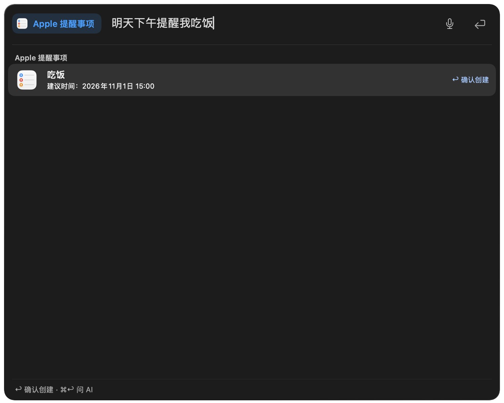

# Natural-language reminder creation — 2026-10-31

The reported sentence, `明天下午提醒我吃饭`, was rejected by a local date-format parser. Reminder creation did not previously invoke the configured AI model. The error was also used as the plan title, which made the launcher repeat it.

Reminder submission now uses the existing text-processing model and structured JSON output. Typing does not call the model or write a reminder. The context supplies the current instant, time zone and a 21-day weekday/date table. Dates are checked locally, including normalized invalid dates, DST gaps and elapsed times. Existing exact local shortcuts retain their previewed dates.

A precise time can create the reminder on submission. A vague period produces a suggestion first: the reported example becomes `吃饭`, with tomorrow at 15:00 for confirmation. Confirmation reuses that result without another model request. Missing information produces one short question. The current single-reminder backend does not silently turn recurring or multiple tasks into a one-off reminder.

The confirmation is bound to the input and time zone. Editing the input clears it; cancellation and expired times cannot submit a stale preview. Native creation still happens through the existing argument-based AppleScript service. An uncertain write receipt offers no automatic write retry.

The UI contains the task, an explicitly suggested time and the create action. It removes the extra explanatory footer. The proposed time uses primary text contrast through an opt-in result-row property; other rows retain their existing appearance. Notes continue to save the user's text. Five localizations replace the format instructions with natural-language guidance. A size guard remains for exceptionally large inputs and is only shown when exceeded.

## Focused validation

- `make test SUITE="AppleReminderInterpreterTests AppleProductivityTests AskPluginSessionTests AskPromptPluginTests"`: 32 test methods in four suites passed. This covers interpretation and clock context, malformed output, invalid/past dates, DST, cancellation, input edits, confirmation reuse, native Return handling and duplicate-write prevention; existing note creation, local shortcuts and prompt streaming are also covered. Total guarded command wall time: **284.71 s**, including rebuild, discovery and execution. The initial attempt stopped at a test-only optional-chaining compile error (**252.25 s**); it was corrected before rerunning the same scope.
- Explicitly opted-in `AppleReminderLiveModelTests`: the user's currently selected custom text-processing model interpreted the actual reported sentence as `吃饭`, suggested the following day at 15:00, and passed the structured-response decoder. Total guarded command wall time: **35.81 s**; model/test execution was 1.188 s. Model preferences were cloned into a disposable domain and credentials were read without permission dialogs. The private context and temporary signed probe were removed. This smoke test constructs no reminder-writing service and creates no real reminder.
- After native UI review, only the two proposal/Return methods were repeated for the shorter wording and Chinese capture: **2 passed**, total guarded command wall time **85.22 s**. The parser and model bridge were unchanged.
- The final contrast adjustment is verified with the proposal/Return methods plus `AppleProductivitySearchTests`, which exercises existing default result rows and permission/list/preview behavior. **13 methods in two suites passed**, total guarded command wall time **91.51 s**.
- All five edited localization files pass `plutil -lint`; the scoped diff passes `git diff --check`.

The focused checks do not claim full-suite coverage or a real installed-app write. The earlier unrelated launcher-suite baseline described in `validation.md` was not rerun.

## Native UI evidence

Captured from the native launcher fixture, using the real plugin factory and keyboard route with a recording creation service. The model is deterministic in this UI fixture; real-model interpretation is checked separately above.

## Installed development app

The feature commit was fast-forwarded into `main` while preserving 30 parallel working files and every unrelated localization value. The normal `make run` launcher rebuilt and installed the Debug development app from that working tree; its Swift source hashes remained stable throughout the build. Total installation/verification command wall time: **100.04 s**, including the backup, build, signing and launch.

Verification passed: a new binary with the same LC_UUID as the fresh Debug artifact, the reminder JSON schema in the installed executable, all five installed placeholders, deep/strict signature verification, unchanged designated signing requirement, entitlements, provisioning profile, transport policy and existing service configuration. The normal host process is running. The feature's Swift files also match commit `6d0c3329` exactly. Parallel work is retained in the installed app and excluded from the feature commit.

The actual model smoke test and native keyboard fixture passed separately. A real reminder was deliberately not created in the installed user's data store; this evidence does not claim an installed-app write/readback acceptance run.
