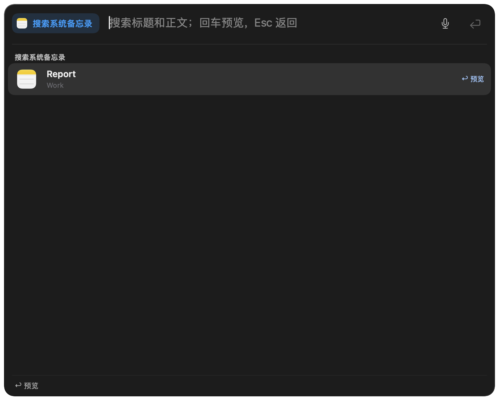
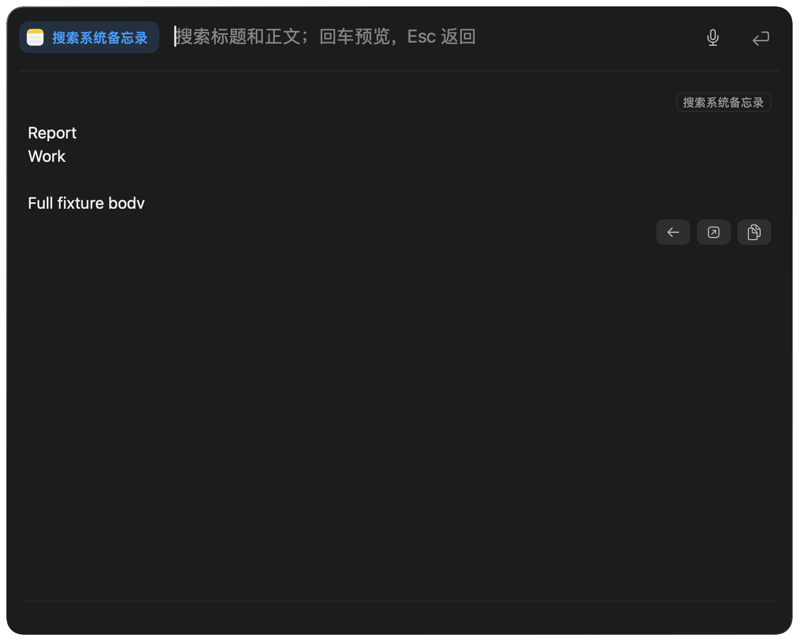
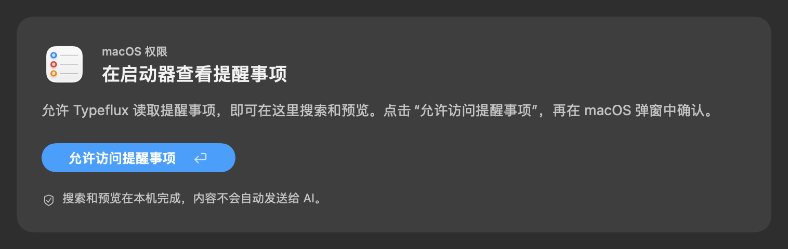

# Apple Notes and Reminders launcher search

`notes [query]` and `reminders [query]` browse existing system items. Return previews in the launcher, Escape returns to results, and Command-O opens the original. Tab switches reminders between incomplete and all items. Creation remains on `note` and `remind`.

Search and preview run locally. Notes use the application's automation interface; reminders use EventKit to avoid slow AppleScript collection traversal. Reminder access is requested from an explicit authorization action. Locked Notes expose titles only. The 30-result limit is applied after matching the complete scope; preview truncation is explicit.

## Focused validation

111 Swift test methods across 11 relevant suites passed, including necessary failed-method or smallest-suite retries. Five Node tests passed in 0.20 seconds. Both application Info.plist files and all five localization files passed `plutil -lint`.

- `AppleProductivitySearchTests`: search, native EventKit snapshots and dates, locked and truncated previews, completion scope, explicit authorization, safe script arguments, stale responses, and real launcher keyboard routing with a fake service. The keyboard tests verify that no AI request is sent.
- `AppleProductivityTests`: existing creation behavior.
- `AskPluginSessionTests`: planning, cancellation, reruns, and request freshness.
- `AskKeywordMatcherTests`, `AskKeywordAliasTests`, `AskKeywordListPresentationTests`, `AskKeywordDraftTests`, `AskLauncherFeatureIconsTests`, and `AskLauncherFeatureSearchTests`: default migration, custom keyword preservation, settings, aliases, directory discovery, and icons.
- `AskOpenChatTests` and `AskLauncherPrimaryActionTests`: directly affected launcher shortcuts, activation protection, and existing chat behavior.
- `node --test scripts/tests/apple_productivity_browse.test.cjs`: full-text filtering, matching before the result limit, locked content, Unicode truncation, changing collections, and explicit-only native opening.

Total Swift command wall time, including build, discovery, runner preparation, execution, and failed retries: **1,291.91 seconds**. Initial build and its build-failure retry took 193.58 and 414.35 seconds. Subsequent focused rebuilds/retries took 110.04, 69.95, 98.65, 66.05, and 88.61 seconds; a verified build-cache method retry took 21.90 seconds. The final input-freshness regression after rebasing onto the latest main took 228.78 seconds. No full or unfiltered test run was used.

The first UI pass exposed Command-O being intercepted by the launcher's window shortcut. A rapid Escape/Return round trip also exposed the 250 ms duplicate-activation gate; search result generations now distinguish separate navigation actions. Command-O also checks the actual current input, composition, and active state before opening an item, and the keyboard test verifies that editing a query cannot open the previous item. The corresponding real keyboard tests pass. One existing home test had an outdated expectation that the complete launcher would not open Chat; the current home starts on the Chat tile. Its assertion was corrected to match the existing home behavior.

## Native acceptance

- Actual Apple Notes creation, body-only case-insensitive matching, bounded result data, and reading Chinese/emoji content passed in 2.57 seconds; the temporary note was removed.
- Temporary reminder probes were reconciled and removed. An additional probe marker returned zero active and zero completed matches in the native Reminders search; the original view was restored.
- The final optimized prebuild passed in 473.89 seconds of command wall time; an earlier optimized build took 426.30 seconds. The official installation script also completed its optimized build (405.91 seconds for the build phase) and launched Typeflux Dev. The complete installer wrapper wall time was not measured.
- Installed-app deep/strict code-signature verification passed. The existing service configuration, embedded provisioning profile, and designated signing requirement were compared with the pre-update app and preserved exactly.
- The computer-control interface could access Finder and Reminders but repeatedly returned `timeoutReached` for Typeflux by both application path and bundle identifier. Global-shortcut and explicit Finder-open attempts did not expose a Typeflux window to that interface. Installed-app search/preview/open and real EventKit reminder-store access therefore remain pending a manually opened launcher and any required system permission. Unit snapshots and the simulated authorization flow do not establish that acceptance.

## Synthetic UI evidence

These screenshots contain fixture data, not the user's notes or reminders.

