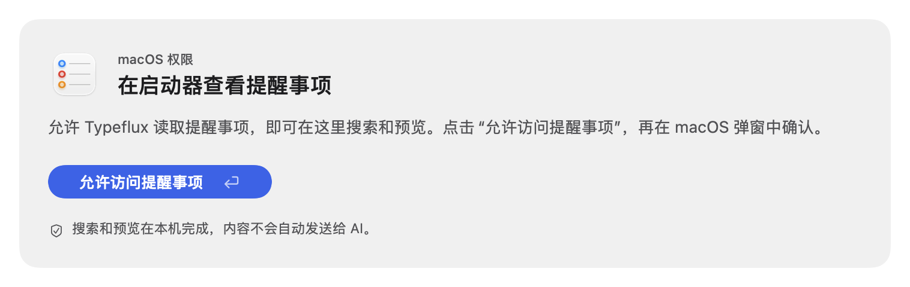
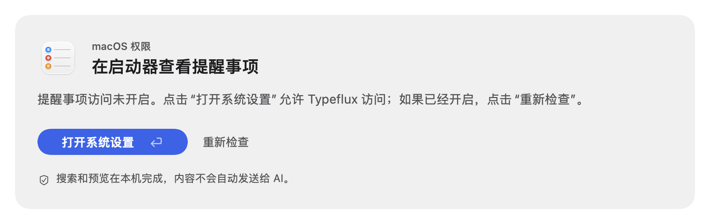
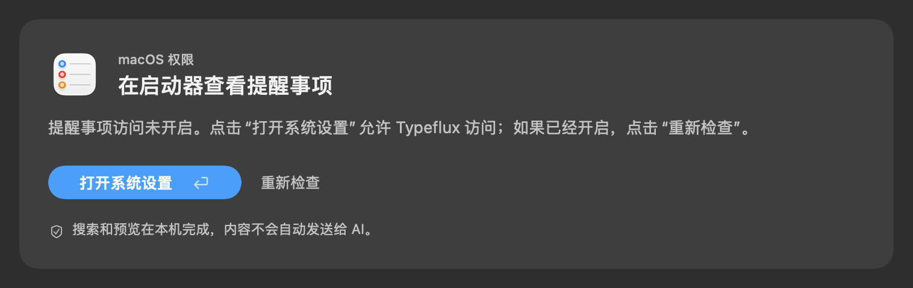

# Apple Notes and Reminders launcher search

`notes [query]` and `reminders [query]` browse existing system items. Return previews in the launcher, Escape returns to results, and Command-O opens the original. Tab switches reminders between incomplete and all items. Creation remains on `note` and `remind`.

Search and preview run locally. Notes use the application's automation interface; reminders use EventKit to avoid slow AppleScript collection traversal. Reminder access is requested from an explicit authorization action. Locked Notes expose titles only. The 30-result limit is applied after matching the complete scope; preview truncation is explicit.

## Focused validation

111 Swift test methods across 11 relevant suites passed, including necessary failed-method or smallest-suite retries. Five Node tests passed in 0.20 seconds. Both application Info.plist files and all five localization files passed `plutil -lint`.

- `AppleProductivitySearchTests`: search, native EventKit snapshots and dates, locked and truncated previews, completion scope, explicit authorization, safe script arguments, stale responses, and real launcher keyboard routing with a fake service. The keyboard tests verify that no AI request is sent.
- `AppleProductivityTests`: existing creation behavior.
- `AskPluginSessionTests`: planning, cancellation, reruns, and request freshness.
- `AskKeywordMatcherTests`, `AskKeywordAliasTests`, `AskKeywordListPresentationTests`, `AskKeywordDraftTests`, `AskLauncherFeatureIconsTests`, and `AskLauncherFeatureSearchTests`: default migration, custom keyword preservation, settings, aliases, directory discovery, and icons.
- `AskOpenChatTests` and `AskLauncherPrimaryActionTests`: directly affected launcher shortcuts, activation protection, and existing chat behavior.
- `node --test scripts/tests/apple_productivity_browse.test.cjs`: full-text filtering, matching before the result limit, locked content, Unicode truncation, changing collections, and explicit-only native opening.

Total Swift command wall time, including build, discovery, runner preparation, execution, and failed retries: **1,291.91 seconds**. Initial build and its build-failure retry took 193.58 and 414.35 seconds. Subsequent focused rebuilds/retries took 110.04, 69.95, 98.65, 66.05, and 88.61 seconds; a verified build-cache method retry took 21.90 seconds. The final input-freshness regression after rebasing onto the latest main took 228.78 seconds. No full or unfiltered test run was used.

The first UI pass exposed Command-O being intercepted by the launcher's window shortcut. A rapid Escape/Return round trip also exposed the 250 ms duplicate-activation gate; search result generations now distinguish separate navigation actions. Command-O also checks the actual current input, composition, and active state before opening an item, and the keyboard test verifies that editing a query cannot open the previous item. The corresponding real keyboard tests pass. One existing home test had an outdated expectation that the complete launcher would not open Chat; the current home starts on the Chat tile. Its assertion was corrected to match the existing home behavior.

## Native acceptance

- Actual Apple Notes creation, body-only case-insensitive matching, bounded result data, and reading Chinese/emoji content passed in 2.57 seconds; the temporary note was removed.
- Temporary reminder probes were reconciled and removed. An additional probe marker returned zero active and zero completed matches in the native Reminders search; the original view was restored.
- The final optimized prebuild passed in 473.89 seconds of command wall time; an earlier optimized build took 426.30 seconds. The official installation script also completed its optimized build (405.91 seconds for the build phase) and launched Typeflux Dev. The complete installer wrapper wall time was not measured.
- Installed-app deep/strict code-signature verification passed. The existing service configuration, embedded provisioning profile, and designated signing requirement were compared with the pre-update app and preserved exactly.
- The computer-control interface could access Finder and Reminders but repeatedly returned `timeoutReached` for Typeflux by both application path and bundle identifier. Global-shortcut and explicit Finder-open attempts did not expose a Typeflux window to that interface. At that initial installation, installed-app search/preview/open and real EventKit access remained pending. The follow-up below validates the actual EventKit backend with the existing grant; complete installed-launcher interaction remains unverified through computer control. Unit snapshots and a simulated authorization flow do not establish that acceptance.

## Synthetic UI evidence

These screenshots contain fixture data, not the user's notes or reminders.

## Reminder authorization follow-up — 2026-10-31

The user reported a successful first grant followed by another setup card on reopening; clicking authorization then loaded the list without another system sheet. Native EventKit logs confirm a successful full-access completion and subsequent successful fetches. The old implementation reset its store after granting, recreated the reader with launcher plugins, and used a synchronous preflight as the only access decision before initializing the lazy store. The exact transient preflight value was not captured; a later fresh-process probe already reported full access.

The reader now retains a shared connection and the SDK-confirmed grant, initializes the store before preflight, and silently reconnects through EventKit's actual completion before every read. Remembered confirmation permits an SDK recheck rather than bypassing authorization; a rejected completion clears it. Unknown first access still requires the explicit action. Authorization overrides are one-shot and do not follow Tab, preview, native opening, or edited queries.

A neutral permission card replaces the icon-only recovery entry for reminders. It provides the native application icon, a benefit-oriented title, concrete instructions, a prominent labeled button and Return hint, and readable local-processing information. Denied access offers a labeled settings button and recheck action. All five supported localizations are updated. Its measured height includes the privacy icon, and both foreground appearances have been rendered for required and denied states.

### Follow-up verification

29 Swift test methods across `AppleProductivitySearchTests`, `AskPluginSessionTests`, and `AskPluginViewTests` passed across the focused pass and targeted retries. Search tests cover SDK-confirmed access, stale preflight, revocation, shared-reader lifetime, one-shot authorization, a real content-button click, closing/reopening, preview, scope changes and no AI submission. Session tests cover rerun/cancellation and shared request state. View tests cover the shared failure renderer and actual native layout, including four required/denied and light/dark rendering cases.

Total follow-up test-command wall time, including preparation, build, discovery, execution and failed retries: **471.52 seconds** (182.29, 53.10, 67.49, 35.93, 54.34, 78.37). The first attempt exposed a side-effectful lazy accessibility traversal in the new test helper; it was replaced with a single-pass loop. Layout validation then exposed an unconstrained test-host width and a two-point privacy-icon height omission; both were fixed. A method selector initially omitted backticks present in discovered test identifiers and matched no tests; its corrected selector ran only the intended methods. Final visual review increased the privacy text contrast, added denied-state captures and restored the test accessibility flag. No full or unfiltered test run was used.

The actual `EventKitReminderBrowser.swift` was compiled into a temporary diagnostic bundle using the installed application's existing signing requirement and bundle identity. A full-access guard prevented requesting a new grant. Initial search, repeat/reopened search, detail reading, completed-item scope and a fresh store all passed against actual reminders in **2.14 seconds** including diagnostic compilation, signing and execution. No reminder content, identifiers or counts were emitted, and no items were created or changed. This validates the real backend rather than a mocked EventKit result; it does not substitute for complete installed-launcher UI acceptance.

The following foreground-state component screenshots contain fixture copy and use the real native view. The existing list and preview screenshots above also contain only fixture data.

### Installed follow-up

Source commit `43042e50` was installed and launched using the official `make run` path. The complete installer wrapper took **409.17 seconds**, including the **383.13-second** optimized build. Deep/strict signature verification passed. Existing service settings, designated signing requirement, runtime entitlements and embedded provisioning profile were preserved exactly. The installed executable UUID matches the release artifact and differs from the previous executable; its application host is running.

A post-install read-only backend check, guarded against requesting a new grant, again passed initial/reopened listing, preview, completed scope and fresh-store reconnect using the retained permission. Verification command wall time was **0.96 seconds**, including a 0.22-second diagnostic output-parser failure corrected before the successful 0.74-second run. The temporary diagnostic bundles were removed afterward. Complete installed-launcher interaction remains outside computer-control acceptance because that interface could not bind its menu-bar window; native-backed UI regression and synthetic screenshots cover the new controls and layout.

## Selected minimal permission design — 2026-10-31

Implemented the user's first selected visual: a centered native icon, benefit title, one short explanatory sentence and a labeled primary button. Permission setup uses a short input label/placeholder and omits the duplicate heading/footer. Denied access keeps the same hierarchy and its existing settings/recheck actions. No authorization backend behavior changed.

Four directly affected suites selected 138 test methods: `AppleProductivitySearchTests` covers authorization interaction/navigation, `AskPluginViewTests` covers shared rendering and twenty localized permission-state renders, `AskPluginReadingLayoutTests` covers shared section/reading behavior, and `AskQuickResultsInteractionTests` covers the shared window fixture and normal launcher controls. After targeted retries, 132 unique methods pass and six legacy methods retain 13 issues. A control restoring the three changed shared production UI files to pre-change HEAD reproduces all six failures and all 13 issues. The final permission-only retry passes both selected methods, including all twenty rendering states.

Total guarded test-command wall time, including build, discovery, desktop serialization, retries and the control: **676.26 seconds** (378.93, 107.29, 101.47, 88.57). The initial layout measurement failure and screenshot host's broad wrapper were corrected; the default host remains the original native type. Final visual calibration then passed its narrow retry. No unfiltered/full test run was used. Five localization resources pass `plutil -lint`.

Visual source, native captures and equal-size comparisons are in `minimal-permission/`. The scoped final visual report is appended to the root `design-qa.md`; visual result is passed. The remaining legacy failures and installed-app automation limit are explicitly retained in that report.
