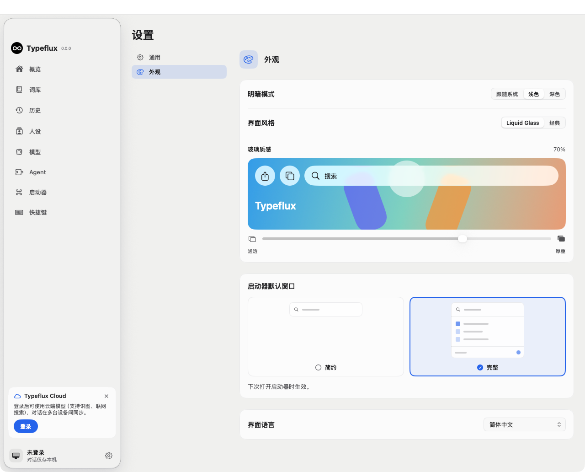
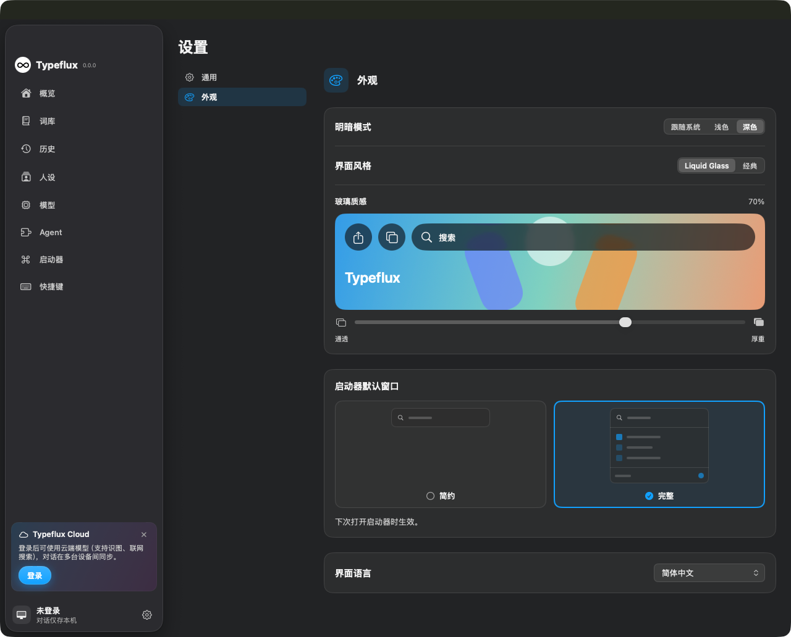
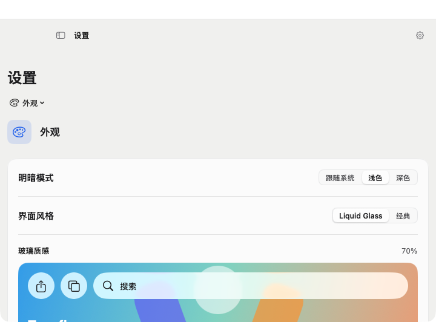

# Appearance settings validation

Settings now has General and Appearance panes. Appearance owns color mode, interface style, glass texture, the default launcher window, and interface language. Existing defaults and persistence keys are preserved.

## Checks

- Focused regression: **53 tests passed** (3 XCTest + 50 Swift Testing), including native menu tracking, all five languages, light/dark themes, settings navigation, persistence, accessibility restrictions, and next-opening launcher behavior.
- `plutil -lint` passed for all five localization files.
- Strict SwiftLint passed for the new views and the two appearance controls; `git diff --check` passed.
- LLVM line coverage from the focused run:

| File | Line coverage |
| --- | --- |
| `AppSettingsPane.swift` | 100% |
| `AppearanceSettingsView.swift` | 100% |
| `LiquidGlassIntensitySetting.swift` | 100% |
| `LauncherWindowModeSetting.swift` | 99.56% |
| Combined | 99.86% |

Focused command:

```sh
TYPEFLUX_SETTINGS_MENU_TESTS=1 swift test --no-parallel --enable-code-coverage --filter 'AppearanceSettingsTests|AskLauncherWindowModeTests|LauncherSettingsPolishTests|LiquidGlassIntensityTests|SettingsBehaviorTests|InterfaceStyleTests|AppLocalizationTests|SettingsMenuPickerTests|simpleWindowExpandsForTypingAndCollapsesWithoutLosingFocus|simpleModeOpensAnExistingDraftInTheFullWindow'
```

## Full regression limitations

`swift test --no-parallel --enable-code-coverage` completed:

- XCTest: 3,745 tests, 17 skipped, zero failures.
- Swift Testing: 2,573 tests in 390 suites, 11 failing tests with 34 reported issues.
- All appearance/settings suites affected by this change passed.

The following failing tests and the launcher/material implementations they exercise are unchanged from the checkout base, `f4b5f85c`. The full base suite was not separately rerun. Failures concern older fixed geometry/history expectations and a material color assertion; they remain unresolved in this PR.

| Suite file | Failing tests |
| --- | --- |
| `AskComposerChromeTests.swift` | `launcherUsesCompactCornersWithoutChangingHeaderLayout` |
| `AskLauncherDragTests.swift` | `doubleClickingTheTopEdgeCentresAndForgets` |
| `AskLauncherHomeTests.swift` | `recentConversationsAreNewestFirstAndLimitedToThree`, `applicationsFillTheSpaceBetweenHistoryAndKeywords` |
| `AskLauncherMotionTests.swift` | `controlsStayAttachedToTheirEdgesAsResultsChange` |
| `AskLauncherPlacementTests.swift` | `fixedLauncherIs800By600PointsAndCentredOnALargeDisplay`, `fixedLauncherFitsInsideASmallerDisplay`, `fixedLauncherRestoresAnAnchorAndClampsOutOfBoundsPositions` |
| `AskLauncherToggleTests+Steadiness.swift` | `theListKeepsItsHeightWhileMatchesComeAndGo` |
| `AskRedesignTests.swift` | `launcherHeightIsTheComposerCardPlusItsGutter` |
| `AskSurfaceOpacityTests.swift` | `glassFrostStaysDarkOverWhiteInBothMaterialPaths` |

The migrated window-mode and glass-intensity tests were updated to assert the current content-driven window sizing and existing 70% glass default. No production geometry or default was changed.

## Visual evidence

Captured from owned native test windows with system glass compositing; verified at 720×500, 1100×800, and 1280×1000 content sizes in both themes. Small windows retain the existing scrolling container and collapse the pane list into a menu.






