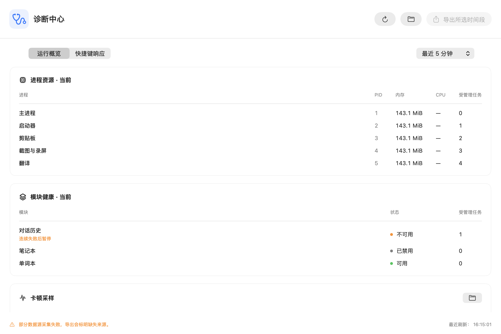
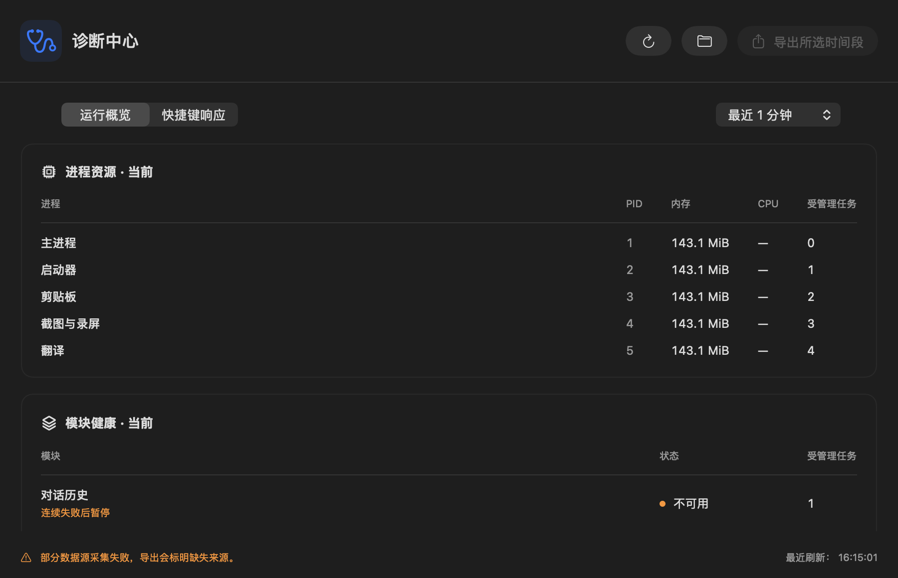
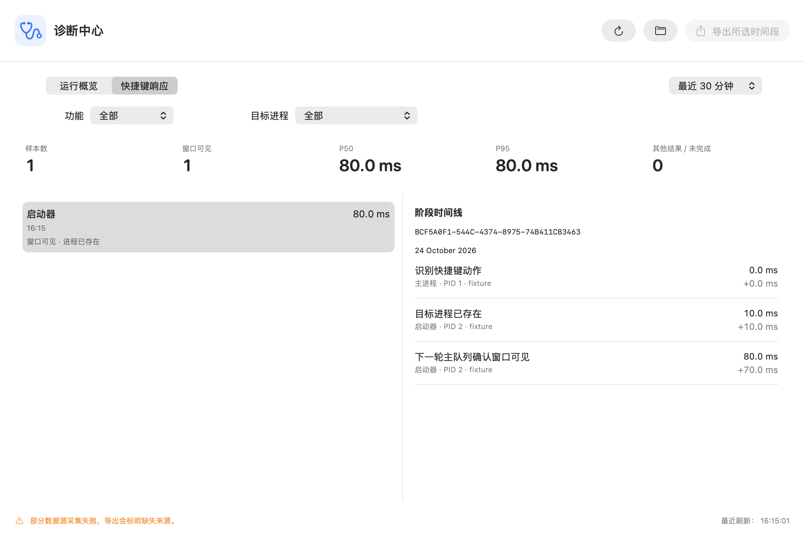
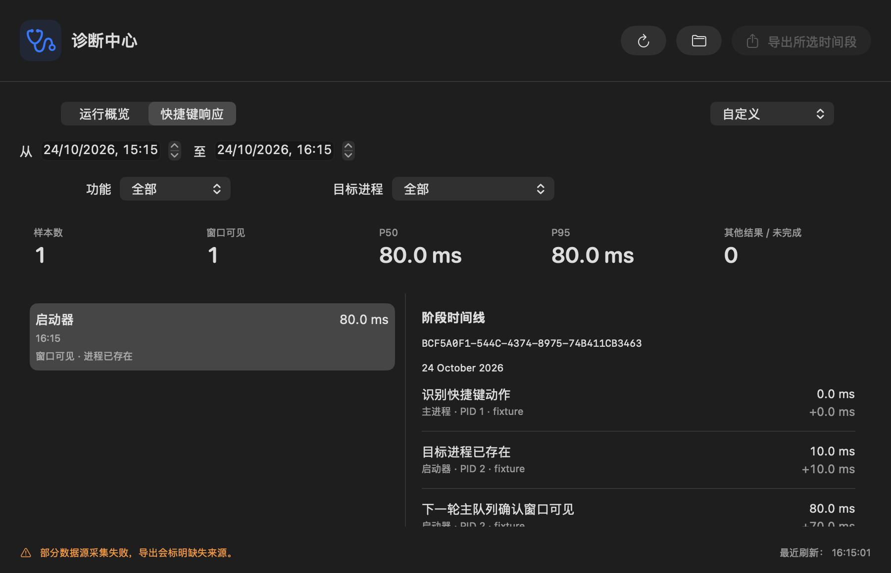

# Recent diagnostic exports and dashboard layout

The range menu adds the last 1, 5, 10, 15 and 30 minutes, defaulting to 5 minutes.
Hour, day, retained-data and custom selections remain available. All relative
ranges end at collection time; inclusive trace-start filtering keeps whole traces.
Exports use the local export timestamp through milliseconds, for example
`typeflux-diagnostics-2026-10-24_15-42-23-123.json`.

The dashboard separates the action bar, time/category controls and scrollable
content. Resources, module health and hang records have their own sections.
Icon actions retain accessible names and hover help. Measurement and privacy
details move to hover help instead of occupying permanent text rows.

## Validation

- `swift build` passed (SwiftPM build time: 81.62 seconds).
- `make coverage SUITE="DiagnosticsReportTests ShortcutLatencyUITests ShortcutLatencyTests"`
  passed 27 methods across three suites, including seven parameterized range
  cases. Complete command wall time: **445.80 seconds**, including dependency
  compilation, discovery, lock waiting, execution and coverage reporting.
- Range tests check requested durations, inclusive start/end boundaries, whole
  trace preservation and hang metadata. Filename tests check local timezone
  formatting and preservation of successive files. Existing parser/export tests
  cover the shared bounded reader. UI tests render injected data and verify all
  range labels in five languages.
- The matching primary binary/profile covered **265/275 changed count-bearing
  production lines (96.36%)**, deduplicating synthesized SwiftUI regions and
  excluding blank lines. Dashboard: 96/105; overview: 144/145; range/filename
  helpers: 25/25. This is changed-code coverage, not project-wide coverage.
- Initial offscreen renders did not populate native list rows. The render test
  now attaches an invisible native window and allows a render turn. The first
  UI-only rebuild was interrupted by concurrent edits to the screenshot module
  (34.55 seconds; no tests ran). The same UI-only retry passed all three methods
  in **212.70 seconds**, including waiting for another SwiftPM command.
- Final native renders were inspected in light mode at 1080×720 and dark mode at
  the 900×580 minimum, including a populated list, selected timeline and custom
  date controls. Long overview/timeline content remains scrollable.
- Five localization files pass `plutil -lint`; `git diff --check` passes.
  No development app, physical shortcuts or interactive save dialog was exercised.
  No full-project test run was performed.

## Native renders

The data and warning states below are synthetic fixtures. Export is disabled
because automatic collection is disabled in the render tests.

