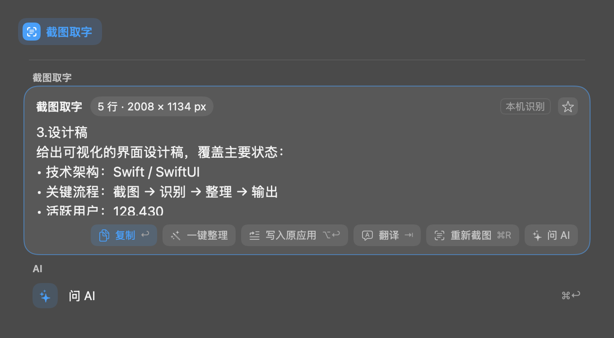
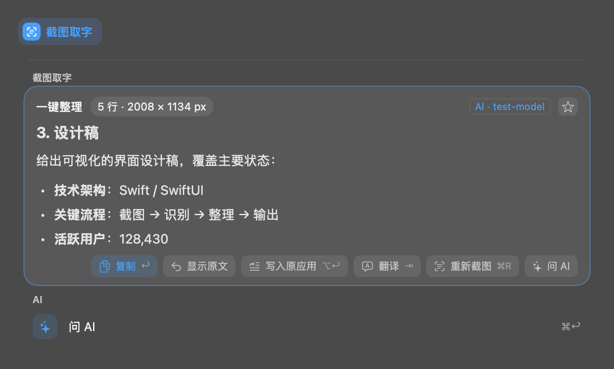
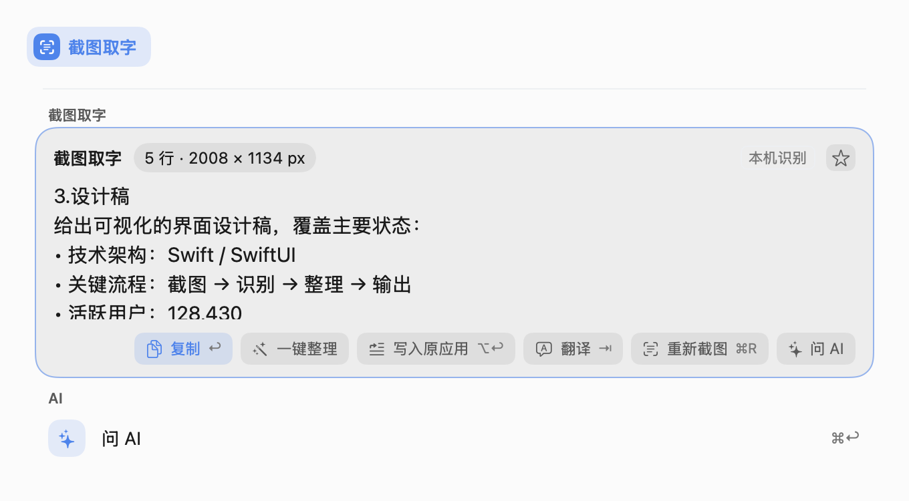
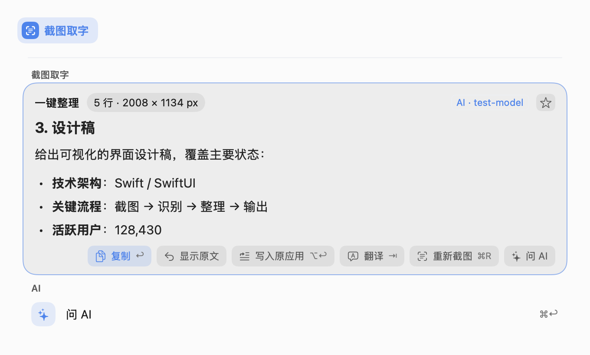

# Screenshot text organization

The screenshot text result card offers **Organize** (`一键整理`) beside Copy.
It sends this capture's recognized text to the configured text-processing model
and streams Markdown into the same card. OCR itself remains local. The prompt
asks the model to repair line breaks and structure headings, paragraphs and lists
while preserving the source language, details, numbers, URLs and code.

Copy, Type into app, Translate and Save use the organized Markdown. **Show original**
restores the cached OCR text, which can be organized again. New captures reset the
organization option. Failures offer retry when appropriate, Show original, and
New screenshot; signed-out Cloud requests retain the Sign in action.

The AI option is bound to the capture ID and uses the existing plugin session's
cancellation and generation checks, so leaving the keyword or replacing the
capture cannot overwrite a later result. Recognition and planning never invoke AI.

## Verification

```sh
swift build
swift test --no-parallel --enable-code-coverage
TYPEFLUX_ASK_SNAPSHOTS=docs/validation/gul-318/rendered \
  swift test --enable-code-coverage --filter AskScreenshotTextOrganization
```

See [the validation record](VALIDATION.md) for executed checks, coverage, and the
UI test fixture repairs needed for reliable validation.

`AskScreenshotTextOrganizationTests` covers model-free OCR, explicit submission,
streaming and Markdown exports, note persistence, original restoration, missing
models, blank OCR and AI responses, network and authentication errors, retry,
capture replacement, and cancellation. Existing screenshot follow-up tests cover
the capture, translation and Ask AI entry points.

`AskScreenshotTextOrganizationVisualTests` renders the production result card
in Chinese and English, in both appearances, for original, organizing, organized
and failure states. Snapshots use synthetic OCR and model output, without an
external model request or a capture of the user's screen.

| Appearance | Original with Organize | Organized Markdown |
| --- | --- | --- |
| Dark |  |  |
| Light |  |  |
