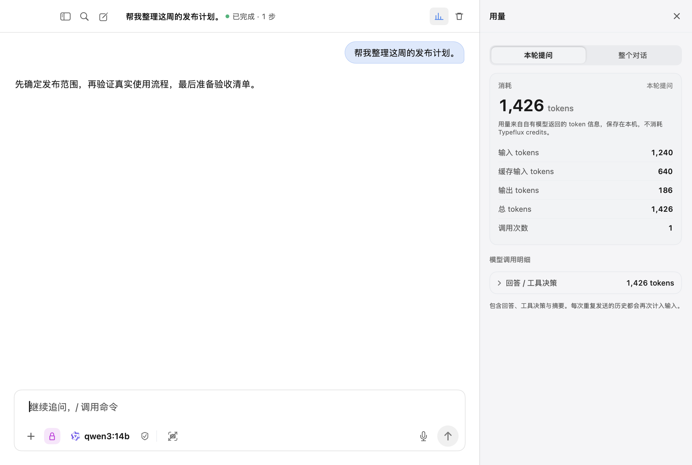
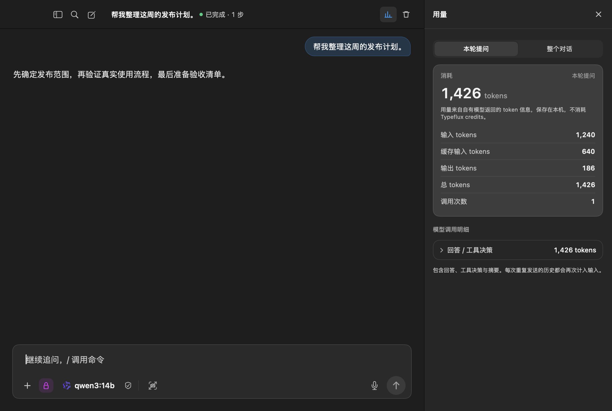
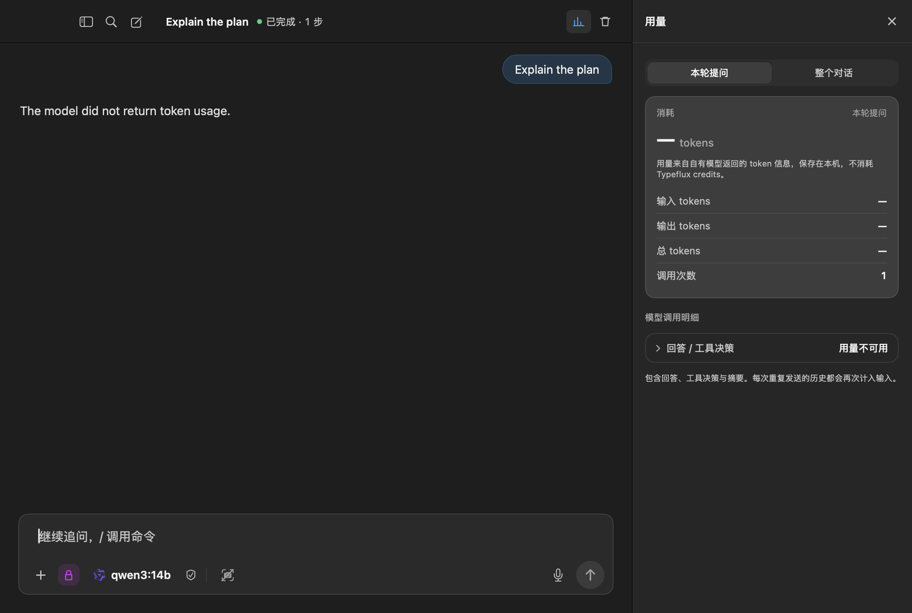

# GUL-320: local conversation token usage

Signed-out users running their own models can inspect conversation totals, run
totals and individual model calls. Provider-reported input, output, cached input
and total tokens are stored with local conversation history. The local panel
shows tokens without a credit balance, a price or cached-token billing advice.

Reports without token usage remain unknown. Partial reports are lower bounds;
duplicate receipts count once. Summaries, tool decisions, failures and cancelled
calls are included. Late reports update metering without changing content,
timestamps or a replacement run's budget. Old conversation files remain readable;
tokens from before metering cannot be recovered.

## Native view evidence

The opt-in `renderLocalUsageSurfaces` test renders `AskConversationView` with
synthetic receipts produced by the real `AskLocalEngine`. It uses a signed-out
fixture, an isolated model profile and the classic interface style. No live
provider or account is used. The known report contains 1,240 input tokens,
186 output tokens and 1,426 total tokens; 640 input tokens were cached.

| Known usage, light | Known usage, dark | Provider omitted usage |
| --- | --- | --- |
|  |  |  |

## Verification

- `make coverage`: XCTest completed with 3,635 tests, 17 environment skips and
  zero failures. Swift Testing reached the existing `capturesTheRealScreen`
  integration test without failures, then stalled inside system screen capture.
  The verified test helper was stopped; this command did not complete and is
  not reported as passing.
- `TYPEFLUX_LOCAL_USAGE_SNAPSHOTS="$PWD/docs/validation/gul-320" swift test
  --skip-build --no-parallel --enable-code-coverage --disable-xctest
  --skip capturesTheRealScreen`: passed all 2,295 tests in 341 Swift Testing
  suites, including the local usage suite and native screenshot renders.
  Real system screen capture remains unverified in this environment.
- LLVM coverage: `AskLocalUsage.swift` has 97.32% line coverage and 94.59% region
  coverage. LCOV counts 148 of 150 added executable production lines covered
  across the four changed Swift source files (98.67%).
- `swiftformat --lint` passes for the new source and test. Strict SwiftLint
  passes for the new source; the three existing changed sources have no new
  lint violations (70 baseline violations, 68 after the change).
- `plutil -lint` passes for all five modified localization files;
  `git diff --check` passes.

### Merge validation (2026-10-11)

Merged `main` at `7643ff2d` and resolved conflicts in the launcher header,
typing motion and settings fixtures. The shared hover helper now waits for a
visible panel; motion retains context preparation and checks the settled home
height. Native controls retain their accessibility press action, with the
shared settings helper used for accessibility elements.

```sh
NSUnbufferedIO=YES TYPEFLUX_LOCAL_USAGE_SNAPSHOTS="$PWD/.build/gul320-merge-snapshots" \
swift test --no-parallel --enable-code-coverage \
  --filter 'AskLauncherHeaderTests|AskLauncherMotionTests|LauncherSettingsPolishTests|AskLocalUsageTests|AskLocalEngineTests|AskLocalLateUsageTests|AskUsage.*Tests|AskConversationVisualTests/renderLocalUsageSurfaces|LocalizationResourceTests|ExclusiveUIStateLanguageTests|AskScreenshotTextOrganizationTests|StatusBarWordBookMenuTests|DirectionalScrollStitcherTests'
```

Passed 42 XCTest cases and 76 Swift Testing tests in 10 suites, including all
three resolved fixtures, local token accounting and rendering, and incoming
screenshot text organization, word book and scroll stitcher regressions.
`plutil -lint` passed for all five localization files and
`git diff --cached --check` passed. Self-review confirmed both branches'
changes and the original behavior assertions remain intact.

## Self-review

Reviewed inference registration, receipt validation, aggregation, paging,
local API routing, persistence, restart, deletion and the production usage view.
Covered duplicate and late receipts, partial-report progression, cancellation,
retry, regeneration, summaries, tool decisions, invalid reports and legacy files.
Local metering remains inside the engine actor and uses the existing atomic,
protected JSON storage. Invocation, run and device identity bind receipts; token
reports cannot create new calls or authorize billing.

Review fixes hide the local header's credit total and cloud cached-token billing
advice. A late receipt from an older budget root, including an unbudgeted run,
cannot settle the replacement run's budget. Tests restore fixture settings,
language and window state.

Full regression exposed three existing AppKit fixture problems. Launcher motion
now waits for the captured home to finish layout; screenshot hover waits for the
delayed panel to appear. Settings tests press native controls through their
accessibility action instead of entering a synchronous mouse-tracking loop.
The original behavior assertions remain in place, with no corresponding product
changes.
