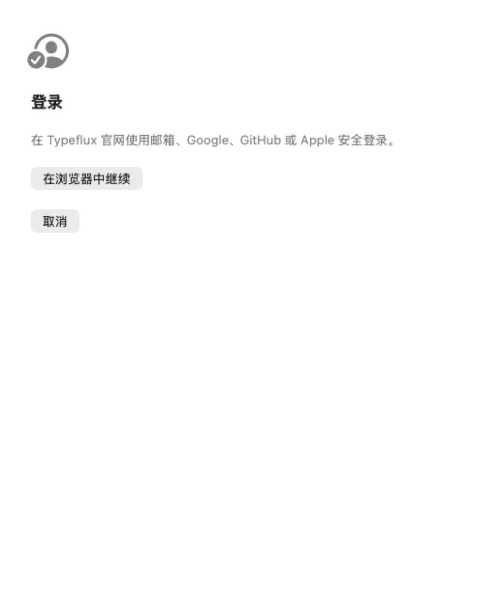
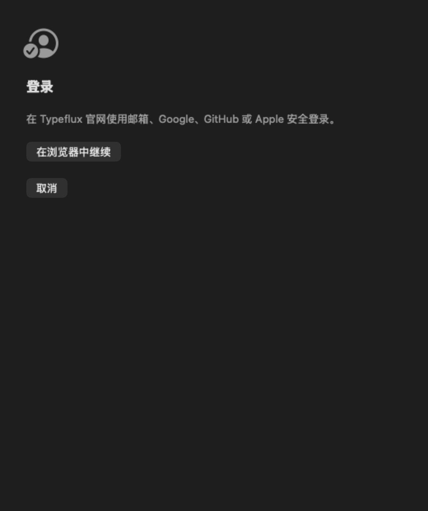

# GUL-360 validation — 2026-10-12

Implementation base: `main`, `4ae0a5f7d9739b2b7e4799f377f9f2a1701fa419`.
API contract: typeflux-api PR #139, `bb0c9622423d5418829670fa219bbf9b03fc81ce`
(merged by delivery time). Homepage implementation remains GUL-359.

Validation ran through the existing macrun connection on an Apple Silicon Mac running
macOS 26.6.2 and Apple Swift 6.4. Linux has no Swift executable; no Linux build is claimed.
The package retains its macOS 13 target; release support remains macOS 13.4+.

## Results

| Check | Result |
| --- | --- |
| Targeted auth, refresh/logout, billing, login sync and localization isolation | 110 XCTest cases and 38 Swift Testing tests passed in the earlier targeted run. |
| Final-source `make coverage` / full `swift test --no-parallel --enable-code-coverage` | XCTest: 3787 reported, 17 skipped, 0 failures. Swift Testing: 2716 tests in 412 suites, 5 failing assertions in 3 pre-existing UI tests; all new Web login suites passed. |
| Focused rerun on the same final sources | 40 tests in 7 suites passed, including both failing UI suites and all 30 new Web login tests. |
| Independent `swift build` | Passed (exit 0); existing unrelated Swift concurrency/deprecation warnings remain. |
| Dev bundle configuration helper | Passed actual macOS PlistBuddy/plutil checks: development channel, flag and origin overrides, independent development scheme, retained native OAuth/billing schemes and bundle ID. Production plist remains disabled and excludes the development scheme. |
| Isolated app bundle | Copied compiled executable and resource bundles, applied development plist, ad-hoc signed, and passed `codesign --verify --deep --strict`. No installation or app launch. Main executable reports Mach-O minimum macOS 13.0; this is not a minimum-OS hardware acceptance test. |
| Static checks | `git diff --check`, shell syntax and matching 12 localization keys across all five languages passed. New Swift sources formatted with repository SwiftFormat settings. |
| Visual review | Light/dark entry screenshots reviewed. OCR verifies visible Typeflux/browser text. Waiting, cancellation, failure recovery and success dismissal have native hosting-view tests. |

The full run failed in unchanged `OverlayTransitionRenderingTests` (two tests, each
in classic/liquid-glass styles, waiting for layout deadlines) and
`ScreenshotCaptureWindowPolicyTests.realCaptureKeepsAppPagePixelsBehindCaptureControls`
(a real-screen pixel assertion). Another Typeflux test process was observed concurrently
on the same Mac in a different worktree; it was not stopped or modified. Both suites
passed in the focused rerun without source changes. This is evidence of environment/timing
sensitivity, not proof of a completely green full-suite run. No unrelated tests were disabled.

Because the full test invocation returned failure, `make coverage` stopped before its
HTML-report stage and SwiftPM did not write its normal JSON export. The full run's
remaining `.profraw` files were merged with `xcrun llvm-profdata merge -sparse`; coverage
was exported with `xcrun llvm-cov export` against that same test binary **before** the
focused rerun could replace the profiles. [coverage.json](coverage.json) records these
full-run results and the original failure messages.

| Coverage scope | Covered / executable lines | Line coverage |
| --- | --- | --- |
| Five new core files: protocol, coordinator, HTTP, AuthState bridge, URL router | 386 / 401 | **96.26%** |
| All seven new production Swift files, including UI and system-browser adapter | 489 / 520 | **94.04%** |
| Entire `Sources/Typeflux` tree | 170619 / 218374 | **78.13%** |

The new modules exceed the 90% target. The complete macOS source tree does not; the
target was not lowered. The last scope excludes tests, third-party dependencies, the
CLI/C bridge and the separate TypefluxChat package. Coverage is not a measurement of
real browser/provider success. The AuthenticationServices wrapper's actual `start()`
and external-browser completion still require end-to-end acceptance.

## Reproduce

```sh
swift test --no-parallel --enable-code-coverage --filter WebLogin
make coverage
swift test --skip-build --no-parallel --enable-code-coverage \
  --filter 'WebLogin|OverlayTransitionRenderingTests|ScreenshotCaptureWindowPolicyTests'
swift build
```

Set `TYPEFLUX_WEB_LOGIN_SCREENSHOTS` to a writable directory to export the two entry
screenshots. Keychain tests use the repository's in-memory Keychain adapter and verify
completed-session restoration, write failure and login notification behavior; they do
not claim a real account's Keychain permissions were tested. Pending login cold starts
are explicitly rejected because verifier/state are process-local in this release.

Still required in GUL-361: real email/Google/GitHub/Apple sign-ins and account continuity,
Safari/Chrome/Firefox callbacks and cookie-loss recovery, production/development coexistence,
real signed-app Keychain permissions, warm/cold system URL delivery, and macOS 13.4 hardware.
The feature remains disabled; no provider credentials, deployment, notarization or production
configuration changed. See [configuration and rollback](../../web-app-login.md).



