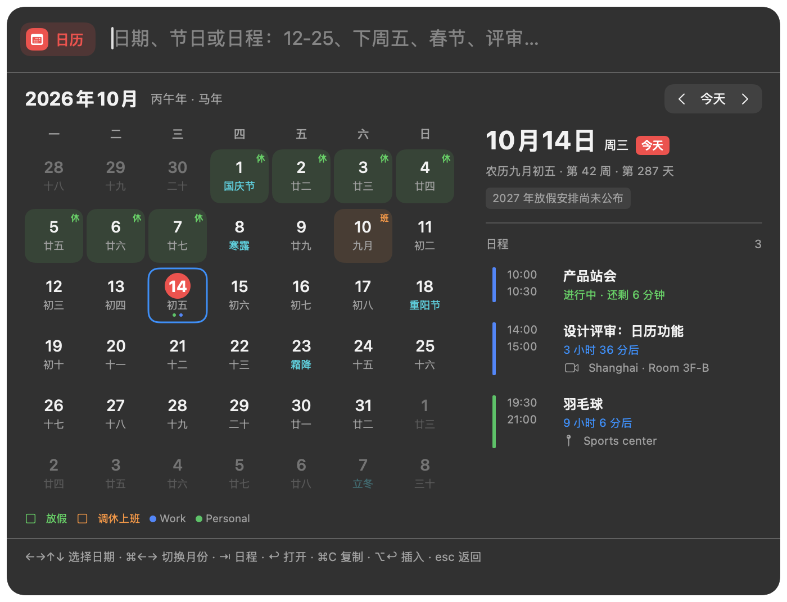
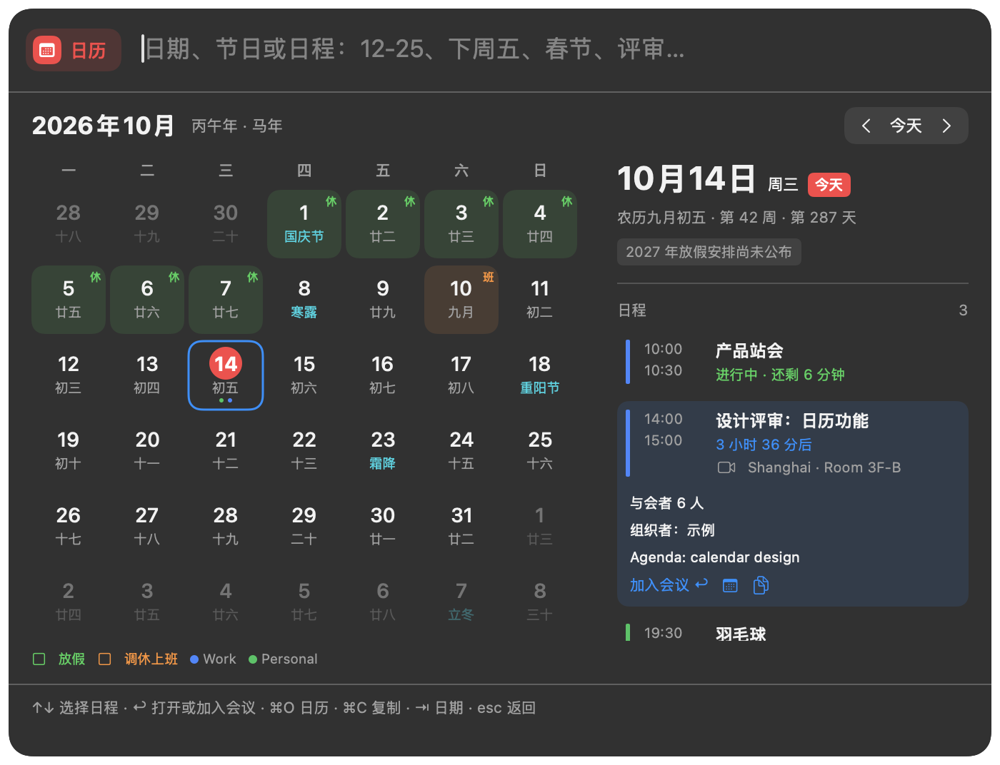
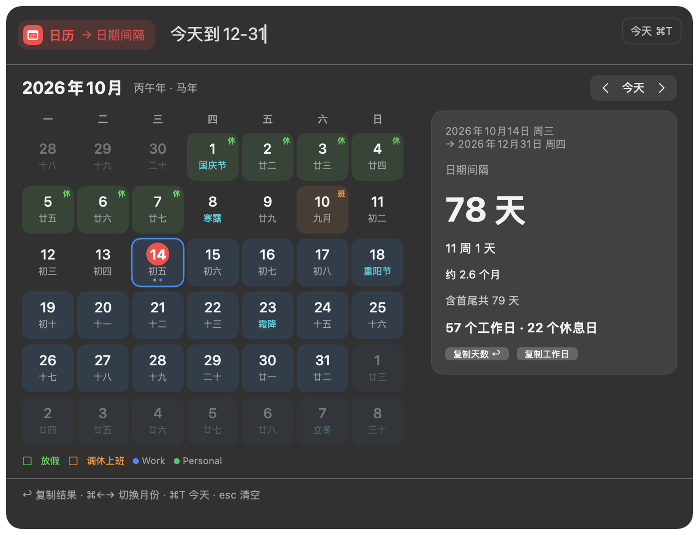
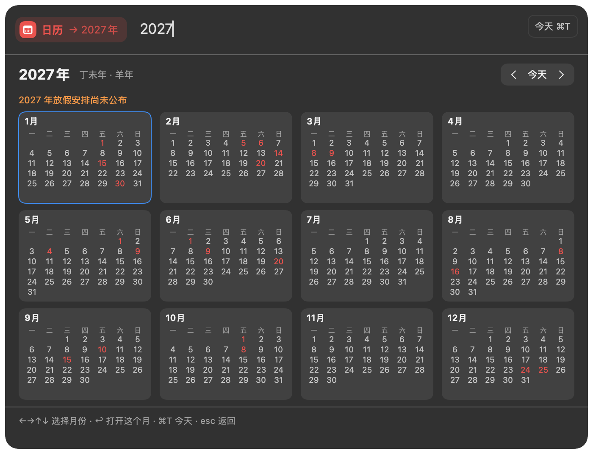
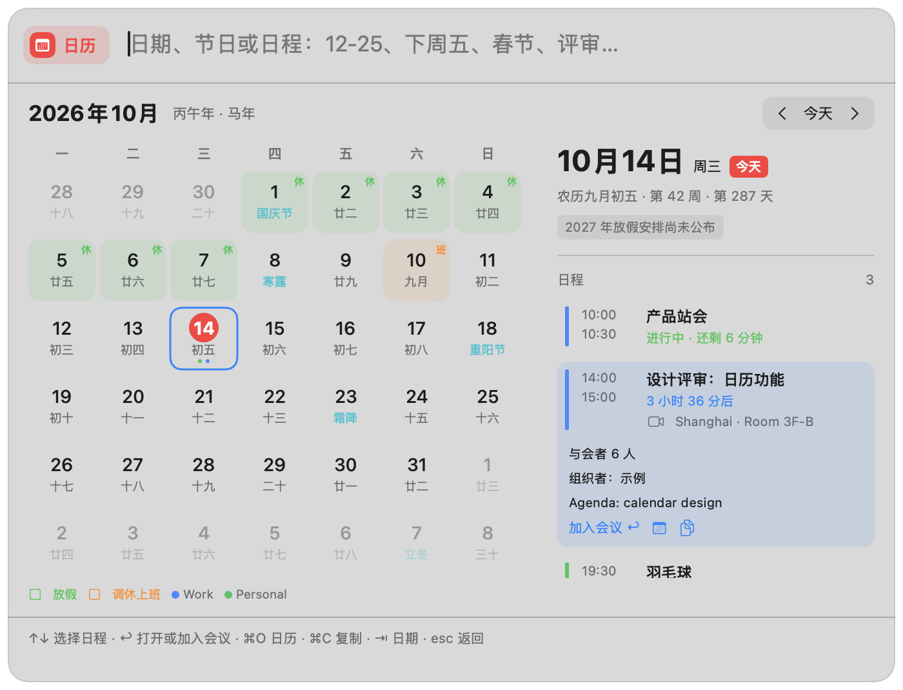

# Launcher calendar validation

Validation ran on an arm64 Mac with Swift 6.4 and the macOS 27 SDK; the package still targets macOS 13. Screenshots render the production `AskLauncherView` with injected, fictional events. No personal calendar content is included.

## Tests

- Focused implementation checks covered date parsing, leap years and daylight saving, lunar festivals and solar terms, holidays and makeup workdays, event ordering, meeting URL validation, explicit permissions, stale reads, settings, and native launcher keyboard routing.
- The one final full `make coverage` run executed 3,787 XCTest cases (17 skipped) and 2,799 Swift Testing tests. It found two failing test cases: two Chinese terminology assertions in `LocalizationResourceTests`, and an asynchronous event-read race in `AskCalendarKeyboardTests`. The strings now use the project's standard terminology, and the keyboard test waits for the event read before selecting a row.
- After those fixes, `swift test --filter 'Calendar|LocalizationResourceTests|AskKeywordAliasTests|AskKeywordListPresentationTests' --enable-code-coverage` passed 23 XCTest cases and 61 Swift Testing tests.
- A subsequent supported-year boundary fix passed all five `CalendarQueryParserTests`. Relative months, named festivals, and intervals now reject results outside 1901–2099.
- After rebasing onto `main`, `swift test --filter 'Calendar|LocalizationResourceTests|AskKeywordAliasTests|AskKeywordListPresentationTests|AskQuickResultsInteractionTests|AskQuickSearchSessionTests|AskCalculatorTests|ExclusiveUIStateLanguageTests' --enable-code-coverage` passed 23 XCTest cases and 206 Swift Testing tests. Following the repository's test policy, the full suite was not repeated to retry failures.
- `swift test --filter 'LauncherSettingsPolishTests.*every' --enable-code-coverage` passed the keyword-sheet test, covering all editable kinds in new/edit and light/dark states, including Calendar.

## Coverage and static checks

The coverage summary combines final integration and keyword-sheet profiles generated by the same test binary, using LLVM coverage mapping. Its scope is all 18 new production files: `Sources/Typeflux/Calendar/`, `AskCalendarPlugin.swift`, and `AskConversationModel+Calendar.swift`. The machine-readable result is in `coverage-summary.json`.

New-file aggregate line coverage is **90.41%** (2,574 / 2,847 LLVM-reported lines), including the OS adapter. SwiftUI closure mappings can count multiple mapped lines for one source line.

Real EventKit account access and macOS permission dialogs are not exercised by the automated tests. Provider, permission-state, error, cancellation, and UI behavior use an injected provider. The OS adapter's authorization and event-mapping branches therefore have limited coverage; granting access to a signed app remains a manual acceptance check.

- `swiftformat --lint` passed for the 25 new Swift files.
- Strict SwiftLint passed with zero findings for all 18 new production files. The affected existing files retain 181 findings, compared with 185 on the original base revision; the existing-file lint command still exits nonzero.
- All 85 calendar localization keys match across five languages. Holiday ranges, makeup-workday separation, privacy usage strings, and debug/runtime/release entitlements passed structure checks.
- `git diff --check` passed. Fifteen UI states rendered, including month, agenda, jump, interval, year, missing holiday data, week numbers, search, permissions, hidden events, denial, invalid input, and light appearances.

## Self-review

Reviewed the complete keyword-to-view/action path, empty and invalid input, supported-year limits, month-end clamping, daylight saving, cross-day/all-day events, unknown holiday years, cancellation, notification observer cleanup, calendar filtering, persistent event hiding, and copying/inserting/opening actions. Calendar data stays local and EventKit is read-only. Meeting actions require a supported exact domain or subdomain and reject URL credentials. Calendar shortcuts preserve the editor's normal caret behavior and the application search row's selection priority.

Review fixes included the 2027 Spring Festival date (February 6), short-year New Year's Eve, pre-2000 solar longitude normalization, subscription-only holiday filtering, stale event results, calendar selection preservation when hiding events, and keyboard routing while application search is pending.

## Screenshots

| Month | Selected event |
| --- | --- |
|  |  |

| Date interval | Year |
| --- | --- |
|  |  |

