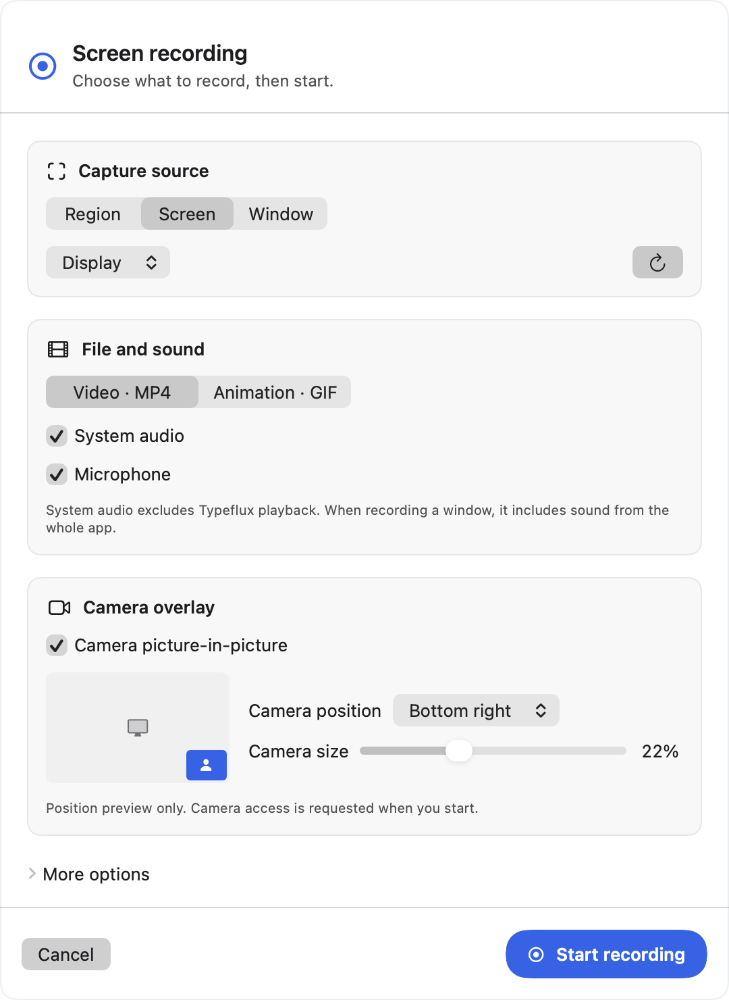
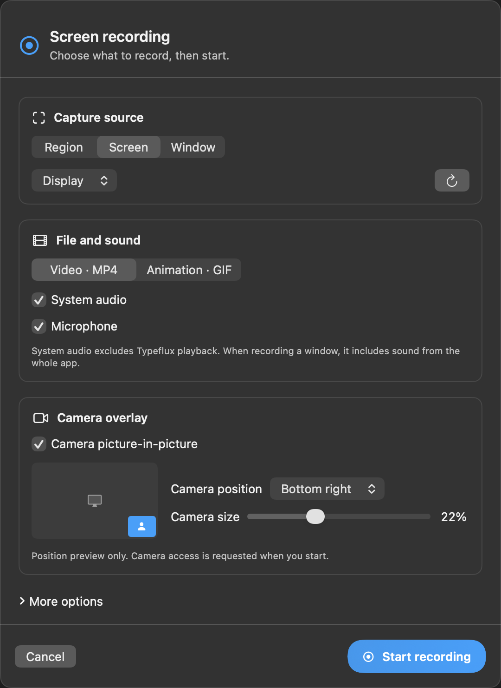
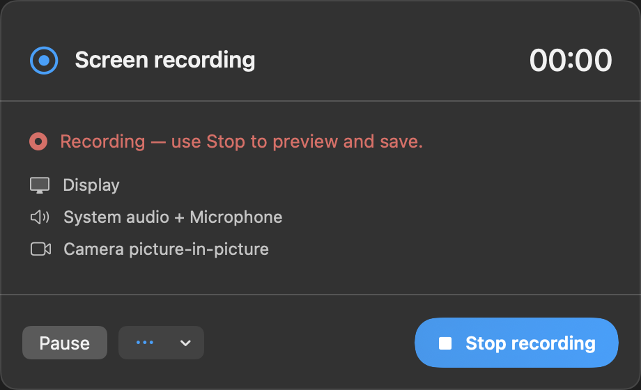
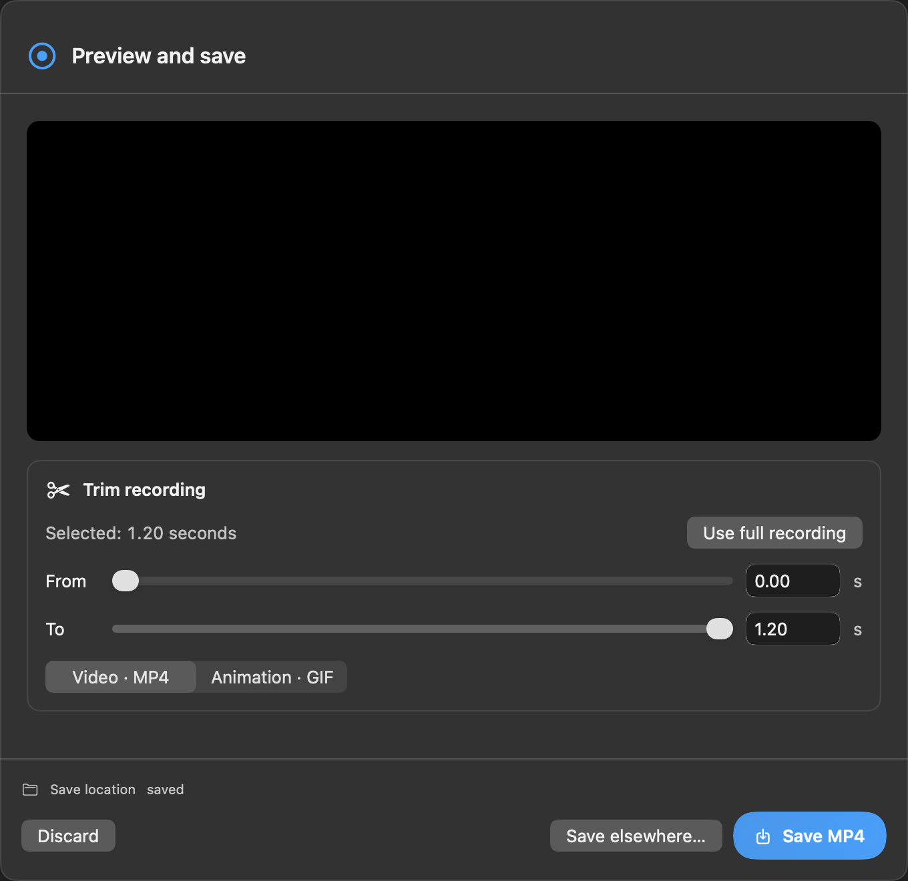

# GUL-366 validation

Environment: macOS 26.6.2, Swift 6.4, Xcode macOS 27 SDK; deployment target macOS 13. Production code was reviewed before committing. `git diff --check` and the app/resource plist and signing entitlement checks pass.

## Automated checks

- Focused recording, screenshot integration, localization and appearance checks passed: 68 XCTest tests and 68 Swift Testing tests in 9 suites. After the final production appearance fixes, the affected recording coordinator, presentation and view suites passed again (19 Swift Testing tests).
- The final full `make coverage` run passed all 3,790 XCTest tests (17 skipped). Its Swift Testing phase completed 376 suites without an assertion failure, then stopped making progress in the existing `ScreenCaptureServiceTests.capturesTheRealScreen` integration test. After roughly ten minutes without log progress, only that run's test helper was terminated. Sampling showed AppKit/SwiftUI layout activity; the underlying full-run stall has not been isolated.
- That native screen-capture test passed on its own in 0.19 seconds. The full suite was not repeated: only the unfinished suites were selected for the remaining checks, including fresh WindowServer screenshots of the recording UI. The remaining selection passed 259 Swift Testing tests in 45 suites. The final precise-seek and copy polish then passed all 24 XCTest and 33 Swift Testing checks in the recording/localization selection. No assertion failures remain in those checks.
- Coverage profiles from the interrupted full run were explicitly flushed and preserved before retries. `coverage.json` records their merged measurement with the completed retry profiles, including native adapters and UI. This is a combined measurement, not a claim that the full suite completed in one uninterrupted run.

The tests exercise real AVFoundation and ImageIO using synthetic frames and audio: H.264/AAC MP4, two-source audio mixing (48 kHz stereo system audio and 44.1 kHz mono microphone), pause removal, static-screen tail duration, camera motion on a static screen, trimming, GIF frame delays and looping, cancellation, recovery and collision-safe publication. Coordinator tests cover permissions, delayed startup, interruption, export failure, screenshot interlocks and region handoff. They do not establish end-to-end hardware capture correctness.

## Coverage

New recording module: **76.28%** of executable lines (2,113 / 2,770, as reported by LLVM). This is below the repository's 90% target; native capture/device coverage remains a gap.

| Component | Line coverage |
| --- | ---: |
| Capture and native engine | 0% |
| Source catalog and authorization | 5.88% |
| Coordinator | 89.64% |
| UI presentation rules | 100.00% |
| Export and file handling | 92.49% |
| Models and geometry | 100% |
| Views and window controller | 81.84% |
| Media writer | 93.92% |

## UI snapshots

See [UI review](ui-review.md) for the consistency/usability audit and actual production-window captures in Classic / Liquid Glass and light/dark appearances. Those captures use a synthetic backdrop to keep desktop content out of the glass. The images below use an opaque fallback surface to make bitmap rendering reliable.

All recording data shown is synthetic. These demonstrate layout, not end-to-end live recording.

| Setup (light) | Setup (dark) |
| --- | --- |
|  |  |

## Manual acceptance still needed

- On macOS 13 and a current macOS release: grant/deny screen, microphone and camera permissions; record a display, a region on each monitor and an independent window.
- Record system audio and microphone separately and together; verify audible content and synchronization with camera picture-in-picture in each corner/size. Change window size, minimize it, remove a display and disconnect a device; verify interruption behavior.
- Pause/resume repeatedly, stop, trim and export both formats; verify GIF's silent 30-second limit. Quit normally during recording and recover the finalized source on relaunch.
- Exercise insufficient disk space and unwritable save directories, then retry export. Check long-duration CPU/memory and disk consumption, and GIF peak memory. These have not been measured here.

macOS 13 compatibility has only been checked through minimum-version compilation, not a macOS 13 runtime. MOV recovery depends on successful finalization and does not guarantee recovery after a crash or power loss. Camera and microphone use the system default devices.
