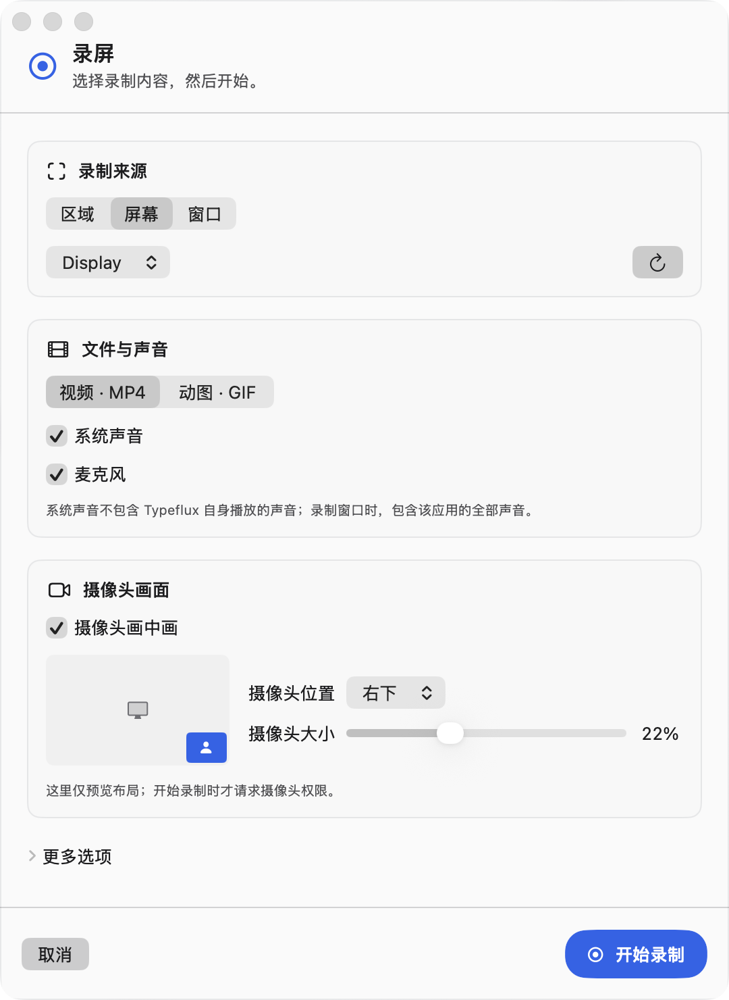
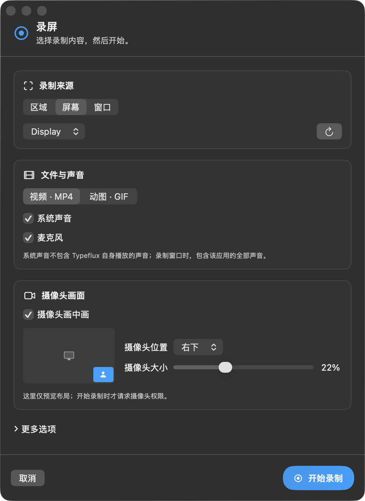
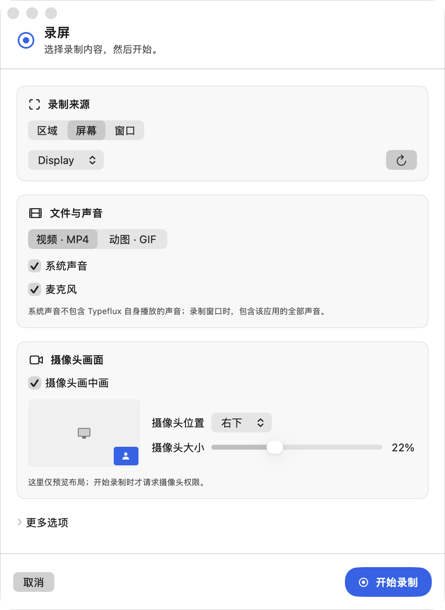
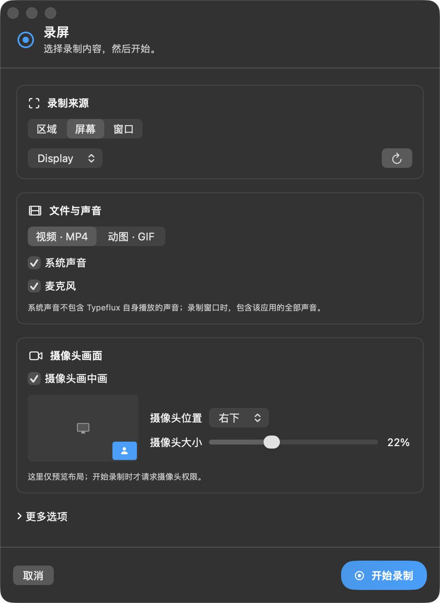
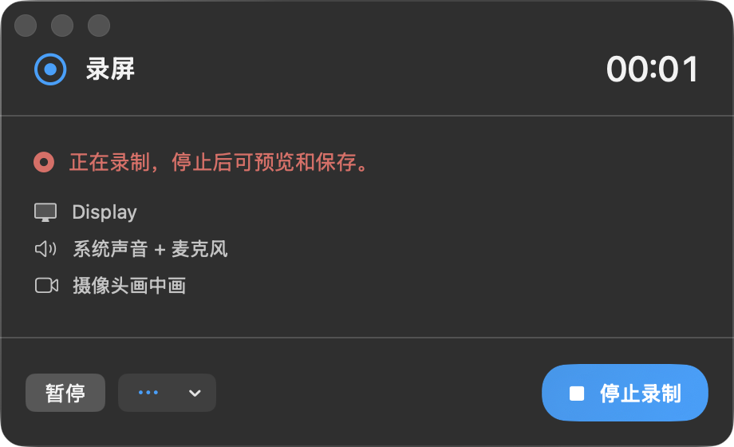
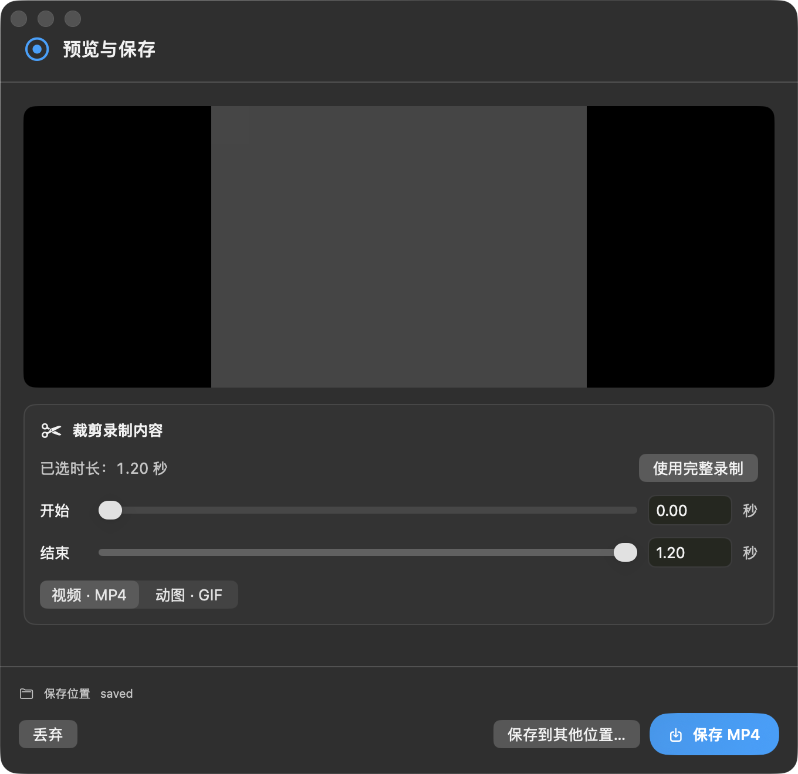

# Recording UI review

Reviewed the recording setup, capture controls, preview, export and recovery against the screenshot toolbar (`ScreenshotEditorToolbar`), screenshot popovers, and the application's shared `AskTheme`, `StudioButton`, `AskInWindowGlass` and `InterfaceStyleObserver` components.

| Finding | Change and user benefit |
| --- | --- |
| A standalone native form did not follow the app's Classic / Liquid Glass setting. | Use the existing theme, glass surface, border and primary button components. The open window follows appearance and interface-style changes; the shared surface also handles reduced transparency and increased contrast. |
| One flat list mixed capture choices with technical quality controls. | Separate capture source, file/sound and camera sections. Hide frame rate, size, cursor and countdown settings behind More options. Keep the start action in a fixed footer. |
| Displays were named using internal display IDs; window and screen choices were mixed. | Separate Region / Screen / Window choices; display names include the system's human-readable screen name and dimensions. Refreshing an empty region choice cannot silently switch to a whole-screen recording. |
| Camera position and size were difficult to picture. | Show a placement diagram, percentage and a clear statement that it is a layout preview. Camera permission is requested when recording starts. |
| It was unclear whether a recording had sound, and discard sat beside the frequent capture actions. | Capture controls show the selected source and enabled sound sources (or No sound); the paused state has both an icon and text. Discard moves into More actions and retains confirmation. |
| Invalid trims were rejected only after clicking Export; export controls remained editable while exporting. | Keep trim endpoints ordered, show selected duration and units, offer reset to the full recording, disable saves for invalid/GIF-too-long selections, and lock edits while exporting. Seek precisely to the selected time so the preview does not fall back to a nearby keyframe. |
| Export did not show its destination, and recovery displayed UUIDs. | Show the save folder and full-path help, name the primary action Save MP4 / Save GIF, distinguish saving elsewhere, and label recovered files by modification time. |
| Every setup failure offered screen-recording permissions, including microphone/camera failures. | Show the relevant permission action only for permission failures, opening the matching system pane. Other errors retain their message and refresh action. |
| Fixed, unscrollable content could hide controls when camera options expanded or the available screen was short. | Bound window size to the visible screen, allow resizing and scroll settings independently from the fixed footer. Test primary-action bounds in all five languages. |
| Closing preview offered Keep recording even though capture had stopped. | Use Continue editing in preview and Keep during capture. |

The changes preserve all previously approved capture capabilities. The placement diagram does not show a live camera feed. No user study or hardware capture certification is claimed by this review.

## Visual evidence

The `recording-window-*.png` images show the production window captured through WindowServer, with a synthetic solid backdrop to keep desktop content out of the glass. They include both interface styles and light/dark appearances, plus recording controls and preview. Bitmap snapshots additionally cover English/Chinese layout, and opaque fallback snapshots cover the base setup/preview states. A bitmap alone is not evidence of native glass compositing.

Automated results and remaining hardware acceptance items are recorded in [README](README.md).
