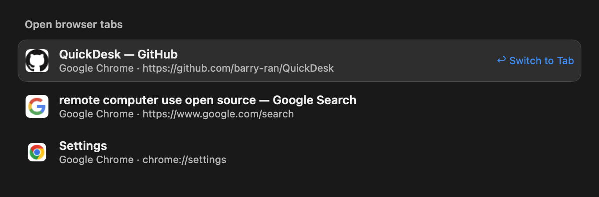

# Browser tab search validation

Tab listing reads titles, URLs and identifiers in collection batches. The plugin debounces for 16 ms. Snapshots newer than two seconds are reused; tab snapshots up to 60 seconds old return immediately while one bounded refresh runs. The three-second list rerun picks up the refreshed cache. Command-R waits for a current snapshot. Focusing validates the live tab identity and URL, then invalidates cached and pending tab reads.

HTTP(S) tab rows load the origin's `/favicon.ico` asynchronously. Identical origins share a memory cache; missing, non-web and offline icons use the browser icon. Paths, query strings, fragments and URL credentials are stripped. The existing cookie-free HTTP transport refuses redirects, limits downloads to 256 KiB and times out after three seconds. Images are downsampled to at most 56 pixels. Failed downloads wait 60 seconds before retrying, and the final row's cancellation cancels its request.

| Changed behavior or dependency | Focused suites |
| --- | --- |
| Batch scripts, formats, permissions, tabs/bookmarks, direct search | `AskBrowserTabBatchTests`, `AskBrowserSearchTests` |
| Immediate cached results, refresh coalescing, expiry, focus invalidation, Command-R | `AskBrowserTabCacheTests` |
| Origin privacy, optional icons, coalescing, cancellation, retry limits, native component rendering | `AskBrowserFaviconTests` |
| Keyword lifecycle, live lists, selection, result views, asynchronous image callers | `AskPluginSessionTests`, `AskPluginViewTests`, `AskPluginVisualTests`, `AskResultImageCacheTests`, `AskQuickSearchSessionTests` |
| Bounded HTTP responses, network failures, redirects and cancellation | `AskImageHTTPTests` |


Validation completed with 90 focused test methods passing. Added/modified executable Swift line coverage is **199/210 (94.76%)**, measured from LLVM LCOV records intersected with the added lines in the Git diff, including new production files. The new favicon cache and view each have **100%** line coverage. Whole-target line coverage from this focused scope is **2.31%**; this was not a full-suite run. Targeted strict SwiftLint reported zero findings in ten files, and `git diff --check` passed.

```sh
make coverage SUITE="AskBrowserSearchTests AskBrowserTabCacheTests AskBrowserTabBatchTests AskBrowserFaviconTests AskPluginSessionTests AskPluginViewTests AskPluginVisualTests AskResultImageCacheTests AskImageHTTPTests AskQuickSearchSessionTests"
```

Local Swift 6.4 required a temporary CLI wrapper selecting `--build-system native` and passing `-Xswiftc -profile-generate -Xswiftc -profile-coverage-mapping` to nested build/test commands. The final scope was run through `scripts/coverage.sh --from-env --jobs 4`; its successful total command wall time, including compilation, discovery, tests and LLVM report export, was **370.98 seconds**. The repository's build and test scripts were not changed.

| Validation attempt | Total command wall time | Result |
| --- | ---: | --- |
| Initial focused coverage | 195.18 s | 88 of 90 methods passed; two fixture assertions failed |
| Failed-method retry | 61.59 s | Both methods passed; command failed because coverage files were absent |
| Native preparation and same-scope coverage | 766.03 s | All 90 methods passed; coverage export still failed because binary instrumentation was absent |
| Explicit compiler instrumentation, same scope | 370.98 s | All 90 methods passed; coverage export succeeded |

The fixture fixes use a bounded raster size assertion, since AppKit represented a 26-point icon at 52 pixels, and inline the mock into JXA's lexical scope instead of using `eval`, which escaped the mock. The initial ordinary `swift build` also passed (145.35 seconds reported by SwiftPM). Existing compiler deprecation/concurrency warnings remain outside this change.

The batch test executes the production adapters in the native JXA engine with synthetic browser collections. All five adapters make the same number of property requests for one and 200 tabs, and profile/space fallback does not duplicate results. A suspended refresh verifies that recent cached results return within 100 ms and stay actionable. This is a cache-path assertion, not a measured cold-browser latency.

Real-browser before/after timing was unavailable: the no-prompt Automation preflight returned `-1744` for Chrome and `-600` for Safari in this runtime. Dia, Arc and Edge were not available as running test targets. Listing/focusing against actual browsers and their end-to-end cold latency still need verification in an authorized app session.

Self-review covered the complete keyword/direct-search-to-focus path, empty/expired/missing results, permission separation, unsafe URLs, asynchronous cancellation, process bounds, image resource limits, and documentation. A focus-versus-refresh race was fixed: an invalidated read cannot restore stale tabs. Reused view state is tied to the icon URL so a changed row cannot retain another site's icon.

The component preview uses the production row, icon and favicon view code with fixture-loaded public GitHub/Google icons and a Chrome fallback. It is a native component render with synthetic rows, not a capture of a user's live browser data.


