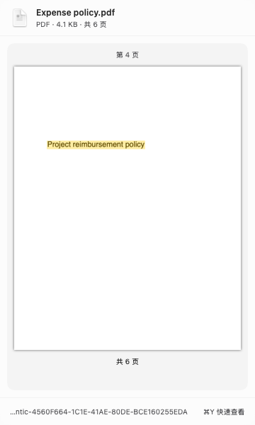
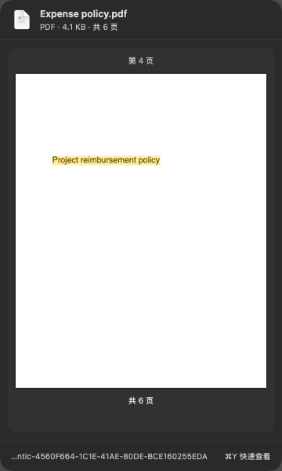
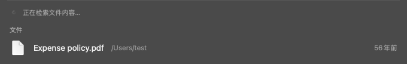

## GUL-383: previews, media and content-search feedback

Based on main `df4b361f` (2026-10-15), including the current inline settings and shared filename/content scope. Experimental content search still defaults off; unsupported devices cannot enable it.

| Behavior | Focused validation |
| --- | --- |
| `f` selection opens the side preview, including partial results | `AskFilePreviewIntegrationTests`, `AskContentPreviewTests`, `AskPluginSessionTests`, `AskFileSearchPluginTests` |
| Matched PDF page, raster highlight, Unicode offsets, evidence-aware cache | `AskContentPreviewTests`, existing preview policy/reader/loader/controller/visual suites |
| Document → image → audio → video, idle gating and cancellation | `SemanticMediaIndexTests`, `SemanticMediaServiceTests` |
| Native image, audio-window and video-frame extraction; private snapshots | `SemanticMediaExtractorTests` (real child IPC plus direct entry-point contract comparison) |
| Actual image/audio model inference, lazy download, cancellation and query cache | `SemanticMediaWorkerTests`, `SemanticEmbeddingWorkerTests` |
| Pending row, stable selection, late evidence and legacy default Return | `SemanticContentSearchProgressTests`, `SemanticHybridSearchTests`, `AskQuickSearchSessionTests`, `AskSearchSchedulingTests` |
| No directory/database quota, atomic updates, storage failure recovery | `SemanticFileCapacityTests`, `SemanticFileStoreTests`, `SemanticFileIndexerTests`, `AskFileStreamingTests` |
| Existing scope/index lifecycle, current inline settings, all five languages | File index/reliability/scope suites, `SemanticFileServiceTests`, `SemanticFileSearchStatusTests`, `LauncherSearchSettingsViewTests`, `LocalizationResourceTests` |

The initial focused coverage scope selected 199 methods across 32 suites (24 XCTest + 175 Swift Testing). It passed except for one outdated capacity fixture, which treated PNG files as unsupported. That fixture now uses unsupported SVGs; the failed method passed on its own. No full test suite was run.

```sh
make coverage SUITE="SemanticMediaIndexTests SemanticMediaWorkerTests SemanticMediaServiceTests SemanticMediaExtractorTests AskContentPreviewTests SemanticContentSearchProgressTests SemanticFileCapacityTests SemanticFilePolicyTests SemanticFileStoreTests SemanticFileContentTests SemanticFileIndexerTests SemanticFileServiceTests SemanticEmbeddingWorkerTests SemanticHybridSearchTests SemanticFileSearchStatusTests SemanticFileSearchVisualTests AskFileStreamingTests AskFileIndexServiceTests AskFileReliabilityTests AskFileScopeTests AskFilePreviewReaderTests AskFilePreviewLoaderTests AskFilePreviewControllerTests AskFilePreviewPolicyTests AskFilePreviewIntegrationTests AskFilePreviewVisualTests AskPluginSessionTests AskFileSearchPluginTests LauncherSearchSettingsViewTests LocalizationResourceTests AskQuickSearchSessionTests AskSearchSchedulingTests"
make coverage FILTER="SemanticFileCapacityTests/largeDirectoryContinuesIntoNestedFoldersAndLaterRoots"
make coverage FILTER="SemanticMediaExtractorTests/imagesAudioWindowsAndVideoFramesUsePrivateSnapshots"
make coverage FILTER="AskContentPreviewTests/pdfMatchUsesTheActualPageAndDrawsHighlights"
```

The last method was extended after the coverage report showed that the disposable child, terminated by its owner, could not flush its runtime coverage. It compares the same real PNG, 31-second WAV and generated movie through direct extraction and child IPC. No production behavior changed for that coverage check.

Validation used the local Swift 6.4 native-build compatibility wrapper with `-profile-generate -profile-coverage-mapping`. `TYPEFLUX_SEMANTIC_TEST_MODEL` and `TYPEFLUX_SEMANTIC_TEST_PROJECTOR` pointed to the pinned local weights; `TYPEFLUX_SEMANTIC_SCREENSHOTS` enabled the committed native screenshots. Tests did not download model weights. The media projector was separately downloaded and its pinned SHA-256 verified for this validation.

Command wall times include build, discovery, execution and report generation: initial focused coverage 156.98 s; failed-method retry 89.85 s; extended extraction-contract check 67.59 s. The PDF snapshot fixture initially failed to compile because the accessibility environment value is read-only (66.88 s); it now uses the existing classic interface style and passed its targeted retry (40.71 s). These commands total 422.01 s. Initial build/discovery-only preparation took 206.88 s; formatting-only build/discovery took 28.39 s.

Changed app executable-line coverage is **95.37% (742/778)**, including new files. Project-wide focused line coverage is **7.90% (18,978/240,296)**. Profiles combine the original run and the three targeted checks, filtering test-only counters before merging. The optional native helper and vendored C++ are outside the coverage denominator. They are checked by actual IPC inference, the bilingual retrieval smoke test and packaging/signature checks. Project-wide focused coverage is not full-project test coverage. Per-file counts and uncovered changed lines are recorded in `coverage-summary.json`.

Measured on this machine, the real SQLite query over 100,001 stored chunks took 120 ms. This includes exact vector scoring and lexical lookup, excludes query embedding, and is a single synthetic-index observation rather than a before/after benchmark. Repeated-query tests verify that cached queries avoid a second inference call. The actual red-square query scored the red image 0.7691 and blue image 0.6982; image/audio vectors were finite, normalized and 768-dimensional. The separate text smoke test passed English/Chinese retrieval and rejected three invalid requests; see `helper-validation.json`.

The pinned Metal/MTMD helper built successfully. The install script copied it and dependency notices into an isolated bundle; ad-hoc signature verification passed, and `otool -L` showed only system libraries/frameworks. Release signing/notarization and the complete codec matrix were not exercised. Native decoding depends on macOS codec support; unsupported/corrupt files are skipped. Scanned-PDF OCR and transcription text are not added.

New Swift files pass strict SwiftLint. Existing changed files retain 129 findings versus 130 on the base, with no per-file rule-count increases. Compiler warnings include pre-existing project warnings and synchronous AVFoundation metadata deprecations in the isolated filesystem child. Shell syntax checks and `git diff --check` pass.

Self-review covered entry-to-result routing, stale selection/preview rejection, PDF/page/time bounds, cancellation, failed/changed media, atomic database publication, disk errors, scope/access changes, symlinks/cloud placeholders, private file permissions, task/process ownership, model verification, compatibility, translations and dependency notices. It fixed the service retention during idle waits, joined cancellation of model transfers, and ensured temporary files/staged vectors are cleared without publishing partial media results.

Native screenshots use synthetic files. PDF screenshots use the app's opaque classic appearance because the bitmap snapshot API does not capture the system's glass compositor.

| Matched PDF page | Pending content lookup |
| --- | --- |
|  |  |
|  |  |
