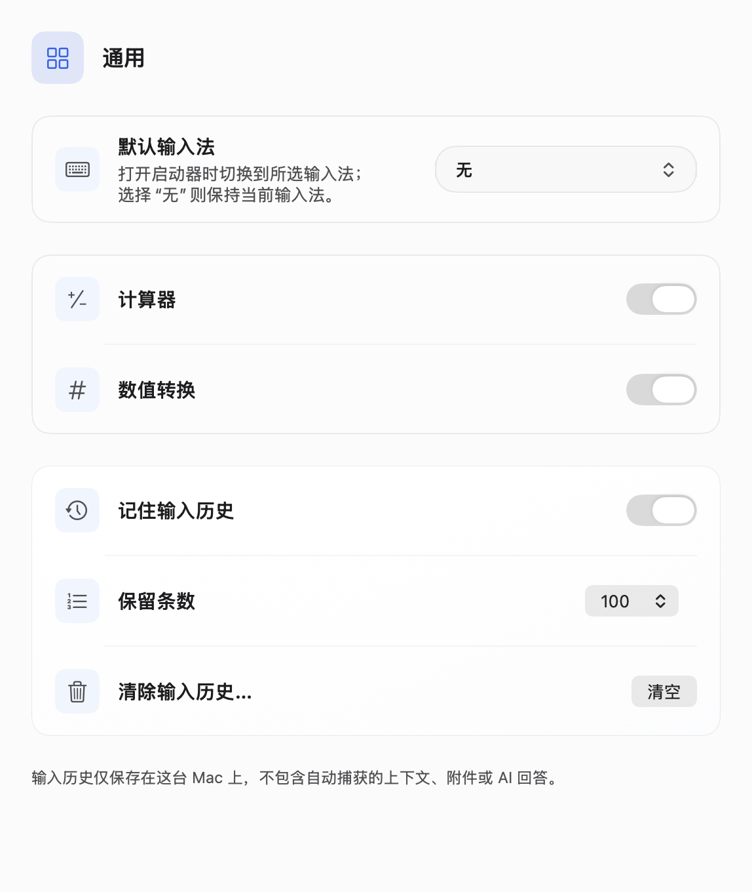
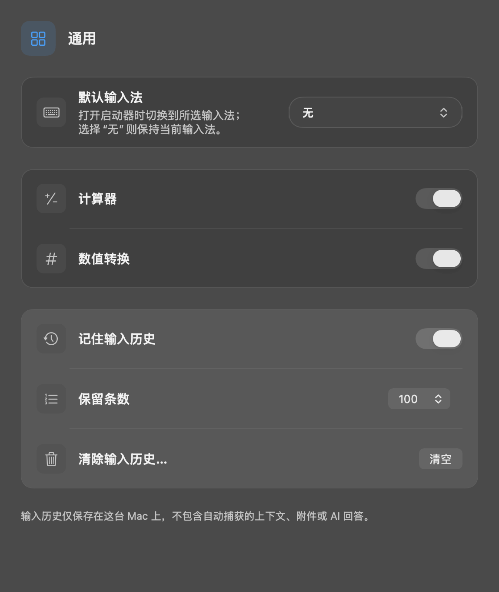

Launcher › General now offers None and the Mac's enabled, selectable keyboard input sources. None is the default and preserves the current input method. A configured source is selected after editor focus on each fresh opening; refocusing an open launcher preserves a manual change. Disabled or removed sources retain their saved ID, display an unavailable option, and are skipped at launch.

Validation on macOS with Swift 6.3.1:

```sh
swift test --build-system native --enable-code-coverage --no-parallel --filter 'AskLauncherInputSourceTests|LauncherInputSourceSettingsTests|AskLauncherToggleTests|AskLauncherMotionTests|AskScreenshotPermissionTests|AskFilePreviewIntegrationTests|LauncherSettingsPolishTests|LocalizationResourceTests'
```

All 64 tests passed: 24 XCTest tests and 40 Swift Testing tests. Total command wall time was 484.24s, including the first native build. `llvm-cov` reports 66/67 added executable lines covered (98.51%); `AskLauncherInputSource.swift` has 96.88% line coverage. These figures describe the changed code, not project-wide coverage.

| Scope | Behavior checked |
| --- | --- |
| Input source and settings tests | Persistence, None, real enabled-source catalog, exact IDs, unavailable and empty catalogs, native picker actions |
| Launcher toggle and motion tests | Focus-before-selection, fresh openings, updated preferences, refocusing, simple/complete window behavior |
| Screenshot permission and file preview integration | Existing launcher entry points and preview lifecycle |
| Settings polish and localization | Full settings pages, Chinese/English light/dark layouts, five-language strings |

The first `make coverage` attempt failed during compilation because the new test catalog's default argument crossed actor isolation (580.72s). The isolation issue was fixed. The same scope then passed all tests (334.30s), but the default `swiftbuild` backend produced no coverage instrumentation or data. The native command above collected valid coverage. No test assertions failed.

The input source and settings files pass strict SwiftLint; the window controller retains the same 15 lint findings as the base revision. SwiftFormat lint passes for those two feature files and the two new test files; `git diff --check` passes.

Self-review checked the settings-to-launcher path, missing preferences, disabled/uninstalled sources, focus ordering, actor isolation, retained Carbon references, notification subscription lifetime, local-only persistence, and localization consistency. Selection is intercepted in tests; the uncovered line is the default `TISSelectInputSource` adapter. Third-party input-method switching was not manually exercised.

Screenshots are rendered from the real settings view with a fixture input-source catalog. Chinese and English layouts and the full page at default/minimum window heights were visually inspected.

| Light | Dark |
| --- | --- |
|  |  |
