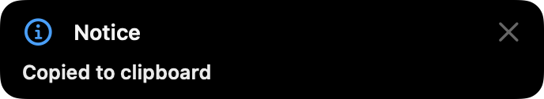
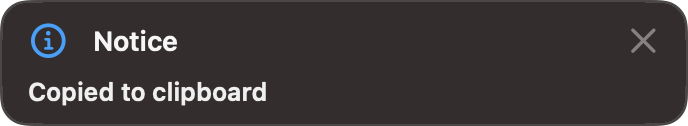

Workflow clipboard feedback now uses the voice-input notice presentation for three seconds, including workflows with a copy action and no explicit HUD. The workflow presenter owns its window so it does not replace an active recording.

Validation against base `5f4fddea`:

- Focused scope: `AskWorkflowNoticeTests`, `AskWorkflowKeywordSelectionTests`, `AskWorkflowActionHostTests`, `AskWorkflowActionRunnerTests`, `AskWorkflowAutomaticWriteBackTests`, and `OverlayControllerTests` (49 discovered test methods).
- The initial run found that `showPassiveNotice` did not initialize a window when called before any recording. Adding `ensureWindow()` fixed this. Only `AskWorkflowNoticeTests` and `AskWorkflowActionHostTests/theNoticePanelShowsANoteForAMoment` were retried: all six methods passed. Previously passing methods were not repeated.
- Changed executable line coverage: 100% (13/13), recorded in `changed-line-coverage.json`. This is changed-line coverage, not project-wide coverage.
- SwiftFormat lint passes for the notice presenter and new tests. SwiftLint reports no findings in the other changed Swift files. `OverlayController.swift` retains the same 22 findings as the base revision. `git diff --check` passes.
- Screenshots below were captured from the rendered notice window and inspected for both interface styles. Tests also verify three-second expiry, repeated-notice timer reset, nonactivating/mouse-transparent presentation, default model routing after launcher dismissal, explicit HUD overrides, and recording isolation.

Coverage used the repository runner. With this Swift 6.4 toolchain, an explicit instrumented native build is needed before coverage discovery; a workspace-local Swift shim supplied `--build-system native --jobs 4` to nested SwiftPM calls without changing the repository or global toolchain.

```sh
swift build --build-system native --jobs 4 --enable-code-coverage --build-tests
SUITE="AskWorkflowNoticeTests AskWorkflowKeywordSelectionTests AskWorkflowActionHostTests AskWorkflowActionRunnerTests AskWorkflowAutomaticWriteBackTests OverlayControllerTests" scripts/coverage.sh --from-env --skip-build

# After fixing first-use window initialization:
swift build --build-system native --jobs 4 --enable-code-coverage --build-tests
scripts/coverage.sh --skip-build --suite AskWorkflowNoticeTests --filter AskWorkflowActionHostTests/theNoticePanelShowsANoteForAMoment
```

Total command wall time, including build, discovery, execution and export: initial failed validation 759.53 seconds; focused retry 148.61 seconds. Initial explicit build took 661.41 seconds; retry build took 86.15 seconds. The retry executed six methods in 22.58 seconds; its coverage runner took 56.77 seconds. No full test run was performed.

Classic:



Liquid Glass:


