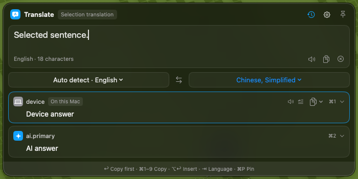
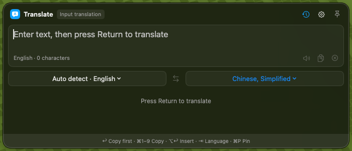
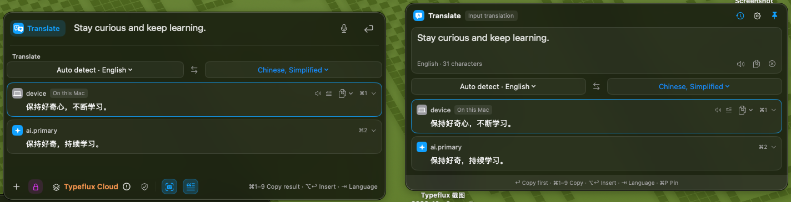
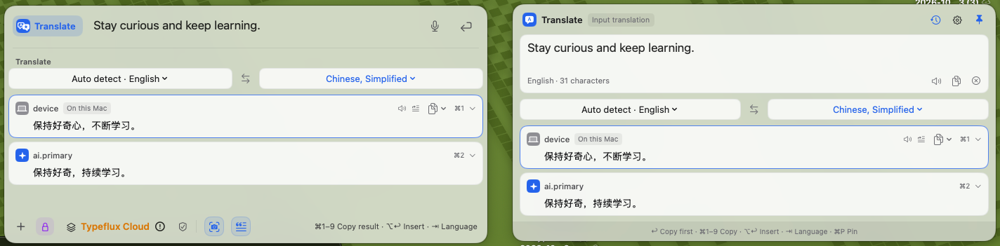
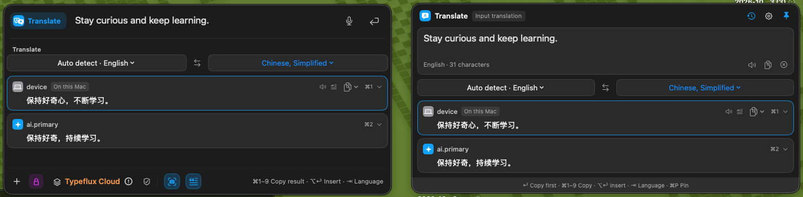
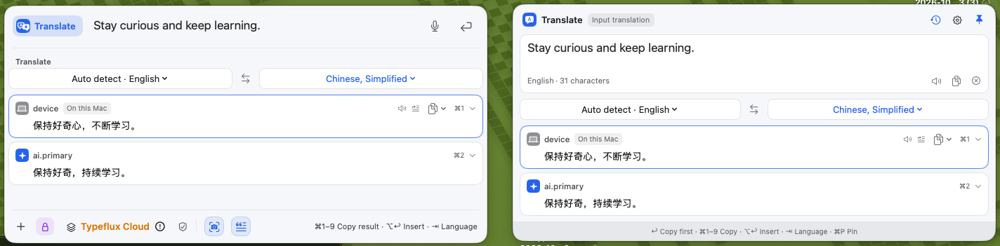
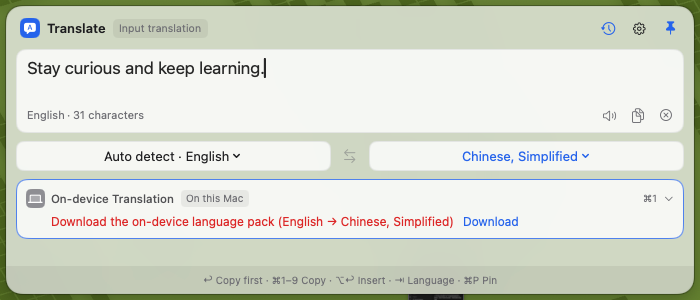

# GUL-392 translation acceptance fixes

The Translate shortcut captures selected text and submits immediately, or focuses/opens the typing panel when no text is selected. Migration prefers the old selection binding, then the old input binding, removes both retired owners and preserves an already migrated binding. Screenshot Translation remains separate.

All entry points use the configured screen-center, pointer or last position. Selection bounds choose the screen, and pinned selection translation keeps the panel's position. The panel defaults to the launcher's 700-point width, supports edge resizing with a 520 × 300-point minimum and remembers the width and viewport-height limit. Short content still fits naturally, while long results scroll within the user's viewport and maximum screen-height preference.

The panel uses the launcher's `AskComposerChrome`, `AskGlassBackground`, native window shadow, 16-point corner and 17-point input font. Its shared translation cards use opaque Classic surfaces or the existing glass card fills. `InterfaceStyleObserver` supplies live style/intensity changes; window appearance changes also apply while it is open. The existing reduced-transparency and increased-contrast material rules apply.

Supported but missing on-device language packs have a separate Download recovery. A view-owned Translation session requests the system download and retries only the device result when ready. Older systems or preparation failures fall back to Language & Region settings. Cancelled/stale preparation and edited input cannot authorize a later translation. See [Apple's session/download documentation](https://developer.apple.com/documentation/translation/translationsession/isready).

## Evidence

Captures use production AppKit controllers and SwiftUI views on the configured Mac mini. Translation, selection and availability dependencies are deterministic test fixtures; screenshots do not claim a live provider request, external-app paste or a completed language-pack download.

## Validation and self-review

The focused scope covers shortcut migration/conflicts/settings, the panel's coordinator/model/placement/controller and keyboard behavior, translation fanout and recovery, shared launcher result interactions, style/material tokens and native rendering. No full test run was requested.

Reviewed entry-to-result and write-back flows, retained content, duplicate/conflicting shortcuts, screen bounds and extreme resize values, async cancellation/stale results, observer/monitor cleanup, native download recovery, credential-safe messages and localization/documentation consistency. Review fixed dynamic center placement during content growth, download focus loss and automatic retry after input edits. The exact executed commands, counts, timing and coverage are recorded below after validation.

## Native screenshots

Every image is an unmodified native screen capture. The paired images show the launcher on the left and the translation panel on the right. Screen-center placement is also asserted against the visible screen frame with selection bounds near its lower-right edge.

| Entry / appearance | Capture |
| --- | --- |
| Selected text, screen-center setting |  |
| No selection, focused typing panel |  |
| Liquid Glass, dark |  |
| Liquid Glass, light |  |
| Classic, dark |  |
| Classic, light |  |
| Missing language pack |  |

The input panel now prompts Return while awaiting its first translation, rather than incorrectly saying that no services are enabled. Visual review checked material, corners, outlines, native shadows, input/result typography and shared cards in all four appearance combinations.

## Executed validation

The final run on macOS 26.6.2 / Swift 6.4 (Xcode 27) passed **155 tests: 133 Swift Testing tests in 20 suites plus 22 XCTest tests**. Parameterized migration tests include all eight legacy/current-binding combinations. The complete final coverage command took **130.35 seconds** including preparation, discovery, execution and reporting; the runner-only total was 126.13 seconds. It rebuilt changed inputs and used verified build products, not cached passing results.

```sh
export PATH="$PWD/artifacts/bin:$PATH"
export TYPEFLUX_TRANSLATION_PANEL_SNAPSHOTS="$PWD/artifacts/native"
export TYPEFLUX_TRANSLATION_NATIVE=1
make coverage \
  SUITE="AskTranslationAcceptanceTests AskTranslationPanelCoordinatorTests AskTranslationPanelSelectionTests AskTranslationPanelPolicyTests AskTranslationPanelControllerTests AskTranslationPanelModelTests AskTranslationPanelSettingsViewTests AskTranslationFanoutTests AskTranslationStackViewTests AskTranslationSettingsTests AskTranslationSettingsModelTests AskTranslationEngineFactoryTests AskTranslationEngineTests AskTranslatePluginTests AskTranslationRoutingTests HotkeySettingsStoreTests HotkeySettingsModelTests HotkeySettingsViewTests HotkeyConflictCheckerTests SettingsViewModelHotkeyTests InterfaceStyleTests AskComposerChromeTests AskGlassTests" \
  FILTER="AskQuickResultsInteractionTests/translationStack.*"
```

The normal runner was attempted first. This toolchain's default Swift build backend ran tests but emitted no profiles. The task-local Swift wrapper used the same native-backend instrumentation workaround recorded for P1–P3: `--build-system native` with `-Xswiftc -profile-generate -Xswiftc -profile-coverage-mapping`. It also restored the standard `zh-Hans.lproj` / `zh-Hant.lproj` names after native SwiftPM lowercased them. Only generated task-local bundle directories were adjusted; no repository build scripts or product resources were renamed.

| Attempt | Complete command wall time | Result |
| --- | ---: | --- |
| Initial standalone build and formatting | 215.34 s | Build failed on one deleted source file retained by the task-local cache seed; removed that stale worker file |
| Normal focused coverage | 51.38 s | Compile failure in the new appearance callback; explicit `self` capture corrected |
| Normal focused coverage retry | 216.67 s | 22 XCTest + 131 Swift Testing tests executed; one size-storage assertion failed; split its cast/member expression into an explicit numeric value. No profiles emitted |
| Instrumented focused coverage | 286.33 s | Resize assertion and native captures passed; one existing locale-resource lookup failed because generated bundle directory names were lowercased |
| Targeted resource/UI retry | 69.97 s | 7/7 passed after generated-bundle normalization and the pending-input prompt fix |
| Final focused coverage, fresh profiles | **130.35 s** | **155/155 passed** after adding native-status-adapter and download-fallback tests |

[Changed-code coverage](changed-code-coverage.json) is **92.76% (282/304 executable added or modified production Swift lines)** against `df4b361f`. Every changed production Swift file is instrumented. The final measurement intersects `git diff --unified=0` with LCOV line records and excludes resources, test code and nonexecutable lines. Earlier profiles were moved aside before the final run: this result uses only the final binary and its fresh focused profiles. It is not project-wide coverage. The per-file report lists the remaining uncovered platform/native-window branches, including the actual system download prompt, which was not exercised during validation.

Final strict SwiftLint comparison against the exact base reports **zero new findings**, with 38 inherited findings in the changed files. The new presenters have no lint findings. `git diff --check` and required localization-key uniqueness checks pass. [Source hashes](source-hashes.json) confirm the worker tested the same 31 Swift/localization files delivered in the checkout. [Capture metadata](capture-metadata.json) records image dimensions and hashes.

The final review also checked resized viewport persistence, invalid stored dimensions, all three selection placement preferences, pinned repeated selections, focused input retention, selection replacement/failure copy, download success/failure/cancellation/stale requests, edited-input retry authorization, live style/appearance observation and observer cleanup. No credentials were added, and no live paid translation or language-pack installation was performed.
