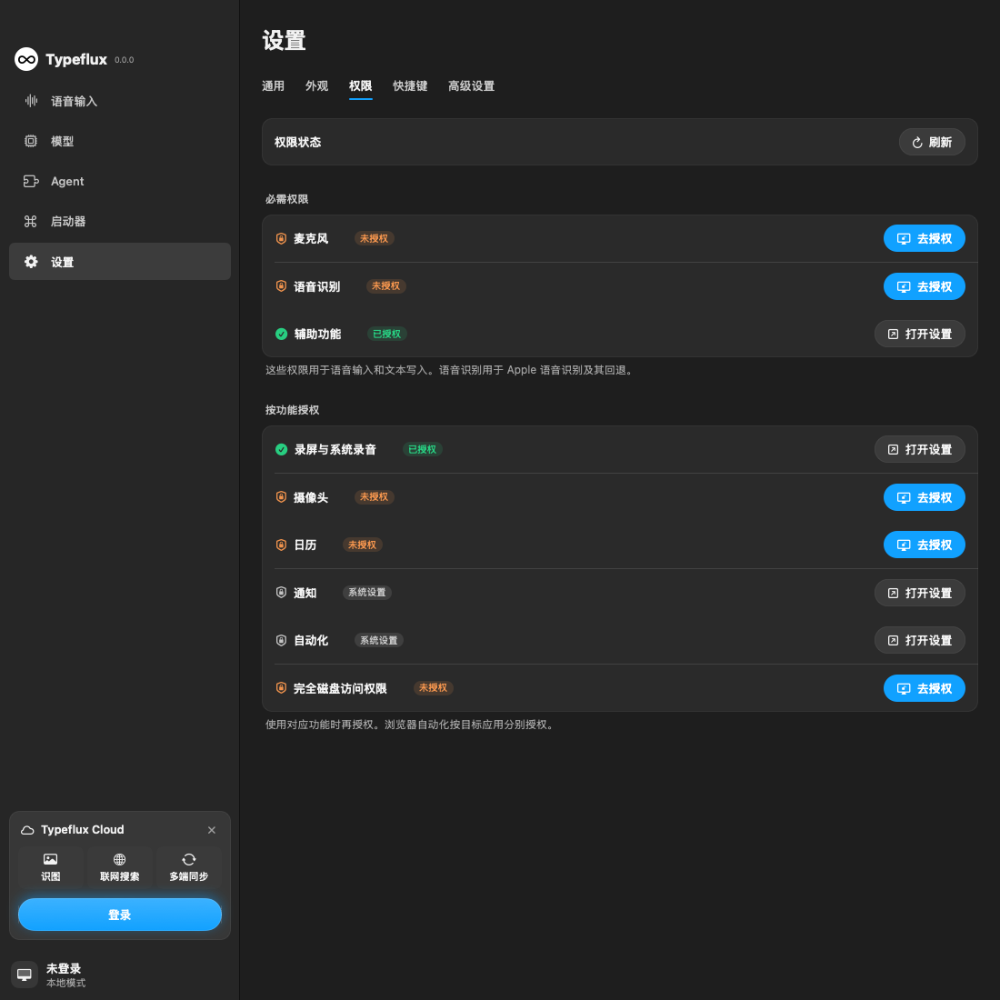
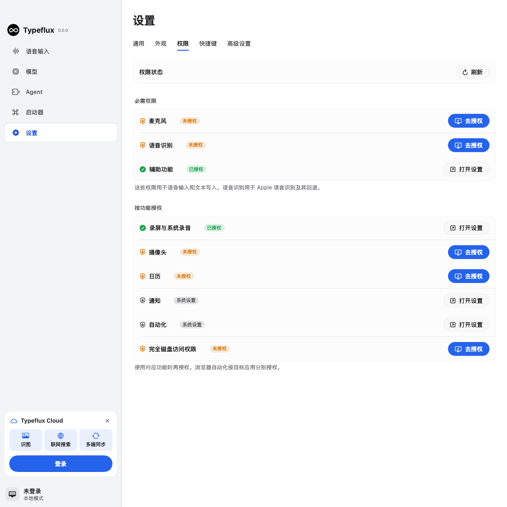

GUL-395 moves permissions from General into a Permissions tab between Appearance and Shortcuts. The page retains microphone, speech recognition and accessibility as the default required group, and adds screen recording, camera, calendar, notifications, automation and full disk access as feature permissions. It uses the existing permission adapters where available. Automation stays managed per target app in System Settings.

The page reads permission status on entry, on refresh and when Typeflux becomes active. Reading status never requests access. Explicit actions request first-time access or open the corresponding system settings after an earlier decision. Requests are serialized, overlapping refreshes are coalesced, and failed requests leave a visible message. The onboarding requirements remain provider-dependent.

Validation ran on macOS with Swift 6.4:

```sh
swift build
make coverage SUITE="PermissionsSettingsTests AppSettingsPagesRenderTests SettingsOrganizationTests KeywordHotkeyRunnerTests PrivacyGuardTests ScreenCapturePermissionTests OnboardingViewModelTests"
```

The build passed. The first coverage attempt failed during test compilation because a nested UI helper lacked a main-actor annotation (49.13 seconds); that annotation was added. The next attempt passed all 75 selected tests, but Swift 6.4's default `swiftbuild` backend did not create its coverage directory (119.54 seconds). Coverage was then collected with the supported native backend and the same scope:

```sh
swift test --build-system native --enable-code-coverage --no-parallel \
  --filter '^TypefluxTests[./](PermissionsSettingsTests|AppSettingsPagesRenderTests|SettingsOrganizationTests|KeywordHotkeyRunnerTests|PrivacyGuardTests|ScreenCapturePermissionTests|OnboardingViewModelTests)[./]'
```

All 75 tests passed: 43 XCTest tests and 32 Swift Testing tests. Total command wall time was 265.83 seconds, including the first native dependency build; this was not a cached test result. The test process used the repository's credential-filtering environment helper.

| Scope | What it verifies |
| --- | --- |
| PermissionsSettingsTests | Catalog, settings URLs, five languages, read-only checks, grant/denial routes, failure and cancellation cleanup, concurrent requests and refreshes, tab placement, rendered actions and 720/1100-point layouts in English/Chinese and light/dark |
| AppSettingsPagesRenderTests | Every settings pane still renders in light and dark |
| SettingsOrganizationTests | Shared settings navigation and page headers |
| KeywordHotkeyRunnerTests | Updated settings tab order and shortcut entry points |
| PrivacyGuardTests, OnboardingViewModelTests | Existing core permission and onboarding requirements |
| ScreenCapturePermissionTests | Screen recording registration, grant checks and settings fallback |

Changed executable source lines have **98.06% coverage (202/206)**. `changed-line-coverage.json` intersects staged source additions with unique LLVM LCOV `DA` line counts; tests, translations and documentation are excluded. Uncovered lines are native notification calls and the unreachable core-permission fallback. Native permission dialogs were not invoked: adapter routing is tested with injected operations, and live status checks are read-only. The ordinary LLVM file-summary report for the four new source files plus AppSettingsPane reports 96.11% line coverage; it includes existing enum code and counts overlapping function regions separately.

SwiftFormat lint passed for the new Swift files and settings enum. Strict SwiftLint passed for those production files with zero violations. Comparing all SettingsView violations against the committed version found no new violations (18 before, 17 after); its existing lint debt was left unchanged. `git diff --check` and `plutil -lint` for all five translation files passed.

Self-review covered navigation through authorization and refresh, unknown/denied/restricted permissions, async cancellation and overlap, resource ownership, privacy and localized copy. It corrected actor-isolated default argument construction, removed the iOS-only ephemeral notification status, and made screenshots wait for enabled actions after refresh. No credentials or new dependencies were added.

These images were rendered by the production StudioView with test settings. Notification status is shown as System Settings because the SwiftPM host is not an app bundle; the packaged app reads its authorization status normally. The 720-point layouts were also rendered and checked for clipped buttons. Real macOS permission dialogs and changes to privacy settings require acceptance testing in the packaged app.




