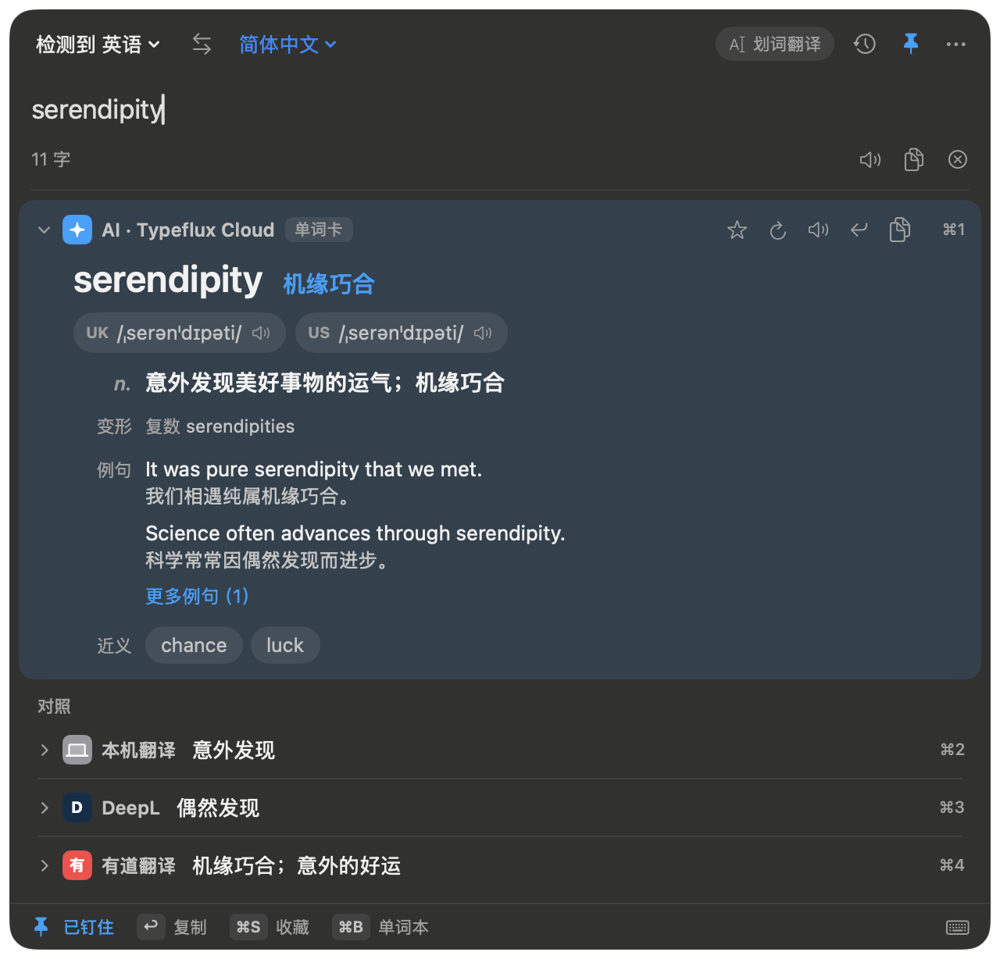
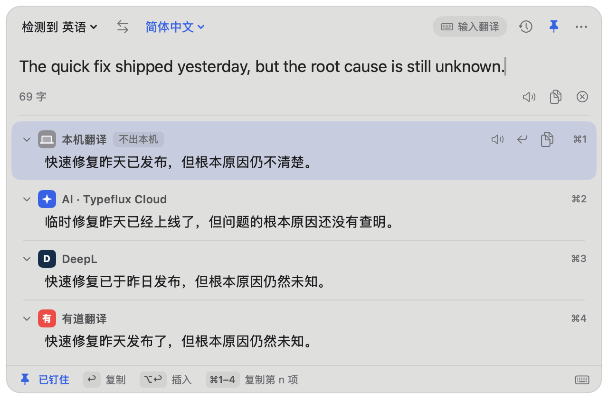
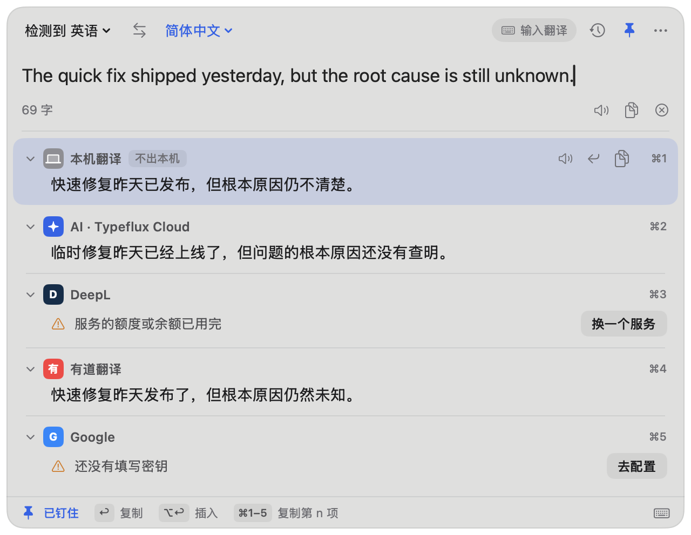
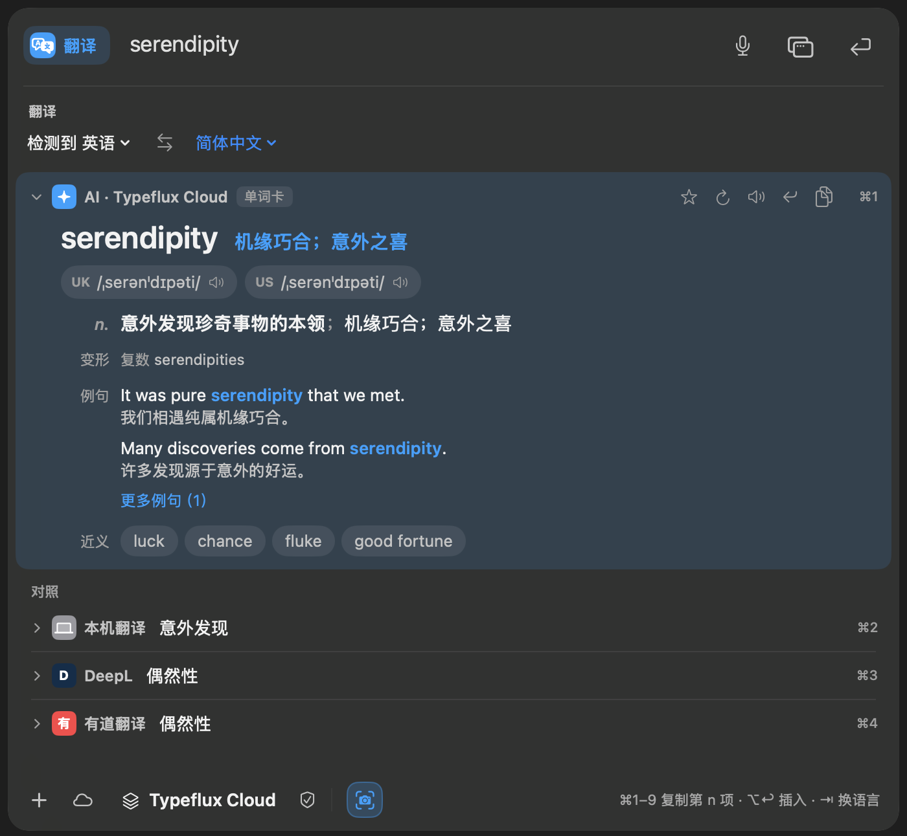

# GUL-396 验证记录：翻译面板 v2

设计稿：`docs/design/translation-panel-v2.html`、`docs/design/translation-panel-v2.md`。

## 真机截图

下面都是 macOS 上实际 AppKit / SwiftUI 窗口的原始截图，没有修改。译文、错误和服务状态由测试依赖提供，不调用真实付费服务。

| 画面 | 截图 |
| --- | --- |
| 单词释义（深色） |  |
| 句子对照（浅色，第 1 项选中） |  |
| 服务失败（浅色） |  |
| 启动器 `fy`（共用语言对和结果行） |  |

## 测试

在 macOS 上用 `make test` 跑相关测试，命令覆盖改动涉及的面板、结果列表、单词卡、本地化，以及启动器里的翻译交互。

```sh
export TYPEFLUX_TRANSLATION_PANEL_SNAPSHOTS=/tmp/gul396-shots TYPEFLUX_TRANSLATION_NATIVE=1
make test SUITE="AskTranslationPanelRedesignTests AskTranslationPanelControllerTests AskTranslationPanelModelTests AskTranslationPanelPolicyTests AskTranslationAcceptanceTests AskTranslationPanelCoordinatorTests AskTranslationPanelSelectionTests AskTranslationStackViewTests AskTranslationPolishTests AskWordCardTests AskWordCardViewTests AskWordCardTranslationTests LocalizationResourceTests" \
  FILTER="AskQuickResultsInteractionTests/translationStack.*"
```

最终一次运行：**84 个 Swift Testing 测试（13 个套件）+ 24 个 XCTest 全部通过**，总耗时 119.45 秒。

中间失败过几次，都已修复：
- 测量到的面板高度多算了 6pt：删掉多余的间距。
- 面板高度是小数（518.4）时，AppKit 会向上取整超出上限：`AskTranslationPanelPlacement.height` 改为取整到整数点。
- 两个测试写死了 700pt 宽度：改为引用 `AskTranslationPanelPlacement.width`。
- 繁体中文、日语、韩语原本缺少 `ask.translation.stack.swap`：已补上。
- 结果行去掉描边后，无障碍框不再包含下边距 10pt：更新了「最后一行到底栏」测试的上限，并在测试里写明原因。

覆盖率：默认构建后端不生成覆盖率数据（与 GUL-392 记录的情况相同），所以改用原生后端插桩：`swift test --build-system native -Xswiftc -profile-generate -Xswiftc -profile-coverage-mapping`。这次跑了 7 个主要套件，43 个测试全部通过，构建加运行耗时 449 秒。下表是 `llvm-cov report` 统计的、改动涉及的源文件的整文件行覆盖率：

| 文件 | 行覆盖率 |
| --- | ---: |
| `AskWordCardView.swift` | 97.83% |
| `AskTranslationStackView.swift` | 95.12% |
| `Panel/AskTranslationPanelView.swift` | 90.16% |
| `Panel/AskTranslationPanelModel.swift` | 95.00% |
| `Panel/AskTranslationPanelModel+Actions.swift` | 89.53% |
| `Panel/AskTranslationPanelPlacement.swift` | 100.00% |
| `Panel/AskTranslationPanelController.swift` | 86.73% |
| **合计** | **93.72%** |

SwiftLint：改动的文件没有错误。`AskTranslationPanelController` 的类型长度警告是改动前就有的，本次从 255 行降到 252 行。

## 自审

- **功能闭环**：语言对、交换、近义词查词（`runWith` → 面板重新翻译，启动器走原有的 `runWith` 路径）、收藏和重新生成图标、复制和插入后的底栏反馈、空白状态点击历史后翻译、⋯ 菜单（单词本和设置）、快捷键面板。
- **边界**：没有历史时显示原来的提示；反馈名称找不到对应服务时，用选中项或截断的原文代替；只有一项结果时显示 `⌘1`；同语言和失败状态沿用原有逻辑。
- **并发和资源**：反馈计时用一个 `Task`，新的反馈会取消旧的，`deinit` 时也会取消。
- **一致性**：去掉了不再使用的 `AskTranslationAppearance.cardFill/border` 和对应断言；设计文档 §6 和 §7 已更新为已实现的状态。
