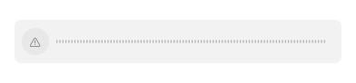

# GUL-399: clipboard file audio playback

Clipboard audio previews now own a persistent session in the existing independent `TypefluxMediaHelper`. The host no longer creates an `AVPlayer` in `ClipboardAudioPlayback`. Loading is silent. Explicit play/pause/seek commands receive ordered acknowledgements; progress is a bounded snapshot requested every 250 ms. Failed commands are not replayed. A missing acknowledgement means the effect may be unknown until the child is stopped, not that the command never happened.

## Contract and ownership

- Private inherited socket fd 100; version/session UUID/strict sequence/command validation. One command and reply in flight; at most one pending explicit control in each view. No progress event queue. Frames are limited to 2 KiB, sequence to 100,000, finite duration to 24 hours and seek fractions to [0, 1]. Pause, seek, end and explicit restart-at-end retain their semantics. UI state is updated from acknowledged native state, not an optimistic toggle.
- Two independent playback admissions, acquired before detached copying or process launch. A single latest replacement load may wait for its old view operation to finish; it cannot resume playback. Cancelled, uncooperative host exchanges retain their admission even after the child is reaped. The shared `MediaLease` and bounded file-copy routine are reused, not another executable or inference service.
- Source must be a local/resident regular non-symlink file, path at most 4 KiB, nonempty and at most 512 MiB. An allowlisted container suffix is preserved on the private copy. Directory mode 0700, input mode 0600, streaming copies in 64 KiB chunks. Pre/post-copy and before/after-command dev/inode/size/mtime/ctime checks reject changed/deleted sources. These checks are snapshots, not an immutable filesystem transaction.
- The child requires an audio track and no video tracks. AVFoundation external media references are forbidden with `AVURLAssetReferenceRestrictionsKey` / `.forbidAll`; a container that depends on other files or URLs fails rather than escaping the private single-file lease. Original files are never removed.
- Parent startup/load deadline 10 seconds; subsequent exchange deadline 5 seconds; child idle read deadline 10 seconds. The helper arms a 12-second independent alarm before receiving and before executing each command, including cleanup after EOF. Parent and child enforce a four-hour session lifetime. Application quit fences new playback and waits up to two seconds for retirement; an uncollected child or stuck host exchange still consumes its slot. Failure budget is independent of thumbnails, waveform/metadata and other media pools, counted once per failed child. No automatic restart or resume.
- View ownership retains the original access/epoch and request generation. Collapse, actual panel orderOut/close, selection, entry replacement/deletion, account changes and owner release stop/fence playback and clear state. The panel scope is invalidated directly on selection changes, rather than waiting for SwiftUI to remove the old subtree. Pausing clipboard capture still permits existing history to be viewed. Failure uses a localized unavailable control in five languages.



## Main integration

During implementation, #544, #545 and #547 merged into main. This PR therefore targets main directly, not the former intermediate branch. Updated main was `f1a7a48a65b9d7f52804ae4e3b22e951303d3b14`; it contains `6d5961f5` and the concurrent #546 launcher/settings changes. Local integration preserved 13 main-only paths and 12 feature-only paths byte-for-byte. Six shared paths (AppCoordinator and five localization tables) merged automatically and were reviewed. Main's obsolete-label removals remain removed; playback labels remain present. No GitHub PR was merged by this agent.

## Validation

The final integrated source passed **33/33 focused XCTest methods**: 12 `ClipboardPlaybackIsolationTests`, nine `ClipboardAudioPlaybackTests`, four row-rendering methods, two panel-scope lifecycle methods, four shared media-worker ownership/copy methods and two localization methods. This maps to protocol/engine controls, hostile frames and identities, source mutation/bounds, crash/hang/cancellation, reaped-child versus blocked-host admission, watchdog/lifetime, no-autoplay/replay, owner release, selection/deletion/account/panel hiding, actual unavailable UI rendering, shared copy/retirement compatibility and preservation of main's localization removals.

Two packaging tests and an actually copied app-bundle helper probe passed again after the final build. The probe sends only `load`, `seek`, `pause`, `status`, then closes the socket and collects the child; its silent WAV bytes remain unchanged. The UI screenshot above is a synthetic component, not desktop capture.

Changed executable lines: **408/419 = 97.37%**. The final five fresh profiles (three host, one direct helper, one copied helper) came from **one final integrated binary set**, each validated with `llvm-profdata show` and merged without warnings. Earlier feature profiles were archived but are not evidence for this final percentage. The helper is supplied as `llvm-cov --object`; no new source was omitted. The eleven uncovered lines are four DI/quit bridges and seven native end/play/restart lines. Line coverage does not establish all branches, allocations, native device behavior, alarm expiry or real quit integration. A premature attempt to read the coverage report before its archival/extraction command completed found no file; after collecting that command, extraction and inspection succeeded without dropping profiles.

Commands (sanitized `scripts/test_runtime.child_environment`, serial, no discovery rebuild between final build and tests):

```sh
swift build --build-system native --build-tests --enable-code-coverage --jobs 4
# Verify __llvm_covmap and __llvm_prf_cnts in the test binary and helper.
swift test --build-system native --skip-build --enable-code-coverage --no-parallel --filter '^Typeflux(?:Focused)?Tests[./](?:ClipboardPlaybackIsolationTests[./]|ClipboardAudioPlaybackTests[./]|ClipboardRowRenderingTests[./]|ClipboardThumbnailIsolationTests[./](?:testActualOrderOutCloseAndAccountChangeRevokePanelScope|testPausePreservesHistoryButHiddenPreviewAndOwnerReleaseClearPixels)|LocalizationResourceTests[./](?:testLocalizedStringTablesParseForAllSupportedLanguages|testGeneralSettingsSectionTitlesExistAndQuickInputCopyIsGoneInEveryLanguage)|MediaWorkerTests[./](?:testCopiedInputIsPrivateAndRemovedOnlyAfterConfirmedCollection|testTwoRetainedChildrenBoundAdmissionAndShutdownFences|testOversizedDataFileMissingFileAndFIFORefusedBeforeSpawn|testCancellationBeforeAndAfterDispatchRejectsLateResult))'
python3 -m unittest scripts.tests.test_media_packaging
```

Build wall times, including preparation/failures: 369.43, 75.81, 41.50, 36.23, 38.77, 63.11, 175.67, 191.38 seconds. Build one failed on the old playback tests' actor/API contract, before any functional tests; subsequent builds passed. Focused test command times: 17.96, 16.97, 20.96 seconds. Earlier packaging/probe: 0.301/0.227 seconds; final packaging/probe: 0.195/0.331 seconds. Total tracked build/test/packaging/probe commands: **1048.844 seconds**. Source audit, archival, coverage extraction and screenshot inspection are additional. No source or test input changed after the final integrated build.

Final test binary SHA-256: `82badce36ba57cc346286ad9c0e5a4325474e1e67414564724667c537bafda02`. Helper: `85d5a12a8c0dae28d3c1928b1a45886f75f88fa5e40b9f0be8459f4d10ecc7e0`. Both application and helper target macOS 13. The test toolchain/runtime's macOS 14 target is not macOS 13/Intel hardware validation. The host has zero global `TypefluxMediaRuntime` symbols (`nm -gU`); native playback remains in the separate helper.


The initial feature pass ran 29 methods: 27 passed and two retirement/cancellation fixtures incorrectly tried to reserve another session immediately after deliberately tripping the same pool's failure backoff. Fixtures were corrected to use separate fault domains / hold both admissions before returning failed children. The affected 10-method isolation suite and one corrected UI method then passed 11/11. The initial UI screenshot was nearly invisible because the fixture mixed dark dynamic colors with a white background; its appearance was corrected and actual visible pixels are now asserted. No production limit was weakened for these failures.

Subsequent review forbade external asset references and added a child command watchdog plus host-exchange retirement barrier. Updated main was then validated with a fresh focused scope; previous passing results and coverage profiles are not reused for this final result.

## Remaining boundaries

Actual audible playback, output devices, interruption/route changes, Developer ID signing/notarization, Intel/macOS 13 hardware and real application quit/recording interactions were not exercised. The native `play()` / end-notification / restart branches are deliberately not triggered by synthetic tests; injected engines test those controls without emitting audio. No real capture, microphone/TCC, clipboard reads/writes, paste events, provider/network calls or full suite were run.

The existing clipboard video `ClipboardMediaPlayer` still owns `AVPlayerView` / `AVPlayer` in the host. `ScreenRecordingCoordinator.preparePreview` still loads AV duration and owns an AVPlayer/periodic observer, and its preview uses AVPlayerView. These require their own coherent video-frame/audio-sync/control/trim lifetime migration; audio-only isolation does not turn them into thumbnails. User-invoked OS Quick Look remains an explicit OS/UI boundary. Existing file-index and semantic decoder workers are unchanged.

Shared persisted health still covers the three stores; playback and other native/media/inference domains need the approved lifecycle/health integration. File playback does not decide microphone capture ownership. Real CoreML/model performance, full Xcode builds, audio/TCC/signing/performance verification and the other approved stages remain unfinished. Host filesystem calls, raw raster/JSON/base64/pasteboard/SQLite/import/export/UI and OS-managed AV/CoreAudio services retain boundaries. Child isolation and bounded admissions are not a system-wide memory, arbitrary host crash or power-loss cleanup guarantee. A host crash can leave private temporary files.
