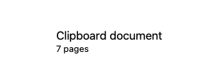

# GUL-399: isolated clipboard metadata and waveforms

Clipboard PDF page counts, AV duration and audio waveform extraction now run in the existing media helper. The host receives validated scalar metadata/normalized peaks, with no PDFKit or AVFoundation parsing in `ClipboardMediaInfoProvider`. This is file analysis, not microphone capture or playback isolation.

This increment depends on #537 (`agent/arch-gpt-astra/gul-399-clipboard-thumbnails`, `2d8d8e670e8657545979ba99a2131048c77e03e2`), still open against #536 at delivery. #536 depends on #535; the earlier consolidated #534 is already on main. Existing PR bases are preserved.

## Contract and ownership

- `MediaClipboardOptions` explicitly selects PDF page count, duration, or waveform. Requests retain the 1 KiB bound; responses are limited to 16 KiB. Mixed payloads, missing options, wrong UUID/version, invalid page counts/durations, nonfinite samples and wrong waveform length fail closed. Older helpers cannot acknowledge this operation and are not used as a host-decoding fallback.
- PDFs use private copied inputs up to 50,000,000 bytes, with page counts from 1 through 1,000,000. Audio/video use private copies up to 512 MiB and allowlisted container-extension hardlinks for AVFoundation format hints. Source paths are local file URLs of at most 4 KiB. The host rejects nonregular/nonlocal/nonresident sources and compares device/inode/size/mtime/ctime before and after extraction to reject changed originals. These metadata checks are not an immutable filesystem transaction or a continuous watcher.
- The existing clipboard waveform semantics remain: first **600 seconds**, mono **8 kHz**, **180 peak buckets**, with max-pool resampling for views. This is separate from the Ask preview's 30-second/80-bucket contract. PCM blocks are limited to 4 MiB and total decoded data to 24 MiB before allocation; sample-index arithmetic and requested bar counts are bounded. Silence remains zero and nonfinite decoded samples cannot escape as UI values.
- Two host admissions occur before detached work. A dedicated `MediaWorker.clipboardMetadata` pool permits two disposable children with a 10-second deadline, retained cancellation/reaping leases and no queue or automatic replay. Private inputs remain until actual child collection and host completion. The existing helper's 35-second orphan alarm remains. App lifecycle wiring fences and awaits the new pool. No new executable, packaging target or resource path is added.
- App-lifetime path-only metadata/waveform caches are removed. Each visible `ClipboardMediaProjection` owns its request, original authorization, generation, task and bounded scope registration. List rows, side previews and waveform views use an explicit asynchronous container; getters do no IPC or task creation. Same-ID source replacement changes the request, while panel hiding, deletion, account changes and preview collapse revoke the existing panel scope. Late/cancelled/unauthorized results cannot repopulate the display. Failed attempt identities do not automatically retry from body recomputation.
- A panel shares the existing 16-observer scope limit with its thumbnails; busy/unavailable projections retain their established placeholder/approximate-information presentation. Metadata results are bounded scalars plus at most 180 floats, not pixels. Original history bytes and explicit copy/paste remain intact. No live pasteboard reread, workflow, Agent action, paid generation or other producer is repeated to recover a projection.

## Focused validation

Implementation and self-review preceded tests. The first preparation build failed on one unqualified static-member reference (`waveformResolution`); it was corrected to `Self.waveformResolution` before tests. The final direct instrumented build passed. **38 XCTest methods passed in one focused pass**, with no functional failures, retries or timeout changes.

Commands use `scripts/test_runtime.child_environment()`:

```sh
swift build --build-system native --build-tests --enable-code-coverage --jobs 4
swift test --build-system native --skip-build --enable-code-coverage --no-parallel --filter '<explicit scope below>'
python3 -m unittest scripts.tests.test_media_packaging
python3 ../gul-399-metadata-probe.py
```

Task-local `gul-399-metadata-test.py` selected:

- All 12 `ClipboardMetadataIsolationTests`: strict protocol; PCM and resampling bounds; real-helper PDF/duration/waveform and changed-file reread; synthetic 601-second audio proving a 300-second pulse is included and a post-600-second pulse excluded; malformed/oversized sources; retained admissions through uncooperative cancellation; source mutation after a response; harmless crash/hang children; failure identity; stale results/authorization; bounded observers; actual scoped metadata rendering and revocation.
- All eight `ClipboardMediaInfoProviderTests`: legacy peak/overflow/silence semantics, resampling, cancellation/later reads, audio duration and shape, PDF pages and unavailable/unsupported inputs. Cache assertions were removed with the cache; native extraction assertions remain.
- All four `ClipboardRowRenderingTests`: row states, stable height, equality/action behavior and waveform/player presentation. Synthetic file preparation does not start playback.
- Four `ClipboardPreviewPaneTests`: `testDetailRowsDescribeTheEntry`, `testPaneDrawsEveryKind`, `testPanelRendersWithThePreviewPane`, `testControllerWidensThePanelForThePreview`.
- Two `ClipboardThumbnailIsolationTests`: `testActualOrderOutCloseAndAccountChangeRevokePanelScope`, `testPausePreservesHistoryButHiddenPreviewAndOwnerReleaseClearPixels` verify the reused panel lifecycle.
- Two `MediaProtocolTests`: `testInvalidIdentityVersionAndAmbiguousResponsesFailClosed`, `testCommandFramesReadFailureAndSuccessfulResponse`.
- Two `MediaAVPreviewTests`: `testTimingAndWaveformProtocolRejectsNonfiniteWrongIdentityAndMixedPayloads`, `testNativeAudioSelectionAndVideoTransform` preserve the independent existing AV preview contract.
- Four `MediaWorkerTests`: `testCopiedInputIsPrivateAndRemovedOnlyAfterConfirmedCollection`, `testProtocolIdentityFailureAndCooldownNeverReplay`, `testTwoRetainedChildrenBoundAdmissionAndShutdownFences`, `testCancellationBeforeAndAfterDispatchRejectsLateResult`.

Both packaging tests passed. A copied-helper probe installed the real executable under `Fixture.app/Contents/Helpers`, requested a synthetic WAV waveform and verified identity, one-second duration, 180 finite normalized values, response size and retained original input. The screenshot below shows the actual scoped metadata container with an injected seven-page result; its test also verifies clearing on scope retirement. It was visually inspected. Existing row/pane rendering tests cover the production callers; this fixture is not a full app or permission-dialog screenshot.



| Command | Wall time | Outcome |
| --- | ---: | --- |
| Preparation build | 52.03 s | static-reference compile failure, fixed |
| Final instrumented build | 429.63 s | passed |
| Focused tests | 23.87 s | 38 methods passed |
| Packaging tests | 0.259 s | 2 passed |
| Copied-helper waveform probe | 0.232 s | passed |

Tracked total: **506.021 seconds**, excluding audit, screenshot inspection and coverage extraction. No full suite, live clipboard capture/copy/paste, microphone/screen capture, external network, paid provider, signed release or hardware matrix was exercised.

## Coverage evidence

The final XCTest and helper contain `__llvm_covmap` and `__llvm_prf_cnts`; no discovery rebuild occurred before the prebuilt test pass. Twelve fresh profiles (three host, eight directly invoked helper, one copied-helper probe) came from this final binary set. Each passed `llvm-profdata show`; the merge completed without warnings. No previous increment profiles or incompatible counter layouts were reused. The helper was included as `llvm-cov --object`, and all new source files were included in the changed-line diff.

`clipboard-metadata-coverage.json`: **248/252 changed executable lines, 98.41%**. The four uncovered lines are DI/quit bridges. The new decoder's 87/87 line hits are not proof of every guard branch, AV/PDF allocation failure, cloud filesystem condition or watchdog expiry.

Matching binaries/profiles are retained task-locally in `.build/clipboard-metadata-validation/final`:

- XCTest SHA-256: `bf2db84150fcc56d26292806a1003f3b83ff03e994d518eebbff16c383a43abc`
- Helper SHA-256: `297e3de56201c064e8794b4d29976ecad51c8b45e11160d77b47af14da0a36ba`

Host/helper Mach-O deployment targets remain macOS 13. This is configuration evidence, not macOS 13/Intel hardware validation. The host does not link the media runtime; the existing independent helper packaging is retained.

## Remaining boundaries

`ClipboardAppIconProvider` still performs native source-application discovery/rasterization with an unbounded dictionary. `ClipboardContentActions` still uses host `NSImage(data:)` for explicit TIFF copy conversion. Clipboard AVPlayer/playback and the user-invoked OS Quick Look panel remain host/OS boundaries. Browser application discovery in `AskBrowserSearchPlugin` and `AskQuickResultsView` also remains pending. None of these is claimed as isolated by this increment.

Host filesystem calls can be uncooperative; admission remains occupied through their actual return. Snapshot metadata can race external writers. Process isolation does not bound all OS/AppKit/GPU memory or contain arbitrary host crashes. Further stage-2 adapters/condition-driven lifecycle/persisted health integration remain; registry coverage is still three stores while media/native/inference use separate domains. Audio/TCC/signing/performance verification must precede microphone capture-isolation decisions. Real CoreML/performance, full Xcode/Developer ID/notarization, Intel/macOS 13 hardware and actual quit/recording remain unverified. GUL-399 stays in progress.
