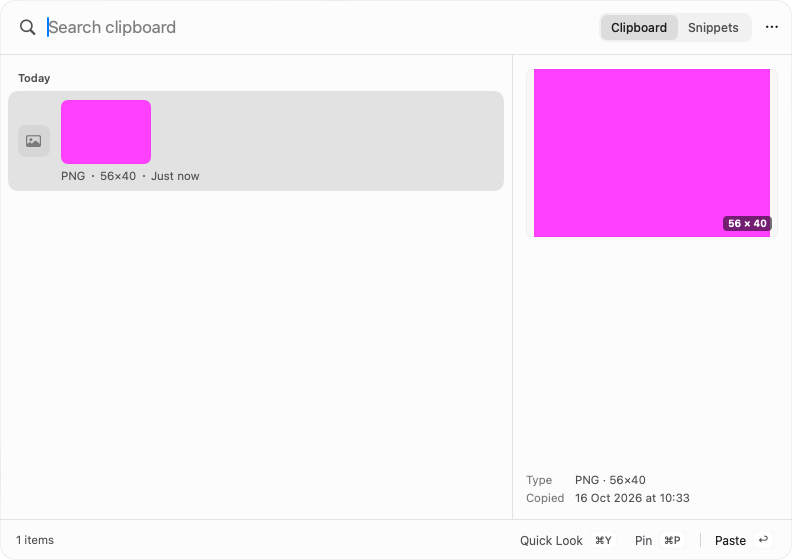

# GUL-399: isolated clipboard history thumbnails

Clipboard history image/PDF/file thumbnails now use the existing disposable media helper. `ClipboardThumbnailProvider` no longer imports ImageIO or QuickLookThumbnailing, decodes originals in the host, or holds an app-lifetime NSCache. Visible views own validated raw pixels and their original authorization. Clipboard capture/read isolation was delivered earlier and is a separate boundary.

This increment is based on #536 (`agent/arch-gpt-astra/gul-399-quicklook`, `791278afe5c2f4bafcd47d84afb245a33ece8a9b`). At delivery preparation, #535 was still open against main and #536 was still open against #535. The consolidated #534 already landed the earlier implementation on main. This increment preserves those bases.

## Contract and ownership

- The provider accepts only local file URLs with paths at most 4 KiB, no NUL, and finite requested edges from 1 through 900 pixels. Two admission leases and a requested-size pixel reservation are acquired before detached work. Busy requests keep a placeholder; there is no queue or automatic retry from view recomputation.
- Common encoded image extensions select the existing copied-image adapter (50 MB input cap). The extension is a routing hint, not validation evidence. The child inspects the actual bytes and returns bounded raw RGBA. Other files use the existing native Quick Look adapter with original file context: local resident regular files or allowlisted document packages, at most 512 MiB and 4,096 entries, with pre/post metadata checks and no nested links/special files. No arbitrary package is copied into an image decoder.
- `MediaWorker.clipboardThumbnails` is an independent two-child, three-second domain. It reuses the executable, protocol, strict response identity/dimension/stride/length validation and confirmed-reaping ownership. The AppCoordinator fences and awaits this pool during ordinary termination; the final shutdown path also fences admission. No new helper target or packaging path is introduced.
- View-owned `AskContextImageModel` reservations come from the shared 64 MiB display budget before work, remain through uncooperative work and displayed-image lifetime, and complement the provider's working reservation. Panel scope observation is bounded to 16 weak consumers. There is no private path-only pixel cache; reopening/replacing a projection rereads current bytes. External file changes after a completed snapshot are not continuously watched.
- The panel-local scope checks the complete history entry, not only its ID. Same-ID replacement with a different source cannot authorize old pixels. Entry changes, preview collapse, actual native `orderOut`/`close`, owner release and account/login/token notifications revoke old scope epochs, cancel tasks and clear display. Native window hiding is handled directly because SwiftUI subtrees can survive a hidden panel. Original authorization is checked again after awaits and on projection.
- Pausing or disabling capture does not erase or prohibit viewing already retained history; existing history semantics are preserved. Deleting an entry does revoke its projection. Original bytes/references, explicit copy/paste, recapture and user-invoked OS Quick Look remain unchanged. A failed thumbnail never rereads the live pasteboard or repeats a user/Agent/workflow operation.

## Focused validation

Implementation and self-review preceded the focused pass. Two instrumented preparation builds passed. There were no compiler failures, functional test failures, retries or timeout changes.

Commands use the sanitized child environment from `scripts/test_runtime.child_environment()`:

```sh
swift build --build-system native --build-tests --enable-code-coverage --jobs 4
swift test --build-system native --skip-build --enable-code-coverage --no-parallel --filter '<explicit scope below>'
python3 -m unittest scripts.tests.test_media_packaging
python3 ../gul-399-clipboard-probe.py
```

The explicit regex in task-local `gul-399-clipboard-test.py` executed **26 XCTest methods**, all passing:

- All 12 `ClipboardThumbnailIsolationTests`: real-helper image reread/malformed input, private PDF Quick Look/original retention, invalid sizing/path/pre-cancellation, oversized sparse image refusal before launch, two retained admissions through uncooperative cancellation, harmless child crash/hang, same-ID replacement/window epoch, deletion during delayed completion, bounded scope consumers, actual native orderOut/close/logout, pause versus preview collapse/owner release, and actual rendered pixels cleared after deletion.
- Five `ClipboardPanelRenderingTests`: `testThumbnailsUseValidatedPixelsWithoutPathCache`, `testPresentedPanelIgnoresPanelsDismissedByOtherControllers`, `testPresentedPanelIsDismissedWhenTheTestFailsEarly`, `testControllerPresentsHandlesKeysAndDismisses`, `testPanelRendersMissingFilesSelectedAndCollapsed`.
- Three `ClipboardPanelModelTests`: `testReplaceEntriesKeepsTheSelectedRow`, `testPreviewFollowsTheSelectionAfterADelay`, `testMissingChecksAreCachedForRenderingButFreshForActions`.
- Four `AskContextImageTests`: `testPixelLeasePrecedesWorkAndSurvivesUncooperativeCancellation`, `testOldResultAndOldDeniedAccessCannotOverwriteNewSelection`, `testAuthorizationIsRecheckedAfterAwaitAndOnEveryProjection`, `testFailureDoesNotRetryFromGettersAndInvalidRastersFailClosed`.
- Two `MediaPreviewTests`: `testHostRejectsMissingTruncatedSymlinkDirectoryAndOversizedRasterFiles`, `testRetainedPreviewFilesAndSlotsWaitForActualReaping`.

Both packaging tests passed. The actual helper was copied by `copy_media_helper.sh` into `Fixture.app/Contents/Helpers`; a private synthetic PNG Quick Look probe verified request/response identity and bounded raw raster bytes. The real helper also decoded synthetic image/PDF fixtures in the Swift tests. The panel screenshot uses an injected magenta raster to identify exactly which pixels the lifetime test owns; the test waits for rendered pixels, then deletes the entry and checks they disappear while the original file remains. The screenshot was visually inspected.



| Command | Wall time | Outcome |
| --- | ---: | --- |
| Preparation build | 385.45 s | passed |
| Final lifecycle/test build | 85.41 s | passed |
| Focused test command | 16.99 s | 26 methods passed |
| Packaging tests | 0.330 s | 2 passed |
| Copied-helper probe | 0.181 s | passed |

Tracked build/test/probe time: **488.361 seconds**, excluding audit, coverage extraction and screenshot inspection. No full suite, actual pasteboard capture/copy/paste, live network/provider, microphone/screen capture, TCC, signed release or hardware matrix was exercised. Explicit system Quick Look and AV playback were not tested as isolation boundaries.

## Coverage evidence

The final XCTest and helper binaries contain `__llvm_covmap` and `__llvm_prf_cnts`. No discovery rebuild occurred between compilation and tests. Eight fresh profiles from one final build (three host, four directly invoked helper, one copied-helper probe) were individually validated with `llvm-profdata show` and merged without warnings. No prior profiles or mixed counter layouts were used. The unchanged helper was included as `llvm-cov --object`; there are no new helper-only executable lines in this increment.

`clipboard-thumbnails-coverage.json`: **87/92 changed executable lines, 94.57%**. Five uncovered lines are four DI/quit bridges and the default environment decoder closure. Controller/provider line hits do not prove every branch, allocation failure, notification ordering or real quit/recording interaction.

Matching binaries/profiles are retained task-locally under `.build/clipboard-thumbnail-validation/initial` (the first and only test pass after final production edits):

- XCTest SHA-256: `3fbb5ee19779033736da3fe34c9d88438445cf66b81cae308bf05873a7f399ce`
- Helper SHA-256: `143d91dc0fb4254234f5424cb7790fdf8b30e75c6c7f486351890a6315f4821e`

The host has zero media-runtime module symbols; the helper has 402. Host/helper Mach-O minimum deployment remains macOS 13. This is not macOS 13/Intel hardware validation.

## Remaining boundaries

Clipboard presentation is not yet completely isolated. `ClipboardMediaInfoProvider` still loads PDF page counts, AV duration and a 600-second/180-bucket waveform in process, with separate cache/task ownership. `ClipboardAppIconProvider` still discovers and rasterizes source application icons in the host. Explicit image copy in `ClipboardContentActions` still builds TIFF through `NSImage(data:)`; `ClipboardInlineMedia` and audio/video playback remain native host paths. These need coherent follow-up contracts and must not be mistaken for the completed thumbnail path. Browser application discovery in `AskBrowserSearchPlugin` and `AskQuickResultsView` also remains pending.

Quick Look can invoke OS-managed providers outside the owned helper. Original-file metadata checks are not an immutable filesystem transaction. Host filesystem/base64/JSON/raw bitmap/pasteboard/SQLite/import-export/UI remain boundaries; reservations do not bound all AppKit/GPU/system memory. No arbitrary host-crash or power-loss guarantee is claimed.

Further approved stage-2 adapters/condition-driven lifecycle/persisted health integration remain (registry: three stores; native/media/inference: independent domains). Audio/TCC/signing/performance verification must precede a microphone-capture isolation decision. Real CoreML/performance, full Xcode/release signing/notarization, Intel/macOS 13 hardware and actual quit/recording remain unverified. GUL-399 remains in progress.
