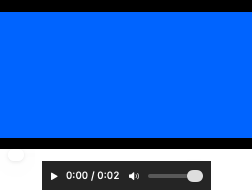

# GUL-399: clipboard file video playback

Clipboard video now uses the existing independent media helper and persistent playback transport. The host no longer constructs AVPlayer or AVPlayerView for this history preview. The child owns video decoding, preferred-transform composition, the player clock, audio and native controls; the host displays validated raw RGBA with explicit play/pause, seek and volume controls. Loading does not play. Failure stops the session without replaying a control, resuming playback or changing original clipboard data.

This increment is based on #549 (`89c199bb512eeb67fa527ae12970ccbf92dbf883`), which was still open against main at delivery. Earlier #544/#545/#547 implementations are already on main; their old chains are not recreated.

## Contract and ownership

- The existing private fd 100 socket keeps its 2 KiB JSON envelope, session UUID/version/strict sequence validation and one command/reply in flight. Video adds a validated frame descriptor followed by exactly its bounded binary RGBA bytes, outside JSON. One request yields at most one frame; socket backpressure and a two-second child send deadline prevent an output queue. Playing requests snapshots after a 33 ms delay; paused video/audio retain 250 ms polling. This is a maximum sampling cadence, not guaranteed 30 fps or measured end-to-end synchronization latency.
- Frames are at most 1280 pixels per axis, 1,048,576 pixels / 4 MiB, with exact width*4 stride and stride*height byte count. Finite timestamps must lie within duration. Source video is one track, at most 8192 axes / 16,777,216 pixels; finite preferred transform is applied inside the child. The player item uses a bounded 30 fps composition, and AVPlayerItemVideoOutput selects pixels using the same item clock as audio. Only one latest frame is retained. Held final/low-frame-rate images may legitimately have a timestamp earlier than the current clock.
- Loading and seeks wait at most approximately one second for a new output buffer. `hasNewPixelBuffer` gates acquisition; blindly copying a buffer can return an already acquired, stale frame after seek. Exact seek tolerances, repeated-position handling and explicit restart are tested. No encoded-image fallback exists in the UI. A missing frame or failed acknowledgement fails closed; a native control may already have taken effect before that failure, so it is never retried.
- Audio and video share the existing two playback admissions, acquired before detached file work. The source contract remains a local/resident regular non-symlink file, 4 KiB path / 512 MiB maximum, privately streamed into a 0700 directory / 0600 input with an allowlisted suffix. AVFoundation external references remain forbidden. Dev/inode/size/mtime/ctime checks surround copying and commands; these are snapshots, not immutable transactions. Originals are retained.
- Video reserves 8 MiB from the shared bitmap budget before opening a session for transport/construction. The real process entry retains this reservation through both actual child retirement and completion of uncooperative host work. Every displayed NSImage separately owns a frame-sized reservation, including old images retained by SwiftUI. Budget exhaustion stops presentation. These reservations do not bound native decoder, CoreImage, AppKit, GPU or all system allocations.
- Existing parent load 10 s / command 5 s, child idle 10 s / independently armed 12 s alarm, four-hour lifetime and two-second quit wait remain. The unchanged 100,000-command sequence cap can end continuously sampled video after roughly 55 minutes, before the four-hour bound; playback is not automatically restarted. No separate pool, executable, target or packaging path was added.
- Each view retains original authorization/epoch/generation and one pending explicit control. Collapse, actual panel hide/close, selection, deletion/replacement, account change and owner release cancel and clear private pixels. A latest replacement load waits for old uncooperative work. Slider gestures capture the original interaction generation; releasing an old drag after a new source/access is installed cannot seek or change its volume. No automatic browser/workflow/Agent/clipboard operation is invoked.



## Validation

**45 distinct focused XCTest methods** passed across the initial and correction runs. Initial scope: 11 new video methods, 12 playback-isolation methods, nine audio-model methods, four row-rendering methods, two panel lifecycle methods, four media-worker ownership/copy methods and two localization methods. The final production build ran **13/13 affected methods**: all 12 video methods (including the added stale-gesture test) plus the actual silent audio-helper compatibility method. Two packaging tests and actual copied app-bundle video/audio helper probes passed again after this final build.

Coverage includes bounded/malformed/overflow/mixed-mode frames, binary backpressure, explicit controls, duplicate commands, missing pixels, pixel-budget admission and retention through host/child completion, uncooperative cancellation, old authorization, actual panel hiding, selection/deletion/account changes, owner release, UI pixels, rotated real video frames, different-color seek results, same-position seek, seek-to-end/restart, natural end and audio-only/malformed video refusal. Shared source mutation, fault-child, protocol sequencing and retirement behavior were exercised by the initial mapped compatibility scope; those earlier profiles are not reused for final coverage.

The real video fixture is a private two-color MJPEG movie with **no audio track**. Only that fixture receives real native play/end/restart commands; no sound is emitted. The separate silent WAV probe sends load/seek/pause/status/EOF and never play. The screenshot is the actual component with injected blue pixels, inspected after the final test. Native audible A/V synchronization, device interruption/route behavior and interactive slider mouse gestures were not exercised; model generation behavior is tested and view wiring reviewed.

Final changed executable line coverage against #549: **221/241 = 91.70%**. All **nine fresh profiles** came from one final binary set: three host, four direct helper and two copied helper profiles. Each was validated individually, then merged without warnings. The helper is an explicit `llvm-cov --object`; new source files were included before extraction. Earlier builds/profiles were not mixed. Uncovered lines: sixteen UI unavailable/slider callback lines, the nonfinite volume guard, the real-client reservation forwarding bridge, and two defensive native timestamp rejection lines. Coverage is not every-branch, allocation, watchdog-expiration or native-device proof.

Final test binary SHA-256: `5f04dc254bce55c2be2b1bb5cccddab9a06a941c5b23796cbcf70dcf1837389e`; helper: `f36b1471405389d3e2eb74ad94694112c5c4b13ee663bb4f10e00add91dee242`. Both app/helper target macOS 13; this does not verify macOS 13/Intel hardware. Host global media-runtime symbols: zero; helper: 133 (`nm -gU`). Matching evidence is archived under `.build/video-validation/integration` (the directory name denotes the final evidence set, not a main merge).

Commands use sanitized `scripts/test_runtime.child_environment`, serial SwiftPM/UI execution, and no discovery rebuild:

```sh
swift build --build-system native --build-tests --enable-code-coverage --jobs 4
# Verify __llvm_covmap and __llvm_prf_cnts in test binary and helper.
swift test --build-system native --skip-build --enable-code-coverage --no-parallel --filter '^Typeflux(?:Focused)?Tests[./](?:ClipboardVideoPlaybackTests[./]|ClipboardPlaybackIsolationTests[./]testRealHelperLoadsSeeksAndPausesWithoutEverPlaying)'
python3 -m unittest scripts.tests.test_media_packaging
```

Initial full mapped filter:

```text
^Typeflux(?:Focused)?Tests[./](?:ClipboardVideoPlaybackTests[./]|ClipboardPlaybackIsolationTests[./]|ClipboardAudioPlaybackTests[./]|ClipboardRowRenderingTests[./]|ClipboardThumbnailIsolationTests[./](?:testActualOrderOutCloseAndAccountChangeRevokePanelScope|testPausePreservesHistoryButHiddenPreviewAndOwnerReleaseClearPixels)|LocalizationResourceTests[./](?:testLocalizedStringTablesParseForAllSupportedLanguages|testGeneralSettingsSectionTitlesExistAndQuickInputCopyIsGoneInEveryLanguage)|MediaWorkerTests[./](?:testCopiedInputIsPrivateAndRemovedOnlyAfterConfirmedCollection|testTwoRetainedChildrenBoundAdmissionAndShutdownFences|testOversizedDataFileMissingFileAndFIFORefusedBeforeSpawn|testCancellationBeforeAndAfterDispatchRejectsLateResult))
```

Build wall times: 90.35, 44.08, 267.74, 135.90, 40.58, 35.65, 35.47, 35.90, 76.18 seconds. The first two failed before tests on async audio-track loading inside a short-circuit autoclosure and NSImage subclass initializers; both were corrected. All later builds passed. Focused commands: 22.99, 14.28, 13.68, 11.30 seconds. Final packaging: 0.104 s; copied video/audio probes: 1.320/0.215 s. Including earlier packaging and diagnostic probes, tracked commands total 829.594 s; audit, archival, extraction and inspection are additional.

Initial 44-method run had one fixture failure: its supposed uncooperative delay actually honored cancellation, freeing the reservation early. Corrected to a detached delay. Expanded native probes then exposed stale frames after end/seek. A 12-method correction run had one real cross-color seek failure. The final `hasNewPixelBuffer` acquisition correction passed 12/12, then the generation-bound gesture addition passed the final 13/13. One diagnostic probe passed structurally while logging a stale timestamp; it was evidence of the defect, not a correctness pass. An initial archive attempt found one empty profile from an abruptly cancelled helper; that entire early set is excluded. Final helper probes exit through EOF and all nine final profiles validate. No source/test input changed after the last build.

## Remaining boundaries

No full suite, full Xcode build, live clipboard read/write, paste/scroll event, screen/microphone capture, TCC, network/provider, real audio output, signed release or hardware validation was performed. Real codec variety, long playback performance, audio/video latency, route changes and macOS 13/Intel remain unverified. Host raw bitmap construction and UI rendering remain native boundaries.

Recording preview is separate: ScreenRecordingCoordinator still loads AV duration, owns AVPlayer and a trim observer; ScreenRecordingPreviewView embeds AVPlayerView. ScreenRecordingPreviewMedia also creates native thumbnails/waveforms, and ScreenRecordingExporter owns AV export/GIF conversion. Their source retention, trim/export correctness and potentially larger recordings need a coherent subsequent migration. Explicit user-invoked OS Quick Look remains an OS/UI boundary. Existing file-index/semantic worker paths are unchanged.

Approved lifecycle/adapters and persisted-health integration still remain (three storage modules versus separate media/native/inference/playback domains), as do CoreML performance and audio/TCC/signing verification before deciding microphone-capture isolation. GUL-399 remains in progress. This delivery does not guarantee immunity to arbitrary host crashes, system-wide memory exhaustion or power-loss cleanup.
