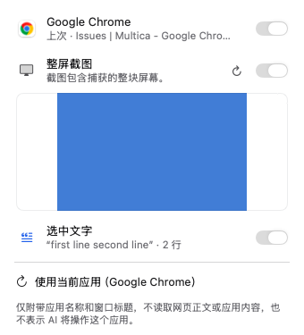
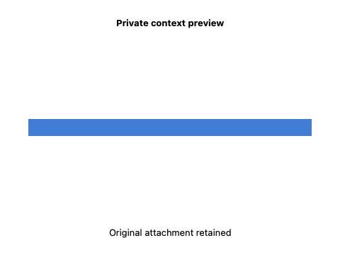

# GUL-399: private context image presentation

Stacked on #529 (`agent/arch-gpt-astra/gul-399-remote-images`). Composer screenshots, attached-image chips, sent attachment previews, message provenance and saved-screenshot recovery now use explicit asynchronous presentation through the existing media helper. The shared `AskImage.decode` host `NSImage(data:)` path and global screenshot/attachment thumbnail caches are removed. Original draft/message/attachment data remains unchanged for requests, restoration and export; presentation never recaptures the screen, resumes an Agent run or repeats generation.

## Contract and ownership

`AskContextImageDecoder` admits at most two operations before detached work, without a queue. Data URLs are bounded to 16 MiB of encoded text and allow PNG/JPEG/GIF base64. MIME is checked again by the media child; a declaration, attachment ID, timestamp or matching byte length does not prove validation. The existing independent preview pool retains its two-child, three-second deadline, bounded raw RGBA protocol and confirmed-reaping ownership. Originals and temporary outputs stay owned through actual child collection. Only validated raw pixels reach `NSImage(cgImage:)`; there is no encoded-image fallback.

Every view reserves 1600 × 1600 × 4 bytes from the shared 64 MiB bitmap budget before decode, retaining that reservation through uncooperative cancelled work and the displayed image's lifetime. A view owns its model and tasks. Full source content and scope epoch determine identity, rather than the former screenshot time/length or attachment-ID cache keys. Synchronous view projections perform no parsing, IPC or task creation. Busy/invalid previews do not retry on ordinary body recomputation; closing/reopening a view or explicitly changing its source can attempt presentation again. Original content and user actions remain available.

The bounded weak scope channel introduced for remote images is generalized and reused, with separate launcher and conversation scopes. Owner/token, selected conversation, generation, deletion and visibility are checked before work, after awaits and during display. Original access remains attached to completed pixels, so freshly granted access cannot bless pixels from an earlier account. Selection changes, logout/login/token refresh, window hiding, closing and view disappearance fence tasks and clear display. A late old result or stale denied access cannot erase a newer image. Failed projections remain observed so revocation clears their retained presentation state too.

The custom launcher glass menu observes both conversation state and its screenshot model; it does not retain an unobserved raw-image snapshot. Screenshot inclusion controls still govern composer previews. Recovery cards and sent-message provenance show existing saved content without changing original consent, claims or receipts. Screenshot recapture, attachment removal, model choice and image recovery remain explicit existing actions.

## Validation

Self-review completed before the focused functional run. **36 distinct methods passed in one pass**: 24 XCTest methods and 12 Swift Testing methods, with three argument cases for the close-confirmation method. There were no compilation or test failures, functional corrections or retries. Both synthetic screenshots below were visually inspected. The launcher fixture was explicitly enabled with `TYPEFLUX_ASK_SNAPSHOTS`; its 14 light/dark captures actually ran rather than returning from the opt-in guard.

Scope mapping:

- `AskContextImageTests` (11): strict bounded input/MIME handling; actual helper valid, truncated, malformed and mislabelled images; two-slot admission and cancellation; exact-content identity; retained pixel leases during uncooperative cancellation; stale-result and stale-access rejection; before/after-await authorization; original-access display guard; failed-projection deduplication; invalid raster counts/dimensions; local/account/token/selection/visibility scopes; original attachment/recovery/provenance retention; actual view pixels and close cleanup.
- `AskRemoteImageTests` (13): generalized weak scope compatibility, observer caps, permission/revocation/lifecycle, bounded HTTP and actual helper paths remain correct.
- `AskConversationWindowLifecycleTests` (5 methods / seven cases): existing actual window/control-mode/close behavior now also asserts context visibility; new launcher close/reopen verifies fresh scopes.
- Four migrated methods: `AskConversationTests.localToolArgumentsAndScriptLiteralsRemainData`, `AskHarnessUITests.artifactsCopyAsImagesAndEncodeAsPNG`, `AskLiquidGlassRedesignTests.screenshotThumbnailIsOwnedByItsViewAndExactContent`, and `AskLauncherHeaderVisualTests.renderLauncherHeaderStates`.
- Three `AskImageCapabilityTests`: screenshot normalization preserves references, restored draft waits for the selected model, and explicit retry checks fresh image capability. These preserve existing consent and recovery semantics.

Commands use `scripts/test_runtime.child_environment()`:

```sh
swift build --build-system native --build-tests --enable-code-coverage --jobs 4
# Verify __llvm_covmap and __llvm_prf_cnts in XCTest and TypefluxMediaHelper.
TYPEFLUX_ASK_SNAPSHOTS=.build/context-image-validation/header swift test --build-system native --skip-build --enable-code-coverage --no-parallel --filter '^Typeflux(?:Focused)?Tests[./](?:(?:AskContextImageTests|AskRemoteImageTests|AskConversationWindowLifecycleTests)[./]|AskHarnessUITests[./]artifactsCopyAsImagesAndEncodeAsPNG|AskConversationTests[./]localToolArgumentsAndScriptLiteralsRemainData|AskLiquidGlassRedesignTests[./]screenshotThumbnailIsOwnedByItsViewAndExactContent|AskLauncherHeaderVisualTests[./]renderLauncherHeaderStates|AskImageCapabilityTests[./](?:screenshotNormalizationPreservesSelectedReferences|restoringDraftWaitsForTheConversationModel|retryChecksFreshCloudImageCapabilities))'
```

No discovery rebuild was inserted. Three preparation builds took **244.39 s / 171.38 s / 43.84 s**, all successful. The single focused test command took **61.14 s** including runner startup; the opt-in header capture method took 27.942 s within it. Total tracked build/test wall time: **520.75 s**, with coverage extraction/visual inspection additional. No full suite or packaging tests were run; packaging/helper source is unchanged. Mach-O minimum macOS remains **13.0**.

Changed executable-line coverage: **149/160 = 93.12%**, using **all seven profiles from the one final build** (three host, four direct-helper), each validated individually and merged without warnings. Matching binaries/profiles are saved in `.build/context-image-validation/final`. No earlier increment or different counter-layout profile was reused. The unchanged helper is supplied as `llvm-cov --object`. The 11 uncovered lines are the temporary-conversation deletion bridge, composer strip/popover/menu bridges, sent-chip popover branches and provenance popover bridge. In particular, the custom glass-menu observation bridge was self-reviewed but not exercised through an actual menu opening in this scope. The new core's 103/103 line hits are not branch/native-allocation proof.

Matching SHA-256:

- XCTest: `7786908d3fddd92101f2ef7fe2999d525541f6e73b434f7f0a1b5f931e9eff85`
- Media helper: `2e3c7c0f8081a150c102e2ee153922c05037d4986047295420021c6de6e79741`





## Remaining boundaries

`AskWorkflowImage` still inspects/converts workflow result files/data URLs with ImageIO; workflow plugin/editor callers and image copy/display paths need coherent asynchronous migration without rerunning the script. Browser favicons, Finder icons, plugin custom image icons and the quick-result image-copy path also retain native host decoding. Existing semantic/file-index decoder workers already isolate their own paths and must not be duplicated.

No packaging, protocol, helper target or macOS deployment-target change is needed here. Real CoreML/model performance, full Xcode/release signing/notarization, Intel/macOS 13 hardware, TCC and actual quit/recording interactions remain unverified. Registry/settings integration for non-storage domains and further lifecycle adapters remain, as does audio/TCC/signing/performance investigation before a microphone-capture isolation decision.

Filesystem, base64/JSON, raw bitmap construction/encoding, SQLite/import-export and UI remain in-process boundaries. Bitmap reservations do not bound AppKit/GPU memory or every image surface. No guarantee is made for arbitrary host crashes, system-wide OOM or power-loss cleanup. GUL-399 remains in progress.
