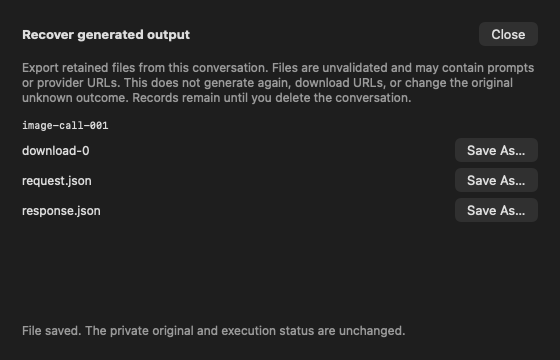

# GUL-399: recover private generation output without repeating generation

Stacked on #527 (`agent/arch-gpt-astra/gul-399-generated-images`, `c030a9f2`). This increment adds a conversation toolbar entry and a local recovery sheet. It does not complete GUL-399.

## Behavior and ownership

- The browser lists only records whose bounded identity matches the current owner and conversation. Each row retains its run and call identity. It scans at most 1,024 entries and returns at most eight pending records. Corrupt identities cannot authorize access and remain on disk.
- Listing reads identity metadata and fixed file names, not response bodies. Explicit Save can export `request.json`, `response.json`, or one `download-0` through `download-7`. Downloads use a `.bin` extension; originals are not decoded or treated as validated pictures. A malformed provider response can still be exported intact.
- The existing per-file bounds remain: 64 KiB request metadata, 46 MiB response, 16 MiB downloaded original. Two global admission slots are acquired before detached disk work; there is no queue. Cancellation retains admission until actual disk completion. Filesystem work remains in process and is not guaranteed interruptible.
- Large reads/writes happen off MainActor. Exports stage a private 0600 file beside the chosen destination, retain its directory descriptor, and commit with `renameat` only after a fresh authorization check. Access checks cover owner, credential, conversation, selection generation and deletion tombstone. There is no suspension between the last check and commit. Private journal destinations are refused. Failed or cancelled staging is removed; private originals remain.
- The sheet owns its task and model. Closing it, changing selection/account, or closing the workspace fences work and clears display. Duplicate UI saves are disabled while busy. The tool protocol exposes an optional recovery root; unrelated implementations default to unavailable.
- Recovery does not call a provider, fetch a response URL, parse/decode an image, invoke an Agent, publish a new artifact, change an execution receipt, or clear an invocation identity. The original unknown outcome remains unknown. No metadata flag is accepted as validation evidence.
- Export does not free pending quota. There is no new per-record discard action or automatic eviction. Existing explicit conversation deletion remains the cleanup action. Local revalidation/publication can be a separate deliberate feature; this slice provides the requested inspection/export alternative. Generic binary artifact Save from #527 is unchanged.
- The sheet warns that files are unvalidated and may include prompts or provider URLs. Strings are supplied in English, Simplified/Traditional Chinese, Japanese and Korean. Errors do not expose raw filesystem errors or paths.

## Focused validation

Self-review preceded functional execution. The initial scope contained **37 methods**:

| Suite | Methods | Reason |
| --- | ---: | --- |
| `AskGenerationRecoveryTests` | 11 | Scoped reopen, malformed/oversized/symlink input, quota/replay fences, staged export, revocation/cancellation/deletion, bounded retained work, production access and UI Save/close |
| `AskGeneratedImageIsolationTests` | 10 | Existing private retention and isolated validation behavior |
| `AskImageToolTests` | 9 | Existing paid-operation consent, receipts, publication and deletion |
| `AskSecureDirectoryTests` | 7 | Descriptor-relative files, locks, replacement, no-follow writes and cleanup |

Initial result: 36 passed; one UI fixture failed to find its SwiftUI accessibility button. The fixture now enables enhanced accessibility and waits for the actual window's button. No production code changed after that pass. The smallest containing recovery suite then passed **11/11**. Thus all 37 distinct methods have passed across this run's pass and correction. No full suite, paid provider call, incidental URL fetch or microphone/TCC interaction was run.

The UI test clicks the real SwiftUI Save button through accessibility with an injected save destination, checks exact exported bytes, captures the sheet, then removes its host and verifies display cleanup. The screenshot below was visually inspected. The native `NSSavePanel` itself was not automated.



## Commands and timing

Commands used `scripts/test_runtime.child_environment()` through task-local wrappers, avoiding inherited runtime variables. Direct build command:

```sh
swift build --build-system native --build-tests --enable-code-coverage --jobs 4
```

Preparation builds took **40.91, 173.12, 35.28, 33.57, 65.24, 30.56, 89.85 seconds**. The first four failed compilation: direct concrete-store access through a tool protocol, wrong test registry settings type, a private test selection setter, and a missing conversation fixture argument. These were corrected before tests. The later preparation builds incorporated self-review and stronger lifecycle fixtures. The UI fixture correction build took **34.25 seconds**. Every build finished before its inputs were edited.

Verified `__llvm_covmap` and `__llvm_prf_cnts` with `xcrun otool -l`. No test-discovery rebuild was inserted. Initial focused command (**12.91 seconds**):

```sh
swift test --build-system native --skip-build --enable-code-coverage --no-parallel \
  --filter '^Typeflux(?:Focused)?Tests[./](?:AskGenerationRecoveryTests|AskGeneratedImageIsolationTests|AskImageToolTests|AskSecureDirectoryTests)[./]'
```

After the fixture-only correction, cleared this checkout's old raw profiles and ran (**8.57 seconds**):

```sh
swift test --build-system native --skip-build --enable-code-coverage --no-parallel \
  --filter '^Typeflux(?:Focused)?Tests[./]AskGenerationRecoveryTests[./]'
```

Tracked build/test command total: **524.26 seconds**. Coverage extraction, diff inspection and screenshot inspection are additional. No packaging path changed, so packaging tests were not repeated. The host Mach-O still declares macOS 13.0.

## Coverage attribution

**182/196 changed executable lines (92.86%)**; see `generation-recovery-coverage.json`. Only three host profiles from the final correction build and its 11-method scope were used. Every raw profile passed `llvm-profdata show`; their merge succeeded without warnings. No initial-pass profile or older increment was used. `llvm-cov show` included the media helper as `--object`, though no helper source changed in this increment.

- Final XCTest SHA-256: `280c762edf73c4f96c040e1fd01f2e85137ca57d650af30a5e792fcb2f1a8a42`.
- Unchanged helper SHA-256: `2e3c7c0f8081a150c102e2ee153922c05037d4986047295420021c6de6e79741`.
- Uncovered: eight conversation toolbar/sheet bridge lines, the default unavailable protocol accessor, and five native Save Panel lines. The recovery implementation's 109/109 line hits do not prove every guard branch, filesystem fault or power-failure scenario.

## Remaining boundaries

The staged file can remain in the chosen directory if the host crashes. Its private mode and journal preservation are not power-loss durability or arbitrary host-crash guarantees. Large filesystem reads/writes, JSON/base64 elsewhere, raw display, SQLite, import/export and UI still have in-process boundaries. The actual app's window/quit/recording integration, signed release and macOS 13/Intel hardware were not exercised.

Next media gap: `AskRunOutputsView` in `AskActivityViews.swift:343` still uses `AsyncImage` for server-generated URLs. Composer/provenance/recovery encoded-image views, workflow image inspection, favicons and Finder icons also remain. Existing file/semantic worker paths should not be duplicated. Stage 2 health/lifecycle integration beyond the three stores and audio/TCC/signing/performance validation before choosing capture isolation remain required. Real CoreML performance and full Xcode/release signing remain unverified. The overall issue stays `in_progress`.
