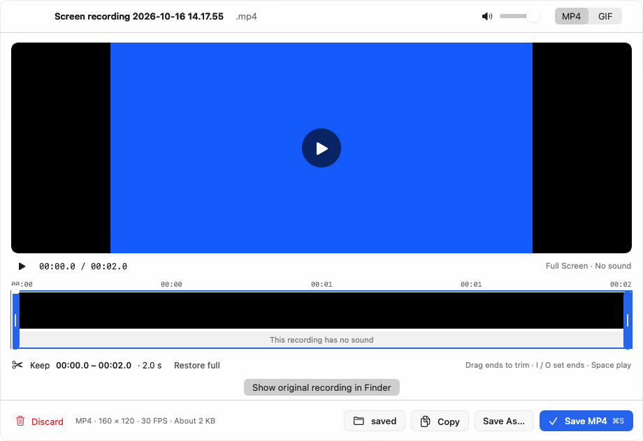

# GUL-399: screen-recording preview playback

The completed recording editor now uses the existing independent media helper for duration loading, video playback and native trim-boundary stopping. `ScreenRecordingCoordinator` no longer owns an AVPlayer, AVURLAsset duration request or periodic player observer; the editor no longer embeds AVPlayerView. It presents validated raw pixels through the shared bounded playback model. Capture, timeline thumbnail/waveform extraction and final export remain separate paths, explicitly described below.

This increment is stacked on #552, base `2f2065c9e501313a14c426dded3104f30b20f2b4`. #552 was still open against #549's audio-playback branch immediately before delivery. Earlier main integration audits are complete and are not repeated here.

## Behavior and boundaries

- Loading is silent. The existing play/pause, exact seek, end/restart and volume controls use ordered acknowledgements. Recording adds a bounded `playRange` command carrying finite start/end values, and `seekPaused`, which pauses and seeks within one native command. The child sets `AVPlayerItem.forwardPlaybackEndTime`; it does not rely on a potentially delayed host poll to stop at the trim end. Range starts outside the current position cause one exact seek before play. Ordinary clipboard playback retains its contract.
- Rapid scrubbing keeps one latest **unsent** read-only seek, not an unbounded task/command queue. Play commands are not coalesced or replayed. Old timeline gestures and volume gestures are bound to the original playback generation; a new source or retired authorization cannot inherit them. Controls are updated from acknowledged player state. Missing acknowledgement still means a control may have happened, not that it is safe to resend it.
- MP4 recording has no configured duration limit, and the existing writer uses `width * height * 5` bits/second. Its files can exceed the clipboard's 512 MiB cap. Recording therefore has a separate **8 GiB** input limit; clipboard audio/video limits remain unchanged. The host checks local/resident regular non-symlink files, 4 KiB paths and pre/post-copy/command revisions. The helper independently enforces the recording byte limit. The original is streamed into a private copy; it is not memory-mapped wholesale or deleted. Two shared playback owners can temporarily retain two such copies. Size limits do not guarantee disk space or bounded filesystem latency.
- All existing transport/decoder limits remain: 2 KiB control frames, session/version/sequence validation, one bounded binary RGBA frame per response, 1280-axis / 1 MP / 4 MiB output, 8192-axis / 16,777,216-pixel source video, finite duration up to 24 hours, forbidden external asset references. The shared pool still admits two owners before copying. The 8 MiB transport/construction reservation and individual displayed-image reservations survive actual child retirement and uncooperative host completion. No new executable, target, DI pool or packaging path was added.
- Parent load/command deadlines remain 10/5 seconds; child idle/independent watchdog budgets remain 10/12 seconds, with a four-hour session lifetime. The unchanged 100,000-sequence cap can end a continuously sampled video sooner (roughly 55 minutes at the maximum polling cadence). There is no automatic restart or resume. These limits do not prove device timing, frame rate, end-to-end audio/video latency or bounded native/system memory.
- The coordinator records ownership of the original before attempting preview. Decoder/unavailable/oversized failure leaves the completed file recoverable and shows a localized unavailable message. Finder reveal provides access to the original; it is an explicit user action. Explicit “Reload preview” reads presentation only, never recaptures or re-exports. Existing trim selection is preserved on reload after export failure. If duration could not be established, trimming/export is unavailable until valid metadata is loaded; the original remains accessible.
- Actual preview-panel `orderOut`, close and miniaturize, controller release/hide, account/token changes and cancellation retire access, stop playback and clear pixels and timeline media. The view hides private editor content after retirement. Source files are retained on these privacy/visibility changes. Explicit confirmed discard still removes the owned recording session, as before. Reopening a retired subtree does not automatically authorize or play the old recording.
- Export stops playback. It checks authorization before starting publication and again before exposing completion/copying/discarding the source. Copy uses an injectable callback in tests; production keeps its explicit pasteboard action. The existing native exporter and asynchronous filesystem publication are **not transactional cancellation boundaries**: a publication already dispatched can complete after cancellation/revocation. This slice does not undo that write, retry it, or claim zero effects. Further publication ownership/receipt work is required alongside export isolation. Original recording retention and no automatic producer replay are preserved.



## Validation

**59 distinct focused Swift methods passed in one functional pass**: 43 XCTest methods and 16 Swift Testing methods. One Swift Testing permission method has three argument cases. Scope comprises ten new recording-isolation tests, nine coordinator methods, five recording presentation methods, one affected redesign method, one editor keyboard method, nine audio-model tests, twelve video tests and twelve shared playback isolation tests.

The scope covers range/nonfinite/mixed payload validation, a sparse-file test of the separate 8 GiB budget without copying that large fixture, coalesced scrubbing and duplicate play refusal, preview failure/original retention, explicit reload after export failure, permission/selection/account/panel retirement, cancelled uncooperative preparation, real panel construction and owner release, raw UI pixels, source mutation, process failures, sequencing and host/child retirement. Existing recording copy tests now record the copied URL through injection instead of touching the user's clipboard. Affected tests wait for asynchronous acknowledgements rather than assuming immediate player state.

The native recording test and actually copied helper probe use a private synthetic movie verified to contain **no audio track**. They exercise silent load, range play, automatic stop at 0.6 seconds, paused exact seek, explicit restart within the trim interval and pause. No audio output occurs. The screenshot is the actual editor with injected blue pixels and a synthetic recording; it was inspected. Interactive timeline/volume mouse drags, real Finder reveal and miniaturize were not driven in this scope; their wiring was reviewed.

Two packaging tests and a copied app-bundle helper probe passed. Changed executable line coverage against #552: **200/215 = 93.02%**. The final eight fresh profiles came from one final binary set: three host profiles, four direct helper profiles and one copied recording-helper profile. Every raw profile was individually validated and merged without warnings. New source files were included before extraction, and the helper was supplied as `llvm-cov --object`. No old passing results or profile layouts were reused. Evidence is archived under `.build/recording-preview-validation/final`.

The fifteen uncovered lines are the default coordinator playback factory, two Finder-reveal lines, miniaturize, nine reload/volume UI callback lines and two timeline gesture guards. Host command/prepare and child range-control changed lines have line hits; that is not all-branch, allocation, arbitrary source-format, native alarm-expiration or real device proof.

Final test binary SHA-256: `2bf3d7241b51425533128f1672f27adba19b055546ed1c9935e836046f4339be`; helper: `bbf297eb32646892482e6693841cd97e358da62192f84a2c527c146d9ac5742f`. App/helper deployment target remains macOS 13; this is not macOS 13/Intel hardware validation. Global media-runtime symbols (`nm -gU`): host zero, helper 134. The host still contains unrelated native media paths, including the deferred timeline/export code.

Commands use sanitized `scripts/test_runtime.child_environment`, serial SwiftPM/UI execution and no discovery rebuild:

```sh
swift build --build-system native --build-tests --enable-code-coverage --jobs 4
# Verify __llvm_covmap and __llvm_prf_cnts in the test binary and helper.
swift test --build-system native --skip-build --enable-code-coverage --no-parallel --filter '^Typeflux(?:Focused)?Tests[./](?:RecordingPreviewIsolationTests[./]|ScreenRecordingCoordinatorTests[./]|ScreenRecordingPresentationTests[./]|ScreenRecordingRedesignTests[./]`player respects trim and named exports copy a file URL`|ScreenRecordingNativeInteractionTests[./]`editor shortcuts ignore typing in the filename field`|ClipboardAudioPlaybackTests[./]|ClipboardVideoPlaybackTests[./]|ClipboardPlaybackIsolationTests[./])'
python3 -m unittest scripts.tests.test_media_packaging
```

Build wall times were **214.39 s passed**, **37.10 s failed**, **30.83 s passed**. The second build found the test fixture's copied-URL field in the wrong nested type; it was moved before any functional test executed. No production limit changed for the compile correction. Focused test command: **24.84 s** (XCTest execution 12.332 s, Swift Testing 4.207 s). Packaging: **0.125 s**; copied-helper probe including packaging/launch: **1.130 s**. Total tracked commands: **308.415 s**, excluding source audit, archival, coverage extraction and screenshot inspection. There were no functional failures or test retries. No source/test input changed after the final build.

## Remaining work

`ScreenRecordingPreviewMedia.load` still performs timeline AVAssetImageGenerator thumbnails and AVAssetReader waveform extraction in the host, and its saved-output thumbnail helper also parses GIF/video natively. This increment only fences their late display and cancellation; it does not isolate those decoders or fully bound their retained native work. They are the next media slice, with a distinct ten-thumbnail / 160-bucket whole-recording contract. Do not reuse clipboard's 600-second/180-bucket waveform blindly.

`ScreenRecordingExporter` still uses native AV compositions/export and GIF decoding/encoding. Its progress/cancellation/publication lifetimes require a separate coherent migration that preserves original and successfully produced outputs and never replays export automatically. Capture, microphone/camera TCC ownership and actual recording remain separate; user-invoked OS Quick Look is also an explicit OS/UI boundary.

No full suite, live screen/microphone capture, TCC, user clipboard write/read, real audio output, network/provider, real Finder launch, full Xcode build, Developer ID/notarization or hardware test ran. Long recordings, device/audio latency, real signed macOS 13/Intel playback, CoreML/model performance and actual quit/recording interaction remain unverified. Approved stage-two lifecycle/adapters and persisted-health integration are unfinished. GUL-399 stays in progress; arbitrary host crash, system-wide OOM and power-loss cleanup immunity are not claimed.
