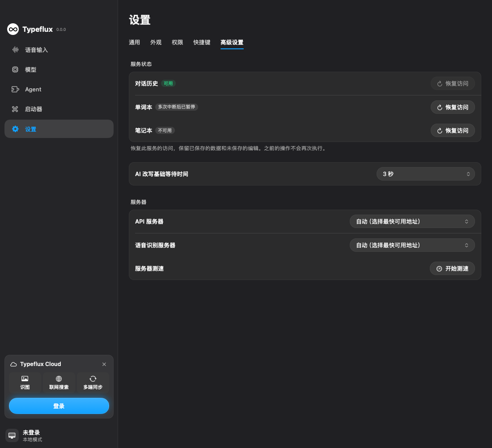

# GUL-399: storage health and deliberate recovery UI (stage 2e)

This increment is stacked on registry PR #517, baseline `eb5700e2`. The overall approved four-stage issue remains in progress.

Settings → Advanced now shows conversation history, word-book and notebook service status, including unavailable storage, persistent quarantine, recovery and cooldown. The existing settings window receives the production registry from DI. Opening or revisiting settings only observes health; it never starts a factory or clears a persistent budget. All five supported languages include the new copy.

Restore access is an explicit service recovery action. Only a quarantined/persistence-failed service requests the existing bounded persistent reset. The supervisor returns a typed admission result (accepted, ready, cooldown, busy, disabled, cancelled or unavailable). Actual readiness comes from the stable health channel, not from accepting a request. Cooldown and retained work cannot be bypassed; rejected requests do not leave a latent persistent reset. Already-ready services are not rebuilt. No feature operation, write, toggle, paid generation, approval, execution claim or receipt is replayed.

The view model owns one bounded subscription per registration and one pending action per module. Repeated clicks and repeated appearance do not multiply requests/subscriptions. Navigation, window close and model release cancel UI-owned tasks. Lifetime tokens reject late UI updates; reopening observes the current service without resubmitting an action. A factory already accepted by the supervisor remains owned by that supervisor. Observation capacity failure disables the recovery action and presents a fixed, localized message, without raw error text or user content. Recovery neither discards caller snapshots/drafts nor deletes user databases.



The screenshot is from a logged-out test fixture with synthetic service states. Its recovery button was exercised through the accessibility tree, followed by navigation away and back without another factory start.

## Focused validation

Self-review preceded execution. Xcode Swift 6.4 commands used `scripts/test_runtime.py`'s sanitized child environment. No full suite, test-discovery rebuild, external CI watch or merge was run.

```sh
swift build --build-system native --build-tests --enable-code-coverage --jobs 4
otool -l .build/arm64-apple-macosx/debug/TypefluxPackageTests.xctest/Contents/MacOS/TypefluxPackageTests
swift test --build-system native --skip-build --enable-code-coverage --no-parallel --filter '^Typeflux(?:Focused)?Tests[./](?:(?:ModuleRecoveryRequestTests|ModuleHealthSettingsTests|ModuleSupervisorTests|ModuleRegistryTests|ModuleHealthStoreTests|StorageModuleRegistryTests|RecoveringAskConversationCacheTests|RecoveringAskWordBookStoreTests|RecoveringAskNoteStoreTests|AskRecoveryJournalTests)[./]|SettingsSidebarChromeTests[./].*native.history|SettingsOrganizationTests[./].*general.removes)'
```

Both `__llvm_covmap` and `__llvm_prf_cnts` were verified before each execution. Coverage replaces a plain test pass.

| Scope | Behavior verified |
| --- | --- |
| ModuleRecoveryRequestTests | Typed admission, cancellation, invalid policy, cooldown without reset, disabled services, deduplicated startup and already-ready no-op |
| ModuleHealthSettingsTests | Observation ownership/capacity, repeated page opening, cancellation before submission, real corrupt-health recovery with preserved SQLite note, failure/busy outcomes, localization, accessible recovery action and navigation |
| ModuleSupervisorTests / ModuleRegistryTests / ModuleHealthStoreTests / StorageModuleRegistryTests | Bounded recovery, generations, independent fault domains, lifecycle dependencies, persistent budget and actual three-store composition |
| RecoveringAskConversationCacheTests / RecoveringAskWordBookStoreTests / RecoveringAskNoteStoreTests / AskRecoveryJournalTests | Direct facade regressions, no mutation replay and durable claims/receipts |
| SettingsSidebarChromeTests selected method / SettingsOrganizationTests selected method | Existing settings-window lifecycle, sidebar and advanced navigation integration |

The first pass executed **62 methods** with one failed test assertion. The failure concerned a transient request acknowledgement: a starting snapshot can legitimately clear it before the final failure snapshot arrives. The test already verified the final unavailable state. Its assertion was corrected to permit no acknowledgement or the unavailable message, while rejecting a misleading success. No production code changed after the initial pass. The failed method was rebuilt and passed on its own:

```sh
swift test --build-system native --skip-build --enable-code-coverage --no-parallel --filter '^Typeflux(?:Focused)?Tests[./]ModuleHealthSettingsTests[./]failedRecoveryAndBusyCleanupNeverReportReady'
```

In total **62 distinct methods were validated**, including the corrected method's successful retry. Timings include preparation and runner startup:

| Command | Wall seconds | Outcome |
| --- | ---: | --- |
| Instrumented build | 225.05 | Passed |
| Initial focused coverage run | 29.23 | 62 methods, one assertion failure |
| Assertion correction build | 33.36 | Passed |
| Failed-method coverage retry | 8.01 | 1/1 passed |
| **Total** | **295.65** | **258.41 build + 37.24 test commands** |

Changed executable-line coverage relative to `eb5700e2` is **141/143 (98.60%)**, not project-wide coverage. `recovery-ui-coverage.json` records every file and uncovered line. All production coverage comes from this run's initial matching binary/profile, captured before the test-only rebuild; no profiles across changed counter layouts were merged, and no earlier increment's results were reused. The uncovered executable lines are the DI assignment and the invalid-policy response's presentation mapping. Localized resources and enum declarations have no executable lines. Line coverage does not establish every scheduling interleaving or branch.

## Remaining approved work

- The settings window, view lifetime and injected storage composition are covered without constructing audio/hotkey services. Real application quit, recording completion and the complete production DI bridge remain unverified in this increment.
- Recovery controls cover the three registered storage modules. Other adapters, condition-driven module lifecycle wiring and broader feature-specific recovery navigation remain stage-2 work.
- SQLite/JSON/import/export and UI are still in process. Bounded tasks do not contain native crashes, OOM or executor starvation. Persistent health is an interrupted-start hint, not crash attribution or arbitrary power-failure durability.
- Next, isolate native system-command adapters: `AskSystemCommandRunner` currently invokes CoreWLAN and dynamically resolved Bluetooth/scroll-direction functions in the app process. Preserve fixed command allowlists and consent; child termination after dispatch must not mean the side effect did not occur, and toggles must never be replayed.
- Media/local-model isolation and audio/TCC/signing/performance validation before audio isolation remain required. This delivery is not whole-issue acceptance.
