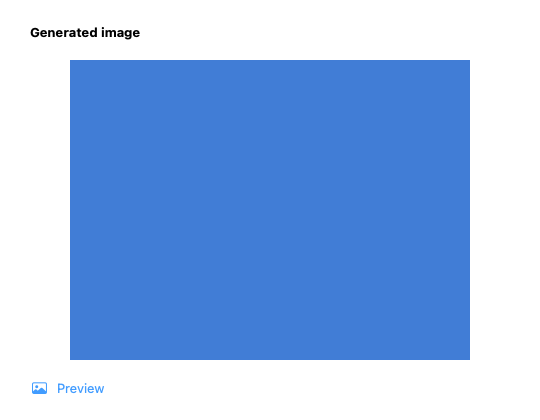

# GUL-399: server-generated image presentation

Stacked on #528 (`agent/arch-gpt-astra/gul-399-generation-recovery`). This increment changes the read-only presentation of server-returned asset references. It never calls generation, submits an Agent operation, or rewrites an execution receipt/claim. Original asset IDs and URLs remain in the conversation model and its durable representation.

## Boundary and ownership

`AskRunOutputsView` serves both activity blocks and final assistant answers in the conversation workspace. Its remote `AsyncImage` is replaced by an explicitly owned asynchronous loader. The loader uses `AskImageHTTP` and the existing `MediaWorker.previews` pool. Only validated raw RGBA pixels reach `NSImage(cgImage:)`; there is no original-image parser or encoded-image fallback in this path. Type detection remains in the media child; HTTP metadata is not validation proof. Existing explicitly typed artifact projections still require matching MIME acknowledgement.

- At most eight assets per output group attempt automatic previews; remaining references retain their external links. Two global remote operations are admitted before network or detached decoder work, with no queue or retry loop.
- Each response is capped at 16 MiB, with a 15-second resource deadline, no cookies, credential storage or cache. Remote previews alone opt into at most three HTTPS GET redirects, stripping all headers and rejecting URL credentials/downgrades. Paid generation retains the default no-redirect policy. Asset IDs and URLs have presentation eligibility bounds of 1 KiB and 16 KiB; the original stored values are not rewritten.
- The existing preview pool admits at most two children with its three-second operation deadline and confirmed-reaping leases. Helper source dimension bounds and raw-raster validation remain unchanged. Downloaded bytes are copied into the owned private media workspace; temporary input/output survives actual child retirement.
- Each preview reserves 1600 × 1600 × 4 bytes from the existing shared 64 MiB tool bitmap budget **before download**. Reservations remain held by cancelled, uncooperative operations until they return, and by completed displayed pixels until release. This budget does not measure AppKit/GPU allocations or other image surfaces.
- Conversation-owned scopes maintain at most 16 weak view registrations. Selection, logout/account changes, deletion, view disappearance and window/control-mode hiding fence late results and clear existing pixels. Access is checked before dispatch and after awaiting the decoder against owner, token, conversation, selection generation and deletion tombstone. A stale result cannot cancel a newer request. The window close cancellation choice leaves the visible scope active.
- Busy, unavailable and over-budget thumbnails retain their original safe external link. Opening that link remains an explicit user action. There is no request to refresh a signed URL, repeat a paid call or replay an Agent operation.

## Validation

Self-review completed before functional validation. **24 distinct methods passed** (20 XCTest + four Swift Testing methods, including three argument cases for close confirmation). Two fixture-only screenshot corrections each reran the same UI method: **1/1 passed twice**. Visual inspection first found a white header on white background, then an occasionally captured pre-render frame despite model readiness. The final fixture explicitly waits for actual blue pixels before capture; no production code changed after the initial pass. There were no functional test failures. The synthetic screenshot was visually inspected; it shows validated pixels and the link-only fallback, without user content.

Scope mapping:

- `AskRemoteImageTests` (13): actual helper valid/truncated/malformed images; byte/dimension/count/admission/pixel budgets; uncooperative cancellation; stale selection and permission revocation; weak observer capacity; bounded HTTPS redirects without credentials; output-group limits; production access fences; view loading and close cleanup.
- `AskImageHTTPTests` (2): existing bounded streaming, errors, cancellation and default redirect refusal, ensuring paid-provider transport behavior stays unchanged.
- `AskGeneratedImageTests` (3): safe URLs, wire negotiation and output aggregation retain their contracts.
- `AskArtifactImageTests.testMIMEAllowlistAndChildRejectsMislabeledImage` and `testRealHelperReturnsRawPixelsAndRedactsFailuresWithoutChangingOriginal`: optional type detection for remote previews does not weaken strict MIME checks for stored artifacts.
- `AskConversationWindowLifecycleTests` (4 methods / six cases): actual owned AppKit window reuse, control-mode hiding/restoration, draft preservation, and close continue/stop/cancel decisions; added remote-scope visibility assertions.

Commands, using `scripts/test_runtime.child_environment()` to strip unrelated runtime credentials:

```sh
swift build --build-system native --build-tests --enable-code-coverage --jobs 4
# Verify __llvm_covmap and __llvm_prf_cnts with otool in XCTest and TypefluxMediaHelper.
swift test --build-system native --skip-build --enable-code-coverage --no-parallel --filter '^Typeflux(?:Focused)?Tests[./](?:(?:AskRemoteImageTests|AskImageHTTPTests|AskGeneratedImageTests|AskConversationWindowLifecycleTests)[./]|AskArtifactImageTests[./](?:testMIMEAllowlistAndChildRejectsMislabeledImage|testRealHelperReturnsRawPixelsAndRedactsFailuresWithoutChangingOriginal))'
# After only the fixture foreground color changed, rebuild directly, verify instrumentation, then:
swift test --build-system native --skip-build --enable-code-coverage --no-parallel --filter '^Typeflux(?:Focused)?Tests[./]AskRemoteImageTests[./]testViewOwnsLoadingPixelsLinksAndCloseCleanup'
```

Preparation builds: **74.16 s** (missing media protocol import), **207.66 s** (test helper needed private access), **53.69 s** (passed). Both compile errors were fixed before executing tests. Initial focused command: **11.37 s**. Fixture-only rebuilds: **35.68 s / 49.78 s**; single UI retries: **7.93 s / 10.63 s**. Total tracked build/test wall time: **450.90 s**, with coverage extraction and visual inspection additional. No full suite or packaging tests were run; packaging and helper sources are unchanged. Mach-O minimum macOS remains **13.0**.

Changed executable-line coverage: **163/165 = 98.79%**. `remote-images-coverage.json` is computed from **only the three individually validated host profiles from the initial production-final build**, with saved matching XCTest/helper binaries. The helper was supplied as `llvm-cov --object`; it has no changed source lines in this increment. No later fixture profile or earlier increment profile was merged into this evidence. Raw profiles merged without warnings. The two uncovered lines are the default view loader initializer and the temporary-conversation-discard tombstone bridge. 133/133 new core line hits do not imply every branch or live native condition was exercised.

Matching SHA-256:

- XCTest: `05d228da1c961c050b9a08a604acd5247434a23d9ff2ad5c068c6e2268f3bbff`
- Media helper: `2e3c7c0f8081a150c102e2ee153922c05037d4986047295420021c6de6e79741`



## Remaining boundaries

No live provider URLs, paid generation, microphone/TCC, full application release/signing, notarization or real CoreML/performance run is part of this validation. No packaging or deployment-target change is needed. HTTP redirect tests use synthetic requests and transport tests use URLProtocol, not external hosts. Helper probes use synthetic local images.

Remaining native media paths include `AskImage.decode` used by composer/context/history/provenance surfaces, `AskWorkflowImage`, browser favicon decoding and Finder icon decoding. Existing file-index and semantic worker implementations already isolate their decoder paths and must not be duplicated. Registry/settings integration for media/native/inference and other stage-two lifecycle adapters, and audio/TCC/signing/performance investigation before capture isolation remain outstanding.

Filesystem, JSON/base64, raw bitmap construction, encoding, SQLite, import/export and UI remain host boundaries. Process isolation does not guarantee survival of arbitrary host/native crashes or system-wide OOM. Coverage line hits are not branch/native allocation, hardware, privacy-prompt or power-failure proof. GUL-399 remains in progress.
