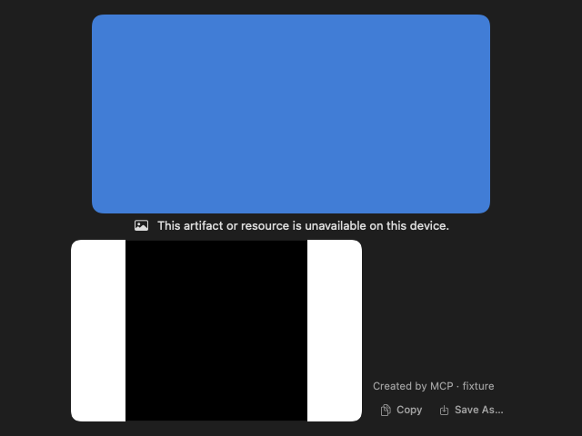

# GUL-399: typed/tool image preparation

This increment is stacked on #525 (`agent/arch-gpt-astra/gul-399-artifact-images`). It extends the existing media executable; it adds no executable, signing entitlement or packaging target. The overall issue remains in progress.

## Behavior and ownership

`AskTypedContent` no longer imports ImageIO, and `AskLocalTools.jpegDataURL` is removed. MCP output preparation and sandbox image projection await `AskToolImageNormalizer`. The existing media helper checks the declared PNG/JPEG/GIF type, dimensions and input size, then produces a metadata-stripped JPEG. A normalization request requires an explicit type acknowledgement; missing or mismatched acknowledgements fail closed. No fallback invokes a host image parser.

Synchronous `project`, `legacyProjection`, `message`, `resultText` and `resultImages` perform no IPC, native decoding or task creation. Image preparation is an ephemeral, content-digest-bound property excluded from Codable. A tool-supplied or persisted `preparedImages` property grants no validation authority. Reopened receipts need explicit preparation. Ordered original blocks and opaque metadata remain in the bounded local receipt, independently of the conservative legacy projection.

`AskAPIClient.result` prepares before network delivery and checks cancellation afterward. A negotiated typed peer receives normalized known-image blocks, or explicit incomplete markers when preparation is unavailable. Original image bytes never bypass preparation through the typed envelope. The existing typed-content byte/block limits still apply to the normalized envelope; oversized normalized blocks become truncation markers. The local original is unchanged. Legacy peers retain the single-JPEG contract and multi-image incomplete notice.

The local engine prepares a bounded recent history for both typed and legacy prompt delivery. It saves completed tool receipts before awaiting preparation and checks the saved revision before queuing inference. Cancellation, deletion or another revision cannot be overwritten by a late preparation. Prepared payloads are cleared from the engine's long-lived record cache. MCP approval is rechecked after preparation; withheld output remains in the local receipt, but no original result content/artifacts are forwarded in that network projection. Execution status, claims and receipts are not converted into permission to retry.

Sandbox projection considers at most four image files after execution. Decoder failure retains stdout/stderr and workspace files and reports an incomplete image projection, with no second program execution. The text-only voice Agent adapter explicitly reports image omission; that adapter still has no binary-result or raw-image journal contract. Its `call` API continues to return the original MCP result to the Ask receipt path.

Tool result rows and transient tool artifact cards now use view-owned raw pixel decoding through the existing media preview facade. A stable loading container owns `.task(id:)`; selection changes, cancellation and disappearance reject late results. Copy/export operate on the decoded bitmap. Stored-artifact handling from #525 is unchanged.

## Bounds

- Existing typed content: 64 blocks, approximately 1 MB total, 600 KB per retained block, 60 KB projected text. No automatic URI retrieval.
- Preparation: four image attempts and 2 MB normalized output per outcome. Prompt preparation considers the last 12 messages, at most eight image attempts and 2 MB normalized image payload. Omitted/unavailable projections remain explicit.
- The existing 1 KiB request / 16 MiB response framing is reused; successful normalization returns exactly one bounded JPEG with UUID/version/type validation.
- Two normalization admissions before detached work, using the existing independent preview pool: two children, three-second deadline, rolling failure budget, confirmed-reaping input leases. This shares the preview domain's budget; it is not a new global worker or a persisted registry domain.
- Workspace input: 10 MiB. Typed inputs retain their smaller existing block limits. The child accepts PNG/JPEG/GIF with source axes at most 4096 and at most 12 MP, then renders the first frame with orientation applied to a 1600-pixel long edge. These source bounds now also apply to workspace image projection. JPEG output uses the existing 1.5 MB data-URL envelope, stricter than the removed converter's 2 MB JPEG-byte check.
- Tool display: fixed 1600×1600 RGBA reservation before decoding, held through cancellation/late completion or displayed-image lifetime. A 64 MiB reservation budget permits six such views/work items. This bounds retained bitmap reservations, not AppKit/GPU overhead. Other existing image surfaces have their own boundaries.

## Focused validation

Implementation and self-review preceded the focused pass. Direct instrumented builds used:

```sh
swift build --build-system native --build-tests --enable-code-coverage --jobs 4
swift test --build-system native --skip-build --enable-code-coverage --no-parallel --filter '<explicit scope below>'
python3 -m unittest scripts.tests.test_media_packaging
```

The task-local wrappers use `scripts/test_runtime.child_environment()`. `otool -l` confirmed `__llvm_covmap` and `__llvm_prf_cnts` in the test bundle and helper before each validation pass. No discovery rebuild or full suite ran.

Initial scope: `AskToolImageIsolationTests`, `AskTypedContentTests`, `AskTypedContentIntegrationTests`, `AskMCPToolsTests`, `MediaProtocolTests`, `MediaWorkerTests`; three `AskLocalEngineTests` methods (`testTypedResultThroughLocalRunAndReopen`, `testCancellationDuringImagePreparationKeepsReceiptAndCannotQueueInference`, `testLegacyReopenedTypedReceiptPreparesWithoutRepeatingTool`); and `AskAPIClientTests.typedResultUsesTrustedOptInAndRetainsLegacyReceipt`.

This maps to decoder/protocol rejection, bounded admission/cancellation, retained pixel reservations, MIME/dimension checks, missing acknowledgement, forged validation metadata, receipt/cache reopen, provider negotiation, sandbox projection without running a program, revision fencing, MCP callers, raw-pixel UI, and existing real harmless crash/hang children.

The initial 53 methods had five failing methods (six assertions/errors): a JSON-string URL assertion, semantic JSON compared as byte order, a sandbox fixture directory lacking private permissions, and an actual empty-view loading bug. The latter prevented SwiftUI image tasks from acquiring a stable rendered owner. Stable loading containers fixed it; the fixture now checks that readiness does not restart decoding. The JSON assertions now compare decoded content, and the sandbox fixture uses a private child directory. Review also tightened the typed network envelope so unavailable original images cannot bypass preparation.

Final correction scope: all 12 `AskToolImageIsolationTests`, six `AskTypedContentTests`, the failed legacy local-engine method, and the HTTP typed-result method. **20/20 passed** (19 XCTest + one Swift Testing). Across the initial pass and correction, **54 distinct Swift methods passed**, plus **2/2 packaging tests**. A copied `Contents/Helpers/TypefluxMediaHelper` processed a synthetic PNG with the new normalization operation, returning the matching UUID, version, MIME acknowledgement and bounded JPEG. The final UI fixture was visually inspected: ready tool images, an unavailable notice and the transient artifact card render correctly.

| Command | Total wall time |
| --- | ---: |
| Preparation build 1 (test-only Swift exclusivity error) | 293.02 s |
| Preparation build 2 | 194.95 s |
| Preparation build 3 | 61.34 s |
| Initial validation build | 70.44 s |
| Initial focused pass | 31.86 s |
| Correction build | 66.17 s |
| Correction focused pass | 15.81 s |
| Packaging tests | 0.259 s |
| Copied-helper probe | 0.224 s |

Tracked build/test/probe command time totals **734.07 s**, including SwiftPM preparation/startup; coverage extraction and code review are additional. No cached passing results were reused. The legacy test's first 6.902-second run is not evidence of a cold-start latency guarantee; the preview deadline remains three seconds.

Changed executable-line coverage is **291/307 = 94.79%** (`typed-images-coverage.json`). All available profiles were individually validated and merged only within their matching build: six initial profiles (three host, three helper) and four final profiles (three host, one bundled helper). Initial matching binaries were saved before correction. Final profiles supply `AskTypedContent.swift`, `AskToolImageView.swift`, `AskActivityViews.swift`, `AskCodeSandbox.swift`, and `MediaDecoder.swift`; initial profiles supply only production files unchanged after that pass. No cross-layout merge was used. Both reports include the helper with `llvm-cov --object`.

Uncovered lines are the expanded tool-row bridge, transient artifact error label, actual program-execution/approved-code bridges and a default engine preparation closure. No real Agent program was executed for this validation. Line coverage does not prove every native allocation, signal, alarm or permission branch.

Final test binary SHA-256: `ed7d858dfa36dc88660ea89f3ab44a435face27209576e8cf060aef37220aad1`.
Final media helper SHA-256: `00d8374a81231c791d88705726803ca3d7f43b395c7d4bea03e5d7e4688e75cd`.
The helper's Mach-O minimum OS remains macOS 13.0.



## Remaining boundaries

`AskGeneratedImageData` still validates paid generation output with ImageIO before artifact publication. Its service/caller needs a coherent retained-output contract before moving that validation to the helper; decoder unavailability must not lose or repeat a paid result. Server-backed generated-image `AsyncImage` display also remains in process. Composer/attachment/provenance/recovery encoded-image views, workflow image inspection, favicons and Finder icons need further audit/migration. File-index and semantic worker decoder calls found by a source search are already separate worker paths and must not be blindly reimplemented.

Filesystem loading/copying/hashing, JSON/base64 handling, trusted raw-bitmap construction/encoding, SQLite/import-export and UI remain in the host. The three storage registry domains are unchanged; native commands, inference and media still need further health/settings and condition-driven lifecycle integration. Audio/TCC/signing/performance verification remains required before deciding microphone capture isolation. No paid provider, real model/CoreML performance, microphone/TCC, hardware toggle, full Xcode release build, Developer ID/notarization, Intel/macOS 13 hardware or real quit/recording interaction was exercised. This increment does not establish whole-issue acceptance or immunity to arbitrary host crashes, OOM or power loss.
