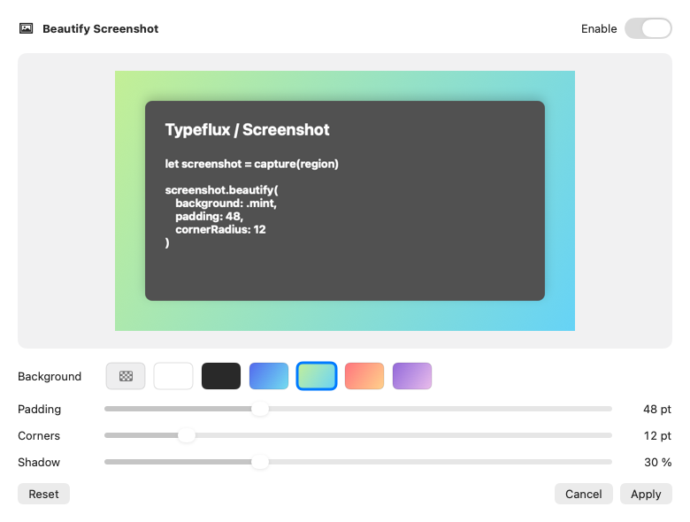
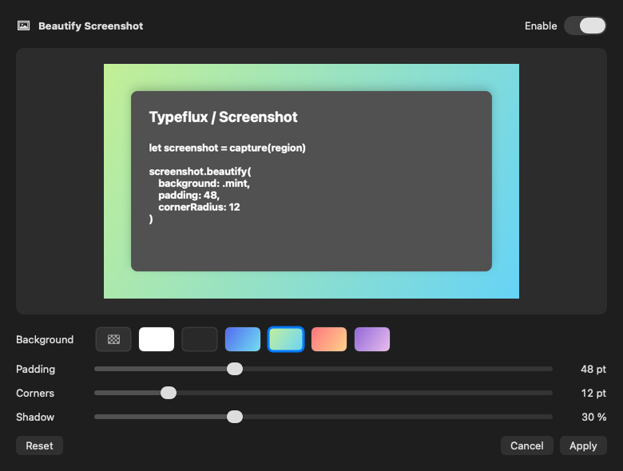

The screenshot toolbar now opens a Beautify sheet for region and scrolling screenshots. It previews transparent, white, charcoal and four gradient backgrounds, with adjustable padding, corner radius and shadow. Apply keeps the settings on the current screenshot; Cancel discards the draft, and Reset restores the original image.

Preview and export share the compositor. Annotations and mosaics are flattened first, then the background is added at the display's native pixel scale. Copy, save, copy-and-save, pins and launcher follow-ups receive that composition. Pins expand around the original region's center to preserve the image's proportions. Recapturing is disabled while beautification is enabled.

The preview downsamples large images, but validates the allocation at the original resolution before allowing Apply. Lengths are clamped and non-finite inputs are rejected or normalized. Dismissing the screenshot also dismisses its sheet and releases its preview.

The focused validation scope maps to these behaviors:

| Scope | Behavior |
| --- | --- |
| `ScreenshotBeautificationTests` | Background pixels, Retina padding, rounded alpha, shadows, PNG alpha, allocation limits, preview updates, native buttons, sheet cancellation/application, both editor controllers and appearance captures |
| `ScreenshotCoordinatorTests` | Copy/save consistency, redacted follow-ups, native pin sizing and long-image export |
| `ScreenshotRendererTests`, `ScreenshotAnnotationEditorTests` | Annotation/redaction rendering and shared editor actions |
| `ScreenshotEditorOverlayTests`, `ScreenshotLongImageEditorTests`, `ScreenshotFollowUpEditorTests`, `ScreenshotPinTests` | Existing toolbar, editing, delivery, window and pin behavior |
| `ScreenRecordingCoordinatorTests` | The shared screenshot event's recording-region caller |
| `LocalizationResourceTests/testScreenshotEditorCopyExistsInEveryLanguage` | All new labels and presets in English, Simplified/Traditional Chinese, Japanese and Korean |

The fixtures use synthetic screenshots and native AppKit windows. No real desktop capture or recording device was needed for these changes.

Final result: **165/165 tests passed** (156 XCTest methods and 9 Swift Testing methods). Changed executable line coverage is **288/295, 97.63%**, against `6326a0bab21f1628876352b417d9e54b79160fea`. The new compositor has 100% executable line coverage. The [machine-readable report](changed-line-coverage.json) lists the remaining seven uncovered lines: slider write bindings, the toolbar's button closure and two preview-render error beeps. Project-wide line coverage from this focused scope is 4.54%; the 97.63% figure applies only to changed production lines.

The final coverage command took **62.17 seconds**, including discovery, execution and report generation (runner total: 58.41 seconds). Explicit instrumented preparation took 505.37 seconds on first use, then 95.82 seconds for the final palette-border adjustment. The complete successful preparation/validation route took 663.36 seconds. These were fresh builds, not cached passing test results.

Swift 6.4's `swift test ... list` discovery built bundles without coverage sections despite the parent command's coverage request. Earlier attempts therefore passed all 165 methods but failed coverage collection: 175.38 seconds and 17.81 seconds with the default engine, and 515.38 seconds with the native engine. An earlier 108.36-second attempt stopped at test compilation; the missing `try` and annotation argument labels were corrected before any tests ran. The application also passed `swift build` after fixing its initial size-conversion and default-argument integration errors (successful retry: 118.67 seconds).

The working route explicitly built the instrumented bundle, then prevented test discovery from rebuilding it. A temporary PATH wrapper inserted `--build-system native` for `swift build` and `swift test`, and appended `--skip-build` after the `list` subcommand. It did not change repository or user-wide settings. The prior uninstrumented bundle was moved out of `.build` so the existing coverage script selected the correct test binary.

```sh
swift build --build-system native --build-tests --enable-code-coverage --jobs 4

# With the temporary wrapper described above:
TYPEFLUX_BEAUTIFICATION_SNAPSHOTS=docs/validation/gul-413 \
./scripts/coverage.sh --skip-build \
  --suite ScreenshotBeautificationTests --suite ScreenshotCoordinatorTests \
  --suite ScreenshotAnnotationEditorTests --suite ScreenshotRendererTests \
  --suite ScreenshotEditorOverlayTests --suite ScreenshotLongImageEditorTests \
  --suite ScreenshotFollowUpEditorTests --suite ScreenshotPinTests \
  --suite ScreenRecordingCoordinatorTests \
  --filter LocalizationResourceTests/testScreenshotEditorCopyExistsInEveryLanguage
```

Strict SwiftLint passes for the two new production files and their test file. `git diff --check` passes. Linting all touched legacy files still reports their existing class-length, complexity and other style violations; these were not refactored as part of this feature. Existing AppKit/Swift concurrency deprecation warnings remain.

Self-review checked output routing, redaction ordering, point/pixel conversion, invalid values, allocation limits, sheet lifetime, callback ownership and localization. It fixed pin stretching, native-size validation before preview downsampling, label wrapping and the white swatch's visibility in light appearance. Both final window-backed captures were visually inspected.

Light appearance:



Dark appearance:


