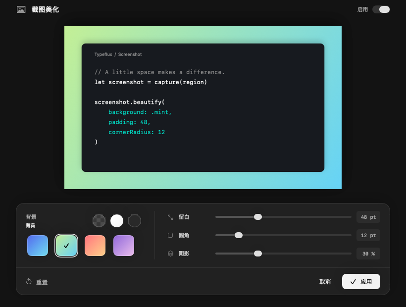
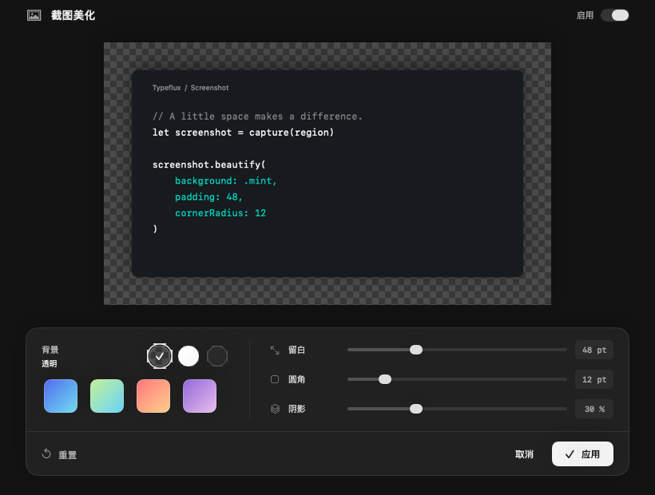
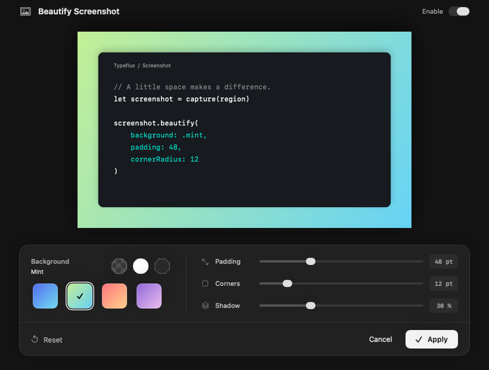
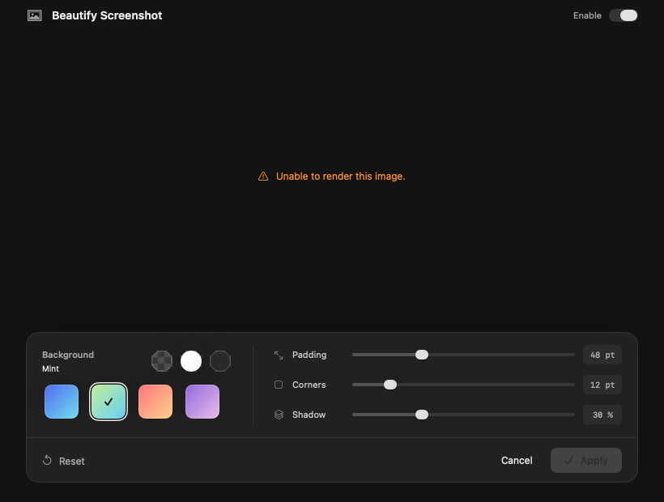

The beautification sheet now follows the reference's large preview and compact dark control panel. Solid colors and transparency use circular swatches; gradients use larger rounded tiles. The controls share a compact layout with value badges, a clear selected state and a prominent Apply button. The sheet stays dark in either system appearance, matching the reference and keeping the screenshot's colors easy to judge.

The preview has a checkerboard beneath transparent pixels, including an unstyled foreground cutout. The native title bar uses the same canvas color and hides its duplicate title. Reset and Cancel keep their existing behavior. Native sliders and the enable switch retain their accessibility actions, and the render error remains readable as its own accessibility element.

Self-review fixed a vertical divider that could stretch the control panel, reduced the palette's height, and made each slider/preset change publish its settings once rather than rendering an intermediate state. Review also checked draft isolation, dismissal and image ownership, invalid-input handling, keyboard shortcuts, localization, and the unchanged annotation/cutout/export ordering. No permissions, network calls or dependencies were added.

All **16 selected methods passed**, with retries limited to failures:

| Scope | Result and purpose |
| --- | --- |
| `ScreenshotBeautificationTests` | 13 passed: compositor, alpha, scaling, allocation limits, preview updates, both editor entry points, cutout processing, Apply/Cancel and sheet lifetime. Added assertions cover the native sheet size and appearance. |
| `ScreenshotBeautificationViewTests/testPreviewRendersInEveryLanguageAndBothSystemAppearances` | Passed after fixing the synthetic screenshot fixture. Captures cover all five languages under Aqua and Dark Aqua, plus a transparent-background state. |
| `ScreenshotBeautificationViewTests/testInvalidPreviewShowsAnAccessibleErrorAndDisablesApply` | Passed after exposing the error text and reading the native `isAccessibilityEnabled` getter. |
| `ScreenshotBeautificationViewTests/testPaletteSlidersToggleAndActionsWorkThroughNativeAccessibility` | Passed after waiting for SwiftUI's auto-enable update to reach the native switch before clicking it. Exercises all seven presets, all three sliders, the switch, Reset, Apply and Cancel. |

The initial 16-method command took 63.37 seconds: the 13 compositor/controller methods passed, while three new view tests failed. The first three-method retry took 56.69 seconds and passed the appearance capture; the two-method retry took 22.95 seconds and passed the error state; the final interaction-only retry took 51.27 seconds and passed. These times include discovery, runner startup, execution and coverage report generation where successful. The six instrumented preparation builds took 676.64 seconds combined (290.47, 99.74, 40.89, 130.20, 67.25 and 48.09 seconds). Total command wall time was 870.92 seconds. No full test or full UI group was run.

Changed executable line coverage is **172/182 (94.51%)** against `b98cb1e540fc0318fece06b9914eea82f4dad641`; see [the report](changed-line-coverage.json). This conservative figure uses only the final successful interaction retry's fresh profile. Earlier binaries' profiles are not combined. The ten uncovered lines are the sheet's size/appearance setup and the render-error label, which passed in the separate controller and error-state methods. This is changed-code coverage, not project-wide coverage.

The commands use the temporary native-build/discovery wrapper documented in the [initial validation record](../README.md):

```sh
swift build --build-system native --build-tests --enable-code-coverage --jobs 4

TYPEFLUX_BEAUTIFICATION_SNAPSHOTS=docs/validation/gul-413/redesign \
./scripts/coverage.sh --skip-build \
  --suite ScreenshotBeautificationTests --suite ScreenshotBeautificationViewTests

# Subsequent retries selected only the failing suite, then the two failing methods,
# then the final interaction method:
./scripts/coverage.sh --skip-build \
  --filter ScreenshotBeautificationViewTests/testPaletteSlidersToggleAndActionsWorkThroughNativeAccessibility

swiftlint lint --quiet --strict \
  Sources/Typeflux/Screenshot/ScreenshotBeautificationPanel.swift \
  Tests/TypefluxTests/ScreenshotBeautificationTests.swift \
  Tests/TypefluxTests/ScreenshotBeautificationViewTests.swift
git diff --check
```

Strict SwiftLint and diff checks pass. Existing AppKit deprecation/concurrency warnings remain. Captures show native window content with synthetic images; no real desktop capture or screen-recording permission was needed. Accessibility actions were exercised programmatically; a manual VoiceOver session was not performed.

The reference and revised capture were inspected together. The preview, dark control panel, compact palette and short sliders follow the reference's hierarchy. The five languages were inspected for clipping, and transparent/error states were checked separately.








