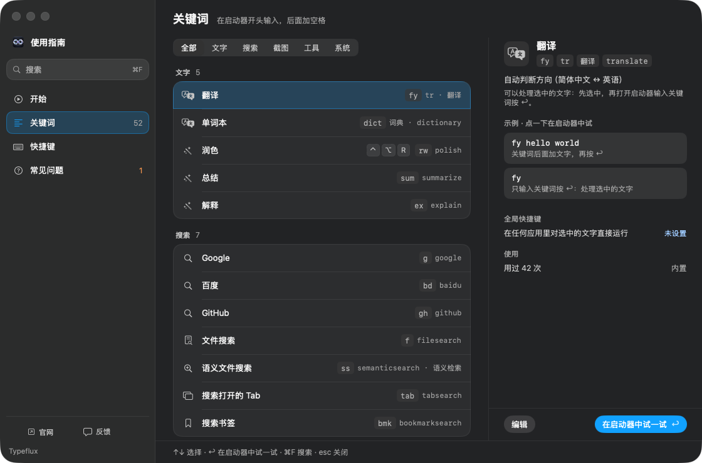
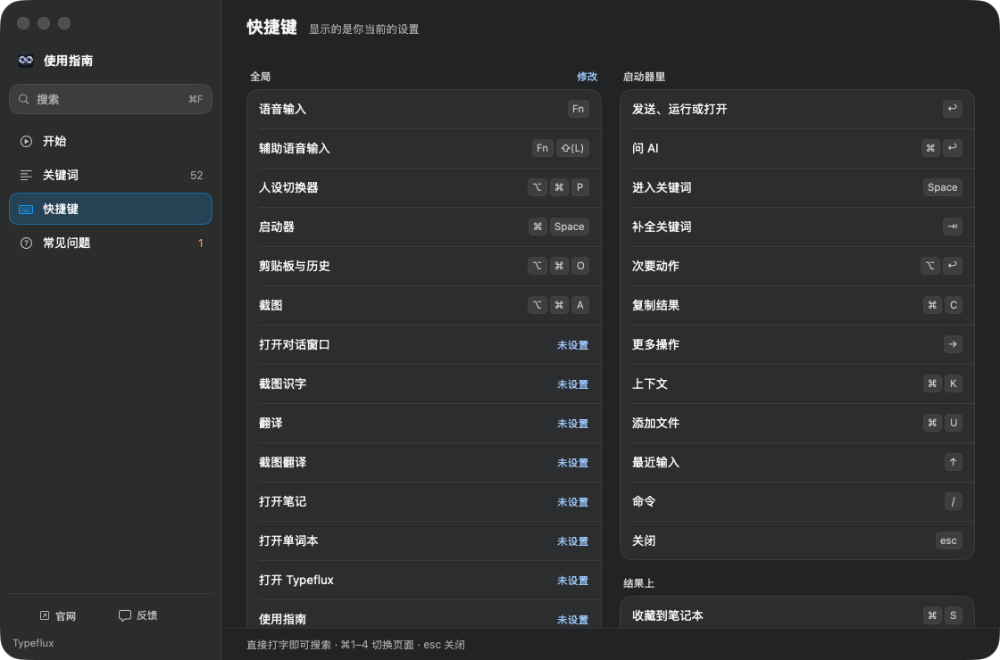

# GUL-433 validation

Guide rows reuse `SettingsDescriptionHint`. Descriptions no longer occupy a second
line. Hovering a row reveals the question icon; hovering that icon opens the shared
settings popover. Clicking the hint also works without selecting the row.

- `make coverage SUITE="HelpGuideModelTests HelpCatalogTests" FILTER="SettingsBehaviorTests/.*description hint"`
  executed 32 test methods in 395.00 seconds including initial build/discovery.
  Existing tests passed; the new parameterized test initially looked for the hint
  before hovering and failed its four cases.
- After correcting the test to dispatch native hover events,
  `make coverage FILTER="HelpGuideModelTests/.*row descriptions"` passed all four
  style/selectability cases in 85.29 seconds including incremental preparation.
  Checks cover initial hiding, row hover, icon hover, automatic dismissal, click
  toggling, independent row activation, empty descriptions and unchanged row height.
  LLVM coverage hit all 12 changed executable production lines (100% changed-line
  coverage, not project-wide coverage).
- `TYPEFLUX_HELP_SNAPSHOT=<output-directory> make test FILTER="HelpGuideModelTests/.*snapshots for design review"`
  passed in 303.01 seconds including the first native-runner build. It captured
  every guide page and search in both interface styles and light/dark appearances
  (20 images). Representative screenshots are retained below.
- `swiftlint lint --quiet --strict --baseline .swiftlint-baseline.json Sources/Typeflux/Help/HelpComponents.swift`
  and `git diff --check` passed.

Self-review covered empty descriptions, actionable and non-actionable rows,
accessibility grouping and activation, shared popover task cleanup, and preservation
of selection and trailing controls. A line-length lint finding was corrected.
No new asynchronous work, dependencies, persistence or network behavior was added.

