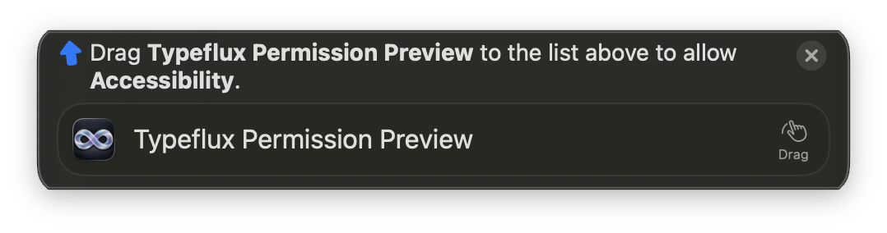

# PermissionFlow integration

The macOS app pins PermissionFlow 2.11.4 and uses its core product for
Accessibility, Screen Recording and Full Disk Access guidance. Existing system
requests and status readers remain authoritative; opening Settings or dragging
the app is never interpreted as a successful grant.

The shared service covers onboarding/core permissions, permission settings,
screenshot and recording settings, launcher/file/browser/semantic search links,
and the text-injection Accessibility recovery entry. Other permission types and
ordinary URLs keep their existing navigation behavior.

Only one guide is active. Switching permissions, returning to Typeflux, obtaining
the grant or quitting System Settings closes it. A five-minute limit bounds the
host's status polling if the library panel was closed without returning to the app.
The screenshot recovery window hides while Settings is open and returns with its
recheck/restart controls intact.

## Visual evidence

These screenshots show the pinned library running in an isolated
**Typeflux Permission Preview.app**, with Typeflux's icon and the resource bundle
copied into the app's Resources directory. They verify packaged rendering and
localization, not an actual production-app permission grant. No permission was
granted by these checks.

| Simplified Chinese | English |
| --- | --- |
|  |  |

The screenshots were captured from the preview's own window. AppKit's offscreen
bitmap capture retained stale text in the nested hosting view during locale
changes; the native window screenshot showed the correct English label.

## Validation scope

- `PermissionGuidanceServiceTests`: permission/URL routing, app-bundle fallback,
  granted status, switching, locale refresh, actual-grant-only completion,
  expiration, return-to-app cleanup.
- `PermissionsSettingsTests`, `PrivacyGuardTests`, `OnboardingBehaviorTests`,
  `OnboardingViewModelTests`: first system request versus Settings navigation,
  refresh, onboarding requirements and permission UI.
- `ScreenCapturePermissionTests`, `ScreenshotCoordinatorTests`,
  `AskScreenshotPermissionTests`, `AskLauncherHomePermissionTests`, and
  `ScreenshotOverlayTests/testGuideShowsRechecksAndCloses`: registration/request
  order, screenshot recovery and returning from Settings.
- `LauncherSearchSettingsViewTests`, `AskBrowserSearchTests`,
  `AXTextInjectorTests`: directly affected permission entry points and callers.
- Python resource-bundle and release-packaging tests: required PermissionFlow
  resources, incomplete builds, bundle copying and signing order. The release
  fixture also supplies the already-required chat helper.

Actual drag-to-grant, revoked grants and OS-required relaunch behavior still need
manual acceptance in a signed Typeflux app; permission logic tests use adapters
and do not change the machine's TCC permissions. Older macOS versions were not
tested interactively.

## Results

- `swift build`: passed with Swift 6.4 / macOS 26; the pinned dependency requires
  Swift 6.1 or newer and supports macOS 13+.
- Python `ResourceBundlePackagingTests` and `test_release_packaging`: 3 passed,
  **5.13 seconds total command time**.
- Focused coverage run: **234 of 235 tests passed** (162 XCTest tests and
  73 Swift Testing tests). All 7 new guidance tests passed. Total command time
  was **224.41 seconds**, including incremental build/discovery and execution.
- The first coverage attempt stopped during compilation because the nested test
  fixture needed `@MainActor`; that was fixed. Its total command time was
  **473.85 seconds**. No tests executed in that attempt.
- Retried only `LauncherSearchSettingsViewTests`: 6 of 7 passed, with the same
  failure reproduced; **56.05 seconds total command time**.
- Changed executable Swift lines: **81/126 (64.29%)**. This is deduplicated
  LCOV line coverage intersected with added lines in `git diff HEAD`, not
  project-wide coverage. The failed broad command exits before HTML export;
  its recorded raw profiles were preserved and merged with `llvm-profdata`
  for this report. See [changed-lines.json](changed-lines.json).

The remaining failure is
`LauncherSearchSettingsViewTests/moved file switch clears and rebuilds A real index`,
at assertions on lines 119 and 122: the snapshot remains after disabling file
search, and enabling it again returns no result. Inspection points to the
unchanged `AskFileIndex.start()` implementation: its configuration-change branch
clears `target` and resets status to `.off`, after which the preparation guard
can skip `turnOff()`. Both that implementation and the failing test are unchanged
by this PR; a separate baseline checkout was not built. The permission guidance
live adapter was never invoked by this test run, as the coverage data confirms.
The PR remains draft rather than claiming a fully green validation result.
